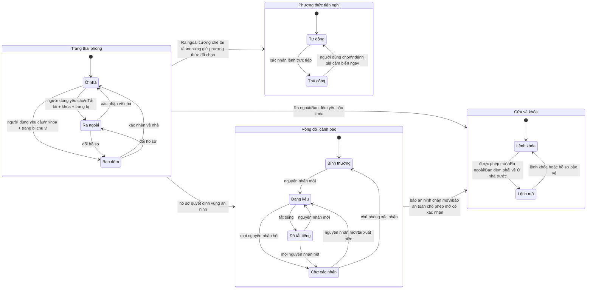

# ĐẶC TẢ HỆ THỐNG PHÒNG THÔNG MINH — PHIÊN BẢN 1.0

> **TÀI LIỆU LỊCH SỬ — ĐÃ ĐƯỢC THAY THẾ VỀ PHẠM VI BỞI [ĐẶC TẢ 1.1](./01-dac-ta-he-thong-v1.1.md). KHÔNG DÙNG BẢN NÀY ĐỂ THIẾT KẾ SẢN PHẨM HIỆN HÀNH.**

## 1. Thông tin kiểm soát tài liệu

| Thuộc tính | Giá trị |
|---|---|
| Tên đề tài | Thiết kế hệ thống giám sát, điều khiển và tự động hóa phòng thông minh dựa trên mạng kết nối vạn vật |
| Phiên bản | 1.0 |
| Trạng thái | **ĐÃ THAY THẾ — CHỈ GIỮ LỊCH SỬ** |
| Giai đoạn | Giai đoạn 1 — Chốt đặc tả hệ thống |
| Phạm vi | Một phòng thông minh ở quy mô mô hình thử nghiệm |
| Tài liệu thay thế | Bản nháp Đặc tả 1.0 trước cập nhật phần cứng và phân hệ an toàn |
| Quyết định duyệt | Người dùng yêu cầu chuyển sang Giai đoạn 2 ngày 25/09/2026 |

## 2. Mục tiêu, phạm vi và giới hạn

Hệ thống phải thể hiện trọn vẹn chu trình **cảm nhận → thu thập → truyền dữ liệu → xử lý → ra quyết định → điều khiển → phản hồi trạng thái** trên kiến trúc dự kiến Arduino UNO R3 và ESP32 CH340.

Phiên bản 1.0 phải chứng minh được:

- giám sát nhiệt độ, độ ẩm, mức sáng, trạng thái cửa, khí/khói tương đối và dấu hiệu lửa;
- điều khiển trực tiếp và tự động hóa đèn/quạt bằng ngưỡng có vùng trễ;
- vận hành theo ba trạng thái phòng Ở nhà, Ra ngoài và Ban đêm;
- khóa cửa servo, xác minh cửa đóng/mở bằng cảm biến cửa và cảnh báo xâm nhập;
- cảnh báo an toàn bằng MQ-2 và cảm biến lửa, có còi/đèn tại chỗ, ứng dụng và nhật ký;
- duy trì cảm nhận, tự động hóa và cảnh báo cục bộ thiết yếu khi Internet bị mất;
- ứng dụng web thích ứng, một tài khoản chủ phòng, lịch sử dữ liệu và nhật ký sự kiện.

Không mở rộng phiên bản 1.0 sang nhiều phòng, nhận diện khuôn mặt, trí tuệ nhân tạo, trợ lý giọng nói, tưới cây, năng lượng phức tạp hoặc chức năng không phục vụ trực tiếp phòng thông minh.

MQ-2 và cảm biến lửa chỉ phục vụ mô hình giáo dục/thử nghiệm. Hệ thống **không phải** thiết bị báo cháy hoặc báo gas đạt chuẩn thương mại; dữ liệu MQ-2 không được tuyên bố là ppm khi chưa có quy trình hiệu chuẩn, khí chuẩn và tài liệu phần cứng phù hợp.

## 3. Mô hình miền và quy ước dữ liệu

### 3.1. Trạng thái nghiệp vụ

| Kiểu miền | Giá trị |
|---|---|
| `phuong_thuc_dieu_khien` | `TỰ_ĐỘNG`, `THỦ_CÔNG` |
| `trang_thai_phong` | `Ở_NHÀ`, `RA_NGOÀI`, `BAN_ĐÊM` |
| `chat_luong_du_lieu` | `HỢP_LỆ`, `CŨ`, `KHÔNG_HỢP_LỆ` |
| `trang_thai_ket_noi` | `TRỰC_TUYẾN`, `SUY_GIẢM`, `NGOẠI_TUYẾN` |
| `trang_thai_an_toan` | `LAM_NONG`, `BINH_THUONG`, `CANH_BAO`, `LOI_CAM_BIEN` |
| `loai_canh_bao` | `AN_TOAN`, `AN_NINH`, `HE_THONG` |
| `muc_do_su_kien` | `THONG_TIN`, `CHU_Y`, `CANH_BAO`, `NGHIEM_TRONG` |
| `trang_thai_cua` | `MO`, `DONG`, `KHONG_XAC_DINH` |
| `lenh_chot_khoa` | `KHOA`, `MO_KHOA`, `KHONG_XAC_DINH` |
| `xac_minh_co_khi` | `true` hoặc `false`; chỉ `true` khi có phản hồi chốt riêng đáng tin cậy |
| `trang_thai_canh_bao` | `BÌNH_THƯỜNG`, `ĐANG_KÊU`, `ĐÃ_TẮT_TIẾNG`, `CHỜ_XÁC_NHẬN` |
| `nguon_dieu_khien` | `BẢO_VỆ_ĐIỆN`, `AN_TOÀN`, `AN_NINH`, `HỒ_SƠ_PHÒNG`, `THỦ_CÔNG`, `TỰ_ĐỘNG` |

Các hằng không dấu ở trên là ký hiệu logic ổn định. Tên trường trên dây, JSON và chủ đề MQTT chưa được khóa; Giai đoạn 6–7 sẽ chọn cú pháp an toàn cho giao thức nhưng không được thay đổi ý nghĩa nghiệp vụ.

### 3.2. Trạng thái cửa và khóa

- `trang_thai_cua` đến từ cảm biến cửa và chỉ cho biết cánh cửa mở/đóng/không xác định.
- Trạng thái khóa gồm `lenh_chot_khoa` (yêu cầu khóa/mở), trạng thái servo báo cáo và `xac_minh_co_khi`.
- Cảm biến cửa **không chứng minh chốt servo đã vào đúng vị trí**. Khi chưa có công tắc hành trình/cảm biến chốt riêng, `xac_minh_co_khi = false` và ứng dụng phải ghi “Đã gửi/thi hành lệnh khóa”, không ghi “Chốt đã khóa chắc chắn”.

### 3.3. Dữ liệu MQ-2

Tối thiểu gồm ADC thô (nếu module/board cho phép), mức tương đối 0–100%, ngưỡng bảo trì, trạng thái làm nóng/hiệu chuẩn và chất lượng dữ liệu. Mức 0–100% là thang tương đối của mô hình, không phải nồng độ vật lý.

### 3.4. Bao lệnh và xác nhận

Mọi lệnh mạng phải có mã lệnh duy nhất, loại lệnh, dữ liệu, phiên bản cấu hình/trạng thái liên quan và thời điểm. Xác nhận phải mang cùng mã lệnh, kết quả chấp nhận/từ chối/hết hạn, lý do và trạng thái thực tế mới nhất. Ứng dụng không cập nhật thành công chỉ vì đã gửi lệnh.

### 3.5. Nhóm dữ liệu UNO–ESP32 và MQTT

- UNO–ESP32 phải biểu diễn được: telemetry, trạng thái báo cáo, lệnh, cấu hình, xác nhận, lỗi và yêu cầu/đáp ứng đồng bộ.
- MQTT phải biểu diễn được: telemetry, trạng thái báo cáo, cấu hình mong muốn/báo cáo, lệnh/xác nhận, sự kiện, cảnh báo và khả dụng.
- Cú pháp khung, giới hạn kích thước, chủ đề, QoS và retain được quyết định ở Giai đoạn 6–7.

### 3.6. Nguồn cấu hình

- Cơ sở dữ liệu máy chủ là nguồn chính thức, lưu cấu hình hiện hành và số phiên bản.
- ESP32 chỉ áp dụng cấu hình hợp lệ, lưu bản gần nhất trong NVS và dùng nó khi ngoại tuyến.
- UNO giữ cấu hình đang chạy trong RAM, chưa chạy tự động hóa sau khởi động cho đến khi nhận cấu hình hợp lệ từ ESP32 và có dữ liệu hợp lệ.
- Cập nhật cấu hình là giao dịch toàn bộ: nếu một trường sai, từ chối cả bản và giữ nguyên phiên bản cũ.

## 4. Đặc tả chức năng

Mỗi chức năng dưới đây có đúng 24 trường. “Dữ liệu MQTT” chỉ mô tả ngữ nghĩa, chưa khóa tên chủ đề hoặc JSON.

### 4.1. MT-01 — Giám sát môi trường

1. **Mã chức năng:** MT-01.
2. **Tên chức năng:** Giám sát nhiệt độ, độ ẩm và mức sáng.
3. **Phân hệ:** Giám sát môi trường.
4. **Mục đích:** Cung cấp dữ liệu môi trường gần thời gian thực cho người dùng, lịch sử và quy tắc tự động.
5. **Tác nhân:** Môi trường phòng, cảm biến, Arduino UNO, ESP32, chủ phòng.
6. **Điều kiện trước:** Cảm biến đã được nhận diện/cấu hình; UNO và ESP32 trao đổi được hoặc UNO vẫn chạy độc lập.
7. **Đầu vào:** Nhiệt độ, độ ẩm từ DHT11 hoặc loại tốt hơn; ADC quang trở và tham số chuẩn hóa.
8. **Điều kiện kích hoạt:** Lịch lấy mẫu dự kiến mỗi 2 giây, khởi động lại hoặc yêu cầu đồng bộ trạng thái.
9. **Quy trình xử lý:** UNO đọc cảm biến, kiểm tra miền hợp lệ, lọc dao động ngắn hạn phù hợp và chuẩn hóa ánh sáng 0–100%; gắn chất lượng và số thứ tự; ESP32 bổ sung thời gian/kết nối rồi chuyển tiếp.
10. **Đầu ra:** Bộ số đo nhiệt độ, độ ẩm, mức sáng, thời điểm, chất lượng và tuổi dữ liệu.
11. **Cảm biến:** DHT11 hoặc tương đương; quang trở và mạch chia áp.
12. **Cơ cấu chấp hành:** Không.
13. **Vai trò Arduino UNO:** Lấy mẫu, kiểm tra sơ bộ, lọc/chuẩn hóa, đánh dấu lỗi và phát telemetry.
14. **Vai trò ESP32:** Nhận telemetry, quản lý thời gian/khả dụng, công bố lên mạng và cung cấp trạng thái mới nhất.
15. **Dữ liệu truyền UNO–ESP32:** Telemetry môi trường gồm số thứ tự, nhiệt độ, độ ẩm, ánh sáng tương đối, chất lượng và mã lỗi đọc.
16. **Dữ liệu MQTT:** Telemetry môi trường và trạng thái báo cáo mới nhất; cú pháp cụ thể chốt sau.
17. **Dữ liệu cần lưu:** Một mẫu tổng hợp/phút trong 30 ngày; không lưu mọi mẫu 2 giây; lưu thay đổi chất lượng như sự kiện.
18. **Nội dung hiển thị trên ứng dụng:** Ba thẻ số đo, đơn vị, chất lượng, thời điểm cập nhật và nhãn “Dữ liệu cũ” khi quá hạn.
19. **Hành vi khi mất Internet:** UNO vẫn đo và phục vụ tự động hóa; không gửi bù toàn bộ mẫu cảm biến; ứng dụng giữ giá trị cuối kèm thời điểm và trạng thái ngoại tuyến.
20. **Hành vi khi cảm biến lỗi:** Không dùng giá trị lỗi làm số đo hiện tại; chuyển xử lý cho MT-02 và hiển thị chất lượng tương ứng.
21. **Quan hệ với trạng thái Ở nhà/Ra ngoài/Ban đêm:** Luôn giám sát trong cả ba trạng thái; Ra ngoài vẫn đo dù tải tiện nghi bị tắt.
22. **Quan hệ với Tự động/Thủ công:** Luôn giám sát; dữ liệu chỉ điều khiển tiện nghi khi phương thức là Tự động và quy tắc được phép.
23. **Quy tắc ưu tiên khi xung đột:** Chất lượng dữ liệu thắng nhu cầu tự động hóa; dữ liệu không hợp lệ không được ép thay đổi đầu ra.
24. **Mức ưu tiên triển khai:** A — Bắt buộc.

### 4.2. CD-01 — Chuyển Tự động/Thủ công

1. **Mã chức năng:** CD-01.
2. **Tên chức năng:** Chuyển phương thức điều khiển tiện nghi.
3. **Phân hệ:** Quản lý chế độ.
4. **Mục đích:** Phân định rõ quyền quyết định giữa chủ phòng và quy tắc tự động.
5. **Tác nhân:** Chủ phòng, ứng dụng, máy chủ, ESP32 và Arduino UNO.
6. **Điều kiện trước:** Chủ phòng đã đăng nhập; trạng thái hệ thống/config đã đồng bộ hoặc có bản hợp lệ gần nhất.
7. **Đầu vào:** Phương thức đích, mã lệnh và phiên bản trạng thái.
8. **Điều kiện kích hoạt:** Chủ phòng đổi công tắc phương thức hoặc xác nhận chuyển sang Thủ công khi điều khiển trực tiếp.
9. **Quy trình xử lý:** Kiểm tra quyền/ràng buộc; ghi phiên bản mới; đồng bộ UNO; khi sang Tự động đánh giá ngay dữ liệu hợp lệ; khi sang Thủ công giữ đầu ra hiện tại nếu không có lệnh kèm theo.
10. **Đầu ra:** Phương thức thực tế, ACK/NACK, phiên bản và các thay đổi đầu ra do đánh giá lại.
11. **Cảm biến:** Nhiệt độ và ánh sáng khi chuyển sang Tự động.
12. **Cơ cấu chấp hành:** Đèn và quạt có thể đổi sau đánh giá Tự động.
13. **Vai trò Arduino UNO:** Áp dụng phương thức, dừng/chạy quy tắc và phản hồi trạng thái thực tế.
14. **Vai trò ESP32:** Lưu cache bền vững, chuyển lệnh, quản lý phiên bản và đồng bộ sau khởi động.
15. **Dữ liệu truyền UNO–ESP32:** Lệnh đổi phương thức, phiên bản; ACK và trạng thái đèn/quạt sau đánh giá.
16. **Dữ liệu MQTT:** Phương thức mong muốn/báo cáo, lệnh/xác nhận và sự kiện thay đổi.
17. **Dữ liệu cần lưu:** Phương thức hiện hành và lịch sử thay đổi gồm người dùng, thời gian, kết quả.
18. **Nội dung hiển thị trên ứng dụng:** Tự động/Thủ công, hộp xác nhận và nguồn điều khiển từng tải.
19. **Hành vi khi mất Internet:** Dùng phương thức gần nhất trong ESP32/UNO; không nhận chuyển đổi từ xa mới.
20. **Hành vi khi cảm biến lỗi:** Cho phép sang Thủ công; sang Tự động được ghi nhận nhưng quy tắc phụ thuộc cảm biến lỗi không chạy và phải cảnh báo.
21. **Quan hệ với trạng thái Ở nhà/Ra ngoài/Ban đêm:** Phương thức được giữ qua các trạng thái; Ra ngoài vẫn cưỡng chế tải tắt; khi về Ở nhà/Ban đêm mới áp dụng lại.
22. **Quan hệ với Tự động/Thủ công:** Đây là chức năng quản lý chính hai phương thức; không chi phối an ninh, khóa cửa hoặc an toàn.
23. **Quy tắc ưu tiên khi xung đột:** Hồ sơ phòng và các lớp cao hơn thắng; việc đổi phương thức không được vô hiệu hóa an toàn/an ninh.
24. **Mức ưu tiên triển khai:** A — Bắt buộc.

### 4.3. CD-02 — Quản lý trạng thái sử dụng phòng

1. **Mã chức năng:** CD-02.
2. **Tên chức năng:** Quản lý Ở nhà, Ra ngoài và Ban đêm.
3. **Phân hệ:** Quản lý chế độ và điều phối.
4. **Mục đích:** Áp dụng nhất quán hồ sơ tiện nghi, cửa và vùng an ninh theo bối cảnh sử dụng.
5. **Tác nhân:** Chủ phòng, ứng dụng, máy chủ, ESP32 và Arduino UNO.
6. **Điều kiện trước:** Chủ phòng đã xác thực; có trạng thái báo cáo mới nhất; các hành động thành phần hỗ trợ xác nhận.
7. **Đầu vào:** Trạng thái đích, mã lệnh, phiên bản; xác nhận thao tác nhạy cảm nếu có.
8. **Điều kiện kích hoạt:** Chủ phòng chọn hồ sơ mới; lệnh mở khóa được xác nhận khi đang Ra ngoài/Ban đêm.
9. **Quy trình xử lý:** Điều phối các bước có mã giao dịch; Ra ngoài tắt tải, yêu cầu khóa và trang bị chu vi/xâm nhập; Ban đêm khóa và trang bị chu vi; Ở nhà gỡ bảo vệ gây báo giả nhưng không tự mở cửa; tổng hợp thành công/thất bại từng phần.
10. **Đầu ra:** Trạng thái phòng thực tế, trạng thái từng hành động và nhãn Bình thường/Suy giảm.
11. **Cảm biến:** Cảm biến cửa và các cảm biến an ninh được triển khai.
12. **Cơ cấu chấp hành:** Đèn, quạt, servo khóa, còi/đèn cảnh báo theo quy tắc.
13. **Vai trò Arduino UNO:** Thi hành hành động cục bộ, trang bị vùng, cưỡng chế tải và phản hồi từng bước.
14. **Vai trò ESP32:** Điều phối giao dịch, lưu cache trạng thái, chống lặp và công bố kết quả tổng hợp.
15. **Dữ liệu truyền UNO–ESP32:** Lệnh hồ sơ, mã giao dịch; kết quả tải, khóa, vùng bảo vệ và lỗi.
16. **Dữ liệu MQTT:** Trạng thái phòng mong muốn/báo cáo, ACK giao dịch và sự kiện từng hành động.
17. **Dữ liệu cần lưu:** Trạng thái hiện hành, mọi lần chuyển và chi tiết thành công/thất bại/suy giảm.
18. **Nội dung hiển thị trên ứng dụng:** Ba lựa chọn tiếng Việt, tiến trình chuyển, kết quả từng bước và cảnh báo Suy giảm.
19. **Hành vi khi mất Internet:** Hồ sơ gần nhất tiếp tục ràng buộc cục bộ; không nhận đổi từ xa; thao tác cục bộ được ghi sự kiện để gửi bù.
20. **Hành vi khi cảm biến lỗi:** Vẫn chuyển trạng thái nhưng đánh dấu Suy giảm nếu không xác minh cửa/vùng; không giả là khóa thành công.
21. **Quan hệ với trạng thái Ở nhà/Ra ngoài/Ban đêm:** Ở nhà cho tiện nghi bình thường, không báo chuyển động nội bộ; Ra ngoài cưỡng chế tắt/khóa/trang bị; Ban đêm khóa và chỉ trang bị chu vi.
22. **Quan hệ với Tự động/Thủ công:** Giữ phương thức trước đó; về Ở nhà: Tự động đánh giá lại, Thủ công giữ tải tắt cho đến lệnh mới.
23. **Quy tắc ưu tiên khi xung đột:** An toàn/an ninh đang hoạt động có thể hạn chế thao tác; Ra ngoài cao hơn mọi yêu cầu tiện nghi; chuyển hồ sơ không tự xóa cảnh báo.
24. **Mức ưu tiên triển khai:** A — Bắt buộc.

### 4.4. CH-01 — Quản lý cấu hình và ngưỡng

1. **Mã chức năng:** CH-01.
2. **Tên chức năng:** Quản lý cấu hình tự động và ngưỡng bảo trì.
3. **Phân hệ:** Cấu hình.
4. **Mục đích:** Cho phép đổi tham số hợp lý mà không sửa mã, đồng thời giữ toàn vẹn và khả năng dùng ngoại tuyến.
5. **Tác nhân:** Chủ phòng đã đăng nhập, máy chủ, cơ sở dữ liệu, ESP32 và Arduino UNO.
6. **Điều kiện trước:** Phiên hợp lệ; bản hiện hành có phiên bản; thiết bị xác định được bản đang chạy.
7. **Đầu vào:** Bốn ngưỡng đèn/quạt; phương thức; trạng thái phòng; ngưỡng MQ-2 trong giao diện bảo trì có giới hạn.
8. **Điều kiện kích hoạt:** Chủ phòng lưu cấu hình hoặc thiết bị yêu cầu đồng bộ sau khởi động/kết nối lại.
9. **Quy trình xử lý:** Máy chủ xác thực kiểu, phạm vi, quan hệ vùng trễ và quyền bảo trì; tạo phiên bản mới theo giao dịch toàn bộ; ESP32 lưu NVS sau kiểm tra; UNO chỉ thay bản chạy khi nhận đủ và hợp lệ.
10. **Đầu ra:** Cấu hình mong muốn/báo cáo, phiên bản, ACK/NACK và lỗi theo trường.
11. **Cảm biến:** Nhiệt độ, ánh sáng và MQ-2 liên quan đến các ngưỡng.
12. **Cơ cấu chấp hành:** Đèn/quạt có thể đổi sau cấu hình; còi/đèn an toàn chỉ do sự kiện an toàn, không do thao tác lưu đơn thuần.
13. **Vai trò Arduino UNO:** Xác thực lần hai các bất biến cần thiết, áp dụng nguyên tử vào RAM và xác nhận phiên bản đang chạy.
14. **Vai trò ESP32:** Nhận bản từ máy chủ, kiểm tra, lưu NVS, đồng bộ UNO và báo cáo phiên bản thực tế.
15. **Dữ liệu truyền UNO–ESP32:** Bản cấu hình đầy đủ có phiên bản/check; ACK/NACK, trường lỗi và yêu cầu đồng bộ.
16. **Dữ liệu MQTT:** Cấu hình mong muốn, cấu hình báo cáo, phiên bản và kết quả áp dụng.
17. **Dữ liệu cần lưu:** Bản hiện hành, lịch sử phiên bản, người thay đổi, thời gian, lý do/kết quả; tài khoản giữ đến khi thay.
18. **Nội dung hiển thị trên ứng dụng:** Biểu mẫu tiếng Việt, đơn vị, giới hạn, lỗi cụ thể, phiên bản đang chạy; MQ-2 nằm riêng ở Bảo trì/Hiệu chuẩn.
19. **Hành vi khi mất Internet:** Dùng bản hợp lệ gần nhất; không nhận cấu hình mới; cấu hình cục bộ không được tự trở thành nguồn chính thức.
20. **Hành vi khi cảm biến lỗi:** Cấu hình có thể được lưu nếu hợp lệ nhưng ứng dụng cảnh báo chưa thể kiểm chứng/chạy quy tắc liên quan.
21. **Quan hệ với trạng thái Ở nhà/Ra ngoài/Ban đêm:** Cấu hình tồn tại xuyên hồ sơ; Ra ngoài vẫn thắng ngưỡng tiện nghi.
22. **Quan hệ với Tự động/Thủ công:** Ngưỡng chỉ tác động đầu ra khi Tự động; cấu hình an toàn độc lập hai phương thức.
23. **Quy tắc ưu tiên khi xung đột:** Bất biến kỹ thuật/an toàn không thể bị cấu hình người dùng ghi đè; bản sai bị từ chối toàn bộ.
24. **Mức ưu tiên triển khai:** A — Bắt buộc.

### 4.5. AN-01 — Giám sát cửa và phát hiện xâm nhập

1. **Mã chức năng:** AN-01.
2. **Tên chức năng:** Giám sát cửa và phát hiện mở cửa trái phép.
3. **Phân hệ:** An ninh.
4. **Mục đích:** Biết cửa mở/đóng và tạo cảnh báo xâm nhập khi vùng chu vi đang được trang bị.
5. **Tác nhân:** Cảm biến cửa, Arduino UNO, chủ phòng và hệ thống cảnh báo.
6. **Điều kiện trước:** Cảm biến cửa đã xác định cực tính/trạng thái; hồ sơ phòng và cửa sổ mở hợp lệ đã đồng bộ.
7. **Đầu vào:** Trạng thái tiếp điểm cửa, hồ sơ phòng, trạng thái trang bị, lệnh mở khóa đã xác nhận và thời gian cho phép mở.
8. **Điều kiện kích hoạt:** Cạnh mở/đóng sau khử dội; mất/khôi phục tín hiệu nếu phát hiện được.
9. **Quy trình xử lý:** Khử dội, cập nhật Mở/Đóng/Không xác định; nếu chu vi được trang bị và cửa mở ngoài giao dịch hợp lệ thì tạo nguyên nhân cảnh báo an ninh; cửa đóng không tự xóa cảnh báo đã chốt.
10. **Đầu ra:** Trạng thái cửa, sự kiện mở/đóng, nguyên nhân xâm nhập hoặc cảnh báo suy giảm cảm biến.
11. **Cảm biến:** Công tắc từ/cảm biến cửa hoặc công tắc hành trình giá rẻ phù hợp.
12. **Cơ cấu chấp hành:** Còi và LED cảnh báo qua CB-01; không tự điều khiển servo từ tín hiệu cảm biến đơn lẻ.
13. **Vai trò Arduino UNO:** Đọc/khử dội, đối chiếu vùng trang bị, phản ứng cục bộ mục tiêu không quá 1 giây.
14. **Vai trò ESP32:** Chuyển trạng thái/sự kiện/cảnh báo, xếp hàng ngoại tuyến và đồng bộ trạng thái trang bị.
15. **Dữ liệu truyền UNO–ESP32:** Trạng thái cửa, chất lượng, sự kiện cạnh, vùng, mã nguyên nhân và trạng thái trang bị.
16. **Dữ liệu MQTT:** Trạng thái cửa báo cáo, sự kiện an ninh, cảnh báo và trạng thái cảm biến.
17. **Dữ liệu cần lưu:** Mọi lần mở/đóng đáng kể, cảnh báo xâm nhập, lỗi/phục hồi cảm biến và thao tác xác nhận.
18. **Nội dung hiển thị trên ứng dụng:** Mở/Đóng/Không xác định, vùng Đang trang bị/Không trang bị, cảnh báo nổi bật và thời điểm.
19. **Hành vi khi mất Internet:** Tiếp tục giám sát/phát còi cục bộ; xếp hàng sự kiện/cảnh báo để gửi bù.
20. **Hành vi khi cảm biến lỗi:** Đánh dấu Không xác định và tạo cảnh báo Hệ thống “Bảo vệ cửa suy giảm”; không gọi là xâm nhập.
21. **Quan hệ với trạng thái Ở nhà/Ra ngoài/Ban đêm:** Ở nhà chỉ ghi trạng thái; Ra ngoài và Ban đêm trang bị vùng cửa/chu vi.
22. **Quan hệ với Tự động/Thủ công:** Độc lập phương thức tiện nghi.
23. **Quy tắc ưu tiên khi xung đột:** Cảnh báo an ninh đang hoạt động chặn mở khóa từ xa cho đến khi nguyên nhân hết và đã xác nhận; an toàn vẫn cao hơn.
24. **Mức ưu tiên triển khai:** A — Bắt buộc.

### 4.6. AN-02 — Khóa/mở cửa bằng servo

1. **Mã chức năng:** AN-02.
2. **Tên chức năng:** Điều khiển chốt khóa cửa bằng servo.
3. **Phân hệ:** An ninh và kiểm soát truy cập.
4. **Mục đích:** Thực hiện lệnh khóa/mở có xác nhận mà không đánh đồng lệnh servo với trạng thái cửa/chốt cơ khí đã kiểm chứng.
5. **Tác nhân:** Chủ phòng, hồ sơ phòng, Arduino UNO, ESP32 và cơ cấu servo.
6. **Điều kiện trước:** Servo/nguồn ở trạng thái cho phép; không có bảo vệ điện; trạng thái cảnh báo và hồ sơ đã đồng bộ.
7. **Đầu vào:** Mã lệnh Khóa/Mở, nguồn lệnh, trạng thái phòng/cảnh báo, xác nhận người dùng và trạng thái cửa.
8. **Điều kiện kích hoạt:** Lệnh trực tiếp hợp lệ; chuyển Ra ngoài/Ban đêm; cơ chế cục bộ AN-03 nếu triển khai.
9. **Quy trình xử lý:** Kiểm tra ưu tiên; giới hạn thời gian/góc servo; thi hành một lần; báo vị trí lệnh. Mở trong Ra ngoài/Ban đêm phải xác nhận và chuyển nguyên tử sang Ở nhà rồi mới mở.
10. **Đầu ra:** Lệnh chốt thực tế đã thi hành/thất bại, trạng thái cửa riêng, cờ xác minh cơ khí và lý do.
11. **Cảm biến:** Cảm biến cửa chỉ xác minh cánh cửa; công tắc chốt riêng chỉ bổ sung nếu kiểm kê có.
12. **Cơ cấu chấp hành:** Servo khóa cửa.
13. **Vai trò Arduino UNO:** Điều khiển servo không chặn, áp giới hạn, cập nhật trạng thái lệnh và trả ACK/NACK.
14. **Vai trò ESP32:** Chuyển lệnh nhạy cảm, chống lặp/hết hạn, điều phối chuyển hồ sơ và công bố xác nhận.
15. **Dữ liệu truyền UNO–ESP32:** Lệnh chốt có mã/nguồn; ACK/NACK, vị trí lệnh, trạng thái cửa, xác minh cơ khí và lỗi servo nếu nhận biết.
16. **Dữ liệu MQTT:** Lệnh/xác nhận khóa, trạng thái báo cáo cửa/chốt và sự kiện truy cập.
17. **Dữ liệu cần lưu:** Mọi lệnh khóa/mở, nguồn, người dùng, kết quả, cảnh báo liên quan và cờ xác minh.
18. **Nội dung hiển thị trên ứng dụng:** Nút Khóa/Mở, hộp xác nhận, trạng thái cửa và chốt tách biệt, nhãn “chưa xác minh cơ khí” khi cần.
19. **Hành vi khi mất Internet:** Không điều khiển từ xa; tự khóa theo hồ sơ cục bộ; phải còn phương án mở cơ khí/cục bộ an toàn được chốt ở thiết kế phần cứng.
20. **Hành vi khi cảm biến lỗi:** Vẫn có thể báo lệnh servo nhưng cửa là Không xác định; chuyển hồ sơ thành Suy giảm, không tuyên bố cửa đã khóa chắc chắn.
21. **Quan hệ với trạng thái Ở nhà/Ra ngoài/Ban đêm:** Ra ngoài/Ban đêm yêu cầu khóa; Ở nhà không tự mở; mở ở hồ sơ bảo vệ chuyển sang Ở nhà trước.
22. **Quan hệ với Tự động/Thủ công:** Độc lập phương thức tiện nghi; không có “Tự động/Thủ công” để vô hiệu hóa khóa.
23. **Quy tắc ưu tiên khi xung đột:** Báo an ninh chặn mở từ xa; báo an toàn cho phép chủ phòng mở có xác nhận nhưng không tự mở; bảo vệ điện có thể từ chối servo.
24. **Mức ưu tiên triển khai:** A — Bắt buộc.

### 4.7. MT-02 — Kiểm soát chất lượng và lỗi cảm biến môi trường

1. **Mã chức năng:** MT-02.
2. **Tên chức năng:** Kiểm soát chất lượng và lỗi cảm biến môi trường.
3. **Phân hệ:** Giám sát môi trường và xử lý lỗi.
4. **Mục đích:** Ngăn số đo sai/cũ điều khiển đèn, quạt và thông báo rõ trạng thái suy giảm.
5. **Tác nhân:** Arduino UNO, ESP32, cảm biến môi trường và hệ thống nhật ký.
6. **Điều kiện trước:** Có lịch lấy mẫu, giới hạn hợp lệ và đồng hồ thời gian chạy cục bộ.
7. **Đầu vào:** Kết quả đọc, mã lỗi, số lần lỗi liên tiếp, thời điểm số đo hợp lệ cuối và trạng thái kết nối UNO–ESP32.
8. **Điều kiện kích hoạt:** Mỗi lần đọc; ba lần đọc thất bại liên tiếp; không có dữ liệu hợp lệ quá 15 giây; hoặc cảm biến phục hồi.
9. **Quy trình xử lý:** Phân loại Hợp lệ/Cũ/Không hợp lệ; phát sự kiện khi trạng thái đổi; giữ đầu ra tự động tối đa 30 giây ân hạn rồi dừng quy tắc liên quan và đưa tải tự động đó về tắt.
10. **Đầu ra:** Chất lượng theo cảm biến, mã lỗi, trạng thái quy tắc và sự kiện lỗi/phục hồi.
11. **Cảm biến:** DHT11/tương đương và quang trở.
12. **Cơ cấu chấp hành:** Đèn/quạt chỉ bị tác động nếu đang do Tự động điều khiển.
13. **Vai trò Arduino UNO:** Phát hiện lỗi, đo tuổi dữ liệu, thực hiện ân hạn và hành vi an toàn cục bộ.
14. **Vai trò ESP32:** Chuyển tiếp chất lượng/lỗi, phát hiện mất telemetry từ UNO và đồng bộ trạng thái suy giảm.
15. **Dữ liệu truyền UNO–ESP32:** Mã cảm biến, chất lượng, mã lỗi, số lần lỗi, tuổi dữ liệu và trạng thái quy tắc liên quan.
16. **Dữ liệu MQTT:** Sự kiện lỗi/phục hồi, trạng thái chất lượng báo cáo và trạng thái kết nối suy giảm.
17. **Dữ liệu cần lưu:** Chỉ lưu lần chuyển trạng thái lỗi/phục hồi và thông tin chẩn đoán, không lặp bản ghi mỗi chu kỳ.
18. **Nội dung hiển thị trên ứng dụng:** Nhãn Hợp lệ/Cũ/Không hợp lệ, nguyên nhân, thời điểm số đo cuối và quy tắc nào đang dừng.
19. **Hành vi khi mất Internet:** Phân loại và xử lý an toàn vẫn diễn ra trên UNO; sự kiện được xếp hàng để gửi bù.
20. **Hành vi khi cảm biến lỗi:** Đây là chức năng xử lý lỗi; cảm biến phục hồi chỉ được đánh dấu hợp lệ sau tiêu chí ổn định được chốt ở thiết kế thuật toán.
21. **Quan hệ với trạng thái Ở nhà/Ra ngoài/Ban đêm:** Áp dụng trong mọi trạng thái; Ra ngoài vốn đã cưỡng chế tắt tải tiện nghi.
22. **Quan hệ với Tự động/Thủ công:** Vô hiệu quy tắc Tự động phụ thuộc cảm biến; không tự tắt tải Thủ công chỉ vì cảm biến tiện nghi lỗi.
23. **Quy tắc ưu tiên khi xung đột:** An toàn dữ liệu cao hơn Thủ công/Tự động về việc dùng số đo; nhưng không chiếm quyền điều khiển tải Thủ công nếu không có nguy cơ điện.
24. **Mức ưu tiên triển khai:** A — Bắt buộc.

### 4.8. DK-01 — Điều khiển trực tiếp đèn và quạt

1. **Mã chức năng:** DK-01.
2. **Tên chức năng:** Điều khiển trực tiếp đèn và quạt.
3. **Phân hệ:** Điều khiển tiện nghi.
4. **Mục đích:** Cho chủ phòng bật/tắt tải và nhận phản hồi trạng thái đã thi hành.
5. **Tác nhân:** Chủ phòng đã đăng nhập, ứng dụng, máy chủ, ESP32 và Arduino UNO.
6. **Điều kiện trước:** Thiết bị trực tuyến; tải không bị bảo vệ điện; trạng thái phòng/phương thức đã đồng bộ.
7. **Đầu vào:** Mã lệnh, thiết bị đích, Bật/Tắt, phiên bản trạng thái và xác nhận chuyển sang Thủ công nếu cần.
8. **Điều kiện kích hoạt:** Chủ phòng bấm điều khiển và xác nhận các cảnh báo giao diện.
9. **Quy trình xử lý:** Máy chủ kiểm tra quyền; nếu đang Tự động thì yêu cầu chuyển Thủ công; nếu Ra ngoài thì từ chối; ESP32 chống lặp và chuyển lệnh; UNO thi hành, đọc trạng thái đầu ra và trả xác nhận.
10. **Đầu ra:** Xác nhận chấp nhận/từ chối/hết hạn, lý do, trạng thái đèn/quạt và nguồn điều khiển thực tế.
11. **Cảm biến:** Không bắt buộc; phản hồi là trạng thái đầu ra điều khiển, không suy diễn dòng/tốc độ tải khi chưa có cảm biến chuyên dụng.
12. **Cơ cấu chấp hành:** LED/đèn mô hình; quạt/động cơ mô hình qua mạch công suất phù hợp.
13. **Vai trò Arduino UNO:** Kiểm tra ràng buộc cục bộ, điều khiển chân/tải, cập nhật máy trạng thái và xác nhận trạng thái báo cáo.
14. **Vai trò ESP32:** Xác thực cấu trúc, chống lệnh lặp, chuyển lệnh, quản lý hết hạn và công bố xác nhận.
15. **Dữ liệu truyền UNO–ESP32:** Lệnh thiết bị có mã lệnh; ACK/NACK gồm kết quả, lý do, đầu ra và nguồn điều khiển.
16. **Dữ liệu MQTT:** Lệnh/xác nhận và trạng thái báo cáo của đèn/quạt.
17. **Dữ liệu cần lưu:** Lệnh, người dùng, kết quả, lý do từ chối và mọi thay đổi trạng thái thiết bị.
18. **Nội dung hiển thị trên ứng dụng:** Nút Bật/Tắt, trạng thái chờ xác nhận, trạng thái thực tế, nguồn điều khiển và lỗi rõ ràng.
19. **Hành vi khi mất Internet:** Khóa điều khiển từ xa; giữ trạng thái cục bộ hiện có, trừ ràng buộc ưu tiên cao hơn; không giả lập thành công.
20. **Hành vi khi cảm biến lỗi:** Lỗi cảm biến tiện nghi không cấm điều khiển Thủ công; lỗi đầu ra/phần cứng nếu phát hiện được phải từ chối hoặc báo suy giảm.
21. **Quan hệ với trạng thái Ở nhà/Ra ngoài/Ban đêm:** Cho phép ở Ở nhà/Ban đêm; Ra ngoài từ chối và yêu cầu chuyển trạng thái phòng.
22. **Quan hệ với Tự động/Thủ công:** Chỉ thi hành sau khi ở Thủ công; thao tác trong Tự động phải xác nhận chuyển phương thức.
23. **Quy tắc ưu tiên khi xung đột:** Bảo vệ điện, an toàn/an ninh liên quan và hồ sơ Ra ngoài thắng lệnh; Thủ công thắng quy tắc Tự động sau khi hợp lệ.
24. **Mức ưu tiên triển khai:** A — Bắt buộc.

### 4.9. TD-01 — Tự động điều khiển quạt

1. **Mã chức năng:** TD-01.
2. **Tên chức năng:** Tự động điều khiển quạt theo nhiệt độ.
3. **Phân hệ:** Tự động hóa tiện nghi.
4. **Mục đích:** Duy trì tiện nghi và minh họa quyết định cục bộ theo hai ngưỡng có vùng trễ.
5. **Tác nhân:** Cảm biến nhiệt độ, Arduino UNO và cấu hình chủ phòng.
6. **Điều kiện trước:** Phương thức Tự động; trạng thái Ở nhà/Ban đêm; cấu hình hợp lệ; nhiệt độ hợp lệ; hết khóa thời gian tối thiểu nếu cần.
7. **Đầu vào:** Nhiệt độ, ngưỡng bật/tắt quạt, trạng thái quạt, tuổi dữ liệu và thời điểm đổi trạng thái cuối.
8. **Điều kiện kích hoạt:** Có số đo hợp lệ mới, đổi cấu hình, đổi trạng thái phòng/phương thức hoặc phục hồi cảm biến.
9. **Quy trình xử lý:** Bật khi nhiệt độ ≥ ngưỡng bật; tắt khi nhiệt độ ≤ ngưỡng tắt; giữ nguyên trong vùng trễ; mỗi trạng thái giữ tối thiểu 10 giây trừ ưu tiên cao hơn.
10. **Đầu ra:** Trạng thái quạt, nguồn Tự động, lý do và số đo/ngưỡng gây quyết định.
11. **Cảm biến:** Cảm biến nhiệt độ DHT11 hoặc tương đương.
12. **Cơ cấu chấp hành:** Quạt/động cơ mô hình và mạch công suất phù hợp.
13. **Vai trò Arduino UNO:** Chạy quy tắc không phụ thuộc Internet, vùng trễ, thời gian tối thiểu và điều khiển đầu ra.
14. **Vai trò ESP32:** Đồng bộ cấu hình, chuyển trạng thái/lý do và lưu trạng thái mới nhất.
15. **Dữ liệu truyền UNO–ESP32:** Cấu hình quạt; trạng thái, nguồn, lý do, nhiệt độ tham chiếu; ACK cấu hình.
16. **Dữ liệu MQTT:** Cấu hình mong muốn/báo cáo, trạng thái quạt và sự kiện tự động hóa.
17. **Dữ liệu cần lưu:** Thay đổi cấu hình và sự kiện quạt đổi trạng thái; số đo được lưu theo MT-01.
18. **Nội dung hiển thị trên ứng dụng:** Trạng thái quạt, “Bật/Tắt do nhiệt độ”, ngưỡng, nhiệt độ và chất lượng dữ liệu.
19. **Hành vi khi mất Internet:** Tiếp tục bằng cấu hình hợp lệ gần nhất; ESP32/UNO đồng bộ lại khi kết nối phục hồi.
20. **Hành vi khi cảm biến lỗi:** Giữ đầu ra tối đa 30 giây rồi tắt nếu đầu ra đang do Tự động điều khiển; phát lỗi MT-02.
21. **Quan hệ với trạng thái Ở nhà/Ra ngoài/Ban đêm:** Hoạt động ở Ở nhà/Ban đêm; Ra ngoài cưỡng chế tắt và ngừng quy tắc.
22. **Quan hệ với Tự động/Thủ công:** Chỉ chạy ở Tự động; sang Thủ công dừng quyết định nhưng giữ đầu ra hiện tại nếu không có lệnh kèm theo.
23. **Quy tắc ưu tiên khi xung đột:** Mọi lớp từ bảo vệ điện đến Thủ công hợp lệ đều cao hơn; thời gian tối thiểu không cản lệnh tắt ưu tiên cao.
24. **Mức ưu tiên triển khai:** A — Bắt buộc.

### 4.10. TD-02 — Tự động điều khiển đèn

1. **Mã chức năng:** TD-02.
2. **Tên chức năng:** Tự động điều khiển đèn theo mức sáng.
3. **Phân hệ:** Tự động hóa tiện nghi.
4. **Mục đích:** Bật đèn khi thiếu sáng, tắt khi đủ sáng và tránh dao động gần ngưỡng.
5. **Tác nhân:** Quang trở, Arduino UNO và cấu hình chủ phòng.
6. **Điều kiện trước:** Phương thức Tự động; trạng thái Ở nhà/Ban đêm; cấu hình/mức sáng hợp lệ.
7. **Đầu vào:** Mức sáng 0–100%, ngưỡng bật/tắt đèn, trạng thái đèn, tuổi dữ liệu và thời điểm đổi cuối.
8. **Điều kiện kích hoạt:** Có số đo hợp lệ mới, đổi cấu hình, đổi trạng thái/phương thức hoặc cảm biến phục hồi.
9. **Quy trình xử lý:** Bật khi mức sáng ≤ ngưỡng bật; tắt khi mức sáng ≥ ngưỡng tắt; giữ nguyên trong vùng trễ; giữ trạng thái tối thiểu 10 giây trừ ưu tiên cao hơn.
10. **Đầu ra:** Trạng thái đèn, nguồn Tự động, lý do và mức sáng/ngưỡng gây quyết định.
11. **Cảm biến:** Quang trở và mạch chia áp.
12. **Cơ cấu chấp hành:** LED/đèn mô hình qua phần tử điều khiển phù hợp.
13. **Vai trò Arduino UNO:** Chuẩn hóa ánh sáng, thực hiện vùng trễ/thời gian tối thiểu và điều khiển đèn.
14. **Vai trò ESP32:** Đồng bộ cấu hình và chuyển trạng thái/lý do lên hệ thống.
15. **Dữ liệu truyền UNO–ESP32:** Cấu hình đèn; trạng thái, nguồn, lý do, ánh sáng tham chiếu; ACK cấu hình.
16. **Dữ liệu MQTT:** Cấu hình mong muốn/báo cáo, trạng thái đèn và sự kiện tự động hóa.
17. **Dữ liệu cần lưu:** Thay đổi cấu hình và sự kiện đèn đổi trạng thái; số đo theo MT-01.
18. **Nội dung hiển thị trên ứng dụng:** Trạng thái đèn, “Bật/Tắt do mức sáng”, ngưỡng, mức sáng và chất lượng dữ liệu.
19. **Hành vi khi mất Internet:** Chạy cục bộ với cấu hình hợp lệ gần nhất; không cần máy chủ để ra quyết định.
20. **Hành vi khi cảm biến lỗi:** Giữ tối đa 30 giây rồi tắt nếu đang do Tự động điều khiển; thông báo lỗi MT-02.
21. **Quan hệ với trạng thái Ở nhà/Ra ngoài/Ban đêm:** Hoạt động ở Ở nhà/Ban đêm; Ra ngoài cưỡng chế tắt.
22. **Quan hệ với Tự động/Thủ công:** Chỉ chạy ở Tự động; Thủ công giữ quyền sau chuyển đổi hợp lệ.
23. **Quy tắc ưu tiên khi xung đột:** Bảo vệ điện, an toàn/an ninh liên quan, Ra ngoài và Thủ công hợp lệ thắng Tự động.
24. **Mức ưu tiên triển khai:** A — Bắt buộc.

### 4.11. AT-01 — Giám sát khí/khói tương đối bằng MQ-2

1. **Mã chức năng:** AT-01.
2. **Tên chức năng:** Giám sát mức khí/khói tương đối bằng MQ-2.
3. **Phân hệ:** An toàn.
4. **Mục đích:** Minh họa phát hiện mức tín hiệu khí/khói bất thường và cảnh báo sớm trong mô hình thử nghiệm.
5. **Tác nhân:** Cảm biến MQ-2, Arduino UNO, chủ phòng và hệ thống cảnh báo.
6. **Điều kiện trước:** Module chính xác đã được kiểm kê; hoàn tất trạng thái làm nóng/hiệu chuẩn mô hình; có ngưỡng bảo trì hợp lệ.
7. **Đầu vào:** ADC thô nếu có, mức tương đối 0–100%, ngưỡng, chất lượng, trạng thái làm nóng và thời gian duy trì tín hiệu.
8. **Điều kiện kích hoạt:** Chu kỳ lấy mẫu an toàn; vượt/ngắt ngưỡng theo thuật toán xác nhận; lỗi hoặc phục hồi cảm biến.
9. **Quy trình xử lý:** Trong Làm nóng chỉ báo trạng thái, không kết luận bình thường; sau sẵn sàng lọc/xác nhận tín hiệu, so ngưỡng, tạo/xóa nguyên nhân; không quy đổi ppm và không tự điều khiển tải/cửa.
10. **Đầu ra:** Trạng thái Làm nóng/Bình thường/Cảnh báo/Lỗi cảm biến, mức tương đối, chất lượng và nguyên nhân cảnh báo.
11. **Cảm biến:** Module MQ-2 thực tế sau kiểm kê.
12. **Cơ cấu chấp hành:** Còi và LED cảnh báo qua CB-01; không tự bật quạt, cắt điện hoặc mở cửa.
13. **Vai trò Arduino UNO:** Lấy mẫu, chuẩn hóa tương đối, quản lý làm nóng/xác nhận, phát cảnh báo cục bộ mục tiêu ≤ 1 giây sau khi điều kiện phát hiện đã được thỏa.
14. **Vai trò ESP32:** Đồng bộ ngưỡng bảo trì, chuyển telemetry/trạng thái/cảnh báo, lưu cache và gửi bù sự kiện.
15. **Dữ liệu truyền UNO–ESP32:** ADC thô, mức tương đối, trạng thái làm nóng, chất lượng, ngưỡng, trạng thái an toàn và mã nguyên nhân.
16. **Dữ liệu MQTT:** Telemetry an toàn, trạng thái báo cáo, cấu hình bảo trì mong muốn/báo cáo, cảnh báo và sự kiện.
17. **Dữ liệu cần lưu:** Cảnh báo/lỗi/phục hồi ngay; có thể lưu mẫu chẩn đoán có giới hạn quanh cảnh báo, không lưu dày vô nghĩa.
18. **Nội dung hiển thị trên ứng dụng:** Mức tương đối 0–100%, ngưỡng, Làm nóng/Hiệu chuẩn/Bình thường/Cảnh báo/Lỗi và tuyên bố giới hạn mô hình.
19. **Hành vi khi mất Internet:** Phát hiện và còi/đèn vẫn hoạt động cục bộ; cảnh báo được xếp hàng; không phụ thuộc MQTT.
20. **Hành vi khi cảm biến lỗi:** Tạo cảnh báo suy giảm `HỆ_THỐNG` riêng với âm/mức độ phân biệt; không ghi sai là phát hiện khí/khói.
21. **Quan hệ với trạng thái Ở nhà/Ra ngoài/Ban đêm:** Luôn hoạt động trong cả ba trạng thái.
22. **Quan hệ với Tự động/Thủ công:** Hoàn toàn độc lập, không được vô hiệu hóa bằng phương thức tiện nghi.
23. **Quy tắc ưu tiên khi xung đột:** An toàn chỉ sau bảo vệ điện/khởi động; có thể chiếm còi/đèn cảnh báo nhưng không tự điều khiển quạt, tải hay cửa.
24. **Mức ưu tiên triển khai:** A — Bắt buộc.

### 4.12. AT-02 — Phát hiện dấu hiệu lửa

1. **Mã chức năng:** AT-02.
2. **Tên chức năng:** Phát hiện dấu hiệu lửa bằng cảm biến lửa.
3. **Phân hệ:** An toàn.
4. **Mục đích:** Phát hiện tín hiệu thử nghiệm phù hợp với cảm biến lửa và tạo cảnh báo độc lập MQ-2.
5. **Tác nhân:** Cảm biến lửa, Arduino UNO, chủ phòng và hệ thống cảnh báo.
6. **Điều kiện trước:** Đã xác định model, ngõ ra, cực tính và dải phát hiện; cảm biến ở trạng thái sẵn sàng.
7. **Đầu vào:** Tín hiệu số/tương tự tùy module, chất lượng, điều kiện xác nhận và trạng thái trước.
8. **Điều kiện kích hoạt:** Cạnh hoặc mức tín hiệu đạt điều kiện xác nhận; lỗi/phục hồi cảm biến.
9. **Quy trình xử lý:** Lấy mẫu/khử nhiễu, xác nhận theo module thực tế, tạo nguyên nhân cảnh báo lửa; không tự mở cửa, cắt tải hay tuyên bố cháy được cơ quan chứng nhận xác định.
10. **Đầu ra:** Bình thường/Cảnh báo/Lỗi cảm biến, tín hiệu chẩn đoán và nguyên nhân cảnh báo.
11. **Cảm biến:** Module cảm biến lửa thực tế sau kiểm kê.
12. **Cơ cấu chấp hành:** Còi và LED cảnh báo qua CB-01.
13. **Vai trò Arduino UNO:** Đọc tín hiệu, xác nhận, tạo phản ứng cục bộ mục tiêu ≤ 1 giây sau khi điều kiện phát hiện được thỏa.
14. **Vai trò ESP32:** Chuyển trạng thái/cảnh báo, gửi bù sự kiện và đồng bộ khả dụng.
15. **Dữ liệu truyền UNO–ESP32:** Trạng thái/tín hiệu cảm biến, chất lượng, mã nguyên nhân và trạng thái cảnh báo.
16. **Dữ liệu MQTT:** Trạng thái an toàn báo cáo, cảnh báo, sự kiện và lỗi/phục hồi.
17. **Dữ liệu cần lưu:** Mọi lần cảnh báo, hết nguyên nhân, lỗi/phục hồi và thao tác tắt tiếng/xác nhận.
18. **Nội dung hiển thị trên ứng dụng:** Trạng thái cảm biến lửa, cảnh báo nổi bật, thời điểm và giới hạn của mô hình.
19. **Hành vi khi mất Internet:** Phát hiện/còi/đèn tại chỗ vẫn chạy; cảnh báo được xếp hàng gửi bù.
20. **Hành vi khi cảm biến lỗi:** Tạo cảnh báo suy giảm Hệ thống riêng; không gọi là phát hiện lửa.
21. **Quan hệ với trạng thái Ở nhà/Ra ngoài/Ban đêm:** Luôn hoạt động.
22. **Quan hệ với Tự động/Thủ công:** Độc lập phương thức tiện nghi.
23. **Quy tắc ưu tiên khi xung đột:** Cùng lớp an toàn với MQ-2; nhiều nguyên nhân cùng tồn tại trong CB-01, không ghi đè nhau.
24. **Mức ưu tiên triển khai:** A — Bắt buộc.

### 4.13. CB-01 — Quản lý vòng đời cảnh báo

1. **Mã chức năng:** CB-01.
2. **Tên chức năng:** Quản lý nhiều nguyên nhân và vòng đời cảnh báo.
3. **Phân hệ:** Cảnh báo.
4. **Mục đích:** Không làm mất cảnh báo, tách tắt tiếng khỏi xác nhận và xử lý nhiều nguyên nhân đồng thời.
5. **Tác nhân:** Các chức năng an toàn/an ninh/hệ thống, chủ phòng, còi và LED.
6. **Điều kiện trước:** Mỗi nguyên nhân có mã duy nhất, loại, mức độ, trạng thái đang còn/hết và thời điểm.
7. **Đầu vào:** Kích hoạt/hết từng nguyên nhân; lệnh Tắt tiếng; lệnh Xác nhận; trạng thái còi/đèn.
8. **Điều kiện kích hoạt:** Nguyên nhân mới, nguyên nhân hết, người dùng tắt tiếng/xác nhận hoặc khởi động phục hồi trạng thái.
9. **Quy trình xử lý:** Nguyên nhân mới đưa hệ thống sang Đang kêu và kích hoạt lại còi kể cả đã tắt tiếng; Tắt tiếng chỉ dừng còi; khi mọi nguyên nhân hết chuyển Chờ xác nhận; chỉ về Bình thường sau xác nhận chủ phòng.
10. **Đầu ra:** Trạng thái tổng, danh sách nguyên nhân, còi/đèn, ACK thao tác và sự kiện chuyển trạng thái.
11. **Cảm biến:** Gián tiếp dùng cảm biến cửa, MQ-2, lửa và cảm biến tùy chọn.
12. **Cơ cấu chấp hành:** Còi và LED cảnh báo.
13. **Vai trò Arduino UNO:** Duy trì nguyên nhân/còi cục bộ, ưu tiên âm/mẫu báo theo mức độ và tái kích hoạt khi có nguyên nhân mới.
14. **Vai trò ESP32:** Đồng bộ danh sách cảnh báo, chuyển lệnh tắt tiếng/xác nhận, xếp hàng và công bố trạng thái.
15. **Dữ liệu truyền UNO–ESP32:** Thêm/xóa nguyên nhân, loại/mức độ, trạng thái còi, lệnh Tắt tiếng/Xác nhận và ACK.
16. **Dữ liệu MQTT:** Cảnh báo hiện hành, sự kiện vòng đời, lệnh/xác nhận và trạng thái còi.
17. **Dữ liệu cần lưu:** Toàn bộ lần kích hoạt, tắt tiếng, hết nguyên nhân, xác nhận, tái kích hoạt và người thao tác.
18. **Nội dung hiển thị trên ứng dụng:** Danh sách nhiều nguyên nhân, mức độ, thời gian; hai nút riêng “Tắt tiếng” và “Xác nhận”.
19. **Hành vi khi mất Internet:** Vòng đời/còi vẫn cục bộ; không tự xóa; thao tác từ xa không dùng được; gửi bù sự kiện khi kết nối lại.
20. **Hành vi khi cảm biến lỗi:** Lỗi cảm biến là nguyên nhân Hệ thống suy giảm riêng, có mẫu báo phân biệt và không mạo danh cảnh báo an toàn.
21. **Quan hệ với trạng thái Ở nhà/Ra ngoài/Ban đêm:** Đổi hồ sơ không xóa cảnh báo; hồ sơ chỉ quyết định cảm biến an ninh nào được trang bị.
22. **Quan hệ với Tự động/Thủ công:** Độc lập hoàn toàn.
23. **Quy tắc ưu tiên khi xung đột:** Bảo vệ điện có thể giới hạn còi/tải; trong các cảnh báo, mức Nghiêm trọng được trình bày/âm báo ưu tiên nhưng mọi nguyên nhân đều được giữ.
24. **Mức ưu tiên triển khai:** A — Bắt buộc.

### 4.14. MN-01 — Giao tiếp mạng, đồng bộ và phục hồi

1. **Mã chức năng:** MN-01.
2. **Tên chức năng:** Giao tiếp mạng, đồng bộ và phục hồi kết nối.
3. **Phân hệ:** Kết nối mạng.
4. **Mục đích:** Truyền dữ liệu/lệnh tin cậy, tự nối lại và giữ chức năng cục bộ khi Wi-Fi/MQTT mất.
5. **Tác nhân:** ESP32, Arduino UNO, Wi-Fi, bộ môi giới MQTT và máy chủ.
6. **Điều kiện trước:** Có cấu hình mạng/bộ môi giới hợp lệ và danh tính thiết bị; UNO–ESP32 có cơ chế đồng bộ.
7. **Đầu vào:** Telemetry, trạng thái, sự kiện, cảnh báo, lệnh, cấu hình, ACK và thay đổi kết nối.
8. **Điều kiện kích hoạt:** Dữ liệu/lệnh mới, mất/nối lại Wi-Fi/MQTT, khởi động ESP32/UNO hoặc lệch phiên bản.
9. **Quy trình xử lý:** Kết nối lại theo khoảng chờ tăng dần có giới hạn; chống lặp theo ID; quản lý ACK/hết hạn; duy trì hàng đợi sự kiện; sau phục hồi gửi khả dụng, sự kiện tồn, trạng thái và phiên bản cấu hình rồi hòa giải.
10. **Đầu ra:** Trực tuyến/Suy giảm/Ngoại tuyến, thông điệp đã chuyển, ACK hoặc lỗi/timeout và kết quả đồng bộ.
11. **Cảm biến:** Không trực tiếp.
12. **Cơ cấu chấp hành:** Không trực tiếp; mọi lệnh chấp hành đi qua chức năng miền tương ứng.
13. **Vai trò Arduino UNO:** Tiếp tục logic cục bộ, đánh số phiên làm việc, trả đồng bộ/trạng thái và không phụ thuộc Internet.
14. **Vai trò ESP32:** Cổng Wi-Fi/MQTT, NVS cấu hình, hàng đợi ngoại tuyến, chống lặp và điểm hòa giải.
15. **Dữ liệu truyền UNO–ESP32:** Toàn bộ nhóm telemetry/trạng thái/lệnh/cấu hình/ACK/lỗi/đồng bộ có framing chốt ở Giai đoạn 6.
16. **Dữ liệu MQTT:** Telemetry, state, desired/reported configuration, command/ack, event, alert và availability.
17. **Dữ liệu cần lưu:** ESP32 giữ tối thiểu 100 sự kiện/cảnh báo theo cơ chế loại cũ nhất khi đầy, trạng thái mới nhất và cấu hình NVS; máy chủ khử trùng lặp.
18. **Nội dung hiển thị trên ứng dụng:** Trực tuyến/Suy giảm/Ngoại tuyến, lần thấy cuối, trạng thái đồng bộ và lệnh chờ/hết hạn.
19. **Hành vi khi mất Internet:** Không dừng logic cục bộ; xếp hàng sự kiện/cảnh báo và giữ state mới nhất; không lưu bù mọi telemetry 2 giây.
20. **Hành vi khi cảm biến lỗi:** Chuyển tiếp đúng lỗi; không nhầm lỗi cảm biến với lỗi mạng; nếu mất UNO thì đánh dấu toàn thiết bị ngoại vi Suy giảm.
21. **Quan hệ với trạng thái Ở nhà/Ra ngoài/Ban đêm:** Hồ sơ cục bộ vẫn có hiệu lực; kết nối không tự thay trạng thái phòng.
22. **Quan hệ với Tự động/Thủ công:** Phương thức cục bộ vẫn có hiệu lực; reconnect không tự đổi phương thức.
23. **Quy tắc ưu tiên khi xung đột:** Trạng thái thực tế thiết bị thắng trạng thái suy đoán máy chủ; hòa giải dùng phiên bản và không phát lại lệnh điều khiển hết hạn.
24. **Mức ưu tiên triển khai:** A — Bắt buộc.

### 4.15. UD-01 — Xác thực và ứng dụng quản lý

1. **Mã chức năng:** UD-01.
2. **Tên chức năng:** Xác thực một chủ phòng và cung cấp ứng dụng web quản lý.
3. **Phân hệ:** Ứng dụng.
4. **Mục đích:** Tạo điểm giám sát, điều khiển và cấu hình thống nhất, thích ứng máy tính/điện thoại.
5. **Tác nhân:** Một chủ phòng, trình duyệt, máy chủ ứng dụng và thiết bị IoT.
6. **Điều kiện trước:** Tài khoản đã được tạo an toàn; máy chủ truy cập được; thiết bị có danh tính.
7. **Đầu vào:** Thông tin đăng nhập, thao tác giao diện, dữ liệu/trạng thái/sự kiện từ hệ thống.
8. **Điều kiện kích hoạt:** Đăng nhập/đăng xuất, mở trang, nhận cập nhật hoặc gửi lệnh/cấu hình.
9. **Quy trình xử lý:** Xác thực phiên; kiểm tra quyền ở máy chủ; phân phối dữ liệu gần thời gian thực; buộc xác nhận thao tác nhạy cảm; chỉ cập nhật sau ACK/trạng thái báo cáo.
10. **Đầu ra:** Phiên người dùng, giao diện dữ liệu, lệnh hợp lệ, thông báo lỗi/chờ và trạng thái kết nối.
11. **Cảm biến:** Hiển thị mọi cảm biến đã triển khai.
12. **Cơ cấu chấp hành:** Điều khiển gián tiếp đèn, quạt, servo, còi theo quyền/quy tắc.
13. **Vai trò Arduino UNO:** Không quản lý tài khoản; cung cấp dữ liệu/trạng thái/xác nhận qua ESP32.
14. **Vai trò ESP32:** Cung cấp danh tính/khả dụng thiết bị và cầu nối lệnh/trạng thái.
15. **Dữ liệu truyền UNO–ESP32:** Không mang thông tin đăng nhập; chỉ dữ liệu/lệnh thiết bị đã được máy chủ chấp thuận.
16. **Dữ liệu MQTT:** Luồng trạng thái, lệnh, ACK, cấu hình, sự kiện và cảnh báo cần cho giao diện.
17. **Dữ liệu cần lưu:** Tài khoản được băm mật khẩu, phiên theo chính sách, nhật ký đăng nhập và thao tác nhạy cảm.
18. **Nội dung hiển thị trên ứng dụng:** Tổng quan, Điều khiển, Trạng thái phòng, Cài đặt tự động, An ninh/Cửa, An toàn/Cảnh báo, Lịch sử và Nhật ký; nhãn tiếng Việt.
19. **Hành vi khi mất Internet:** Hiển thị dữ liệu cuối với thời gian/nhãn cũ; khóa lệnh không thể thực hiện; không giả thành công.
20. **Hành vi khi cảm biến lỗi:** Hiển thị lỗi/chất lượng ngay tại thành phần, không thay bằng 0 hoặc giá trị hợp lệ giả.
21. **Quan hệ với trạng thái Ở nhà/Ra ngoài/Ban đêm:** Giao diện trình bày ràng buộc và yêu cầu xác nhận khi chuyển/mở khóa.
22. **Quan hệ với Tự động/Thủ công:** Hiển thị rõ, hỏi chuyển Thủ công trước lệnh trực tiếp và không dùng phương thức này cho an toàn/an ninh.
23. **Quy tắc ưu tiên khi xung đột:** Máy chủ chặn lệnh sai sớm nhưng thiết bị vẫn là lớp kiểm tra cuối; ACK thực tế quyết định hiển thị.
24. **Mức ưu tiên triển khai:** A — Bắt buộc.

### 4.16. DL-01 — Lưu trữ dữ liệu và nhật ký

1. **Mã chức năng:** DL-01.
2. **Tên chức năng:** Lưu trữ dữ liệu và nhật ký sự kiện có cấu trúc.
3. **Phân hệ:** Dữ liệu.
4. **Mục đích:** Lưu đúng dữ liệu có ý nghĩa, truy vết thao tác/cảnh báo và tránh bản ghi lặp.
5. **Tác nhân:** Máy chủ, cơ sở dữ liệu, ESP32, Arduino UNO và chủ phòng.
6. **Điều kiện trước:** Có định danh thiết bị/sự kiện, đồng hồ máy chủ và chính sách lưu 30 ngày.
7. **Đầu vào:** Mẫu cảm biến, trạng thái thiết bị, cấu hình, sự kiện hệ thống và cảnh báo.
8. **Điều kiện kích hoạt:** Đến chu kỳ tổng hợp một phút, trạng thái đổi, cấu hình đổi, sự kiện/cảnh báo phát sinh hoặc dữ liệu ngoại tuyến gửi bù.
9. **Quy trình xử lý:** Phân loại; khử trùng lặp theo ID; chuẩn hóa thời gian/nguồn/mức độ/nội dung/dữ liệu bổ sung; lưu giao dịch và dọn dữ liệu hết hạn.
10. **Đầu ra:** Bản ghi truy vấn được, trạng thái lưu/khử lặp và thống kê khoảng trống.
11. **Cảm biến:** Bao phủ toàn bộ cảm biến qua dữ liệu nguồn.
12. **Cơ cấu chấp hành:** Bao phủ thay đổi của mọi cơ cấu qua sự kiện/trạng thái.
13. **Vai trò Arduino UNO:** Tạo ID/số thứ tự phiên cục bộ và sự kiện nguồn có ngữ cảnh.
14. **Vai trò ESP32:** Đóng gói, xếp hàng, gửi bù và bảo toàn ID sự kiện.
15. **Dữ liệu truyền UNO–ESP32:** Telemetry, trạng thái, sự kiện/cảnh báo có sequence, nguồn, mức độ và dữ liệu bổ sung.
16. **Dữ liệu MQTT:** Các nhóm dữ liệu tương ứng có ID và thời gian thiết bị/máy chủ khi cần.
17. **Dữ liệu cần lưu:** Mẫu một phút, thay đổi thiết bị, cấu hình, sự kiện và cảnh báo 30 ngày; cấu hình hiện hành/tài khoản giữ đến khi thay; lịch sử cấu hình theo chính sách dự án.
18. **Nội dung hiển thị trên ứng dụng:** Nhật ký lọc theo thời gian/loại/mức độ/nguồn; chi tiết dữ liệu bổ sung; lịch sử cảm biến.
19. **Hành vi khi mất Internet:** Chỉ sự kiện/cảnh báo và state mới nhất được gửi bù; biểu đồ để trống giai đoạn thiếu telemetry, không nội suy thành số đo thật.
20. **Hành vi khi cảm biến lỗi:** Lưu chuyển trạng thái lỗi/phục hồi, không lưu dày cùng một lỗi mỗi chu kỳ.
21. **Quan hệ với trạng thái Ở nhà/Ra ngoài/Ban đêm:** Mọi đổi hồ sơ và kết quả thành phần đều được lưu.
22. **Quan hệ với Tự động/Thủ công:** Mọi đổi phương thức và nguồn điều khiển của thay đổi thiết bị đều được lưu.
23. **Quy tắc ưu tiên khi xung đột:** Bản ghi không thay đổi điều khiển; dữ liệu thiết bị và ACK được giữ riêng với yêu cầu để phản ánh thất bại trung thực.
24. **Mức ưu tiên triển khai:** A — Bắt buộc.

### 4.17. BC-01 — Biểu đồ lịch sử

1. **Mã chức năng:** BC-01.
2. **Tên chức năng:** Xem biểu đồ lịch sử môi trường.
3. **Phân hệ:** Ứng dụng và dữ liệu.
4. **Mục đích:** Hỗ trợ phân tích nhiệt độ, độ ẩm, ánh sáng và nhận biết khoảng trống dữ liệu.
5. **Tác nhân:** Chủ phòng, ứng dụng, máy chủ và cơ sở dữ liệu.
6. **Điều kiện trước:** Chủ phòng đã đăng nhập; có dữ liệu mẫu hoặc khoảng trống được ghi nhận.
7. **Đầu vào:** Khoảng 24 giờ, 7 ngày hoặc 30 ngày; loại cảm biến.
8. **Điều kiện kích hoạt:** Người dùng mở/đổi bộ lọc lịch sử.
9. **Quy trình xử lý:** Truy vấn mẫu một phút, sắp thời gian, giảm điểm chỉ khi cần mà không bịa giá trị; giữ null/khoảng trống.
10. **Đầu ra:** Chuỗi thời gian và metadata về chất lượng/khoảng trống.
11. **Cảm biến:** Nhiệt độ, độ ẩm và ánh sáng.
12. **Cơ cấu chấp hành:** Không.
13. **Vai trò Arduino UNO:** Không xử lý biểu đồ; là nguồn số đo ban đầu.
14. **Vai trò ESP32:** Chuyển dữ liệu nguồn; không lưu toàn bộ lịch sử biểu đồ.
15. **Dữ liệu truyền UNO–ESP32:** Telemetry MT-01, không có gói riêng cho biểu đồ.
16. **Dữ liệu MQTT:** Telemetry nguồn; truy vấn biểu đồ dùng giao diện máy chủ phù hợp ở giai đoạn sau.
17. **Dữ liệu cần lưu:** Dùng mẫu một phút giữ 30 ngày; không tạo bản sao không cần thiết.
18. **Nội dung hiển thị trên ứng dụng:** Biểu đồ ba đại lượng, bộ lọc, chú giải, đơn vị, tooltip và khoảng trống nhìn thấy được.
19. **Hành vi khi mất Internet:** Không tải dữ liệu mới nếu máy chủ không truy cập được; dữ liệu cục bộ thiết bị và quy tắc vẫn hoạt động.
20. **Hành vi khi cảm biến lỗi:** Không vẽ giá trị lỗi như 0; thể hiện khoảng trống/đánh dấu chất lượng.
21. **Quan hệ với trạng thái Ở nhà/Ra ngoài/Ban đêm:** Có thể lọc/đối chiếu sự kiện hồ sơ nếu triển khai giao diện, không thay đổi logic.
22. **Quan hệ với Tự động/Thủ công:** Chỉ quan sát; có thể hiển thị mốc đổi phương thức, không điều khiển.
23. **Quy tắc ưu tiên khi xung đột:** Tính trung thực dữ liệu cao hơn tính liên tục hình ảnh; không nội suy gây hiểu nhầm.
24. **Mức ưu tiên triển khai:** A — Bắt buộc.

### 4.18. AN-04 — Phát hiện rung/tác động cửa

1. **Mã chức năng:** AN-04.
2. **Tên chức năng:** Phát hiện rung hoặc tác động bất thường bằng SW-420.
3. **Phân hệ:** An ninh.
4. **Mục đích:** Bổ sung tín hiệu can thiệp vào cửa trước khi hoặc không kèm mở cửa.
5. **Tác nhân:** Cảm biến SW-420, Arduino UNO và hệ thống cảnh báo.
6. **Điều kiện trước:** Có module thật, lắp đúng vị trí và hiệu chỉnh độ nhạy; vùng cửa đang được trang bị.
7. **Đầu vào:** Xung rung, cửa sổ thời gian, số xung/điều kiện xác nhận và hồ sơ phòng.
8. **Điều kiện kích hoạt:** Mẫu rung đạt điều kiện xác nhận trong Ra ngoài/Ban đêm; lỗi/phục hồi nếu phát hiện được.
9. **Quy trình xử lý:** Khử rung giả, đếm/xác nhận theo cửa sổ, tạo nguyên nhân an ninh độc lập và chuyển CB-01.
10. **Đầu ra:** Sự kiện rung đã xác nhận, mức độ, vùng và nguyên nhân cảnh báo.
11. **Cảm biến:** SW-420 hoặc cảm biến rung tương đương được xác nhận.
12. **Cơ cấu chấp hành:** Còi và LED qua CB-01.
13. **Vai trò Arduino UNO:** Đọc xung, khử nhiễu, xác nhận cục bộ và phản ứng mục tiêu ≤ 1 giây sau điều kiện.
14. **Vai trò ESP32:** Chuyển/xếp hàng sự kiện và trạng thái cảm biến.
15. **Dữ liệu truyền UNO–ESP32:** Số xung/cửa sổ, sự kiện xác nhận, vùng, chất lượng và mã nguyên nhân.
16. **Dữ liệu MQTT:** Sự kiện/cảnh báo an ninh và trạng thái cảm biến.
17. **Dữ liệu cần lưu:** Sự kiện đã xác nhận, cảnh báo và lỗi/phục hồi; không lưu mọi nhiễu thô.
18. **Nội dung hiển thị trên ứng dụng:** Trạng thái cảm biến, sự kiện rung, vùng, mức độ và thời gian.
19. **Hành vi khi mất Internet:** Phát hiện/cảnh báo cục bộ và xếp hàng sự kiện.
20. **Hành vi khi cảm biến lỗi:** Tạo cảnh báo suy giảm Hệ thống, không ghi là rung thật.
21. **Quan hệ với trạng thái Ở nhà/Ra ngoài/Ban đêm:** Ở nhà không báo động; Ra ngoài/Ban đêm trang bị vùng cửa.
22. **Quan hệ với Tự động/Thủ công:** Độc lập.
23. **Quy tắc ưu tiên khi xung đột:** Tuân theo an ninh; sự kiện mới tái kích hoạt còi; không ghi đè nguyên nhân khác.
24. **Mức ưu tiên triển khai:** B — Nên triển khai nếu kiểm kê/mua được module phù hợp.

### 4.19. TB-01 — Thông báo trình duyệt

1. **Mã chức năng:** TB-01.
2. **Tên chức năng:** Gửi thông báo trình duyệt cho cảnh báo quan trọng.
3. **Phân hệ:** Ứng dụng và thông báo.
4. **Mục đích:** Đưa cảnh báo ra ngoài trang đang mở mà không phụ thuộc email/SMS.
5. **Tác nhân:** Chủ phòng, trình duyệt, máy chủ và hệ thống cảnh báo.
6. **Điều kiện trước:** Trình duyệt hỗ trợ/cấp quyền; phiên/ngữ cảnh thông báo hợp lệ.
7. **Đầu vào:** Mã cảnh báo, loại, mức độ, nội dung, trạng thái đã gửi và trạng thái kết nối thiết bị.
8. **Điều kiện kích hoạt:** Cảnh báo an toàn/an ninh mới hoặc thiết bị ngoại tuyến kéo dài theo chính sách sau này.
9. **Quy trình xử lý:** Kiểm tra quyền, chống gửi lặp theo mã cảnh báo, gửi nội dung tối thiểu và ghi kết quả.
10. **Đầu ra:** Thông báo hệ điều hành/trình duyệt hoặc trạng thái không thể gửi.
11. **Cảm biến:** Gián tiếp theo nguồn cảnh báo.
12. **Cơ cấu chấp hành:** Không.
13. **Vai trò Arduino UNO:** Chỉ tạo sự kiện nguồn.
14. **Vai trò ESP32:** Chuyển sự kiện nguồn; không trực tiếp gửi thông báo trình duyệt.
15. **Dữ liệu truyền UNO–ESP32:** Không có loại riêng ngoài cảnh báo/sự kiện nguồn.
16. **Dữ liệu MQTT:** Cảnh báo/sự kiện làm nguồn cho máy chủ thông báo.
17. **Dữ liệu cần lưu:** Mã cảnh báo, trạng thái/lần gửi và lỗi để chống lặp/kiểm tra.
18. **Nội dung hiển thị trên ứng dụng:** Xin quyền rõ ràng, trạng thái quyền; cảnh báo trong ứng dụng luôn còn dù từ chối quyền.
19. **Hành vi khi mất Internet:** Không thể nhận từ xa; sự kiện nguồn được gửi bù nhưng chính sách không phát thông báo cũ gây nhiễu sẽ chốt ở thiết kế.
20. **Hành vi khi cảm biến lỗi:** Có thể thông báo suy giảm với nội dung đúng loại, không gọi là khí/lửa/xâm nhập.
21. **Quan hệ với trạng thái Ở nhà/Ra ngoài/Ban đêm:** Chỉ phản ánh cảnh báo hợp lệ theo hồ sơ.
22. **Quan hệ với Tự động/Thủ công:** Độc lập.
23. **Quy tắc ưu tiên khi xung đột:** Thông báo không thay đổi trạng thái cảnh báo; CB-01 là nguồn chuẩn.
24. **Mức ưu tiên triển khai:** B — Nên triển khai.

### 4.20. AN-03 — Nhập mã PIN tại chỗ

1. **Mã chức năng:** AN-03.
2. **Tên chức năng:** Mở khóa tại chỗ bằng bàn phím mã PIN.
3. **Phân hệ:** An ninh và kiểm soát truy cập.
4. **Mục đích:** Cung cấp phương án truy cập cục bộ không phụ thuộc Internet nếu đủ phần cứng/chân.
5. **Tác nhân:** Người tại cửa, bàn phím, Arduino UNO và servo.
6. **Điều kiện trước:** Có bàn phím; PIN được cung cấp/lưu an toàn; servo khả dụng; chính sách khóa nhập được đồng bộ.
7. **Đầu vào:** Chuỗi phím, PIN đã biến đổi phù hợp, số lần sai và thời gian khóa.
8. **Điều kiện kích hoạt:** Người dùng nhập/kết thúc mã.
9. **Quy trình xử lý:** So khớp cục bộ không truyền PIN rõ; đúng thì áp dụng quy tắc mở; sai tăng bộ đếm; ba lần sai khóa nhập 60 giây và tạo sự kiện an ninh.
10. **Đầu ra:** Thành công/thất bại/đang khóa, lệnh mở hợp lệ và sự kiện.
11. **Cảm biến:** Bàn phím ma trận 4×4.
12. **Cơ cấu chấp hành:** Servo, còi/LED theo cảnh báo.
13. **Vai trò Arduino UNO:** Quét phím không chặn, xác minh cục bộ, giới hạn thử và gọi AN-02.
14. **Vai trò ESP32:** Đồng bộ dữ liệu cấu hình đã bảo vệ và chuyển nhật ký kết quả.
15. **Dữ liệu truyền UNO–ESP32:** Chỉ kết quả, số lần sai/sự kiện và ACK mở; không có PIN rõ.
16. **Dữ liệu MQTT:** Sự kiện truy cập thành công/thất bại/khóa nhập; không mang PIN rõ.
17. **Dữ liệu cần lưu:** Kết quả truy cập, thời gian, số lần sai và cảnh báo; không lưu PIN rõ.
18. **Nội dung hiển thị trên ứng dụng:** Trạng thái bàn phím, khóa nhập và nhật ký; cấu hình PIN chỉ nếu thiết kế bảo mật sau này chấp nhận.
19. **Hành vi khi mất Internet:** Tiếp tục hoạt động cục bộ và gửi bù sự kiện.
20. **Hành vi khi cảm biến lỗi:** Vô hiệu đường PIN, báo suy giảm và giữ phương án cơ khí an toàn; không tự mở.
21. **Quan hệ với trạng thái Ở nhà/Ra ngoài/Ban đêm:** Mã đúng có thể chuyển nguyên tử sang Ở nhà rồi mở theo chính sách; mã sai trong hồ sơ bảo vệ tạo sự kiện.
22. **Quan hệ với Tự động/Thủ công:** Độc lập.
23. **Quy tắc ưu tiên khi xung đột:** Báo an ninh đang hoạt động vẫn chặn theo chính sách trừ cơ chế khôi phục được thiết kế riêng; bảo vệ điện thắng servo.
24. **Mức ưu tiên triển khai:** C — Tùy chọn nếu đủ phần cứng/tài nguyên.

### 4.21. MR-01 — Hiện diện hoặc thiết bị phụ

1. **Mã chức năng:** MR-01.
2. **Tên chức năng:** Bổ sung hiện diện bằng siêu âm hoặc một thiết bị phụ có ích.
3. **Phân hệ:** Mở rộng.
4. **Mục đích:** Tăng chiều sâu khi tài nguyên còn đủ mà không làm giảm độ tin cậy nhóm A.
5. **Tác nhân:** Cảm biến siêu âm/cảm biến phù hợp, Arduino UNO và chủ phòng.
6. **Điều kiện trước:** Hoàn thành nhóm A; còn chân, bộ nhớ, nguồn; mục tiêu cụ thể được duyệt và không trùng an ninh.
7. **Đầu vào:** Khoảng cách/hiện diện hoặc lệnh/trạng thái thiết bị phụ.
8. **Điều kiện kích hoạt:** Chu kỳ đo hoặc lệnh hợp lệ theo thiết kế bổ sung.
9. **Quy trình xử lý:** Lọc/diễn giải dữ liệu, áp quy tắc đã duyệt, dùng cùng cơ chế ACK/trạng thái và kiểm tra xung đột.
10. **Đầu ra:** Trạng thái hiện diện hoặc trạng thái thiết bị phụ, chất lượng và sự kiện liên quan.
11. **Cảm biến:** Siêu âm hoặc module được chốt sau kiểm kê.
12. **Cơ cấu chấp hành:** Có thể không có hoặc một tải phụ được duyệt.
13. **Vai trò Arduino UNO:** Đọc/điều khiển cục bộ nếu tài nguyên cho phép.
14. **Vai trò ESP32:** Chuyển cấu hình, dữ liệu, trạng thái và sự kiện.
15. **Dữ liệu truyền UNO–ESP32:** Dùng loại thông điệp chuẩn đã thiết kế, không tạo chuỗi tùy tiện.
16. **Dữ liệu MQTT:** Dùng mô hình telemetry/state/command/ack phù hợp.
17. **Dữ liệu cần lưu:** Chỉ dữ liệu/sự kiện phục vụ mục tiêu được duyệt, có thời hạn rõ.
18. **Nội dung hiển thị trên ứng dụng:** Thành phần riêng chỉ khi chức năng thực sự được triển khai.
19. **Hành vi khi mất Internet:** Logic cục bộ đã chốt vẫn chạy; không làm ảnh hưởng nhóm A.
20. **Hành vi khi cảm biến lỗi:** Vô hiệu quy tắc bổ sung, báo lỗi; không tác động nhóm A.
21. **Quan hệ với trạng thái Ở nhà/Ra ngoài/Ban đêm:** Phải định nghĩa trước triển khai; không dùng chuyển động bên trong Ban đêm để báo động giả.
22. **Quan hệ với Tự động/Thủ công:** Nếu là tiện nghi thì tuân theo hai phương thức; nếu chỉ giám sát thì độc lập.
23. **Quy tắc ưu tiên khi xung đột:** Luôn thấp hơn mọi chức năng nhóm A/B và bị loại nếu gây thiếu tài nguyên/độ ổn định.
24. **Mức ưu tiên triển khai:** C — Tùy chọn.

## 5. A — Danh sách chức năng bắt buộc

| Mã | Chức năng | Lý do bắt buộc |
|---|---|---|
| MT-01 | Giám sát nhiệt độ, độ ẩm, ánh sáng | Chứng minh lớp cảm nhận và dữ liệu môi trường. |
| MT-02 | Chất lượng/lỗi cảm biến | Ngăn dữ liệu sai điều khiển. |
| DK-01 | Điều khiển trực tiếp đèn/quạt | Năng lực điều khiển có phản hồi. |
| TD-01 | Tự động quạt | Tự động hóa có vùng trễ. |
| TD-02 | Tự động đèn | Tự động hóa theo ánh sáng. |
| CD-01 | Tự động/Thủ công | Giải quyết quyền điều khiển. |
| CD-02 | Ba trạng thái phòng | Điều phối bối cảnh phòng. |
| CH-01 | Cấu hình/ngưỡng | Tránh viết cứng và hỗ trợ ngoại tuyến. |
| AN-01 | Giám sát cửa/xâm nhập | Kịch bản an ninh bằng phần cứng thật. |
| AN-02 | Khóa cửa servo | Kiểm soát truy cập và demo hồ sơ phòng. |
| AT-01 | MQ-2 | Phân hệ an toàn chính. |
| AT-02 | Cảm biến lửa | Phân hệ an toàn chính độc lập MQ-2. |
| CB-01 | Vòng đời cảnh báo | Không mất dấu/nhiễu cảnh báo. |
| MN-01 | Mạng/đồng bộ/phục hồi | Bản chất IoT và hoạt động ngoại tuyến. |
| UD-01 | Ứng dụng/xác thực | Điểm quản lý thống nhất. |
| DL-01 | Lưu trữ/nhật ký | Truy vết và dữ liệu có ý nghĩa. |
| BC-01 | Biểu đồ lịch sử | Phân tích dữ liệu theo thời gian. |

## 6. B — Danh sách chức năng nên có

| Mã | Chức năng | Điều kiện triển khai |
|---|---|---|
| AN-04 | Rung/tác động bằng SW-420 | Kiểm kê có hoặc mua được, hiệu chỉnh giảm báo giả. |
| TB-01 | Thông báo trình duyệt | Trình duyệt/hạ tầng hỗ trợ; cảnh báo trong ứng dụng vẫn bắt buộc. |

## 7. C — Danh sách chức năng tùy chọn

| Mã | Chức năng | Điều kiện triển khai |
|---|---|---|
| AN-03 | Mã PIN tại chỗ | Có bàn phím, chân/bộ nhớ và thiết kế lưu PIN phù hợp. |
| MR-01 | Hiện diện/siêu âm hoặc tải phụ | Nhóm A ổn định và còn tài nguyên; mục tiêu được duyệt riêng. |

## 8. D — Bảng xung đột logic và cách xử lý

| Mã | Tình huống xung đột | Quyết định nhất quán |
|---|---|---|
| XD-01 | Người dùng tắt quạt khi Tự động đang yêu cầu bật | Yêu cầu xác nhận chuyển Thủ công; sau ACK chuyển phương thức, giữ quạt tắt và chỉ cảnh báo nhiệt độ cao. |
| XD-02 | Người dùng bật đèn/quạt trong Ra ngoài | Từ chối; yêu cầu chuyển hồ sơ trước. Ra ngoài là ràng buộc liên tục, không phải cảnh một lần. |
| XD-03 | Số đo dao động quanh ngưỡng | Dùng hai ngưỡng và giữ trạng thái tối thiểu 10 giây; giữ nguyên trong vùng trễ. |
| XD-04 | Dữ liệu môi trường cũ/lỗi nhưng Tự động đang bật tải | Giữ tối đa 30 giây rồi dừng quy tắc và tắt tải do Tự động; Thủ công không bị tắt chỉ vì lỗi này. |
| XD-05 | Ứng dụng còn giá trị trước khi mất mạng | Giữ giá trị cuối cùng kèm thời điểm và nhãn Dữ liệu cũ/Ngoại tuyến. |
| XD-06 | Lệnh đã gửi nhưng chưa ACK | Hiển thị Đang chờ; timeout là thất bại/không xác định, không tự đổi trạng thái thiết bị. |
| XD-07 | Chuyển Ra ngoài nhưng khóa/tải không phản hồi | Ghi hồ sơ Ra ngoài nhưng trạng thái Suy giảm, cảnh báo từng hành động thất bại và giữ các ràng buộc có thể thi hành. |
| XD-08 | Về Ở nhà sau Ra ngoài khi phương thức Thủ công | Giữ Thủ công nhưng đèn/quạt vẫn tắt đến lệnh mới; không phục hồi đầu ra cũ. |
| XD-09 | Về Ở nhà khi phương thức Tự động | Đánh giá ngay cảm biến hợp lệ; không phục hồi mù đầu ra trước đó. |
| XD-10 | Mở khóa khi đang Ra ngoài/Ban đêm và không có cảnh báo | Hỏi xác nhận; giao dịch chuyển sang Ở nhà, gỡ vùng bảo vệ phù hợp rồi mới mở; thất bại bước nào phải báo rõ. |
| XD-11 | Yêu cầu mở khóa khi báo an ninh đang hoạt động | Chặn từ xa đến khi nguyên nhân hết và chủ phòng xác nhận cảnh báo. |
| XD-12 | Yêu cầu mở khóa khi báo an toàn đang hoạt động | Cho phép chủ phòng mở có xác nhận để thoát; hệ thống không tự mở và cảnh báo vẫn tồn tại. |
| XD-13 | Cảnh báo đã tắt tiếng nhưng có nguyên nhân mới | Tái kích hoạt còi, thêm nguyên nhân mới; không xóa nguyên nhân cũ. |
| XD-14 | MQ-2 và lửa cảnh báo đồng thời | Giữ hai nguyên nhân; mức tổng theo nguyên nhân cao nhất; chỉ Chờ xác nhận khi cả hai đã hết. |
| XD-15 | Lỗi/mất cảm biến an toàn | Tạo cảnh báo suy giảm Hệ thống riêng, âm/mức độ phân biệt; không ghi “phát hiện khí/lửa”. |
| XD-16 | Người dùng muốn tắt phân hệ an toàn | Không cung cấp chức năng vô hiệu hóa; chỉ cho Tắt tiếng còi, còn trạng thái/nguyên nhân vẫn tồn tại. |
| XD-17 | Reconnect có cấu hình máy chủ mới hơn NVS | So phiên bản, xác thực, áp dụng nguyên tử; máy chủ là nguồn chính thức. Lệnh điều khiển hết hạn không phát lại. |
| XD-18 | UNO khởi động lại trong lúc ESP32 còn chạy | Đầu ra tiện nghi về tắt, yêu cầu cấu hình/trạng thái; chỉ chạy Tự động khi cấu hình và dữ liệu hợp lệ. |
| XD-19 | ESP32 khởi động lại/mất Internet | UNO tiếp tục logic cục bộ; ESP32 nạp NVS, đồng bộ UNO, rồi hòa giải máy chủ khi mạng trở lại. |
| XD-20 | Cảm biến cửa báo Đóng nhưng servo đã nhận lệnh Khóa | Chỉ hiển thị cửa Đóng và lệnh chốt Khóa; không xác nhận chốt cơ khí nếu thiếu cảm biến chốt. |
| XD-21 | Ban đêm có chuyển động bên trong | Không tạo báo động từ vùng bên trong; chỉ cảm biến chu vi được trang bị. |
| XD-22 | An toàn cảnh báo trong Ra ngoài | Cảnh báo vẫn kích hoạt; không tự bật quạt/cắt tải/mở cửa; tải tiện nghi tiếp tục theo ràng buộc Ra ngoài. |

## 9. E — Bộ quy tắc ưu tiên điều khiển

| Thứ tự | Lớp ưu tiên | Quy tắc |
|---:|---|---|
| 1 | Bảo vệ điện và khởi động | Đưa đầu ra về an toàn, chặn tải/servo khi nguồn hoặc phần cứng không bảo đảm; không lớp nào được ghi đè. |
| 2 | An toàn | MQ-2/lửa và suy giảm bảo vệ điều khiển còi/LED/cảnh báo; không tự điều khiển quạt, điện hoặc cửa. |
| 3 | An ninh và truy cập | Vùng bảo vệ, xâm nhập, khóa/mở cửa; có quyền chặn mở từ xa khi báo an ninh. |
| 4 | Trạng thái phòng | Ra ngoài cưỡng chế tắt tiện nghi/khóa/trang bị; Ban đêm trang bị chu vi; Ở nhà gỡ bảo vệ gây báo giả. |
| 5 | Thủ công tiện nghi | Lệnh chủ phòng đã xác nhận chi phối đèn/quạt khi hồ sơ cho phép. |
| 6 | Tự động môi trường | Quy tắc nhiệt độ/ánh sáng chỉ chạy khi mọi lớp trên cho phép. |

Quy tắc áp dụng bổ sung:

1. Các lớp khác miền không tự ý điều khiển nhau: cảnh báo an toàn không tự bật quạt, mở cửa hay cắt điện.
2. Trong cùng một lớp, trạng thái thực tế/ACK mới hơn thắng yêu cầu cũ; lệnh trùng ID không thi hành lại.
3. Lệnh ưu tiên cao được phép phá thời gian giữ tối thiểu để đưa tải về an toàn; Tự động không được làm vậy.
4. Nhiều nguyên nhân cảnh báo được hợp nhất ở giao diện nhưng vẫn lưu riêng.

## 10. F — Sơ đồ trạng thái logic tổng quát

Sơ đồ sau là mã Mermaid tái tạo được. Bốn máy trạng thái độc lập nhưng trao đổi qua các ràng buộc chú thích.

Lưu ý: `LOCKED_CMD`/`UNLOCKED_CMD` là trạng thái lệnh chốt, không thay cho `MỞ`/`ĐÓNG` của cảm biến cửa và không tự chứng minh chốt cơ khí.

## 11. G — Dữ liệu và cấu hình người dùng có thể thay đổi

| Cấu hình | Mặc định đề xuất | Phạm vi/ràng buộc | Nguồn chính thức |
|---|---:|---|---|
| Ngưỡng bật quạt | 30 °C | 20–40 °C | Cơ sở dữ liệu máy chủ |
| Ngưỡng tắt quạt | 28 °C | 15–39 °C; thấp hơn ngưỡng bật ít nhất 1 °C; vùng trễ ≤ 10 °C | Cơ sở dữ liệu máy chủ |
| Ngưỡng bật đèn | 30% | 0–80%; 0% là tối nhất | Cơ sở dữ liệu máy chủ |
| Ngưỡng tắt đèn | 50% | 20–100%; cao hơn ngưỡng bật ít nhất 5 điểm phần trăm | Cơ sở dữ liệu máy chủ |
| Phương thức tiện nghi | Tự động | Tự động hoặc Thủ công | Cơ sở dữ liệu; ESP32 NVS cache |
| Trạng thái phòng | Ở nhà | Ở nhà, Ra ngoài hoặc Ban đêm | Cơ sở dữ liệu; ESP32 NVS cache |
| Ngưỡng MQ-2 tương đối | Chưa khóa | Chỉ trong Bảo trì/Hiệu chuẩn; dải và bước chỉ khóa sau kiểm kê/đo nền; không được dùng để vô hiệu hóa | Cơ sở dữ liệu; ESP32 NVS cache |
| Mật khẩu tài khoản chủ phòng | Không có giá trị mặc định dùng thật | Đổi qua luồng bảo mật; không lưu rõ | Kho xác thực máy chủ |

Mọi cấu hình thiết bị có số phiên bản. ESP32 lưu bản hợp lệ gần nhất; UNO giữ bản đang chạy trong RAM. Việc sửa một trường không hợp lệ làm từ chối toàn bộ giao dịch.

## 12. H — Thông số cố định vì an toàn hoặc kỹ thuật

| Thông số/quy tắc | Giá trị phiên bản 1.0 hoặc nguyên tắc khóa | Lý do |
|---|---|---|
| Chu kỳ cảm biến môi trường | Dự kiến 2 giây | Gần thời gian thực nhưng không tạo tải vô nghĩa. |
| Cập nhật ứng dụng | Không chậm hơn 5 giây khi mạng bình thường | Tiêu chí trải nghiệm. |
| Dữ liệu môi trường cũ | Sau 15 giây không có mẫu hợp lệ | Ngăn hiển thị/điều khiển bằng dữ liệu quá hạn. |
| Ân hạn lỗi tiện nghi | 30 giây, sau đó tải Tự động liên quan về tắt | Tránh phản ứng vì lỗi thoáng qua nhưng vẫn an toàn. |
| Giữ trạng thái đèn/quạt | Tối thiểu 10 giây, trừ ưu tiên cao hơn | Chống bật/tắt liên tục. |
| Lưu mẫu lịch sử | Một mẫu/phút, 30 ngày | Cân bằng phân tích và dung lượng. |
| Hàng đợi ESP32 | Tối thiểu 100 sự kiện/cảnh báo; đầy thì loại cũ nhất có ghi nhận | Chịu mất mạng có giới hạn. |
| Khởi động tải tiện nghi | Luôn bắt đầu Tắt | Trạng thái điện an toàn. |
| Khởi động Tự động | Chỉ sau cấu hình và số đo hợp lệ | Ngăn hành vi từ dữ liệu rác. |
| An toàn khí/lửa | Luôn hoạt động khi cảm biến sẵn sàng; không có nút vô hiệu hóa | Tránh tắt bảo vệ tùy tiện. |
| Cơ cấu do cảnh báo an toàn | Chỉ còi, LED, thông báo, nhật ký | Không tự bật quạt/cắt điện/mở cửa khi chưa có thiết kế an toàn chứng nhận. |
| MQ-2 | Chỉ mức tương đối; thời gian làm nóng/dải ADC chờ model thật | Tránh tuyên bố ppm sai. |
| Xóa cảnh báo | Mọi nguyên nhân hết và chủ phòng xác nhận | Không mất dấu cảnh báo. |
| Tắt tiếng | Chỉ dừng còi; nguyên nhân mới làm còi kêu lại | Tách giảm âm khỏi xử lý sự cố. |
| Thứ tự ưu tiên | Bảo vệ điện → an toàn → an ninh → hồ sơ → Thủ công → Tự động | Giải quyết xung đột nhất quán. |
| Ra ngoài | Cưỡng chế liên tục, không phải cảnh một lần | Ngăn lệnh tiện nghi phá hồ sơ. |
| Bảo mật lệnh | Mọi lệnh có ID, kết quả/lý do/trạng thái thực tế | Chống lặp và hiển thị giả. |
| Giao tiếp điện UNO–ESP32 | Chung đất; UNO TX 5 V phải hạ mức trước ESP32 RX 3,3 V | Bảo vệ chân ESP32. |

Thời gian làm nóng MQ-2, cực tính cảm biến lửa, dải ADC, giới hạn ngưỡng bảo trì, góc servo và thông số nguồn **chưa được phép điền số** trước khi kiểm kê model/datasheet và thử an toàn.

## 13. I — Danh sách linh kiện dự kiến

Đây là danh sách phục vụ kiểm kê, **không phải tuyên bố đang sở hữu**.

| Mức | Linh kiện/module dự kiến | Vai trò/ghi chú kiểm kê |
|---|---|---|
| Bắt buộc | Arduino UNO R3 | Bộ điều khiển cục bộ 5 V; xác nhận đúng board/clone. |
| Bắt buộc | ESP32 CH340 | Cổng Wi-Fi/MQTT; xác nhận biến thể board và pinout. |
| Bắt buộc | DHT11 hoặc cảm biến tốt hơn | Nhiệt độ/độ ẩm; gần như chắc chắn mua bổ sung nếu kit thiếu. |
| Bắt buộc | Quang trở + điện trở chia áp | Mức sáng tương đối. |
| Bắt buộc | Module MQ-2 | An toàn khí/khói tương đối; xác nhận AO/DO, điện áp và model. |
| Bắt buộc | Module cảm biến lửa | Xác nhận AO/DO, cực tính, điện áp và góc/độ nhạy. |
| Bắt buộc | Servo | Chốt khóa mô hình; xác định dòng kẹt và nguồn riêng phù hợp. |
| Bắt buộc | Cảm biến cửa/công tắc từ hoặc hành trình | Xác minh cánh cửa mở/đóng; cần mua nếu kit thiếu. |
| Bắt buộc | Còi và LED cảnh báo + điện trở | Cảnh báo cục bộ; kiểm tra active/passive và dòng. |
| Bắt buộc | LED/đèn mô hình | Tải chiếu sáng. |
| Bắt buộc | Động cơ/quạt mô hình | Tải quạt; không nối trực tiếp chân vi điều khiển. |
| Bắt buộc | Driver/transistor/MOSFET phù hợp + diode khi tải cảm | Điều khiển động cơ/relay/còi theo dòng thực tế. |
| Bắt buộc | Nguồn 5 V đủ dòng cho servo/động cơ và phương án cấp board | Tính sau khi biết tải; không lấy dòng tải lớn từ chân board. |
| Bắt buộc | Mạch hạ mức UNO TX 5 V → ESP32 RX 3,3 V | Chia áp/level shifter được tính đúng; chiều ESP32 TX cần kiểm tra ngưỡng UNO. |
| Bắt buộc | Breadboard, dây, điện trở, tụ/linh kiện bảo vệ cần thiết | Lắp mô hình và ổn định nguồn; xác nhận số lượng. |
| Nên có | SW-420 | Phát hiện rung cửa; mua nếu muốn AN-04 và không có tương đương. |
| Tùy chọn | Bàn phím ma trận 4×4 | AN-03 nếu đủ chân/tài nguyên. |
| Tùy chọn | Cảm biến siêu âm | MR-01; không mặc định là cảm biến an ninh. |
| Tùy chọn | Cảm biến âm thanh | Chỉ dùng khi có mục tiêu rõ và kiểm soát báo giả. |
| Tùy chọn | RTC | Chỉ cần nếu kiến trúc thời gian sau này chứng minh cần thiết. |
| Tùy chọn | Relay/module phụ | Chỉ dùng đúng điện áp/dòng và mục tiêu; không điều khiển điện lưới trong mô hình nếu chưa có biện pháp an toàn. |

## 14. J — Các điểm đã được xác nhận khi khóa 1.0

1. Đã duyệt toàn bộ 17 chức năng nhóm A, trong đó khóa cửa, MQ-2, cảm biến lửa và biểu đồ lịch sử là bắt buộc.
2. Đã duyệt hai chức năng nhóm B (SW-420, thông báo trình duyệt) và hai chức năng nhóm C (bàn phím, hiện diện/thiết bị phụ) ở đúng mức ưu tiên.
3. Đã duyệt thứ tự ưu tiên và chính sách mở khóa khác nhau giữa báo an ninh và báo an toàn.
4. Đã duyệt MQ-2 chỉ hiển thị mức tương đối, ngưỡng thuộc Bảo trì/Hiệu chuẩn và không có nút vô hiệu hóa an toàn.
5. Đã chấp thuận nguyên tắc mua bổ sung linh kiện bắt buộc giá rẻ nếu kiểm kê xác nhận thiếu.
6. Đã xác nhận Giai đoạn 2 mới chốt model; chân, nguồn, cực tính, thời gian làm nóng, dải ADC, góc servo và giới hạn ngưỡng MQ-2 chỉ được khóa sau khi có đủ bằng chứng phần cứng.
7. Không có yêu cầu thêm/bỏ chức năng tại thời điểm chuyển giai đoạn. Thay đổi sau mốc này phải qua quản lý thay đổi.

## 15. Khởi động và phục hồi bắt buộc

1. ESP32 nạp trạng thái phòng, phương thức và cấu hình hợp lệ gần nhất từ NVS; máy chủ vẫn là nguồn chính thức khi kết nối được.
2. UNO đưa đèn/quạt về Tắt, không chạy Tự động trước khi nhận cấu hình hợp lệ và có số đo hợp lệ.
3. Servo chỉ về vị trí khóa khi thiết kế cơ khí Giai đoạn 5 chứng minh thao tác khởi động an toàn; nếu chưa chứng minh, giữ trạng thái an toàn đã chốt và báo Không xác định.
4. UNO yêu cầu đồng bộ ESP32; ESP32 đối chiếu phiên bản với máy chủ khi mạng trở lại.
5. Tự động đánh giá lại cảm biến; Thủ công giữ tải tắt sau khởi động cho đến lệnh mới.
6. Phát sự kiện khởi động, nguyên nhân reset nếu lấy được và kết quả đồng bộ; không ghi cảnh báo cũ là mới nếu chỉ phục hồi trạng thái.

## 16. Tiêu chí chấp nhận cấp đặc tả

- 21 chức năng có đủ 24 trường và được phân đúng A/B/C.
- Tất cả chức năng nhóm A có trường hợp kiểm thử truy vết trong Ma trận 1.0.
- Thuật ngữ, trạng thái, cấu hình, sơ đồ, phần cứng và kiểm thử không mâu thuẫn.
- Không có tuyên bố ppm, chứng nhận an toàn thương mại, kết quả thực nghiệm hoặc linh kiện “đã có” khi chưa kiểm kê.
- Trạng thái tài liệu là **ĐÃ DUYỆT**; thay đổi hành vi sau mốc duyệt phải ghi lịch sử và đánh giá tác động.

## 17. Lịch sử sửa đổi

| Phiên bản | Trạng thái | Nội dung | Lý do/ảnh hưởng |
|---|---|---|---|
| 1.0 (bản nháp trước cập nhật) | Bị thay thế | 19 chức năng, an toàn/khóa cửa chưa là phạm vi bắt buộc đầy đủ | Cấu hình bộ kit và yêu cầu an toàn thay đổi. |
| 1.0 (bản mở rộng) | Chờ duyệt | 21 chức năng × 24 trường; nâng khóa cửa, MQ-2, lửa và biểu đồ vào nhóm A; thêm quy trình/cảnh báo/kiểm thử | Thay thế cùng phiên bản vì bản trước chưa được duyệt sau cập nhật. |
| 1.0 (bản hiện hành) | **Đã duyệt — 25/09/2026** | Khóa phạm vi và chuyển Giai đoạn 2 | Người dùng yêu cầu “hãy chuyển sang giai đoạn 2”; không thay đổi nội dung chức năng. |

**MỐC KHÓA:** Đặc tả 1.0 là nguồn chuẩn đã duyệt. Giai đoạn 2 chỉ kiểm kê/phân loại phần cứng; chưa thiết kế chân/mạch, khóa giao thức hoặc viết firmware.
