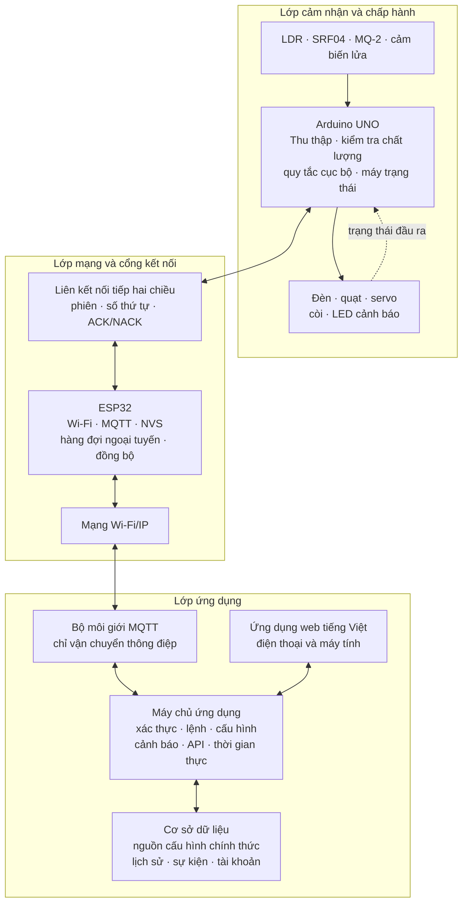
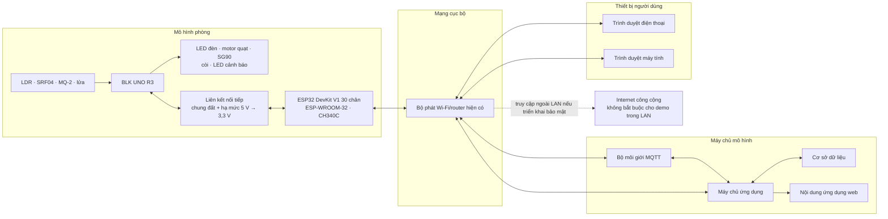
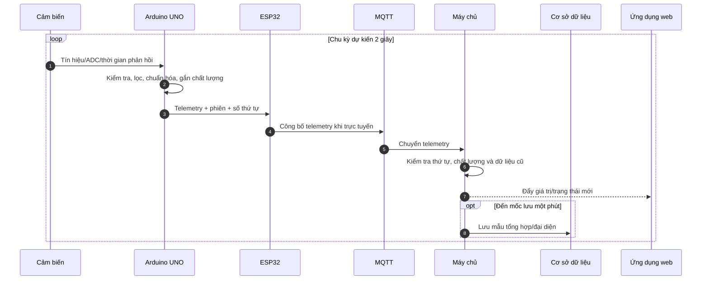
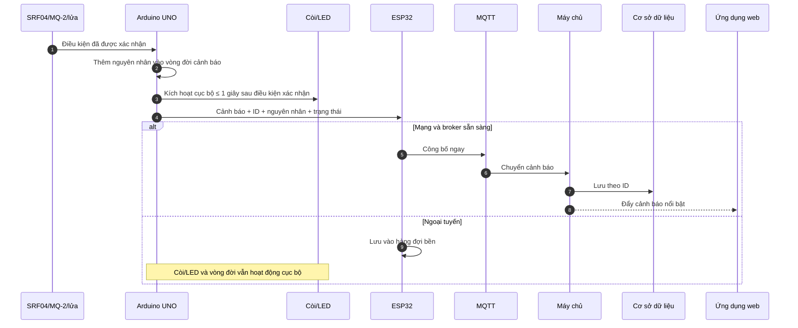
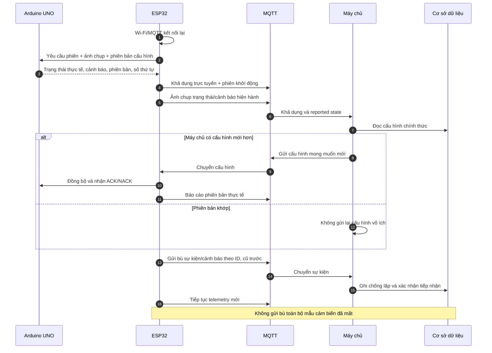

# KIẾN TRÚC HỆ THỐNG PHÒNG THÔNG MINH — PHIÊN BẢN 1.0

## 1. Thông tin kiểm soát

| Thuộc tính | Giá trị |
|---|---|
| Phiên bản | 1.0 |
| Trạng thái | **ĐÃ DUYỆT — 26/09/2026** |
| Giai đoạn | Giai đoạn 3 — Thiết kế kiến trúc hệ thống |
| Ngày tạo | 26/09/2026 |
| Phạm vi | Một phòng thông minh ở quy mô mô hình thử nghiệm |
| Đầu vào đã khóa | Đặc tả 1.1, Ma trận kiểm thử 1.1, Danh mục phần cứng 1.1 và CR-01 |
| Ràng buộc phần cứng | BLK UNO R3 55+ và ESP32 đã chọn; không mua thêm linh kiện |
| Nội dung chưa thuộc giai đoạn này | Pinout, sơ đồ điện, ngân sách nguồn, khung giao thức dây, MQTT topic/QoS, lược đồ cơ sở dữ liệu và công nghệ giao diện cụ thể |

Tài liệu này khóa **ranh giới, trách nhiệm, nguồn dữ liệu chính thức và các luồng hệ thống**. Các giai đoạn sau được phép chọn cách hiện thực nhưng không được phá vỡ các nguyên tắc kiến trúc đã duyệt nếu không mở kiểm soát thay đổi.

## 2. Mục tiêu kiến trúc

Kiến trúc phải thỏa đồng thời:

1. Thể hiện trọn chu trình **cảm nhận → thu thập → truyền → xử lý → quyết định → điều khiển → phản hồi**.
2. UNO vẫn đọc cảm biến, tự động hóa đèn, duy trì trạng thái phòng và cảnh báo cục bộ khi ESP32, Wi-Fi, MQTT hoặc máy chủ không khả dụng.
3. ESP32 tách biệt trách nhiệm mạng khỏi vòng điều khiển thời gian thực.
4. Mọi lệnh từ xa có mã lệnh, trạng thái chờ và ACK/NACK cuối; giao diện không suy đoán thiết bị đã đổi trạng thái.
5. Cấu hình có phiên bản và một nguồn chính thức; thiết bị vẫn dùng được bản hợp lệ gần nhất khi ngoại tuyến.
6. Dữ liệu lịch sử, trạng thái, cấu hình, sự kiện và cảnh báo được phân biệt rõ.
7. Một lỗi mạng không được vô hiệu hóa an ninh/an toàn cục bộ; một lỗi cảm biến không được mô tả sai thành nguy cơ đã phát hiện.
8. Phù hợp giới hạn bộ nhớ/tài nguyên của UNO và ESP32, đồng thời đủ rõ để phát triển firmware, máy chủ và web độc lập.

## 3. Phương án được chọn và các phương án không chọn

### 3.1. Kiến trúc được chọn

Hệ thống sử dụng kiến trúc phân tầng hai bộ điều khiển:

```text
Cảm biến/cơ cấu chấp hành
        ↕
Arduino UNO — xử lý cục bộ và trạng thái thực tế
        ↕ giao tiếp nối tiếp hai chiều
ESP32 — cổng mạng, bộ nhớ đệm và đồng bộ
        ↕ Wi-Fi / MQTT
Bộ môi giới MQTT
        ↕
Máy chủ ứng dụng
        ↕
Cơ sở dữ liệu
        ↕
Ứng dụng web trên điện thoại/máy tính
```

Máy chủ, bộ môi giới, cơ sở dữ liệu và ứng dụng web được tách **về logic** nhưng có thể chạy trên cùng một máy tính/máy chủ trong mô hình thử nghiệm.

### 3.2. Phân tích phương án

| Phương án | Ưu điểm | Hạn chế | Quyết định |
|---|---|---|---|
| Chỉ dùng ESP32 cho mọi chức năng | Ít board, ít giao tiếp nội bộ | Không tận dụng UNO được giao; gom mạng và điều khiển vào một điểm; thay đổi phạm vi/kiến trúc đã chốt | Không chọn |
| UNO đọc cảm biến, ESP32 điều khiển một phần tải trực tiếp | Chia bớt chân UNO | Hai nơi cùng sở hữu trạng thái vật lý, dễ lệch trạng thái và khó hoạt động ngoại tuyến nhất quán | Không chọn |
| UNO sở hữu toàn bộ I/O; ESP32 là cổng mạng | Trách nhiệm rõ; UNO tự chủ khi mất mạng; ESP32 tập trung Wi-Fi/MQTT/NVS | Cần giao thức nối tiếp và hòa giải sau reset | **Chọn** |
| Trình duyệt kết nối MQTT trực tiếp | Cập nhật nhanh, ít lớp | Lộ thông tin thiết bị, khó xác thực/phân quyền, khó kiểm toán lệnh và quản lý cấu hình | Không chọn |
| Ứng dụng đi qua máy chủ; máy chủ kết nối MQTT | Xác thực tập trung, ACK/NACK, nhật ký và dữ liệu nhất quán | Thêm thành phần máy chủ | **Chọn** |
| Chỉ dùng máy chủ đám mây | Truy cập từ xa tự nhiên | Demo phụ thuộc Internet/dịch vụ ngoài; trái mục tiêu chịu mất mạng | Không chọn cho bản cơ sở |
| Máy chủ cục bộ trong LAN, có thể chuyển lên Internet sau | Demo ổn định, không tốn dịch vụ; mất Internet công cộng vẫn dùng được trong LAN | Truy cập ngoài LAN cần triển khai bảo mật bổ sung | **Chọn cho phiên bản 1.0** |
| Máy chủ cũng tự chạy quy tắc đèn | Có thể phân tích tập trung | Hai bộ quyết định có thể tranh chấp; mất mạng làm đổi hành vi | Không chọn; máy chủ chỉ quản lý cấu hình và quan sát |

## 4. Các quyết định kiến trúc đã khóa

| Mã | Quyết định | Hệ quả |
|---|---|---|
| ADR-03-01 | Arduino UNO là chủ sở hữu duy nhất của cảm biến, cơ cấu chấp hành và trạng thái đầu ra thực tế | Không có lệnh mạng nào được coi là thành công trước ACK/trạng thái từ UNO. |
| ADR-03-02 | UNO thực hiện tự động hóa đèn, ràng buộc hồ sơ phòng, an ninh và an toàn cục bộ | Hệ thống thiết yếu tiếp tục khi ESP32/mạng/máy chủ lỗi. |
| ADR-03-03 | ESP32 không trực tiếp điều khiển thiết bị phòng; ESP32 là cổng nối tiếp–Wi-Fi–MQTT | Tránh hai nguồn điều khiển vật lý và đơn giản hóa hòa giải. |
| ADR-03-04 | Ứng dụng web chỉ làm việc với máy chủ qua API/kênh thời gian thực, không truy cập MQTT trực tiếp | Tài khoản, quyền, xác thực lệnh và nhật ký tập trung. |
| ADR-03-05 | Bộ môi giới chỉ vận chuyển thông điệp, không phải nguồn dữ liệu hay nơi thực hiện quy tắc nghiệp vụ | Khởi động lại broker không làm thay đổi trạng thái phòng. |
| ADR-03-06 | Cơ sở dữ liệu máy chủ là nguồn chính thức của cấu hình; ESP32 giữ bản hợp lệ gần nhất trong NVS; UNO giữ bản đang chạy trong RAM | Có thể ngoại tuyến nhưng hòa giải theo phiên bản khi kết nối lại. |
| ADR-03-07 | Trạng thái vật lý báo cáo từ UNO thắng trạng thái mong muốn của ứng dụng | Giao diện không cập nhật lạc quan và không giả trạng thái tải/servo. |
| ADR-03-08 | ESP32 xếp hàng sự kiện/cảnh báo ngoại tuyến, nhưng không dựng lại toàn bộ telemetry bị thiếu | Nhật ký quan trọng được gửi bù; biểu đồ giữ khoảng trống trung thực. |
| ADR-03-09 | Máy chủ cục bộ trong LAN là triển khai chuẩn của mô hình; kiến trúc cho phép di chuyển máy chủ lên Internet mà không đổi trách nhiệm thiết bị | Không phát sinh chi phí dịch vụ; mất Internet công cộng không làm hỏng điều khiển cục bộ/LAN. |
| ADR-03-10 | Đồng bộ dùng phiên bản cấu hình, mã lệnh, mã sự kiện, phiên khởi động và số thứ tự | Chống lặp, nhận biết reset và phát hiện dữ liệu cũ. |
| ADR-03-11 | Cảnh báo an toàn chỉ điều khiển còi/LED/thông báo/nhật ký; không tự bật quạt, cắt tải hoặc mở khóa | Giữ đúng phạm vi và tránh hành vi nguy hiểm chưa được chứng minh. |
| ADR-03-12 | Không dùng điện lưới; tải động chỉ được kích hoạt sau khi vượt cổng thiết kế nguồn Giai đoạn 5 | Kiến trúc không được hiểu là phê duyệt đấu điện. |

## 5. Kiến trúc logic

Kiến trúc logic tuân theo mô hình ba lớp của hệ thống IoT: lớp cảm nhận/chấp hành, lớp mạng/cổng kết nối và lớp ứng dụng.



### 5.1. Các miền logic

| Miền | Nội dung | Nơi ra quyết định |
|---|---|---|
| Cảm nhận | Ánh sáng, khoảng cách vùng cửa, MQ-2, dấu hiệu lửa | UNO xác thực phép đọc và gắn chất lượng |
| Tiện nghi | Đèn và quạt | UNO; đèn có Tự động/Thủ công, quạt chỉ Thủ công |
| Hồ sơ phòng | Ở nhà, Ra ngoài, Ban đêm | Trạng thái mong muốn từ máy chủ/ESP32; UNO thi hành và báo trạng thái thực tế |
| An ninh | Vùng cửa SRF04 và lệnh khóa servo | UNO phát hiện/thi hành; máy chủ quản lý lệnh từ xa và hiển thị |
| An toàn | MQ-2 và cảm biến lửa | UNO phát hiện/cảnh báo cục bộ; máy chủ phản chiếu và lưu |
| Kết nối | Nối tiếp, Wi-Fi, MQTT, khả dụng | ESP32 quản lý liên kết; máy chủ suy ra trạng thái hệ thống |
| Cấu hình | Ngưỡng đèn, hồ sơ, phương thức, ngưỡng MQ-2 bảo trì | Máy chủ/DB quản lý phiên bản; ESP32 và UNO kiểm tra lại trước áp dụng |
| Dữ liệu | Mẫu, trạng thái, sự kiện, cảnh báo, tài khoản | Máy chủ phân loại; DB lưu theo chính sách |

## 6. Kiến trúc vật lý và bố trí triển khai



### 6.1. Quyết định triển khai máy chủ

- Trong mô hình thử nghiệm, broker, máy chủ, cơ sở dữ liệu và web có thể chạy trên cùng một máy tính để giảm phụ thuộc và chi phí.
- Chúng vẫn là bốn thành phần logic riêng, có cổng, tài khoản và vòng đời riêng.
- Điện thoại/máy tính trong cùng LAN truy cập ứng dụng mà không cần Internet công cộng.
- Truy cập từ ngoài LAN không nằm trong tiêu chí bắt buộc của kiến trúc 1.0. Nếu bổ sung, phải dùng HTTPS/TLS và không mở trực tiếp cổng điều khiển thiếu bảo vệ.
- Việc chuyển các dịch vụ lên máy chủ Internet sau này không làm ESP32 hoặc UNO thay đổi trách nhiệm; chỉ thay cấu hình điểm kết nối và chính sách bảo mật.

## 7. Trách nhiệm từng thành phần

### 7.1. Arduino UNO

UNO chịu trách nhiệm:

- đọc LDR, SRF04, MQ-2 và cảm biến lửa;
- lọc sơ bộ, kiểm tra miền, tuổi dữ liệu và chất lượng;
- chuẩn hóa mức sáng và mức MQ-2 tương đối theo cấu hình hợp lệ;
- giữ máy trạng thái hồ sơ phòng, phương thức tiện nghi, cảnh báo và lệnh chốt đang chạy;
- thực hiện quy tắc đèn có vùng trễ/thời gian giữ;
- điều khiển đèn, quạt, servo, còi và LED cảnh báo sau khi phần cứng được phê duyệt ở Giai đoạn 5;
- phản ứng an ninh/an toàn cục bộ, không chờ mạng;
- cưỡng chế Ra ngoài và thứ tự ưu tiên đã khóa;
- tạo trạng thái báo cáo, sự kiện, cảnh báo và ACK/NACK cuối;
- tiếp tục với cấu hình đang chạy trong RAM khi liên kết ESP32 bị mất;
- đưa đầu ra về trạng thái khởi động an toàn khi reset.

UNO không chịu trách nhiệm Wi-Fi, MQTT, tài khoản, cơ sở dữ liệu, thời gian lịch tuyệt đối hoặc lưu lịch sử dài hạn.

### 7.2. ESP32

ESP32 chịu trách nhiệm:

- quản lý Wi-Fi và kết nối MQTT;
- làm cổng hai chiều giữa giao thức nối tiếp nội bộ và MQTT;
- kiểm tra cấu trúc/phiên bản cơ bản trước khi chuyển lệnh hoặc cấu hình;
- quản lý mã lệnh, hạn lệnh và chống chuyển lặp;
- lưu cấu hình hợp lệ gần nhất, hồ sơ/phương thức gần nhất và metadata đồng bộ trong NVS;
- giữ hàng đợi vòng tối thiểu 100 sự kiện/cảnh báo ngoại tuyến bằng lưu trữ bền phù hợp;
- chỉ giữ trạng thái mới nhất thay vì xếp hàng mọi bản cập nhật trạng thái;
- không xếp hàng toàn bộ telemetry định kỳ;
- tự kết nối lại theo khoảng chờ tăng dần có giới hạn;
- hòa giải phiên bản với UNO và máy chủ sau khởi động/kết nối lại;
- công bố khả dụng, phiên khởi động, trạng thái báo cáo và lỗi liên kết.

ESP32 không tự suy ra trạng thái đầu ra, không chạy bản sao quy tắc đèn và không trực tiếp điều khiển thiết bị phòng.

### 7.3. Bộ môi giới MQTT

Bộ môi giới:

- xác thực thiết bị/máy chủ theo chính sách Giai đoạn 7;
- chuyển telemetry, trạng thái, cấu hình, lệnh, ACK, sự kiện, cảnh báo và khả dụng;
- hỗ trợ phát hiện mất kết nối bằng cơ chế khả dụng thích hợp;
- không thực hiện quy tắc nghiệp vụ;
- không phải kho lịch sử hoặc nguồn cấu hình chính thức;
- không coi việc nhận bản tin là bằng chứng cơ cấu chấp hành đã thi hành.

### 7.4. Máy chủ ứng dụng

Máy chủ chịu trách nhiệm:

- xác thực tài khoản chủ phòng và quản lý phiên;
- cung cấp API cho lệnh, cấu hình, lịch sử, nhật ký và cảnh báo;
- kết nối MQTT bằng tài khoản dịch vụ riêng;
- kiểm tra quyền, kiểu dữ liệu, phạm vi và bất biến nghiệp vụ;
- tạo mã lệnh, hạn lệnh và trạng thái `ĐANG_CHỜ/THÀNH_CÔNG/TỪ_CHỐI/HẾT_HẠN/KHÔNG_XÁC_ĐỊNH`;
- chỉ đánh dấu lệnh thành công sau ACK cuối từ UNO qua ESP32;
- quản lý vòng đời bản cấu hình chờ áp dụng/đã áp dụng/bị từ chối;
- phân loại và lưu telemetry, trạng thái, sự kiện và cảnh báo;
- chống bản ghi lặp theo ID;
- đẩy cập nhật gần thời gian thực tới trình duyệt;
- đánh dấu dữ liệu cũ, suy giảm và ngoại tuyến;
- không tự điều khiển đầu ra khi thiết bị ngoại tuyến.

### 7.5. Cơ sở dữ liệu

Cơ sở dữ liệu lưu:

- tài khoản và dữ liệu xác thực đã băm;
- cấu hình chính thức và lịch sử phiên bản;
- bản cấu hình đang chờ thiết bị áp dụng;
- trạng thái thiết bị mới nhất và thời điểm nhận;
- mẫu ánh sáng một phút trong 30 ngày;
- thay đổi thiết bị, lệnh, ACK/NACK, sự kiện, cảnh báo và nhật ký kiểm toán;
- trạng thái gửi thông báo nếu TB-01 được triển khai.

Cơ sở dữ liệu không nhận dữ liệu trực tiếp từ thiết bị; mọi ghi thiết bị đi qua máy chủ để kiểm tra và chống lặp.

### 7.6. Ứng dụng web

Ứng dụng web:

- hiển thị tiếng Việt, thích ứng điện thoại/máy tính;
- đăng nhập qua máy chủ;
- lấy ảnh chụp trạng thái ban đầu qua API;
- nhận cập nhật qua kênh thời gian thực do máy chủ cung cấp;
- gửi lệnh/cấu hình qua API có xác thực;
- hiển thị trạng thái đang chờ cho đến khi có ACK cuối;
- hiển thị giá trị cuối kèm thời điểm và nhãn Dữ liệu cũ/Ngoại tuyến;
- tách rõ trạng thái lệnh servo với xác minh cơ khí;
- không chứa thông tin xác thực MQTT của thiết bị.

## 8. Nguồn dữ liệu và quyền quyết định chính thức

| Dữ liệu/trạng thái | Nguồn chính thức | Bản sao/cache | Quy tắc hòa giải |
|---|---|---|---|
| Tài khoản chủ phòng | Cơ sở dữ liệu máy chủ | Phiên đăng nhập | Máy chủ quyết định quyền. |
| Cấu hình mong muốn | Cơ sở dữ liệu máy chủ | ESP32 NVS | Phiên bản máy chủ mới hơn được gửi lại sau kết nối. |
| Cấu hình đang áp dụng | ACK UNO + bản báo cáo ESP32 | UNO RAM, ESP32 NVS, DB reported | Chỉ đổi sang phiên bản mới sau chuỗi áp dụng thành công. |
| Hồ sơ phòng/phương thức mong muốn | Cơ sở dữ liệu máy chủ | ESP32 NVS | Có phiên bản; máy chủ là nguồn khi kết nối. |
| Hồ sơ/phương thức thực tế | UNO | ESP32 và DB | Trạng thái UNO báo cáo thắng yêu cầu chưa ACK. |
| Số đo cảm biến hiện tại | UNO | ESP32 trạng thái mới nhất, máy chủ cache | Dùng số thứ tự/phiên và chất lượng; không lấy giá trị cũ làm hiện tại. |
| Trạng thái đèn/quạt/servo/còi | UNO | ESP32 và DB | Chỉ trạng thái báo cáo/ACK cuối có giá trị; servo không xác minh cơ khí. |
| Nguyên nhân cảnh báo đang hoạt động | UNO | ESP32 và máy chủ phản chiếu | Sau reconnect, ảnh chụp UNO là nguồn cho trạng thái hiện thời; DB giữ lịch sử. |
| Trạng thái kết nối | ESP32 và máy chủ suy ra từ liên kết/last-seen | Ứng dụng | Phân biệt Trực tuyến/Suy giảm/Ngoại tuyến theo nhiều liên kết. |
| Lịch sử và nhật ký | Cơ sở dữ liệu | Không có bản sao chính thức trên thiết bị | Sự kiện ngoại tuyến được ESP32 gửi bù theo ID. |
| Thời gian tuyệt đối | Máy chủ/ESP32 khi đồng bộ thời gian | Sự kiện có uptime/phiên | Không giả thời gian chính xác khi thiết bị chưa đồng bộ. |

### 8.1. Cấu hình hai trạng thái

Máy chủ quản lý riêng:

- **Cấu hình mong muốn:** bản hợp lệ mà người dùng muốn thiết bị áp dụng;
- **Cấu hình báo cáo:** phiên bản UNO đang thực sự dùng.

Khi thiết bị ngoại tuyến, cấu hình mới có thể được lưu ở trạng thái **Chờ áp dụng** nhưng không được trình bày là đã chạy. Bản đang áp dụng cũ tiếp tục có hiệu lực cục bộ.

## 9. Ranh giới giao tiếp

### 9.1. UNO ↔ ESP32

Giai đoạn 3 chỉ khóa ngữ nghĩa, chưa khóa cú pháp dây:

| Nhóm thông điệp | Chiều chính | Nội dung bắt buộc ở mức kiến trúc |
|---|---|---|
| Khởi động/đồng bộ | Hai chiều | Phiên khởi động, phiên bản giao thức, phiên bản cấu hình, yêu cầu ảnh chụp |
| Telemetry | UNO → ESP32 | Số thứ tự, phiên, dữ liệu, chất lượng, tuổi/mã lỗi |
| Trạng thái báo cáo | UNO → ESP32 | Hồ sơ, phương thức, đầu ra, nguồn điều khiển, trạng thái vùng/cảnh báo |
| Lệnh | ESP32 → UNO | Mã lệnh, loại, dữ liệu, hạn/phiên bản liên quan |
| Cấu hình | ESP32 → UNO | Bản đầy đủ, phiên bản và kiểm tra toàn vẹn |
| ACK/NACK | UNO → ESP32 | Mã gốc, kết quả, lý do, trạng thái thực tế và phiên bản áp dụng |
| Sự kiện/cảnh báo | UNO → ESP32 | ID, loại, mức độ, nguyên nhân, phiên/uptime và trạng thái hiện tại |
| Nhịp sống/lỗi | Hai chiều | Khả dụng liên kết, lỗi parse, timeout, yêu cầu gửi lại/đồng bộ |

Giai đoạn 6 sẽ quyết định UART hay nối tiếp phần mềm trên UNO, baud rate, framing, checksum/CRC, giới hạn kích thước, timeout và retry. Dù chọn cách nào, UNO TX 5 V phải được hạ mức trước ESP32 RX 3,3 V.

### 9.2. ESP32 ↔ MQTT

Các kênh ngữ nghĩa bắt buộc:

- khả dụng;
- telemetry;
- trạng thái báo cáo;
- cấu hình mong muốn và cấu hình báo cáo;
- lệnh và xác nhận;
- sự kiện;
- cảnh báo.

Giai đoạn 7 mới khóa tên topic, JSON, QoS, retain, Last Will, ACL và giới hạn tải tin.

### 9.3. Máy chủ ↔ trình duyệt

- API yêu cầu–đáp ứng cho đăng nhập, lệnh, cấu hình, truy vấn lịch sử và nhật ký;
- kênh đẩy thời gian thực cho telemetry, trạng thái, lệnh, khả dụng và cảnh báo;
- cookie/token phiên an toàn do máy chủ quản lý;
- trình duyệt không mở kết nối tới UNO, ESP32 hoặc broker.

Công nghệ HTTP, WebSocket/SSE và framework cụ thể được khóa ở Giai đoạn 9–10; kiến trúc yêu cầu có một kênh đẩy thời gian thực nhưng không bắt buộc thư viện ở giai đoạn này.

## 10. Luồng dữ liệu cảm biến



Nguyên tắc:

- UNO không chờ phản hồi mạng để tiếp tục lấy mẫu.
- ESP32 không sửa giá trị cảm biến; chỉ bổ sung metadata mạng/thời gian nếu có.
- Máy chủ không nội suy khoảng mất dữ liệu thành phép đo thật.
- Telemetry hai giây phục vụ trạng thái gần thời gian thực; cơ sở dữ liệu chỉ lưu một mẫu/phút theo đặc tả.

## 11. Luồng lệnh điều khiển và ACK/NACK

```mermaid
sequenceDiagram
    autonumber
    actor N as Chủ phòng
    participant W as Ứng dụng web
    participant S as Máy chủ
    participant M as MQTT
    participant E as ESP32
    participant U as Arduino UNO
    participant A as Cơ cấu chấp hành

    N->>W: Bật/Tắt/Khóa/Mở hoặc đổi hồ sơ
    W->>S: Yêu cầu có phiên xác thực
    S->>S: Kiểm tra quyền, trạng thái và bất biến
    S-->>W: Đã nhận + mã lệnh (chưa phải thành công)
    S->>M: Lệnh + mã + hạn + phiên bản
    M->>E: Chuyển lệnh
    E->>E: Kiểm tra cấu trúc, trùng ID và hết hạn
    E->>U: Chuyển lệnh nội bộ
    U->>U: Áp dụng thứ tự ưu tiên và ràng buộc
    alt Lệnh được phép và thi hành được
        U->>A: Thay đổi đầu ra
        U->>E: ACK + trạng thái thực tế
        E->>M: ACK/trạng thái báo cáo
        M->>S: Kết quả cuối
        S->>S: Ghi lệnh, ACK và trạng thái
        S-->>W: Thành công + trạng thái thực tế
    else Bị từ chối/lỗi/timeout
        U-->>E: NACK + lý do + trạng thái không đổi
        E-->>M: NACK hoặc timeout có nguồn
        M-->>S: Kết quả thất bại/không xác định
        S-->>W: Lý do; không giả trạng thái mới
    end
```

Ba mức phản hồi phải được phân biệt:

1. API đã nhận yêu cầu;
2. ESP32 đã nhận/chuyển lệnh;
3. UNO đã thi hành hoặc từ chối — đây mới là kết quả cuối.

## 12. Luồng cấu hình có phiên bản

```mermaid
sequenceDiagram
    autonumber
    actor N as Chủ phòng
    participant W as Ứng dụng web
    participant S as Máy chủ
    participant D as Cơ sở dữ liệu
    participant M as MQTT
    participant E as ESP32
    participant U as Arduino UNO

    N->>W: Lưu cấu hình mới
    W->>S: Bản ứng viên + phiên hiện tại
    S->>S: Kiểm tra kiểu, phạm vi, vùng trễ và quyền
    alt Không hợp lệ
        S-->>W: Từ chối toàn bộ + lỗi theo trường
    else Hợp lệ
        S->>D: Lưu bản N+1 ở trạng thái Chờ áp dụng
        S-->>W: Đã lưu, chờ thiết bị xác nhận
        S->>M: Cấu hình mong muốn N+1
        M->>E: Chuyển N+1
        E->>E: Kiểm tra lại toàn bộ
        E->>U: Bản đầy đủ N+1
        U->>U: Kiểm tra và áp dụng nguyên tử vào RAM
        alt UNO chấp nhận
            U-->>E: ACK phiên bản N+1
            E->>E: Ghi NVS sau ACK UNO
            E->>M: Báo cáo đã áp dụng N+1
            M->>S: Phiên bản báo cáo N+1
            S->>D: Chuyển N+1 thành Đang áp dụng
            S-->>W: Thiết bị đã áp dụng N+1
        else UNO/ESP32 từ chối hoặc lỗi lưu
            U-->>E: NACK + lý do, giữ bản N
            E-->>M: NACK + phiên bản thực tế
            M-->>S: Kết quả từ chối/suy giảm
            S->>D: Đánh dấu N+1 bị từ chối hoặc còn chờ; bản N vẫn hiệu lực
            S-->>W: Chưa áp dụng + lý do
        end
    end
```

Khi thiết bị ngoại tuyến, máy chủ giữ N+1 ở trạng thái Chờ áp dụng. Không tầng nào được trộn một phần trường N và N+1.

## 13. Luồng cảnh báo



- Nhiều nguyên nhân có thể cùng tồn tại.
- Tắt tiếng chỉ dừng còi; nguyên nhân mới làm còi hoạt động lại.
- Chỉ về Chờ xác nhận khi mọi nguyên nhân hết; chỉ về Bình thường sau xác nhận của chủ phòng.
- Báo an ninh chặn mở từ xa; báo an toàn cho phép chủ phòng mở có xác nhận nhưng không tự mở.
- Lỗi cảm biến tạo nguyên nhân suy giảm Hệ thống, không được ghi là đã phát hiện khí/lửa/xâm nhập.

## 14. Hoạt động trực tuyến, ngoại tuyến và suy giảm

### 14.1. Các mức khả dụng

| Tình huống | UNO | ESP32 | Máy chủ/ứng dụng | Hành vi bắt buộc |
|---|---|---|---|---|
| Toàn hệ thống trực tuyến | Đầy đủ | Nối tiếp + Wi-Fi + MQTT | Đầy đủ | Giám sát, lệnh, cấu hình, lịch sử và cảnh báo hoạt động. |
| Mất Internet công cộng nhưng LAN và máy chủ cục bộ còn | Đầy đủ | Vẫn nối broker trong LAN | Dùng được trong LAN; ngoài LAN mất | Không ảnh hưởng chức năng cục bộ/LAN. |
| Mất Wi-Fi hoặc AP | Đầy đủ | Thử nối lại; không gửi MQTT | Hiển thị cũ/ngoại tuyến | UNO tiếp tục; ESP32 xếp hàng sự kiện/cảnh báo. |
| Broker không khả dụng | Đầy đủ | Wi-Fi có nhưng MQTT retry | Không nhận dữ liệu thiết bị | Giống mất MQTT; không phát lại lệnh hết hạn. |
| Máy chủ/DB lỗi nhưng broker còn | Đầy đủ | Vẫn kết nối broker | Web suy giảm/không dùng được | Không ảnh hưởng logic UNO; ESP32 không coi broker ACK là lệnh thành công. |
| Liên kết UNO–ESP32 lỗi | Tiếp tục cấu hình RAM và logic cục bộ | Báo Suy giảm, từ chối/timeout lệnh | Không hiển thị thành công giả | Không có điều khiển từ xa đáng tin cậy; khi nối lại phải đồng bộ ảnh chụp. |
| ESP32 reset | UNO tiếp tục | Nạp NVS, bắt tay lại, reconnect | Khoảng trống ngắn | Không làm UNO reset hoặc đổi tải. |
| UNO reset | Đầu ra an toàn, chờ cấu hình/dữ liệu | Phát hiện phiên mới và đồng bộ | Báo khởi động/suy giảm | Không tự phục hồi tải Thủ công cũ. |
| Mất nguồn toàn mô hình | Không hoạt động | Không hoạt động | Chỉ thấy ngoại tuyến | Không tuyên bố có bảo vệ khi phần cứng mất điện. |

### 14.2. Chức năng được giữ khi thiết bị mất kết nối máy chủ

- lấy mẫu và kiểm tra cảm biến;
- tự động hóa đèn bằng cấu hình đang chạy;
- giữ quạt theo trạng thái cục bộ hợp lệ, chịu ràng buộc hồ sơ;
- ba trạng thái phòng và thứ tự ưu tiên;
- phát hiện vùng cửa khi được trang bị;
- MQ-2/cảm biến lửa sau khi sẵn sàng;
- còi/LED, Tắt tiếng/Xác nhận cục bộ nếu có giao diện vật lý được thiết kế;
- khóa theo hành động hồ sơ đã có, với điều kiện nguồn/cơ khí được Giai đoạn 5 phê duyệt.

### 14.3. Chức năng tạm mất

- điều khiển/cấu hình từ xa;
- cập nhật giao diện ở ngoài thiết bị;
- ghi tức thời vào cơ sở dữ liệu;
- thông báo trình duyệt;
- xem lịch sử/nhật ký mới từ bên ngoài hệ thống cục bộ.

## 15. Đồng bộ lại sau kết nối



Thứ tự ưu tiên khi phục hồi:

1. xác nhận liên kết và phiên khởi động;
2. công bố trạng thái/cảnh báo đang hoạt động;
3. hòa giải cấu hình và hồ sơ/phương thức;
4. gửi bù cảnh báo/sự kiện quan trọng;
5. tiếp tục telemetry định kỳ.

Nếu hàng đợi đầy, ESP32 loại bản cũ nhất theo cơ chế vòng và tạo một sự kiện tràn để máy chủ biết lịch sử không đầy đủ.

## 16. Xử lý khởi động lại

### 16.1. Arduino UNO khởi động lại

1. Đưa đèn, quạt, còi và tín hiệu servo về trạng thái điện an toàn đã xác định ở Giai đoạn 5.
2. Tạo phiên khởi động mới và xóa các gói lệnh đang xử lý dở.
3. Không chạy tự động hóa cho đến khi nhận cấu hình hợp lệ và có mức sáng hợp lệ.
4. Quạt giữ Tắt cho tới lệnh Thủ công mới.
5. MQ-2/cảm biến lửa vào trạng thái khởi động phù hợp; không kết luận an toàn khi dữ liệu chưa hợp lệ.
6. Gửi yêu cầu đồng bộ tới ESP32; nhận hồ sơ, phương thức và cấu hình gần nhất.
7. Báo ảnh chụp đầu ra/cảm biến/cảnh báo mới; không biến cảnh báo phục hồi thành sự kiện phát hiện mới.

### 16.2. ESP32 khởi động lại

1. UNO không bị reset và tiếp tục logic cục bộ.
2. ESP32 nạp cấu hình/cache/hàng đợi hợp lệ từ bộ nhớ bền.
3. Tạo phiên khởi động mới; mọi lệnh cũ chưa hoàn tất chuyển thành Không xác định hoặc hết hạn theo chính sách máy chủ.
4. Bắt tay với UNO và lấy ảnh chụp thực tế trước khi báo trạng thái thiết bị.
5. Kết nối Wi-Fi/MQTT theo backoff; công bố khả dụng và phiên mới.
6. Hòa giải cấu hình với máy chủ rồi gửi bù sự kiện.

### 16.3. Cả hai board cùng khởi động

- UNO ưu tiên đầu ra an toàn và đợi cấu hình.
- ESP32 nạp NVS, bắt tay với UNO và cung cấp bản hợp lệ gần nhất trước khi Internet sẵn sàng.
- Sau khi kết nối máy chủ, bản chính thức mới hơn được áp dụng bằng luồng cấu hình có phiên bản.
- Không phục hồi mù đầu ra Thủ công trước reset.

### 16.4. Máy chủ khởi động lại

- Thiết bị tiếp tục logic cục bộ.
- Máy chủ nạp cấu hình và trạng thái lưu từ DB, kết nối lại broker, sau đó chờ ảnh chụp/report mới.
- Trạng thái lưu trước reset được hiển thị là cũ cho đến khi có report mới.
- Không phát lại lệnh đang chờ nếu đã hết hạn hoặc không chứng minh được chưa thi hành.

## 17. Thời gian, phiên và chống lặp

- UNO dùng thời gian đơn điệu cục bộ cho lấy mẫu, vùng trễ, timeout và cảnh báo; không phụ thuộc đồng hồ lịch.
- Mỗi lần UNO/ESP32 khởi động tạo một mã phiên; số thứ tự chỉ được so sánh trong cùng phiên.
- ESP32 gắn thời gian tuyệt đối khi đã đồng bộ; nếu chưa có, giữ uptime và đánh dấu chất lượng thời gian.
- Máy chủ luôn ghi `received_at`; không thay `occurred_at` không chắc chắn bằng một thời điểm giả.
- Mỗi lệnh và sự kiện có ID duy nhất; ESP32, UNO và máy chủ duy trì cửa sổ chống lặp phù hợp.
- Lệnh có hạn dùng; reconnect không làm sống lại lệnh hết hạn.
- Cấu hình so sánh bằng số phiên bản, không dựa vào thời gian thiết bị.

## 18. Bảo mật kiến trúc

1. Trình duyệt xác thực với máy chủ; thiết bị xác thực với broker bằng danh tính riêng.
2. Không dùng tài khoản MQTT của thiết bị cho người dùng web.
3. Broker không cho phép xuất bản ẩn danh; quyền topic cụ thể được khóa ở Giai đoạn 7.
4. Mật khẩu, Wi-Fi và khóa bí mật không ghi cứng vào repository; dùng cơ chế cấu hình bí mật sau này.
5. Mọi lệnh/cấu hình được kiểm tra ở máy chủ, ESP32 và UNO theo trách nhiệm từng tầng.
6. Mã lệnh, hạn dùng, phiên bản và chống lặp giảm nguy cơ phát lại.
7. Nếu truy cập ngoài LAN, MQTT và web phải dùng TLS/HTTPS; không công khai broker/DB trực tiếp.
8. Cơ sở dữ liệu không được truy cập trực tiếp từ trình duyệt hoặc ESP32.
9. Nhật ký không lưu bí mật; dữ liệu xác thực phải được băm bằng cơ chế phù hợp ở Giai đoạn 14–16.
10. Phiên bản 1.0 có một tài khoản chủ phòng; kiến trúc vẫn tách quyền người dùng và quyền thiết bị.

## 19. Quan sát, lỗi và trạng thái kết nối

### 19.1. Trạng thái tổng hợp

| Trạng thái | Điều kiện kiến trúc |
|---|---|
| `TRỰC_TUYẾN` | Máy chủ nhận khả dụng và report mới trong thời hạn; liên kết UNO–ESP32 bình thường. |
| `SUY_GIẢM` | Một phần vẫn hoạt động nhưng có lỗi cảm biến, nối tiếp, cấu hình lệch, hàng đợi tràn hoặc tải không phản hồi. |
| `NGOẠI_TUYẾN` | Không còn khả dụng/heartbeat ESP32 trong thời hạn đã khóa. |

### 19.2. Metadata bắt buộc

Mọi report quan trọng phải đủ để chẩn đoán:

- định danh thiết bị;
- phiên khởi động UNO/ESP32;
- số thứ tự hoặc ID;
- phiên bản cấu hình;
- chất lượng dữ liệu/thời gian;
- nguồn điều khiển;
- mã lỗi và thành phần phát hiện lỗi;
- thời điểm thiết bị nếu có và thời điểm máy chủ nhận.

Log vận hành không thay cho dữ liệu nghiệp vụ. Telemetry không được ghi vào nhật ký sự kiện ở mỗi chu kỳ; chỉ thay đổi đáng chú ý hoặc lỗi/phục hồi mới tạo sự kiện.

## 20. Ràng buộc hiệu năng và tài nguyên

| Ràng buộc | Kiến trúc đáp ứng |
|---|---|
| Lấy mẫu ánh sáng dự kiến 2 giây | UNO lập lịch không chặn; không phụ thuộc MQTT. |
| Cập nhật ứng dụng không quá 5 giây khi mạng bình thường | ESP32 chuyển report ngay; máy chủ đẩy thay đổi tới web. |
| Cảnh báo cục bộ không quá 1 giây sau điều kiện xác nhận | UNO kích còi/LED trực tiếp trước khi gửi mạng. |
| Dữ liệu cũ sau 15 giây | UNO và máy chủ cùng có tuổi dữ liệu; ứng dụng hiển thị nhãn cũ. |
| Ân hạn lỗi ánh sáng 30 giây | UNO giữ bộ đếm cục bộ và tắt đèn Tự động khi hết hạn. |
| Giữ trạng thái đèn tối thiểu 10 giây | UNO quản lý bằng thời gian đơn điệu. |
| Hàng đợi ≥ 100 sự kiện/cảnh báo | ESP32 dùng hàng đợi vòng bền; không dùng UNO RAM cho lịch sử. |
| Lưu một mẫu/phút trong 30 ngày | Máy chủ chọn mẫu/tổng hợp; DB dọn theo thời hạn. |
| UNO có RAM hạn chế | Thông điệp nội bộ có giới hạn cố định; không giữ lịch sử hoặc cấu trúc động lớn. |
| ESP32 flash có tuổi ghi hữu hạn | Chỉ ghi cấu hình thay đổi và sự kiện quan trọng; không ghi mỗi mẫu 2 giây. |

## 21. Truy vết chức năng nhóm A tới thành phần kiến trúc

| Chức năng | UNO | ESP32 | Máy chủ/DB | Ứng dụng |
|---|---|---|---|---|
| MT-03 | Đọc, lọc, chuẩn hóa LDR | Chuyển telemetry | Kiểm tra, lưu một phút | Hiển thị mức sáng/chất lượng |
| MT-02 | Phân loại lỗi/cũ, hành vi cục bộ | Báo suy giảm liên kết | Lưu lỗi/phục hồi | Nhãn lỗi/dữ liệu cũ |
| DK-01 | Thi hành đèn/quạt và ACK | Chống lặp/chuyển lệnh | Xác thực, vòng đời lệnh | Điều khiển và chờ ACK |
| TD-02 | Quy tắc đèn/vùng trễ | Đồng bộ ngưỡng | Nguồn cấu hình | Hiển thị lý do tự động |
| CD-01 | Áp dụng phương thức | Cache/đồng bộ | Lưu mong muốn/phiên bản | Chuyển Tự động/Thủ công |
| CD-02 | Cưỡng chế hồ sơ và báo kết quả | Điều phối/đồng bộ | Lưu giao dịch hồ sơ | Chọn hồ sơ, hiển thị Suy giảm |
| CH-01 | Kiểm tra và áp dụng RAM | Kiểm tra/NVS | Nguồn chính thức/phiên bản | Biểu mẫu và lỗi |
| AN-05 | Đo SRF04, xác nhận xâm nhập | Chuyển/xếp hàng cảnh báo | Lưu/phân phối | Trạng thái vùng cửa |
| AN-02 | Điều khiển servo, trạng thái lệnh | Lệnh nhạy cảm/ACK | Chính sách mở khóa, nhật ký | Khóa/Mở và nhãn chưa xác minh |
| AT-01 | MQ-2, làm nóng, cảnh báo cục bộ | Chuyển/xếp hàng | Lưu mức/cảnh báo | Mức tương đối/trạng thái |
| AT-02 | Phát hiện lửa/cảnh báo cục bộ | Chuyển/xếp hàng | Lưu cảnh báo | Cảnh báo lửa |
| CB-01 | Máy trạng thái cảnh báo/còi | Chuyển lệnh Tắt tiếng/Xác nhận | Lưu nhiều nguyên nhân | Vòng đời cảnh báo |
| MN-01 | Logic không phụ thuộc mạng | Wi-Fi/MQTT/reconnect/queue | Theo dõi khả dụng | Trực tuyến/Suy giảm/Ngoại tuyến |
| UD-01 | Cung cấp trạng thái qua ESP32 | Danh tính thiết bị | Tài khoản/API/kênh đẩy | Sáu khu vực chức năng |
| DL-01 | Sinh ID/sự kiện cục bộ | Gửi bù/chống lặp sơ bộ | Phân loại, lưu, dọn dữ liệu | Nhật ký/bộ lọc |
| BC-01 | Cung cấp telemetry nguồn | Chuyển dữ liệu | Truy vấn lịch sử | Biểu đồ và khoảng trống |

TB-01 dùng sự kiện từ máy chủ và API trình duyệt, không thêm đường điều khiển thiết bị. MR-01 nếu triển khai phải đi qua đúng các ranh giới UNO → ESP32 → máy chủ như nhóm A, không tạo kiến trúc song song.

## 22. Rủi ro kiến trúc và biện pháp kiểm soát

| Rủi ro | Ảnh hưởng | Kiểm soát |
|---|---|---|
| Liên kết nối tiếp là cầu duy nhất giữa hai board | Mất điều khiển/giám sát từ xa | UNO tự chủ; heartbeat, phiên, timeout, resync và trạng thái Suy giảm. |
| UNO chỉ có một UART phần cứng dùng chung USB | Xung đột nạp/log/liên kết | Giai đoạn 5–6 đánh giá UART phần cứng với quy trình tách kết nối hoặc nối tiếp phần mềm; không khóa sớm. |
| Máy chủ cục bộ là điểm lỗi của chức năng từ xa | Mất web/lưu tức thời | Logic cục bộ không phụ thuộc; ESP32 xếp hàng sự kiện; sao lưu DB ở giai đoạn triển khai. |
| Cấu hình lệch giữa ba tầng | Quy tắc không nhất quán | Phiên bản, desired/reported, áp dụng nguyên tử và hòa giải sau reconnect. |
| Lệnh bị phát lại sau reconnect | Thao tác tải ngoài ý muốn | ID, hạn dùng, chống lặp và không replay pending mù. |
| Telemetry ngoại tuyến không được lưu hết | Khoảng trống lịch sử | Chủ động hiển thị khoảng trống; ưu tiên sự kiện/cảnh báo thay vì bịa mẫu. |
| Ghi flash quá thường xuyên | Giảm tuổi thọ ESP32 | Không ghi telemetry; gom/giới hạn sự kiện và chỉ ghi cấu hình khi phiên bản đổi. |
| Trạng thái servo bị hiểu thành cửa đã khóa | Sai an ninh | `xac_minh_co_khi=false`, UI và DB tách lệnh khỏi xác minh. |
| Nguồn kit có thể không đủ tải động | Reset/hỏng phần cứng | Cổng bắt buộc Giai đoạn 5; không cấp tải trước khi tính/đo; mở thay đổi phạm vi nếu cần. |

## 23. Nội dung chủ động để giai đoạn sau quyết định

| Giai đoạn | Nội dung chưa khóa | Ràng buộc từ kiến trúc này |
|---:|---|---|
| 4 | UML chi tiết | Phải phản ánh đúng tác nhân, ranh giới và luồng đã chọn. |
| 5 | Pinout, nguồn, driver, mức logic, góc servo, vùng cảm biến | UNO sở hữu I/O; ESP32 không điều khiển tải; không mua thêm linh kiện. |
| 6 | UART/nối tiếp phần mềm, baud, framing, checksum, timeout | Phải hỗ trợ đủ nhóm thông điệp, phiên, ACK/NACK và resync. |
| 7 | MQTT topic, JSON, QoS, retain, LWT, ACL | Phải giữ bảy kênh ngữ nghĩa và không biến broker thành nguồn dữ liệu. |
| 8 | Lược đồ DB, chỉ mục, retention | Phải tách desired/reported, telemetry, trạng thái, lệnh, sự kiện và cảnh báo. |
| 9 | Wireframe và luồng UI | Không cập nhật lạc quan; hiển thị cũ/suy giảm/chưa xác minh cơ khí. |
| 10–18 | Công nghệ và cấu trúc mã | Phải giữ ranh giới thành phần; có mô phỏng thiết bị để kiểm thử luồng. |

## 24. Tiêu chí chấp nhận Giai đoạn 3

- Có kiến trúc logic và vật lý rõ ràng, nguồn Mermaid tái tạo được.
- Trách nhiệm UNO, ESP32, broker, máy chủ, DB và ứng dụng không chồng chéo.
- Đủ luồng telemetry, lệnh, cấu hình, ACK/NACK, cảnh báo và đồng bộ lại.
- Xác định rõ nguồn chính thức cho cấu hình và trạng thái thực tế.
- Mô tả riêng mất Internet công cộng, mất Wi-Fi/MQTT, lỗi nối tiếp và reset từng thành phần.
- Không phụ thuộc Internet để đọc cảm biến, tự động hóa đèn hoặc cảnh báo cục bộ.
- Không khóa sớm pin, nguồn, wire protocol, topic hoặc công nghệ máy chủ.
- Không có kết quả thực nghiệm giả hoặc tuyên bố tải đã được cấp an toàn.
- Truy vết đủ 16 chức năng nhóm A.

## 25. Lịch sử sửa đổi

| Phiên bản | Trạng thái | Nội dung | Lý do/ảnh hưởng |
|---|---|---|---|
| 1.0 | **ĐÃ DUYỆT — 26/09/2026** | Kiến trúc phân tầng UNO–ESP32–MQTT–máy chủ–DB–web; máy chủ cục bộ trước; nguồn dữ liệu, luồng ACK/cấu hình/cảnh báo/reconnect và reset | Đầu ra chính thức Giai đoạn 3 dựa trên bộ tài liệu 1.1 đã khóa. |

**TRẠNG THÁI KHÓA:** Giai đoạn 3 hoàn tất ngày 26/09/2026. Kiến trúc 1.0 là đường cơ sở cho UML và thiết kế chi tiết; mọi thay đổi ranh giới/trách nhiệm phải qua kiểm soát thay đổi.
