# THIẾT KẾ UML HỆ THỐNG PHÒNG THÔNG MINH — PHIÊN BẢN 1.0

## 1. Thông tin kiểm soát

| Thuộc tính | Giá trị |
|---|---|
| Phiên bản | 1.0 |
| Trạng thái | **ĐÃ DUYỆT — 26/09/2026** |
| Giai đoạn | Giai đoạn 4 — Thiết kế UML |
| Ngày tạo | 26/09/2026 |
| Đầu vào đã khóa | Đặc tả 1.1, Ma trận kiểm thử 1.1, Danh mục phần cứng 1.1, Kiến trúc 1.0 |
| Ký pháp | PlantUML nhúng trong Markdown; nguồn có thể tái tạo |
| Giới hạn | Không gán chân, không thiết kế mạch, không khóa giao thức dây/MQTT và không mô tả kết quả thực nghiệm |

## 2. Mục tiêu và nguyên tắc sử dụng UML

Bộ UML này nhằm:

- xác định ai tương tác với hệ thống và vì mục đích gì;
- đặc tả các luồng chính, luồng thay thế và điều kiện thất bại;
- làm rõ trách nhiệm giữa ứng dụng, máy chủ, ESP32 và UNO;
- biểu diễn các máy trạng thái độc lập nhưng có ràng buộc ưu tiên;
- tạo mô hình miền dùng chung cho firmware, máy chủ, cơ sở dữ liệu và giao diện;
- cung cấp truy vết từ chức năng đã khóa tới sơ đồ và kiểm thử.

Không tạo sơ đồ chỉ để đủ số lượng. Sơ đồ kiến trúc vật lý/logical không lặp lại tại đây vì đã được khóa trong `docs/05-kien-truc-he-thong-v1.0.md`.

## 3. Tác nhân và ranh giới hệ thống

| Tác nhân | Loại | Mục tiêu/ảnh hưởng |
|---|---|---|
| Chủ phòng | Chính | Đăng nhập, giám sát, điều khiển, cấu hình, đổi hồ sơ, xử lý cảnh báo và xem lịch sử. |
| Môi trường ánh sáng | Ngoài hệ thống | Tạo tín hiệu cho giám sát và tự động hóa đèn. |
| Đối tượng tại vùng cửa | Ngoài hệ thống | Làm thay đổi khoảng cách SRF04 và có thể tạo sự kiện an ninh khi vùng được trang bị. |
| Điều kiện khí/khói tương đối | Ngoài hệ thống | Làm thay đổi MQ-2; chỉ dùng trong mô hình giáo dục. |
| Dấu hiệu lửa | Ngoài hệ thống | Tác động cảm biến lửa theo quy trình thử an toàn. |
| Hạ tầng Wi-Fi/MQTT | Hệ thống ngoài | Cung cấp hoặc làm mất kết nối; không ra quyết định nghiệp vụ. |
| Trình duyệt | Biên giao diện | Hiển thị ứng dụng và thông báo nếu được cấp quyền; không kết nối trực tiếp MQTT. |

Arduino UNO, ESP32, broker, máy chủ và cơ sở dữ liệu là **thành phần bên trong** ranh giới hệ thống, không phải tác nhân nghiệp vụ.

## 4. Danh mục trường hợp sử dụng

| Mã | Tên trường hợp sử dụng | Tác nhân chính | Nhóm |
|---|---|---|---|
| UC-00 | Xác thực phiên người dùng | Chủ phòng | Dùng chung |
| UC-01 | Xem tổng quan gần thời gian thực | Chủ phòng | A |
| UC-02 | Điều khiển đèn/quạt thủ công | Chủ phòng | A |
| UC-03 | Chuyển Tự động/Thủ công | Chủ phòng | A |
| UC-04 | Chuyển trạng thái phòng | Chủ phòng | A |
| UC-05 | Cập nhật cấu hình và ngưỡng | Chủ phòng | A |
| UC-06 | Khóa/mở khóa bằng servo | Chủ phòng | A |
| UC-07 | Tắt tiếng và xác nhận cảnh báo | Chủ phòng | A |
| UC-08 | Xem nhật ký và biểu đồ lịch sử | Chủ phòng | A |
| UC-09 | Giám sát và kiểm soát chất lượng ánh sáng | Môi trường ánh sáng | A |
| UC-10 | Tự động điều khiển đèn | Môi trường ánh sáng | A |
| UC-11 | Phát hiện xâm nhập vùng cửa | Đối tượng tại vùng cửa | A |
| UC-12 | Phát hiện và cảnh báo an toàn | Khí/khói tương đối, dấu hiệu lửa | A |
| UC-13 | Phục hồi kết nối và đồng bộ | Hạ tầng Wi-Fi/MQTT | A |
| UC-14 | Nhận thông báo trình duyệt | Chủ phòng, trình duyệt | B |
| UC-15 | Sử dụng cảm biến/thiết bị phụ | Môi trường, chủ phòng | C |

## 5. Sơ đồ trường hợp sử dụng

### 5.1. Tương tác của chủ phòng

Mục đích: cho thấy mọi thao tác ghi đều cần xác thực, còn trạng thái thành công phải dựa trên xác nhận thiết bị.

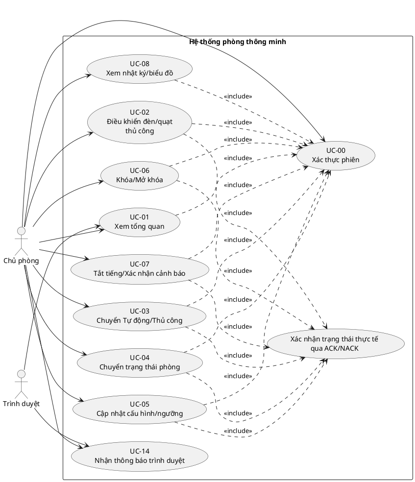

### 5.2. Hành vi tự động và sự kiện ngoài hệ thống

Mục đích: tách các chức năng tự phát sinh từ cảm biến khỏi thao tác chủ phòng và cho thấy phục hồi mạng không điều khiển trực tiếp tải.

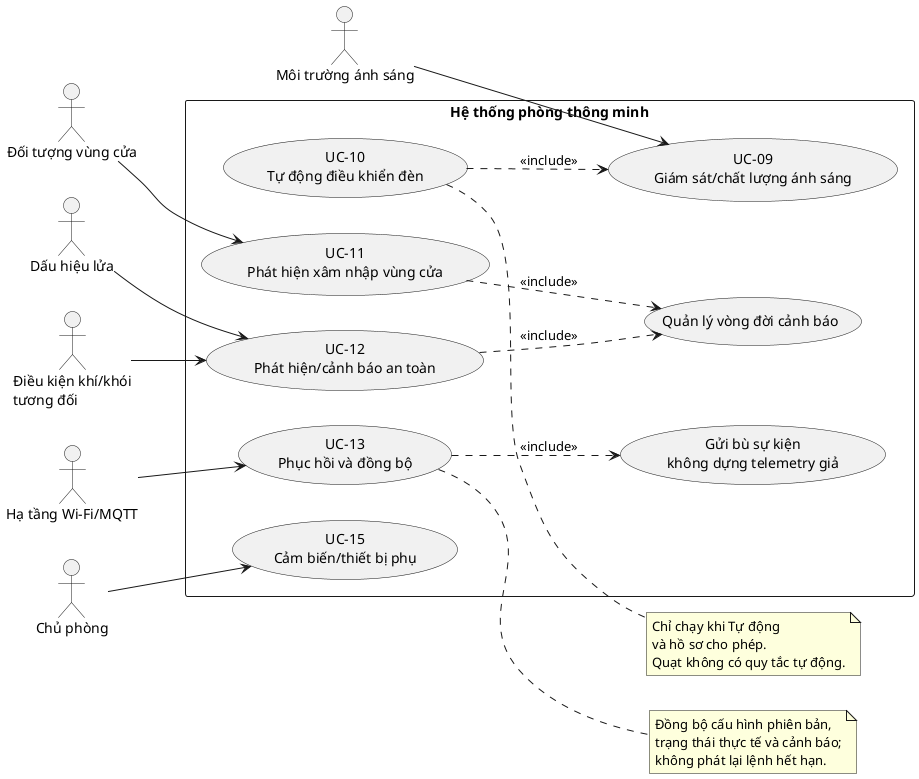

## 6. Đặc tả trường hợp sử dụng

### 6.1. UC-00 — Xác thực phiên người dùng

| Mục | Nội dung |
|---|---|
| Tác nhân | Chủ phòng |
| Mục tiêu | Chỉ một chủ phòng hợp lệ được truy cập dữ liệu và gửi thao tác ghi. |
| Điều kiện trước | Máy chủ và cơ sở dữ liệu hoạt động; tài khoản đã được tạo an toàn. |
| Kích hoạt | Người dùng mở ứng dụng hoặc phiên hiện tại hết hạn. |
| Luồng chính | Nhập thông tin → máy chủ xác minh → tạo phiên → chuyển tới Tổng quan. |
| Ngoại lệ | Sai thông tin/phiên hết hạn: từ chối, không sinh MQTT hay lệnh thiết bị. |
| Hậu điều kiện | Phiên hợp lệ có thời hạn; mật khẩu không xuất hiện rõ trong log. |
| Truy vết | UD-01; KT19. |

### 6.2. UC-01 — Xem tổng quan gần thời gian thực

| Mục | Nội dung |
|---|---|
| Tác nhân | Chủ phòng, trình duyệt |
| Mục tiêu | Xem mức sáng, vùng cửa, MQ-2, lửa, đèn, quạt, khóa lệnh, cảnh báo và kết nối. |
| Điều kiện trước | UC-00 thành công. |
| Kích hoạt | Mở trang Tổng quan hoặc có cập nhật mới. |
| Luồng chính | Lấy snapshot từ máy chủ → mở kênh đẩy → hiển thị trạng thái báo cáo cùng thời điểm/chất lượng. |
| Ngoại lệ | Thiết bị ngoại tuyến: giữ giá trị cuối, đánh dấu Dữ liệu cũ/Ngoại tuyến và khóa thao tác không thể thi hành. |
| Hậu điều kiện | Không làm thay đổi thiết bị; trạng thái không được suy ra từ lệnh mong muốn. |
| Truy vết | MT-03, AN-05, AT-01, AT-02, MN-01, UD-01; KT19, KT25, KT27, KT36, KT38. |

### 6.3. UC-02 — Điều khiển đèn/quạt thủ công

| Mục | Nội dung |
|---|---|
| Tác nhân | Chủ phòng |
| Mục tiêu | Bật/tắt tải tiện nghi và nhận kết quả thực tế. |
| Điều kiện trước | Đã đăng nhập; thiết bị trực tuyến; không có bảo vệ điện; hồ sơ không phải Ra ngoài. |
| Kích hoạt | Người dùng bấm Bật/Tắt. |
| Luồng chính | Kiểm tra phương thức → tạo mã lệnh → MQTT → ESP32 → UNO → tải → ACK cuối → cập nhật UI/nhật ký. |
| Luồng thay thế | Nếu đang Tự động, hỏi xác nhận chuyển Thủ công; hủy thì không gửi lệnh. |
| Ngoại lệ | Ra ngoài: từ chối; timeout/NACK: UI báo thất bại/không xác định và giữ trạng thái báo cáo cũ. |
| Hậu điều kiện | Nếu thành công, tải và UI cùng trạng thái; nguồn điều khiển là Thủ công. |
| Truy vết | DK-01, CD-01, MN-01, UD-01, DL-01; KT03, KT04, KT18. |

### 6.4. UC-03 — Chuyển Tự động/Thủ công

| Mục | Nội dung |
|---|---|
| Tác nhân | Chủ phòng |
| Mục tiêu | Phân định quyền giữa người dùng và quy tắc đèn. |
| Điều kiện trước | Phiên hợp lệ; cấu hình/hồ sơ đã đồng bộ. |
| Kích hoạt | Chọn phương thức hoặc xác nhận từ UC-02. |
| Luồng chính | Gửi phương thức có phiên bản → UNO áp dụng → ACK → lưu và hiển thị nguồn điều khiển. |
| Tự động | UNO đánh giá ngay ánh sáng hợp lệ cho đèn; quạt chuyển Tắt vì không có quy tắc quạt tự động. |
| Thủ công | Giữ đầu ra hiện tại nếu không kèm lệnh; lệnh trực tiếp sau đó chi phối tải. |
| Ngoại lệ | Ra ngoài vẫn giữ phương thức nhưng cưỡng chế tải Tắt; cảm biến lỗi làm quy tắc đèn không chạy. |
| Truy vết | CD-01, TD-02, DK-01; KT04, KT08, KT11. |

### 6.5. UC-04 — Chuyển trạng thái phòng

| Mục | Nội dung |
|---|---|
| Tác nhân | Chủ phòng |
| Mục tiêu | Áp dụng nhất quán Ở nhà/Ra ngoài/Ban đêm. |
| Điều kiện trước | Phiên hợp lệ; có trạng thái báo cáo mới nhất hoặc biết rõ trạng thái suy giảm. |
| Kích hoạt | Chọn hồ sơ mới hoặc xác nhận mở khóa từ hồ sơ bảo vệ. |
| Luồng Ra ngoài | Ghi trạng thái đích → tắt đèn/quạt → gửi lệnh khóa → trang bị SRF04 → tổng hợp ACK từng bước. |
| Luồng Ban đêm | Gửi lệnh khóa → trang bị vùng cửa → giữ tiện nghi theo phương thức. |
| Luồng Ở nhà | Gỡ trang bị gây báo giả → giữ phương thức; Tự động đánh giá đèn, Thủ công giữ tải Tắt; không tự mở khóa. |
| Ngoại lệ | Một bước lỗi: trạng thái phòng vẫn đổi nhưng hồ sơ mang nhãn Suy giảm và nêu rõ hành động thất bại. |
| Truy vết | CD-02, AN-05, AN-02, DK-01, CB-01; KT09, KT10, KT11. |

### 6.6. UC-05 — Cập nhật cấu hình và ngưỡng

| Mục | Nội dung |
|---|---|
| Tác nhân | Chủ phòng trong quyền thường hoặc Bảo trì/Hiệu chuẩn |
| Mục tiêu | Thay đổi ngưỡng mà không sửa mã và không tạo cấu hình từng phần. |
| Điều kiện trước | Phiên hợp lệ; biết phiên bản cấu hình hiện hành. |
| Kích hoạt | Người dùng bấm Lưu cấu hình. |
| Luồng chính | Máy chủ xác thực toàn bộ → lưu N+1 Chờ áp dụng → gửi thiết bị → UNO áp dụng nguyên tử → ESP32 lưu NVS → máy chủ đánh dấu Đang áp dụng. |
| Ngoại lệ đầu vào | Sai kiểu/phạm vi/vùng trễ/quyền MQ-2: từ chối cả bản và giữ N. |
| Ngoại lệ kết nối | Thiết bị ngoại tuyến: giữ N+1 Chờ áp dụng, không hiển thị là đã chạy. |
| Ngoại lệ thiết bị | NACK/lỗi NVS: giữ hoặc phục hồi bản đang áp dụng; UI hiển thị phiên bản thực tế. |
| Truy vết | CH-01, TD-02, AT-01, MN-01; KT07, KT08, KT16, KT26. |

### 6.7. UC-06 — Khóa/mở khóa bằng servo

| Mục | Nội dung |
|---|---|
| Tác nhân | Chủ phòng, trạng thái phòng |
| Mục tiêu | Thi hành lệnh chốt servo mà không tuyên bố trạng thái cơ khí không được đo. |
| Điều kiện trước | Servo/nguồn đã vượt cổng Giai đoạn 5; không có bảo vệ điện; chính sách cảnh báo cho phép. |
| Kích hoạt | Lệnh Khóa/Mở hoặc chuyển Ra ngoài/Ban đêm. |
| Luồng chính | Kiểm tra chính sách → điều khiển servo có giới hạn → trả vị trí lệnh và `xac_minh_co_khi=false`. |
| Luồng bảo vệ | Mở trong Ra ngoài/Ban đêm: xác nhận → chuyển Ở nhà/gỡ vùng → mới mở. |
| Ngoại lệ an ninh | Báo an ninh còn nguyên nhân: chặn mở từ xa đến khi hết và được xác nhận. |
| Ngoại lệ an toàn | Cho phép chủ phòng mở có xác nhận; không tự mở và không xóa cảnh báo. |
| Truy vết | AN-02, CD-02, CB-01; KT24, KT37. |

### 6.8. UC-07 — Tắt tiếng và xác nhận cảnh báo

| Mục | Nội dung |
|---|---|
| Tác nhân | Chủ phòng |
| Mục tiêu | Giảm âm nhưng không làm mất nguyên nhân; chỉ kết thúc cảnh báo đúng điều kiện. |
| Điều kiện trước | Có cảnh báo hoặc trạng thái Chờ xác nhận. |
| Kích hoạt | Bấm Tắt tiếng hoặc Xác nhận. |
| Luồng Tắt tiếng | Gửi lệnh → UNO dừng còi → giữ nguyên danh sách nguyên nhân và trạng thái Đã tắt tiếng. |
| Luồng Xác nhận | Chỉ chấp nhận khi mọi nguyên nhân đã hết và trạng thái Chờ xác nhận → Bình thường. |
| Ngoại lệ | Nguyên nhân mới/tái xuất hiện: còi kêu lại và trạng thái Đang kêu. |
| Hậu điều kiện | Mọi chuyển trạng thái được lưu; không có nút vô hiệu hóa an toàn. |
| Truy vết | CB-01, UD-01, DL-01; KT13, KT29, KT30. |

### 6.9. UC-08 — Xem nhật ký và biểu đồ lịch sử

| Mục | Nội dung |
|---|---|
| Tác nhân | Chủ phòng |
| Mục tiêu | Tra cứu sự kiện/cảnh báo và mức sáng theo thời gian. |
| Điều kiện trước | Đăng nhập; máy chủ/DB khả dụng. |
| Kích hoạt | Mở Nhật ký hoặc Lịch sử; chọn bộ lọc/khoảng thời gian. |
| Luồng chính | Máy chủ kiểm tra quyền → truy vấn dữ liệu → trả bản ghi phân trang/chuỗi mẫu → web hiển thị. |
| Ngoại lệ | Khoảng mất dữ liệu: biểu đồ để trống, không nội suy; máy chủ lỗi: hiển thị lỗi, không thay bằng cache giả. |
| Hậu điều kiện | Không thay đổi thiết bị; truy vấn được ghi ở mức cần thiết, không lưu bí mật. |
| Truy vết | DL-01, BC-01; KT20, KT21. |

### 6.10. UC-09 — Giám sát và kiểm soát chất lượng ánh sáng

| Mục | Nội dung |
|---|---|
| Tác nhân | Môi trường ánh sáng |
| Mục tiêu | Cung cấp mức sáng 0–100% có chất lượng và tuổi dữ liệu. |
| Điều kiện trước | LDR/mạch chia áp đã được Giai đoạn 5 phê duyệt và hiệu chỉnh. |
| Kích hoạt | Chu kỳ dự kiến 2 giây hoặc yêu cầu snapshot. |
| Luồng chính | Đọc ADC → lọc/chuẩn hóa → gắn phiên/số thứ tự/chất lượng → chuyển tới ứng dụng → lưu một mẫu/phút. |
| Ngoại lệ | Ba lần lỗi hoặc quá 15 giây: Không hợp lệ/Cũ; sau ân hạn 30 giây, quy tắc đèn dừng và đèn Tự động Tắt. |
| Hậu điều kiện | Tải Thủ công không bị tắt chỉ vì LDR lỗi; sự kiện lỗi/phục hồi không bị ghi lặp. |
| Truy vết | MT-03, MT-02, MN-01, DL-01; KT02, KT14, KT15, KT36. |

### 6.11. UC-10 — Tự động điều khiển đèn

| Mục | Nội dung |
|---|---|
| Tác nhân | Môi trường ánh sáng, cấu hình chủ phòng |
| Mục tiêu | Bật khi thiếu sáng, tắt khi đủ sáng và chống dao động. |
| Điều kiện trước | Tự động; Ở nhà/Ban đêm; cấu hình và ánh sáng hợp lệ. |
| Kích hoạt | Số đo mới, đổi cấu hình/hồ sơ/phương thức hoặc cảm biến phục hồi. |
| Luồng chính | So ngưỡng → bật ở ≤ ngưỡng bật, tắt ở ≥ ngưỡng tắt, giữ trong vùng trễ → áp thời gian giữ 10 giây. |
| Ngoại lệ | Ra ngoài: cưỡng chế Tắt; lỗi dữ liệu: ân hạn rồi Tắt; ưu tiên cao hơn được phá thời gian giữ. |
| Hậu điều kiện | Report gồm trạng thái, nguồn Tự động, mức sáng và lý do. |
| Truy vết | TD-02, MT-03, MT-02; KT06, KT11, KT14, KT17. |

### 6.12. UC-11 — Phát hiện xâm nhập vùng cửa

| Mục | Nội dung |
|---|---|
| Tác nhân | Đối tượng tại vùng cửa |
| Mục tiêu | Phát hiện đối tượng trong vùng SRF04 khi Ra ngoài/Ban đêm. |
| Điều kiện trước | SRF04 hợp lệ, vùng đã hiệu chỉnh, trạng thái bảo vệ được trang bị. |
| Kích hoạt | Khoảng cách vào vùng đủ số mẫu/thời gian xác nhận. |
| Luồng chính | Lọc mẫu → xác nhận → thêm nguyên nhân AN_NINH → còi/LED cục bộ → gửi sự kiện/cảnh báo. |
| Ngoại lệ | Ở nhà: chỉ giám sát; nhiễu ngắn: bỏ qua; cảm biến lỗi: `KHONG_XAC_DINH` và cảnh báo suy giảm Hệ thống. |
| Hậu điều kiện | Không suy ra cánh cửa mở/đóng; cảnh báo chỉ xóa theo UC-07. |
| Truy vết | AN-05, CB-01, DL-01; KT10, KT12, KT30, KT31, KT38. |

### 6.13. UC-12 — Phát hiện và cảnh báo an toàn

| Mục | Nội dung |
|---|---|
| Tác nhân | Điều kiện khí/khói tương đối, dấu hiệu lửa |
| Mục tiêu | Cảnh báo cục bộ và từ xa độc lập hồ sơ/phương thức. |
| Điều kiện trước | Cảm biến đã qua cổng điện; MQ-2 đã sẵn sàng; cảm biến lửa đã xác minh cực tính. |
| Kích hoạt | Tín hiệu được xác nhận vượt điều kiện tương ứng hoặc cảm biến lỗi/phục hồi. |
| Luồng chính | Xác nhận → thêm nguyên nhân AN_TOAN → còi/LED ≤ 1 giây → gửi cảnh báo/nhật ký. |
| Ngoại lệ cảm biến | Lỗi tạo LOI_CAM_BIEN/HE_THONG; không ghi phát hiện khí/lửa. |
| Ràng buộc | Không thể vô hiệu hóa; không tự bật quạt, cắt tải hoặc mở khóa; MQ-2 chỉ mức tương đối, không ppm. |
| Hậu điều kiện | Cảnh báo tồn tại đến khi mọi nguyên nhân hết và chủ phòng xác nhận. |
| Truy vết | AT-01, AT-02, CB-01; KT12, KT25, KT26, KT27, KT28, KT29, KT30, KT31. |

### 6.14. UC-13 — Phục hồi kết nối và đồng bộ

| Mục | Nội dung |
|---|---|
| Tác nhân | Hạ tầng Wi-Fi/MQTT |
| Mục tiêu | Khôi phục kết nối mà không phát lại lệnh hết hạn hoặc làm sai trạng thái. |
| Điều kiện trước | ESP32 có cache/hàng đợi; UNO có thể đang chạy độc lập. |
| Kích hoạt | Khởi động ESP32, Wi-Fi/MQTT phục hồi hoặc nối tiếp phục hồi. |
| Luồng chính | Bắt tay phiên → lấy snapshot UNO → công bố khả dụng/trạng thái/cảnh báo → hòa giải cấu hình → gửi bù sự kiện → tiếp tục telemetry. |
| Ngoại lệ | Cấu hình NVS cũ hơn máy chủ: nhận bản chính thức; lệnh cũ hết hạn: không thi hành; hàng đợi tràn: gửi sự kiện tràn. |
| Hậu điều kiện | Các tầng biết phiên bản thực tế; biểu đồ giữ khoảng trống telemetry. |
| Truy vết | MN-01, CH-01, DL-01; KT14, KT15, KT16, KT17, KT18, KT31. |

### 6.15. UC-14 và UC-15 — Chức năng có điều kiện

| Mã | Điều kiện triển khai | Luồng chính | Truy vết |
|---|---|---|---|
| UC-14 | TB-01 được triển khai và trình duyệt cấp quyền | Máy chủ nhận cảnh báo mới → kiểm tra ID đã gửi → tạo một thông báo; từ chối quyền vẫn giữ cảnh báo trong ứng dụng | TB-01; KT34 |
| UC-15 | Nhóm A ổn định, còn chân/tài nguyên và chọn module âm thanh/tải phụ trong kit | UNO xử lý module → đi qua cùng giao thức/trạng thái/nhật ký → chạy hồi quy nhóm A | MR-01; KT35 |

## 7. Sơ đồ hoạt động

### 7.1. Điều khiển trực tiếp và chuyển sang Thủ công

Mục đích: giải quyết xung đột giữa lệnh trực tiếp, Tự động và hồ sơ Ra ngoài.

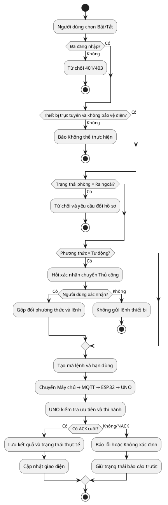

### 7.2. Tự động điều khiển đèn

Mục đích: biểu diễn vùng trễ, dữ liệu lỗi và thứ tự ưu tiên.

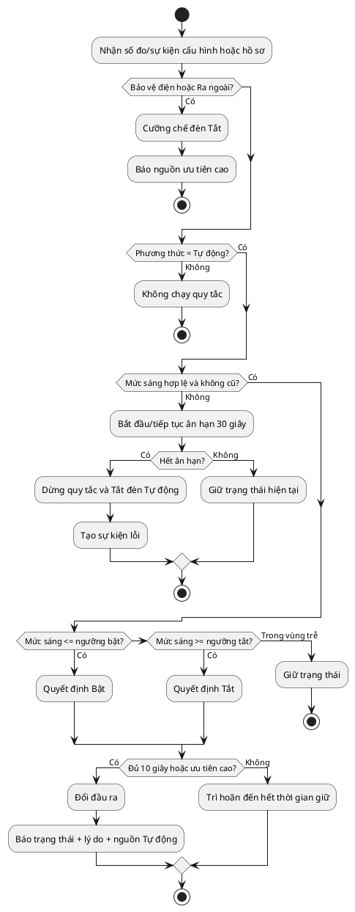

### 7.3. Chuyển trạng thái phòng

Mục đích: cho thấy chuyển hồ sơ là giao dịch nhiều bước nhưng có thể kết thúc ở trạng thái Suy giảm.

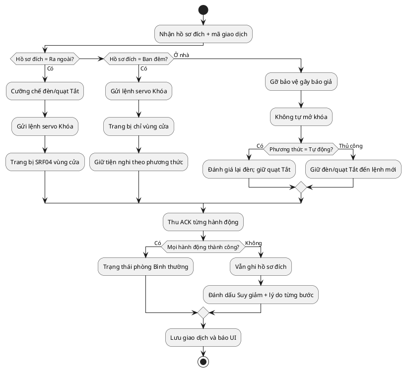

### 7.4. Cập nhật cấu hình nguyên tử

Mục đích: không cho bản cấu hình sai hoặc cập nhật một phần đi vào thiết bị.

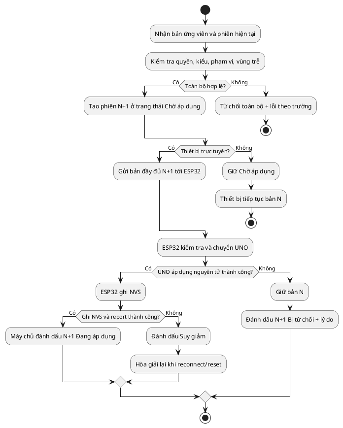

## 8. Sơ đồ tuần tự

### 8.1. Điều khiển thủ công với ACK cuối

Mục đích: phân biệt “máy chủ đã nhận” với “thiết bị đã thi hành”.

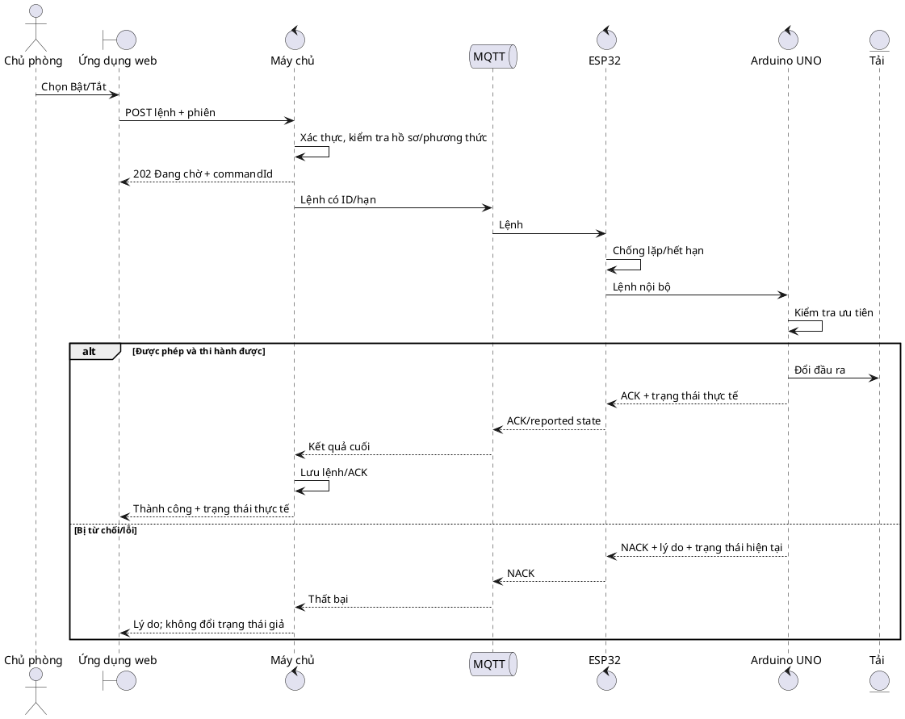

### 8.2. Cảnh báo an ninh khi mạng bị mất

Mục đích: chứng minh phản ứng cục bộ xảy ra trước và độc lập với mạng.

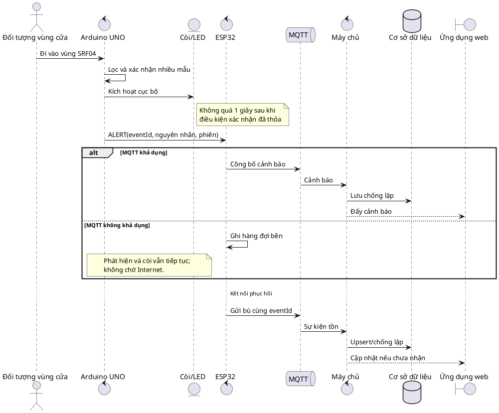

### 8.3. Khởi động lại UNO và đồng bộ

Mục đích: làm rõ trạng thái an toàn và thứ tự đồng bộ trước khi tự động hóa.

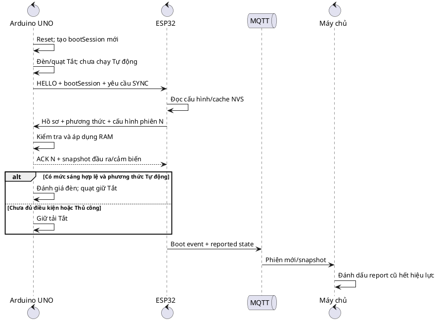

## 9. Sơ đồ trạng thái

### 9.1. Trạng thái sử dụng phòng

Mục đích: mô tả ba hồ sơ độc lập với phương thức tiện nghi.

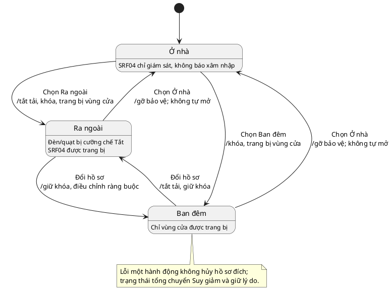

### 9.2. Phương thức tiện nghi

Mục đích: tách Tự động/Thủ công khỏi trạng thái phòng và an ninh/an toàn.

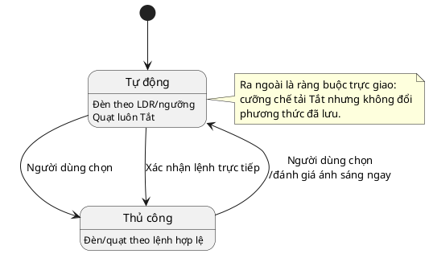

### 9.3. Trạng thái lệnh khóa servo

Mục đích: ngăn nhầm lệnh servo với trạng thái cửa/chốt cơ khí.

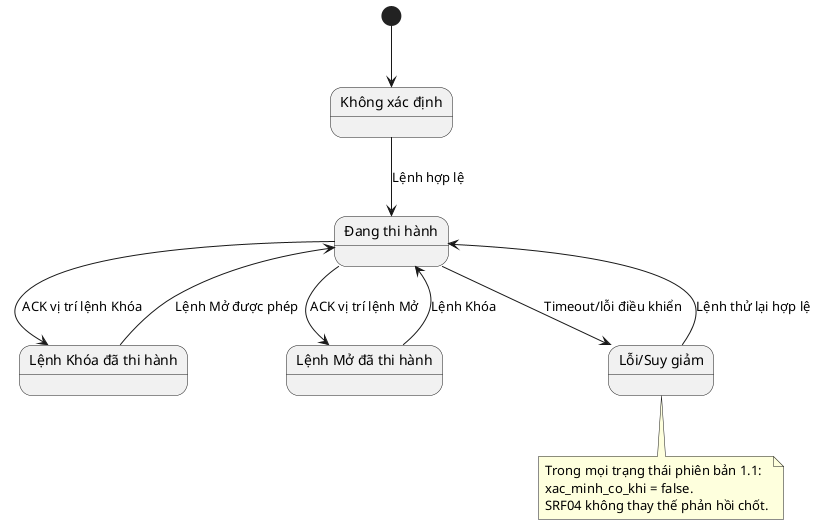

### 9.4. Vòng đời cảnh báo nhiều nguyên nhân

Mục đích: tách Tắt tiếng khỏi Xác nhận và giữ đồng thời nhiều nguyên nhân.

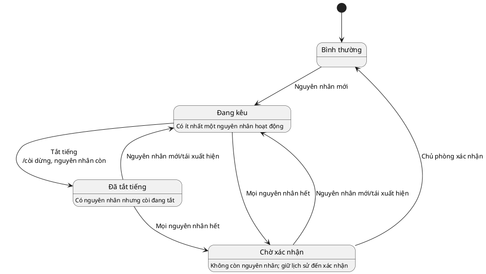

### 9.5. Trạng thái kết nối tổng hợp

Mục đích: không đánh đồng Wi-Fi có sóng với hệ thống điều khiển từ xa hoạt động đầy đủ.

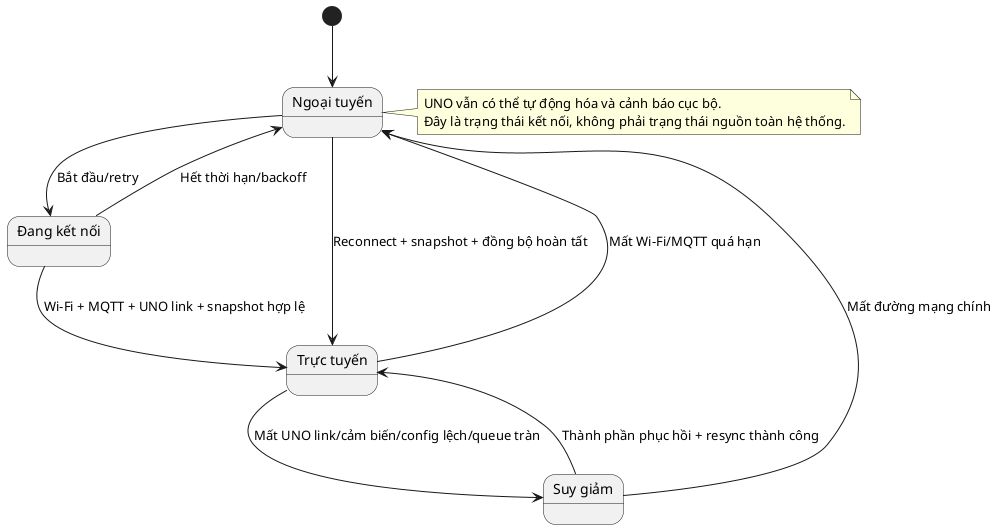

## 10. Sơ đồ lớp miền khái niệm

Mục đích: thống nhất từ vựng và quan hệ dữ liệu cho Giai đoạn 6–9. Đây **không phải** lược đồ cơ sở dữ liệu cuối cùng.

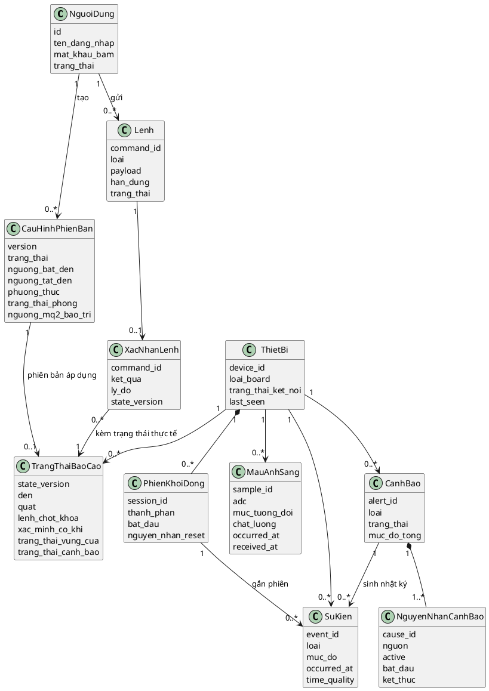

### 10.1. Bất biến miền

1. `CommandAck.command_id` phải khớp `Command.command_id`.
2. Một lệnh không có ACK cuối không được chuyển sang Thành công.
3. `ConfigVersion` chỉ trở thành Đang áp dụng khi phiên bản báo cáo xác nhận.
4. `ReportedState` của servo luôn có `xac_minh_co_khi=false` trong phiên bản 1.1.
5. Một `Alert` có ít nhất một `AlertCause`; Tắt tiếng không xóa quan hệ nguyên nhân.
6. Cảnh báo chỉ về Bình thường sau khi mọi nguyên nhân hết và có xác nhận.
7. `LightSample.chat_luong` khác Hợp lệ không được dùng làm giá trị hiện tại/quyết định mới.
8. `occurred_at` có thể không chắc chắn khi ngoại tuyến; `received_at` không được thay thế nó một cách im lặng.

## 11. Ma trận trạng thái trực giao và ưu tiên

Bốn máy trạng thái chính hoạt động đồng thời. Quyết định đầu ra được tính theo thứ tự:

| Thứ tự | Máy trạng thái/nguồn | Ví dụ ảnh hưởng |
|---:|---|---|
| 1 | Bảo vệ điện/khởi động | Chặn tải, đưa đầu ra về an toàn. |
| 2 | Cảnh báo an toàn | Còi/LED/thông báo; không tự điều khiển tải/cửa. |
| 3 | An ninh và khóa | Chặn mở từ xa khi báo an ninh. |
| 4 | Trạng thái phòng | Ra ngoài cưỡng chế tải Tắt; Ban đêm trang bị vùng cửa. |
| 5 | Phương thức Thủ công | Lệnh hợp lệ chi phối đèn/quạt. |
| 6 | Tự động | Chỉ quy tắc đèn khi mọi lớp trên cho phép. |

Ví dụ: trạng thái `TU_DONG` không tự bảo đảm đèn được bật; nếu hồ sơ là `RA_NGOAI`, lớp trạng thái phòng vẫn cưỡng chế Tắt. Tương tự, `LENH_MO` không được chuyển đến servo khi vòng đời cảnh báo có nguyên nhân an ninh đang hoạt động.

## 12. Truy vết chức năng – UML – kiểm thử

| Chức năng | Trường hợp sử dụng | Sơ đồ hành vi/trạng thái chính | Kiểm thử |
|---|---|---|---|
| MT-03 | UC-01, UC-09 | Hoạt động 7.2; lớp miền | KT14, KT15, KT21, KT36 |
| MT-02 | UC-09 | Hoạt động 7.2 | KT02 |
| DK-01 | UC-02 | Hoạt động 7.1; tuần tự 8.1 | KT03, KT04, KT09, KT18 |
| TD-02 | UC-03, UC-10 | Hoạt động 7.2; trạng thái 9.2 | KT02, KT06, KT07, KT11, KT14 |
| CD-01 | UC-02, UC-03 | Hoạt động 7.1; trạng thái 9.2 | KT04, KT08, KT11 |
| CD-02 | UC-04 | Hoạt động 7.3; trạng thái 9.1 | KT08, KT09, KT10, KT11, KT24 |
| CH-01 | UC-05 | Hoạt động 7.4; lớp miền | KT07, KT08, KT16, KT26 |
| AN-05 | UC-11 | Tuần tự 8.2; trạng thái 9.1/9.4 | KT09, KT10, KT12, KT30, KT31, KT38 |
| AN-02 | UC-04, UC-06 | Hoạt động 7.3; trạng thái 9.3 | KT09, KT24, KT37 |
| AT-01 | UC-12 | Tuần tự 8.2; trạng thái 9.4 | KT07, KT25, KT26, KT28, KT31 |
| AT-02 | UC-12 | Tuần tự 8.2; trạng thái 9.4 | KT27, KT28, KT31 |
| CB-01 | UC-07, UC-11, UC-12 | Trạng thái 9.4 | KT12, KT13, KT24, KT29, KT30, KT31 |
| MN-01 | UC-13 | Tuần tự 8.3; trạng thái 9.5 | KT14, KT15, KT16, KT17, KT18, KT31 |
| UD-01 | UC-00, UC-01, UC-02 | Trường hợp sử dụng 5.1; tuần tự 8.1 | KT03, KT19, KT36 |
| DL-01 | UC-08, UC-09, UC-11, UC-12 | Lớp miền | KT15, KT20, KT21, KT30, KT36, KT38 |
| BC-01 | UC-08 | Đặc tả UC-08; lớp miền | KT21 |
| TB-01 | UC-14 | Đặc tả UC-14 | KT34 |
| MR-01 | UC-15 | Đặc tả UC-15 | KT35 |

## 13. Quy tắc chuyển thành thiết kế/mã nguồn

- Mỗi máy trạng thái phải được hiện thực bằng enum/trạng thái tường minh, không bằng tập cờ mâu thuẫn.
- Sự kiện chuyển trạng thái phải có nguyên nhân và có thể ghi log.
- UNO là nơi thi hành chuyển trạng thái vật lý; ESP32 không tự báo thành công thay UNO.
- Máy chủ quản lý desired/reported và trạng thái lệnh; UI chỉ biểu diễn dữ liệu máy chủ đã xác minh.
- Các luồng timeout/NACK phải có đường kết thúc; không để lệnh ở trạng thái Đang chờ vô hạn.
- Việc áp dụng cấu hình phải nguyên tử và có phiên bản ở cả ba tầng.
- Các sơ đồ hoạt động không cho phép `delay` chặn dài; Giai đoạn 11 sẽ dùng lịch thời gian không chặn.
- Tên enum trên dây có thể không dấu ở Giai đoạn 6–8 nhưng ý nghĩa phải giữ nguyên như đặc tả.

## 14. Nội dung để giai đoạn sau quyết định

| Giai đoạn | Nội dung |
|---:|---|
| 5 | Ánh xạ cảm biến/cơ cấu vào chân, nguồn, driver, mức logic và cổng an toàn điện. |
| 6 | Chuyển các sự kiện/lớp UML thành thông điệp nối tiếp, timeout và ACK/NACK cụ thể. |
| 7 | Chuyển các tương tác máy chủ–ESP32 thành topic/payload/QoS/retain/ACL. |
| 8 | Chuyển mô hình lớp miền thành lược đồ DB và thời hạn lưu. |
| 9 | Chuyển UC và trạng thái thành màn hình, thành phần và luồng UX. |
| 11–16 | Hiện thực các máy trạng thái/sequence trong firmware và ứng dụng. |
| 18–19 | Dùng ma trận truy vết để tạo và chạy kiểm thử. |

## 15. Tiêu chí chấp nhận Giai đoạn 4

- Tác nhân và ranh giới hệ thống đúng kiến trúc 1.0.
- Trường hợp sử dụng bao phủ 16 A, 1 B và 1 C.
- Có đặc tả luồng chính, thay thế, ngoại lệ và hậu điều kiện cho mọi use case chính.
- Sơ đồ hoạt động giải quyết lệnh trực tiếp, tự động đèn, hồ sơ phòng và cấu hình nguyên tử.
- Sơ đồ tuần tự thể hiện ACK cuối, cảnh báo ngoại tuyến và đồng bộ sau reset.
- Bốn máy trạng thái bắt buộc — phòng, phương thức, khóa, cảnh báo — nhất quán với đặc tả; kết nối được mô hình hóa bổ sung.
- Mô hình lớp miền không bị trình bày như lược đồ DB đã khóa.
- Mọi chức năng đang áp dụng có truy vết UML và kiểm thử.
- Không có mã chức năng/kiểm thử bị tái sử dụng và không có kết quả thực nghiệm giả.
- Nguồn PlantUML đầy đủ, có thể tái tạo.

## 16. Lịch sử sửa đổi

| Phiên bản | Trạng thái | Nội dung | Lý do/ảnh hưởng |
|---|---|---|---|
| 1.0 | **ĐÃ DUYỆT — 26/09/2026** | Hai sơ đồ use case, 16 trường hợp sử dụng, bốn sơ đồ hoạt động, ba sơ đồ tuần tự, năm máy trạng thái, mô hình lớp miền và ma trận truy vết | Đầu ra chính thức Giai đoạn 4 dựa trên Đặc tả 1.1 và Kiến trúc 1.0 đã khóa. |

**TRẠNG THÁI KHÓA:** Thiết kế UML 1.0 được người dùng duyệt ngày 26/09/2026. Giai đoạn 4 hoàn tất; mọi thay đổi hành vi UML sau mốc này phải đánh giá tác động và quản lý phiên bản.
