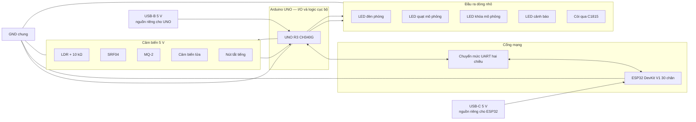
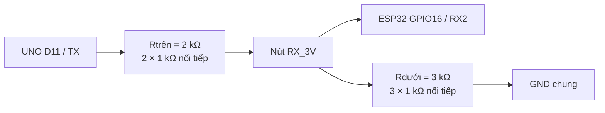
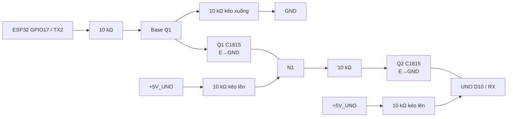
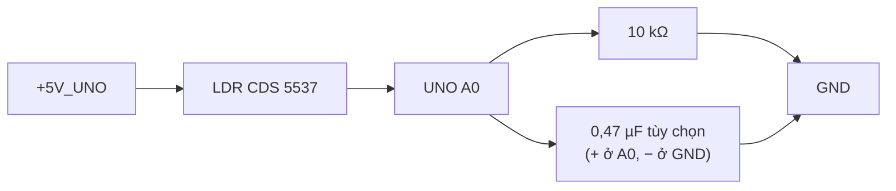
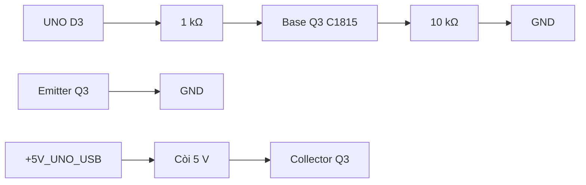

# THIẾT KẾ PHẦN CỨNG HỆ THỐNG PHÒNG THÔNG MINH — PHIÊN BẢN 1.0

## 1. Thông tin kiểm soát

| Thuộc tính | Giá trị |
|---|---|
| Phiên bản | 1.0 |
| Trạng thái | **ĐÃ DUYỆT — 26/09/2026** |
| Giai đoạn | Giai đoạn 5 — Thiết kế phần cứng |
| Ngày tạo | 26/09/2026 |
| Đầu vào hiện hành | CR-02; Đặc tả 1.2, Ma trận 1.2, Danh mục phần cứng 1.2, Kiến trúc 1.1 và UML 1.1 — đã duyệt ngày 26/09/2026 |
| Phạm vi | Phân bổ chân, đường nguồn, mức logic, cảm biến, cơ cấu chấp hành, tầng công suất, bảo vệ, sơ đồ nối dây và cổng kiểm tra trước khi cấp điện |
| Chưa thuộc tài liệu này | Baud rate, khung bản tin và CRC; MQTT topic/QoS; lược đồ cơ sở dữ liệu; mã firmware; kết quả đo thực tế |

Tài liệu này là thiết kế, **không phải bằng chứng mạch đã lắp hoặc đã chạy**. Mọi cổng đo ở Mục 16 hiện mang trạng thái `CHƯA THỰC HIỆN`.

## 2. Kết luận thiết kế

1. Arduino UNO tiếp tục là chủ sở hữu duy nhất của toàn bộ cảm biến và đầu ra; ESP32 chỉ dùng hai chân UART2 cho liên kết với UNO.
2. UNO dùng D10/D11 cho nối tiếp phần mềm với ESP32, giữ D0/D1 cho nạp chương trình và nhật ký USB. Tốc độ và giao thức dây được quyết định ở Giai đoạn 6.
3. Chiều UNO 5 V → ESP32 3,3 V dùng bộ chia áp 2 kΩ/3 kΩ. Chiều ESP32 3,3 V → UNO 5 V dùng hai tầng C1815 không đảo mức để có biên logic bảo đảm theo đặc tính điện.
4. Đèn phòng dùng LED thật; quạt và khóa dùng hai LED riêng cùng trạng thái phần mềm có nhãn `MO_PHONG`. D5/D9 được tái phân bổ cho hai LED này.
5. Servo SG90, động cơ DC và relay **không được nối nguồn hoặc tín hiệu** trong sản phẩm chính 1.2. Adapter 12 V/1 A, AMS1117, IRF3205/IRF4905 và diode tải cảm không thuộc mạch chuẩn.
6. UNO và ESP32 được cấp bằng hai đường USB riêng đã có; chỉ nối chung GND và UART đã chuyển mức. Không nối hai rail 5 V và không dùng chân 5 V ESP32 làm điểm phân phối.
7. Nhánh UNO gồm cảm biến, bốn LED, chuyển mức và còi có ngân sách thiết kế dưới 400 mA. Còi chỉ được nối qua C1815 khi dòng nhánh đo được không quá 50 mA.
8. Sạc USB-C 5 V/3 A có thể cấp trực tiếp ESP32 qua cổng USB-C, nhưng không được biến thành nguồn tải chung khi không có mạch tách/phân phối nguồn sẵn có.

## 3. Nguyên tắc an toàn điện

- Mọi thao tác lắp, đổi dây hoặc chuyển chế độ nguồn phải thực hiện khi đã ngắt điện.
- Không nối trực tiếp tín hiệu 5 V của UNO vào GPIO ESP32.
- Không nối servo, động cơ hoặc relay; không cấp còi trực tiếp từ chân I/O.
- Không cấp đồng thời USB và chân 5 V ngoài cho cùng một board; không nối hai rail 5 V USB với nhau.
- Hai board phải chung GND trước khi nối UART; đo chênh lệch đất nếu chúng dùng hai nguồn vật lý khác nhau.
- Không dùng điện lưới, adapter 12 V hoặc AMS1117 trong mạch sản phẩm.
- Đầu ra khởi động mặc định: bốn LED và còi tắt; trạng thái quạt/khóa luôn mang cờ mô phỏng.
- MQ-2 và cảm biến lửa chỉ dùng cho mô hình giáo dục; không dùng làm thiết bị bảo vệ con người hoặc tài sản.

## 4. Kiến trúc điện tổng thể

### 4.1. Hai chế độ cấp nguồn

| Chế độ | Cách cấp nguồn | Tải được phép | Mục đích |
|---|---|---|---|
| `NAP_CHAN_DOAN` | UNO qua USB-B; ESP32 qua USB-C; chỉ nối GND/UART sau cổng mức logic | Hai board, UART và từng nhánh cảm biến/LED được lắp lần lượt | Nạp, log và đo từng nhánh |
| `TICH_HOP_HAI_USB` | UNO tiếp tục qua USB-B; ESP32 tiếp tục qua USB-C từ máy tính/host phù hợp hoặc sạc 5 V cho riêng ESP32 | Cảm biến, bốn LED và còi đã đạt cổng; không có servo/motor/relay | Chạy sản phẩm chính và kiểm thử tích hợp |

Không cấp qua chân 5 V/VIN trong cấu hình chuẩn. Mỗi board chỉ nhận nguồn từ đúng cổng USB của nó. Nếu ESP32 chuyển từ máy tính sang sạc điện thoại, phải rút cáp nguồn cũ trước; không cấp hai nguồn cùng lúc.

Quy ước rail:

- `+5V_UNO_USB`: rail UNO, cảm biến và đầu ra dòng nhỏ từ USB-B;
- `+5V_ESP_USB`: rail riêng của ESP32 từ USB-C;
- `GND_SYS`: mốc chung sau khi kiểm tra; bắt buộc cho UART;
- `+5V_UNO_USB` và `+5V_ESP_USB` **không bao giờ nối với nhau**; không tồn tại `+5V_LOAD` hoặc `+5V_SYS` trong bản 1.2.

## 5. Ngân sách nguồn

### 5.1. Ngân sách thiết kế bảo thủ

| Hạng mục | Dòng thiết kế | Căn cứ/trạng thái |
|---|---:|---|
| UNO R3 | 70 mA | Biên thiết kế cho board, chưa phải số đo thực tế |
| MQ-2 | 190 mA | Công suất sưởi tối đa 950 mW ở 5 V theo Winsen |
| SRF04 | 40 mA | Mức trên của dải 10–40 mA do nhà bán công bố |
| Cảm biến lửa | 30 mA | Biên thiết kế; phải đo module thật |
| Còi | 50 mA tối đa qua C1815 | Cổng bắt buộc; nếu lớn hơn thì không nối còi vật lý |
| Bốn LED ngoài | 40 mA | Mỗi nhánh thiết kế xấp xỉ 10 mA với 330 Ω |
| LDR, UART và phần phụ | 20 mA | Dự phòng bảo thủ cho chia áp và ba C1815 |
| **Tổng phía UNO** | **400 mA** | Trần thiết kế; tải ngoài UNO xấp xỉ 330 mA, phải đo trước tích hợp |
| ESP32 khi Wi-Fi phát | 500 mA | Nằm trên rail USB-C riêng, không cộng vào rail UNO |

Con số 400 mA là ngân sách, không phải kết quả đo. Khi đo tải ngoài chân 5 V UNO, giới hạn chấp nhận là 330 mA; cộng biên 70 mA cho board cho tổng 400 mA. Nếu điện áp sụt, board reset hoặc nhánh ngoài vượt giới hạn, ưu tiên loại còi vật lý; LED cảnh báo vẫn bắt buộc.

### 5.2. Phân phối và lọc nguồn

- `+5V_UNO_USB` cấp các module UNO qua một rail breadboard dòng nhỏ; `+5V_ESP_USB` chỉ cấp ESP32.
- Đặt tụ 47 µF giữa rail cảm biến UNO và GND gần MQ-2/SRF04; có thể dùng 0,47 µF tại A0 theo Mục 9.1.
- Không cần tụ 1000 µF cho bản chuẩn vì không có servo/motor/relay.
- Nối GND hai board tại một điểm; dây UART ngắn và tách khỏi dây còi/MQ-2.
- Đo điện áp tại UNO 5 V, tại MQ-2 và tại ESP32 khi Wi-Fi hoạt động; không suy ra từ nhãn sạc.

### 5.3. Các nguồn bị loại khỏi chế độ tích hợp

| Nguồn/phần tử | Quyết định | Lý do |
|---|---|---|
| Adapter 12 V/1 A + AMS1117 5 V | `KHÔNG_DÙNG_BẢN_1_2` | Không cần rail chung; tổn hao tuyến tính lớn và không đáng nhận rủi ro |
| Pin 9 V thường + AMS1117 5 V | `KHÔNG_DÙNG_BẢN_1_2` | Không ổn định và không cần thiết |
| Chân 3,3 V UNO/ESP32 | `KHÔNG_DÙNG_CHO_TẢI` | Không đúng điện áp và không đủ dòng cho cơ cấu chấp hành/MQ-2 |
| Chân GPIO | `CẤM_CẤP_TẢI` | Chỉ mang tín hiệu; vượt dòng có thể hỏng vi điều khiển |
| Chân 5 V ESP32 làm đầu ra tải | `KHÔNG_DÙNG` | Không dùng đường USB/trace của board như bộ phân phối nguồn |

## 6. Phân bổ chân Arduino UNO

| Chân | Hướng | Tín hiệu | Phần cứng | Trạng thái khi reset/ghi chú |
|---|---|---|---|---|
| D0/RX | Dự phòng | USB UART RX | CH340G | Không nối ESP32; giữ cho nạp/log |
| D1/TX | Dự phòng | USB UART TX | CH340G | Không nối ESP32; giữ cho nạp/log |
| D2 | Vào/ngắt | `SRF04_ECHO` | ECHO SRF04 | TTL 5 V vào UNO; đo cạnh bằng ngắt ngoài |
| D3 | Ra | `BUZZER_CTRL` | Tầng C1815 + còi | Mặc định LOW; Timer2/tone nếu cần |
| D4 | Vào | `FLAME_DO` | DO cảm biến lửa | Cực tính xác định ở cổng vật lý; không giả active-low/high |
| D5 | Ra | `LOCK_SIM_LED` | LED khóa mô phỏng + 330 Ω | Mặc định LOW; không có servo/chốt cơ khí |
| D6 | Ra | `ROOM_LIGHT_LED` | LED đèn + 330 Ω | Mặc định LOW |
| D7 | Ra | `SRF04_TRIG` | TRIG SRF04 | Mặc định LOW |
| D8 | Vào | `LOCAL_MUTE_BUTTON` | Nút nhấn xuống GND | `INPUT_PULLUP`; nhấn = LOW; khử dội phần mềm |
| D9 | Ra | `FAN_SIM_LED` | LED quạt mô phỏng + 330 Ω | Mặc định LOW; không có motor/relay |
| D10 | Vào | `LINK_RX` | Đầu ra tầng nâng mức ESP32→UNO | Nối tiếp phần mềm; idle HIGH |
| D11 | Ra | `LINK_TX` | Bộ chia áp UNO→ESP32 | Nối tiếp phần mềm; idle HIGH sau khởi tạo |
| D12 | Ra | `ALARM_LED` | LED cảnh báo + 330 Ω | Mặc định LOW |
| D13 | Ra/dự phòng | `LOCAL_STATUS_LED` | LED tích hợp board | Chỉ báo nhịp/lỗi cục bộ; không phải cảnh báo chính |
| A0 | Vào ADC | `LIGHT_ADC` | LDR + 10 kΩ | ADC 10 bit; hiệu chỉnh tối/sáng |
| A1 | Vào ADC | `MQ2_AO` | AO module MQ-2 | Chỉ mức tương đối; không quy đổi ppm |
| A2 | Dự phòng | — | — | Dành cho chẩn đoán/module thay thế có kiểm soát |
| A3 | Dự phòng | — | — | Dành cho MR-01 nếu được triển khai |
| A4/SDA | Dự phòng | I²C SDA | — | Không dùng trong nhóm A |
| A5/SCL | Dự phòng | I²C SCL | — | Không dùng trong nhóm A |

### 6.1. Kiểm tra tài nguyên UNO

| Tài nguyên | Sử dụng | Xung đột đã xử lý |
|---|---|---|
| Timer0 | `millis()/micros()` và lịch không chặn | Không đổi prescaler; không dùng `delay` dài |
| Timer1 | Chưa dùng | D9 chỉ là đầu ra số cho LED quạt mô phỏng |
| Timer2 | Âm báo/tone trên D3 nếu còi thụ động | Không dùng PWM D3/D11 cho tải khác |
| INT0 | Cạnh ECHO trên D2 | Nút tắt tiếng chuyển sang D8 và được thăm dò/khử dội |
| Pin-change interrupt | RX nối tiếp phần mềm D10 | Giai đoạn 6 phải kiểm thử mất byte khi SRF04/còi hoạt động |
| UART phần cứng | USB nạp/log D0/D1 | Không có tranh chấp điện với ESP32 |
| SRAM 2 KB | Trạng thái cục bộ và bộ đệm cố định | Không giữ lịch sử hoặc JSON động trên UNO |

## 7. Phân bổ chân ESP32

| Chân ESP32 DevKit V1 30 pin | Hướng | Tín hiệu | Ghi chú |
|---|---|---|---|
| GPIO16 / UART2 RX | Vào | `LINK_RX_FROM_UNO` | Nhận sau bộ chia 2 kΩ/3 kΩ; không chịu 5 V trực tiếp |
| GPIO17 / UART2 TX | Ra | `LINK_TX_TO_UNO` | Qua hai tầng C1815 nâng mức không đảo |
| 5V/VIN | Không nối | — | ESP32 chỉ cấp bằng USB-C trong bản 1.2 |
| GND | Nguồn | `GND_SYS` | Chung với UNO và toàn bộ ngoại vi |
| GPIO1/GPIO3 | USB UART | Nạp/log ESP32 | Không dùng cho liên kết UNO |
| GPIO0, GPIO2, GPIO12, GPIO15 | Không dùng | Chân strap | Tránh làm thay đổi chế độ khởi động |

ESP32 không nối trực tiếp với cảm biến hoặc đầu ra phòng, đúng ADR-03-03. Anten PCB phải nhô khỏi vùng dây dày/kim loại.

## 8. Chuyển mức UNO–ESP32

### 8.1. UNO TX 5 V → ESP32 RX 3,3 V

- Điện áp danh định: `5 × 3 / (2 + 3) = 3,0 V`.
- Với điện trở 5% và rail 4,75–5,25 V, khoảng tính bảo thủ xấp xỉ 2,74–3,28 V: cao hơn ngưỡng vào HIGH 0,75×VDD của ESP32 và thấp hơn giới hạn 3,6 V.
- Phải đo thực tế trước khi nối nút `RX_3V` vào ESP32; dải chấp nhận tại trạng thái idle HIGH là 2,7–3,4 V.

### 8.2. ESP32 TX 3,3 V → UNO RX 5 V

Không nối thẳng vì mức HIGH tối thiểu bảo đảm của ESP32 là 0,8×3,3 = 2,64 V, trong khi ATmega328P ở 5 V có thể yêu cầu tối thiểu 0,6×VCC = 3,0 V. Dùng hai tầng C1815 để nâng mức và giữ đúng cực tính:

- Hai tầng đảo liên tiếp tạo đầu ra không đảo.
- Dòng kéo lên khoảng 0,5 mA. Với điện trở kéo xuống base Q1 10 kΩ, dòng base khả dụng ở mức HIGH tối thiểu vẫn xấp xỉ `(2,64 − 0,7)/10 kΩ − 0,7/10 kΩ = 0,124 mA`, đủ cho tải collector cỡ 0,5 mA; điện trở kéo xuống giữ Q1 tắt khi ESP32 chưa điều khiển.
- Phải đối chiếu đúng thứ tự chân E–C–B trên C1815 thực tế; không suy luận chỉ từ hướng mặt phẳng.
- Khi ESP32 chưa cấp nguồn, D10 được kéo HIGH; không được cấp riêng UNO lâu dài khi mạch có đường back-power chưa kiểm tra.

### 8.3. Quy tắc dây UART

- Dây ngắn, đi tách khỏi MQ-2/còi; GND chung bắt buộc.
- Không nối chéo GPIO16/17 với D0/D1.
- Tốc độ, framing, CRC, timeout và retry chưa khóa; thuộc Giai đoạn 6.
- Giai đoạn 6 phải thử đồng thời UART, SRF04 và còi/LED để xác nhận nối tiếp phần mềm không mất khung.

## 9. Mạch cảm biến

### 9.1. Quang trở LDR

- Với cách mắc này, ADC tăng khi sáng hơn; firmware chuẩn hóa theo hai mốc `adc_toi` và `adc_sang` đo thực tế.
- Không gán lux; chỉ hiển thị 0–100% tương đối.
- Nếu bỏ tụ, lọc số vẫn bắt buộc. Nếu dùng tụ hóa 0,47 µF phải đúng cực.

### 9.2. MQ-2

| Chân module | Nối |
|---|---|
| VCC | `+5V_UNO_USB` sau khi đạt cổng điện áp/ngân sách USB |
| GND | `GND_SYS` |
| AO | UNO A1 |
| DO | Không dùng trong bản 1.0 phần cứng |

- Dùng AO để lưu ADC thô và mức tương đối; không tuyên bố ppm.
- Cảm biến trần MQ-2 yêu cầu 5,0 ±0,1 V và tiêu thụ sưởi tối đa 950 mW theo Winsen.
- Điều kiện hóa ban đầu theo tài liệu MQ-2 là không dưới 48 giờ. Đây là điều kiện kỹ thuật của cảm biến, không đồng nghĩa mỗi lần reset phải đợi 48 giờ; sau mỗi lần cấp lại nguồn, firmware vẫn phải có trạng thái `LAM_NONG` và chỉ chuyển sẵn sàng sau quy tắc ổn định được khóa ở Giai đoạn 11 dựa trên phép đo nền.
- Không thử bằng cách xả gas hoặc tạo khói trong phòng kín. Phương pháp kích thích thực tế phải được duyệt ở Giai đoạn 19.

### 9.3. Cảm biến lửa

| Chân module | Nối |
|---|---|
| VCC | `+5V_UNO_USB` sau khi xác minh nhãn module |
| GND | `GND_SYS` |
| DO | UNO D4 |

- Module nhà bán công bố đầu ra số qua LM393 và có biến trở độ nhạy; tài liệu bán hàng không đủ để khóa active-high/active-low.
- Cổng G5-SEN-02 phải đo DO ở nền và khi dùng nguồn hồng ngoại thử an toàn; firmware chuẩn hóa thành boolean `lua_phat_hien`.
- Không dùng AO vì module trong danh sách hiện hành chỉ được bảo đảm có đầu ra số.

### 9.4. SRF04 vùng cửa

| Chân module | Nối |
|---|---|
| VCC | `+5V_UNO_USB` |
| GND | `GND_SYS` |
| TRIG | UNO D7 |
| ECHO | UNO D2/INT0 |

- Nhà bán công bố 5 V, dòng 10–40 mA, dải lý tưởng 2–300 cm và chính xác nhất dưới 100 cm; mô hình đặt vùng cửa trong khoảng dưới 100 cm.
- ECHO là TTL 5 V và chỉ đi vào UNO, không đi vào ESP32.
- D2 đo cạnh không chặn; timeout và lọc nhiều mẫu thuộc firmware.
- Khoảng cách nền/ngưỡng vùng phải được hiệu chỉnh theo mô hình thật; không dùng SRF04 để suy ra cửa hoặc chốt đã khóa.

### 9.5. Nút tắt tiếng cục bộ

- Một chân nút nối D8, chân đối diện nối GND.
- D8 dùng `INPUT_PULLUP`; trạng thái nhấn là LOW.
- Khử dội phần mềm; nút chỉ tắt tiếng còi, không xóa nguyên nhân cảnh báo.

## 10. Mạch cơ cấu chấp hành

### 10.1. Bốn LED đầu ra

| LED | Anode | Cathode | Dòng xấp xỉ với LED đỏ 2 V |
|---|---|---|---:|
| Đèn phòng | UNO D6 qua 330 Ω | GND | `(5−2)/330 ≈ 9 mA` |
| Quạt mô phỏng | UNO D9 qua 330 Ω | GND | `(5−2)/330 ≈ 9 mA` |
| Khóa mô phỏng | UNO D5 qua 330 Ω | GND | `(5−2)/330 ≈ 9 mA` |
| Cảnh báo | UNO D12 qua 330 Ω | GND | `(5−2)/330 ≈ 9 mA` |

Bốn LED phải có màu hoặc nhãn vật lý phân biệt. LED D13 chỉ báo trạng thái board, không thay bất kỳ đầu ra nghiệp vụ nào. LED D5/D9 và trạng thái mạng tương ứng luôn mang nhãn `MO_PHONG`.

### 10.2. Còi cảnh báo qua C1815

- Chỉ dùng còi nếu dòng nhánh đo được ≤50 mA và tổng tải ngoài UNO ≤330 mA. Nếu không đạt, để còi ngắt và dùng LED cảnh báo; không thay bằng linh kiện mua thêm.
- Nếu còi là tải điện từ, đặt 1N4007 song song ngược: cathode về +5 V, anode về collector. Nếu là piezo, không tự thêm diode khi chưa xác minh cấu tạo.
- D3 mặc định LOW; điện trở 10 kΩ giữ transistor tắt khi chân treo.
- Không nối còi trực tiếp vào D3.

### 10.3. Quạt mô phỏng

- D9 điều khiển LED qua 330 Ω; `HIGH` biểu diễn Bật, `LOW` biểu diễn Tắt.
- ACK/trạng thái báo cáo phải kèm `che_do_co_cau=MO_PHONG`; giao diện không được hiển thị tốc độ, dòng hoặc “motor đang quay”.
- Động cơ, relay, IRF3205/IRF4905 và 1N4007 không nằm trong đường mạch.

### 10.4. Khóa mô phỏng

- D5 điều khiển LED qua 330 Ω; quy ước `HIGH=KHOA`, `LOW=MO_KHOA` được ghi trong firmware và sơ đồ giao diện.
- Mọi báo cáo kèm `che_do_co_cau=MO_PHONG` và `xac_minh_co_khi=false`.
- Servo SG90 để rời hoàn toàn; không có góc khóa/mở, thời gian di chuyển hoặc phản hồi cơ khí trong bản 1.2.

## 11. Bảng kết nối chuẩn

| Từ | Qua | Đến | Ghi chú |
|---|---|---|---|
| USB-B | Cổng USB UNO | `+5V_UNO_USB` | Cấp board UNO và rail cảm biến/đầu ra dòng nhỏ |
| USB-C | Cổng USB ESP32 | `+5V_ESP_USB` | Cấp riêng ESP32; không xuất ngược sang tải |
| `GND_SYS` | — | GND UNO + ESP32 + mọi module | Một mốc tham chiếu chung |
| UNO D11 | 2 kΩ nối tiếp; 3 kΩ xuống GND | ESP32 GPIO16 | Hạ 5 V xuống danh định 3,0 V |
| ESP32 GPIO17 | Q1/Q2 C1815 + năm điện trở 10 kΩ | UNO D10 | Nâng mức không đảo; base Q1 có kéo xuống |
| LDR | Chia áp 10 kΩ | UNO A0 | Sáng hơn → ADC tăng |
| MQ-2 AO | Trực tiếp | UNO A1 | Cùng rail 5 V/ADC reference |
| SRF04 ECHO/TRIG | — | UNO D2/D7 | ECHO vào INT0 |
| Flame DO | — | UNO D4 | Cực tính chuẩn hóa sau đo |
| Nút nhấn | D8 xuống GND | UNO D8 | `INPUT_PULLUP` |
| UNO D6 | 330 Ω + LED | GND | Đèn phòng |
| UNO D12 | 330 Ω + LED | GND | Cảnh báo |
| UNO D3 | 1 kΩ + Q3 C1815 | Còi 5 V | Có kéo xuống base 10 kΩ |
| UNO D5 | 330 Ω + LED | GND | Khóa mô phỏng; không nối servo |
| UNO D9 | 330 Ω + LED | GND | Quạt mô phỏng; không nối motor/relay |

Điện trở 10 kΩ kéo xuống được đặt tại D7 để TRIG giữ LOW trong reset; base Q3 có kéo xuống riêng. D5/D9 là LED xuống GND và được firmware đặt LOW ngay khi khởi động.

### 11.1. Kiểm kê linh kiện tiêu thụ bởi mạch chuẩn

| Linh kiện | Số dùng / số có trong kit | Mục đích |
|---|---:|---|
| Điện trở 1 kΩ | 6/10 | Năm điện trở tạo bộ chia 2 kΩ/3 kΩ; một điện trở base còi |
| Điện trở 10 kΩ | 8/10 | LDR; năm điện trở nâng mức; kéo xuống còi và TRIG |
| Điện trở 330 Ω | 4/10 | Bốn LED nghiệp vụ |
| C1815 | 3/5 | Hai tầng nâng mức và một driver còi |
| 1N4007 | 0–1/10 | Chỉ dùng nếu xác nhận còi là tải điện từ |
| Tụ 1000 µF/16 V | 0/5 | Không cần vì không có tải động |
| Tụ 47 µF | 1/5 | Lọc nhánh logic/cảm biến |
| Tụ 0,47 µF | 0–1/5 | Lọc analog LDR tùy chọn |

## 12. Trạng thái khởi động và lỗi điện

### 12.1. Khi vừa cấp nguồn

1. Q3 được giữ tắt bằng điện trở kéo xuống; servo, motor và relay không nối.
2. UNO đặt D3, D5, D6, D7, D9 và D12 LOW trước khi khởi tạo thành phần khác.
3. Trạng thái khóa khởi tạo `KHOA`, quạt mô phỏng Tắt; chỉ cập nhật LED tương ứng sau khi máy trạng thái sẵn sàng.
4. MQ-2 ở `LAM_NONG`; cảm biến lửa và SRF04 ở `KHONG_XAC_DINH` cho tới khi đủ mẫu hợp lệ.
5. UNO bắt tay ESP32 qua D10/D11; mất liên kết không ngăn đọc cảm biến/cảnh báo cục bộ.
6. Sau đồng bộ, hồ sơ/phương thức và quy tắc ưu tiên quyết định đầu ra; không phục hồi mù tải Thủ công cũ.

### 12.2. Khi nguồn suy giảm

- Nếu rail USB <4,75 V, MQ-2 không đạt điện áp yêu cầu, board reset bất thường hoặc UART nhiễu khi còi hoạt động, ghi lỗi nguồn/suy giảm và ngắt còi vật lý.
- Không mô tả brownout/reset là lỗi mạng hoặc phát hiện khí/lửa.
- Nếu còi làm reset board, để còi ngắt và giữ cảnh báo bằng LED/phần mềm; không tăng tụ để che lỗi trước khi đo.
- Cảnh báo an toàn chỉ điều khiển còi/LED/nhật ký; không đổi trạng thái quạt/khóa mô phỏng.

## 13. Bố trí vật lý

- MQ-2 đặt thoáng, cách LDR và vật liệu nhựa dễ biến dạng; không che lưới kim loại và không chạm khi đang nóng.
- Cảm biến lửa hướng ra vùng thử, tránh nhìn trực tiếp LED hồng ngoại/ánh nắng mạnh ngoài ý muốn.
- SRF04 hướng vuông góc vùng cửa, bề mặt mục tiêu tương đối phẳng, khoảng cách làm việc mục tiêu dưới 100 cm.
- LDR không đặt sát LED đèn mô hình nếu muốn đo ánh sáng môi trường; nếu đèn phải ảnh hưởng LDR thì ghi rõ đây là vòng phản hồi của mô hình.
- ESP32 để anten PCB thoáng, tránh dây nguồn cuộn và vật kim loại.
- Bố trí bốn LED có nhãn `ĐÈN`, `QUẠT MÔ PHỎNG`, `KHÓA MÔ PHỎNG`, `CẢNH BÁO`.
- Breadboard chỉ dùng tín hiệu/dòng nhỏ; servo, motor và relay để ngoài breadboard và không nối.

## 14. Kiểm tra xung đột và khả năng mở rộng

| Hạng mục | Kết quả |
|---|---|
| Số chân số UNO | D2–D13 được phân bổ; D0/D1 giữ cho USB; không trùng |
| Chân analog UNO | A0–A1 dùng; A2–A5 còn dự phòng |
| Timer | Timer1 còn trống; Timer2 dành còi nếu cần; D5/D9 chỉ là LED số |
| Ngắt | INT0 dành ECHO; nút dùng thăm dò nên không tranh chấp |
| ESP32 | Chỉ GPIO16/17; không dùng chân strap và không có I/O phòng trực tiếp |
| UART USB | D0/D1 tách khỏi D10/D11 nên có thể nạp/log khi cảm biến/LED hoạt động |
| MR-01 | Có thể dùng A3 hoặc chân dự phòng sau khi nhóm A ổn định; chưa nối trong bản chuẩn |
| Servo/motor/relay | Không nối; được thay bằng D5/D9 và trạng thái mô phỏng có nhãn |
| IRF3205/IRF4905/1N4007 | Không dùng trong mạch chuẩn vì không có tải động |

## 15. Quyết định thiết kế Giai đoạn 5

| Mã | Quyết định | Lý do/ảnh hưởng |
|---|---|---|
| ADR-05-01 | UNO sở hữu toàn bộ chân cảm biến/chấp hành | Giữ đúng Kiến trúc 1.0 và hoạt động ngoại tuyến |
| ADR-05-02 | D10/D11 là liên kết UNO–ESP32; D0/D1 giữ cho USB | Không phải tháo UART khi nạp; Giai đoạn 6 kiểm thử tải ngắt |
| ADR-05-03 | Hạ mức UNO→ESP bằng 2 kΩ/3 kΩ | Biên 2,74–3,28 V theo dung sai thiết kế |
| ADR-05-04 | Nâng mức ESP→UNO bằng hai C1815 | Tránh phụ thuộc vào trường hợp 3,3 V vừa đủ ngưỡng 5 V |
| ADR-05-05 | D9 + LED 330 Ω mô phỏng quạt | Thực hiện DK-02 mà không giả động cơ đã chạy |
| ADR-05-06 | D5 + LED 330 Ω mô phỏng khóa | Thực hiện AN-06; luôn `xac_minh_co_khi=false` |
| ADR-05-07 | Không dùng 12 V + AMS1117 làm rail hệ thống | Tổn hao nhiệt không phù hợp tải tổng hợp |
| ADR-05-08 | Hai board dùng hai nguồn USB riêng; không nối rail 5 V | Dùng hạ tầng đang có và tránh đường phân phối tải chưa chứng minh |
| ADR-05-09 | Còi dùng C1815 và giới hạn dòng đo ≤50 mA | Giữ tổng phía UNO dưới 400 mA; nếu không đạt thì dùng LED cảnh báo |
| ADR-05-10 | Flame dùng DO; MQ-2 dùng AO | Phù hợp module seller công bố và giữ dữ liệu MQ-2 tương đối |
| ADR-05-11 | Không nối servo, motor hoặc relay | Không có rail tải tách riêng; CR-02 chuyển chức năng sang mô phỏng |
| ADR-05-12 | Không có điện lưới trong bất kỳ sơ đồ nào | Giới hạn rủi ro và đúng phạm vi mô hình |
| ADR-05-13 | Mọi trạng thái quạt/khóa mang `che_do_co_cau=MO_PHONG` | Ngăn giao diện, nhật ký và báo cáo diễn đạt sai phần cứng |

## 16. Cổng xác minh trước khi cấp tải

| Cổng | Thao tác/bằng chứng cần có | Tiêu chí đạt | Trạng thái |
|---|---|---|---|
| G5-ID-01 | Ảnh rõ nhãn/chân UNO, ESP32, MQ-2, flame, SRF04 và còi | Khớp pinout tài liệu hoặc cập nhật sơ đồ trước đấu | `CHƯA THỰC HIỆN` |
| G5-PWR-01 | Đo rail USB của UNO và ESP32 ở trạng thái board hoạt động | 4,75–5,25 V tại board; không reset/nóng bất thường | `CHƯA THỰC HIỆN` |
| G5-PWR-02 | Đo dòng tải ngoài UNO khi LDR/SRF04/MQ-2/flame/bốn LED hoạt động; thử thêm còi riêng | Không quá 330 mA ngoài board; tổng thiết kế không quá 400 mA; còi không làm reset/sụt áp | `CHƯA THỰC HIỆN` |
| G5-PWR-03 | Kiểm tra hai rail USB và GND | Không nối hai rail 5 V; mỗi board chỉ có một nguồn; chênh GND trước nối tín hiệu ≤0,1 V | `CHƯA THỰC HIỆN` |
| G5-PWR-04 | Đo điện áp ngay tại VCC MQ-2 sau khi ổn định | 4,9–5,1 V theo điều kiện tham chiếu MQ-2; nếu không đạt thì AT-01 không dùng dữ liệu thật | `CHƯA THỰC HIỆN` |
| G5-LVL-01 | Đo nút chia áp UNO TX idle HIGH trước khi nối ESP32 | 2,7–3,4 V | `CHƯA THỰC HIỆN` |
| G5-LVL-02 | Đo đầu ra nâng mức ESP32 TX tại UNO D10 | LOW ≤0,4 V; HIGH ≥3,0 V; đúng cực tính | `CHƯA THỰC HIỆN` |
| G5-SEN-01 | Đo LDR tối/sáng, SRF04 nền, MQ-2 nền sau điều kiện hóa | Có miền tách biệt và không vượt 0–5 V ADC | `CHƯA THỰC HIỆN` |
| G5-SEN-02 | Đo flame DO ở nền và kích thích hồng ngoại an toàn | Xác định được cực tính, tín hiệu lặp lại | `CHƯA THỰC HIỆN` |
| G5-ACT-01 | Đo dòng còi qua Q3 | ≤50 mA; GPIO không cấp tải trực tiếp; nếu không đạt thì để còi ngắt | `CHƯA THỰC HIỆN` |
| G5-ACT-02 | Kiểm tra bốn LED và nhãn vật lý | Đúng chân, đúng cực tính, mỗi dòng xấp xỉ 5–12 mA; quạt/khóa ghi rõ mô phỏng | `CHƯA THỰC HIỆN` |
| G5-EXC-01 | Kiểm tra servo/motor/relay | Cả ba để rời, không nối nguồn hoặc tín hiệu | `CHƯA THỰC HIỆN` |
| G5-LINK-01 | Truyền dữ liệu hai chiều khi SRF04/MQ-2/còi/LED hoạt động | Không mất/đảo byte ở tốc độ Giai đoạn 6 chọn | `CHƯA THỰC HIỆN` |

Không cổng nào được tự chuyển `ĐẠT` từ tính toán. Người dùng thực hiện phép đo vật lý; GPT phân tích bằng chứng và cập nhật kết quả.

## 17. Trình tự lắp an toàn

1. Giữ toàn bộ nguồn ngắt; đối chiếu nhãn và thứ tự chân thực tế.
2. Lắp GND và mạch UART chuyển mức; cấp hai board bằng hai USB riêng, chưa nối cảm biến/còi.
3. Đo G5-LVL-01/02; chỉ sau khi đạt mới nối GPIO16/D10.
4. Lắp LDR, nút và bốn LED; dán nhãn rồi kiểm tra riêng từng đường.
5. Lắp SRF04, flame và MQ-2; xác minh điện áp/polarity rồi mới đọc tín hiệu.
6. Đo hai rail USB riêng; lắp MQ-2 sau cùng trong nhóm cảm biến và đo điện áp/dòng tải ngoài UNO.
7. Lắp tầng còi C1815, đo dòng; ngắt còi nếu vượt 50 mA hoặc làm sụt áp/reset.
8. Xác nhận servo, motor và relay vẫn để rời hoàn toàn.
9. Chỉ chạy đồng thời sau khi từng nhánh đạt G5-PWR-01..04 và G5-ACT-01..02.

## 18. Truy vết chức năng–phần cứng–kiểm thử

| Chức năng | Phần cứng/đường tín hiệu | Kiểm thử liên quan |
|---|---|---|
| MT-03 | LDR A0, 10 kΩ, tùy chọn 0,47 µF | KT36 |
| MT-02 | A0 và chẩn đoán tuổi/miền dữ liệu | KT02 |
| DK-02 | LED đèn D6 + LED quạt mô phỏng D9 | KT03, KT04 |
| TD-02 | LDR A0 + LED D6 | KT06 |
| CD-01 | UNO + đầu ra D6/D9 | KT04, KT11 |
| CD-02 | D5/D6/D9; SRF04 D2/D7; cảnh báo D3/D12 | KT09, KT10, KT11 |
| CH-01 | UART D10/D11 + ESP32 NVS | KT07, KT08 |
| AN-05 | SRF04 D2/D7 + còi/LED | KT10, KT12, KT38 |
| AN-06 | LED khóa mô phỏng D5 | KT24, KT39 |
| AT-01 | MQ-2 AO A1 + còi/LED | KT25, KT26, KT28, KT29, KT30, KT31 |
| AT-02 | Flame DO D4 + còi/LED | KT27, KT28, KT29, KT30, KT31 |
| CB-01 | D3, D8, D12 | KT12, KT13, KT30 |
| MN-01 | D10/D11, GPIO16/17 và nguồn ổn định | KT14, KT15, KT16, KT17, KT18 |
| UD-01 | ESP32; không thêm I/O phòng | KT18, KT19 |
| DL-01 | ESP32 chuyển dữ liệu; không thêm phần cứng | KT15, KT20 |
| BC-01 | Dữ liệu nguồn A0 qua liên kết | KT21 |
| TB-01 | Không cần phần cứng mới | KT34 |
| MR-01 | A3/chân dự phòng nếu kích hoạt sau | KT35 |

## 19. Điểm còn mở và phân loại

| Điểm | Người quyết định/xác minh | Ảnh hưởng |
|---|---|---|
| Điện áp và khả năng tải thật của hai cổng USB | Người dùng đo theo G5-PWR-01..04 | Quyết định MQ-2/còi có được nối vật lý; không ảnh hưởng servo/motor/relay vì đã loại |
| Đồng hồ vạn năng và cáp USB dữ liệu | Người dùng đã xác nhận có | Không còn là quyết định mở; vẫn phải thực hiện phép đo |
| Pinout/cực tính module thực tế | Người dùng cung cấp ảnh khi nhãn khác/không rõ; GPT đối chiếu | Có thể đổi dây nhưng không đổi kiến trúc |
| Active HIGH/LOW của flame | Đo ở G5-SEN-02 | Thành tham số phần cứng firmware |
| Dòng thực tế còi | Đo ở G5-ACT-01 | Nếu vượt 50 mA thì không nối còi; LED cảnh báo vẫn hoạt động |
| Tốc độ và giao thức D10/D11 | GPT quyết định ở Giai đoạn 6, rồi kiểm tra G5-LINK-01 | Không đổi pinout |

Không còn quyết định mua linh kiện. Cổng còn mở chỉ là phép đo phần cứng thật; thất bại cổng MQ-2/còi làm nhánh tương ứng bị ngắt hoặc chuyển sang mô phỏng có nhãn, không kéo servo/motor/relay trở lại thiết kế.

## 20. Tài liệu kỹ thuật sử dụng

1. [Danh sách bộ BLK UNO R3 và 55+ mạch điện tử cơ bản](https://banlinhkien.com/bo-kit-hoc-tap-blk-uno-r3-va-55-mach-dien-tu-co-ban-p38422156.html).
2. [Arduino UNO R3 — tài liệu phần cứng chính thức](https://docs.arduino.cc/hardware/uno-rev3).
3. [ATmega328P — đặc tính điện mức vào số](https://onlinedocs.microchip.com/oxy/GUID-0EC909F9-8FB7-46B2-BF4B-05290662B5C3-en-US-12.1.1/GUID-6021D919-A79A-408F-970A-7BE478329E6E.html).
4. [ESP32-DevKitC — cấp nguồn và pinout](https://docs.espressif.com/projects/esp-dev-kits/en/latest/esp32/esp32-devkitc/user_guide.html).
5. [ESP32 Series Datasheet — giới hạn và mức logic GPIO](https://documentation.espressif.com/esp32_datasheet_en.html).
6. [Winsen MQ-2 — điều kiện điện, công suất sưởi và thời gian điều kiện hóa](https://www.winsen-sensor.com/product/mq-2.html).
7. [SRF04 — thông số module theo nhà bán](https://banlinhkien.com/cam-bien-sieu-am-srf04-p6646905.html).
8. [Module cảm biến lửa — thông số theo nhà bán](https://banlinhkien.com/module-cam-bien-phat-hien-lua-flame-sensor-p6646877.html).

Các nguồn trên được dùng để ra quyết định thiết kế; việc đưa chúng vào danh mục tham khảo báo cáo cuối chỉ thực hiện nếu nội dung tương ứng thực sự được trích dẫn trong báo cáo.

## 21. Tiêu chí chấp nhận Giai đoạn 5

- Pinout UNO và ESP32 không trùng, không dùng chân strap ESP32 và giữ USB UART để nạp/log.
- Có chuyển mức được tính cho cả hai chiều UART; không có đường 5 V trực tiếp vào ESP32.
- Mỗi cảm biến và cơ cấu nhóm A có đường nguồn, tín hiệu và trạng thái reset rõ ràng.
- Bốn LED có điện trở; còi có driver/giới hạn 50 mA; servo/motor/relay không nối.
- Có ngân sách USB, phương án lọc/nối đất và lý do loại 12 V + AMS1117.
- Không dùng điện lưới, không nối hai rail 5 V và không dùng board làm bộ phân phối tải.
- Có trình tự lắp và cổng đo trước khi cấp tải.
- Có truy vết đủ 16 chức năng nhóm A, 1 nhóm B và 1 nhóm C.
- Không ghi kết quả cổng hoặc kiểm thử là đạt khi chưa đo thật.
- Cáp và dụng cụ đo đã được xác nhận; các phép đo nguồn vẫn ở trạng thái `CHƯA THỰC HIỆN`.

## 22. Lịch sử sửa đổi

| Phiên bản | Trạng thái | Nội dung | Lý do/ảnh hưởng |
|---|---|---|---|
| 1.0 | **ĐÃ DUYỆT — 26/09/2026** | Pinout, chuyển mức, cảm biến và ngân sách hai USB; thay servo/motor/relay bằng LED mô phỏng; giới hạn còi 50 mA; cập nhật cổng đo/truy vết | Không mua thêm và chỉ dùng phần cứng/hạ tầng hiện có; không bịa cơ cấu vật lý. |

**TRẠNG THÁI KHÓA:** Thiết kế phần cứng 1.0 đã được duyệt ngày 26/09/2026 và cho phép chuyển sang Giai đoạn 6. Các cổng vật lý vẫn là `CHƯA THỰC HIỆN` và phải đạt trước khi đấu nhánh tương ứng; servo, motor và relay không được nối trong mọi trường hợp của bản 1.2.
