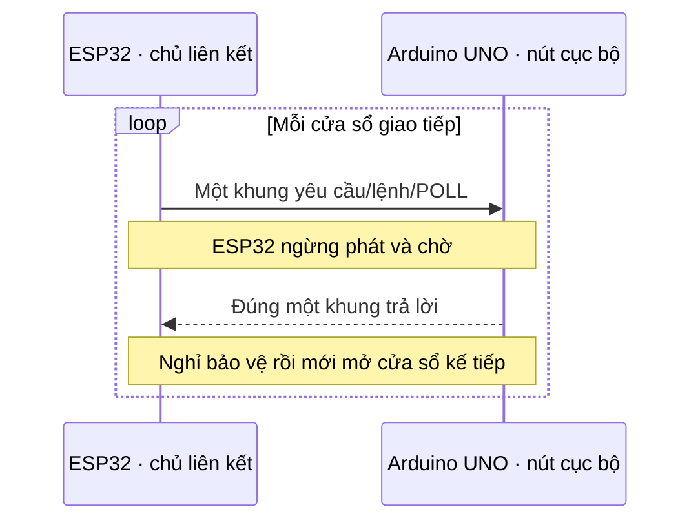
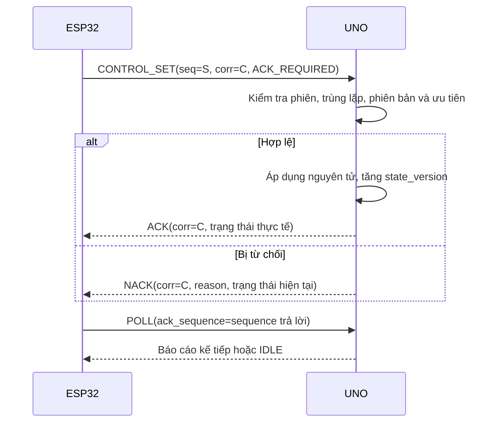
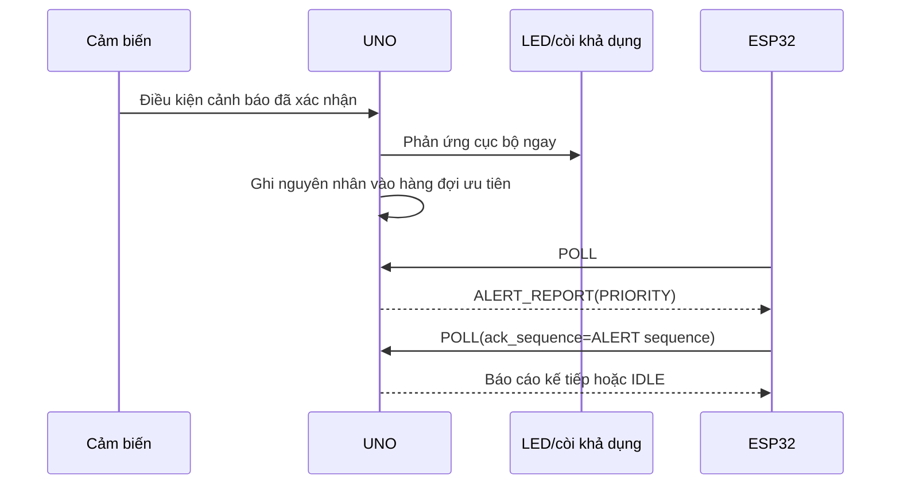

# GIAO THỨC UNO ↔ ESP32 — PHIÊN BẢN 1.0

## 1. Thông tin kiểm soát

| Thuộc tính | Giá trị |
|---|---|
| Tên tài liệu | Thiết kế giao thức nối tiếp Arduino UNO ↔ ESP32 |
| Phiên bản | 1.0 |
| Trạng thái | **ĐÃ DUYỆT — 26/09/2026** |
| Giai đoạn | Giai đoạn 6 — Thiết kế giao tiếp UNO–ESP32 |
| Ngày tạo | 26/09/2026 |
| Đầu vào đã khóa | Đặc tả 1.2, Ma trận kiểm thử 1.2, Danh mục phần cứng 1.2, CR-02, Kiến trúc 1.1, UML 1.1 và Thiết kế phần cứng 1.0 |
| Liên kết vật lý | UNO D10/D11 ↔ ESP32 GPIO17/GPIO16 qua mạch chuyển mức đã duyệt |
| Chưa thuộc tài liệu này | Chủ đề/tải tin MQTT, lược đồ cơ sở dữ liệu, API web, mã firmware và kết quả đo liên kết thực tế |

## 2. Mục tiêu và phạm vi

Giao thức phải:

1. vận chuyển telemetry, trạng thái báo cáo, cấu hình, lệnh, ACK/NACK, sự kiện, cảnh báo, lỗi và dữ liệu đồng bộ;
2. không dùng cấp phát động hoặc JSON trên UNO;
3. có ranh giới khung rõ ràng, tự tái đồng bộ sau byte lỗi và phát hiện hỏng dữ liệu;
4. ngăn lệnh bị thi hành hai lần khi mất ACK hoặc gửi lại;
5. phân biệt khởi động lại UNO, khởi động lại ESP32 và khởi tạo lại phiên liên kết;
6. ưu tiên cảnh báo nhưng không làm logic an toàn/an ninh cục bộ phụ thuộc đường truyền;
7. hoạt động trong giới hạn SRAM 2 KB và bộ đệm nối tiếp phần mềm của Arduino UNO;
8. giữ nguyên ý nghĩa nghiệp vụ, cờ mô phỏng và quy tắc ưu tiên của Đặc tả 1.2.

Giao thức này chỉ bảo vệ tính toàn vẹn và nhất quán trên dây nối nội bộ. CRC không phải cơ chế mã hóa hoặc xác thực người dùng.

## 3. Phương án thiết kế

### 3.1. So sánh phương án

| Phương án | Ưu điểm | Hạn chế | Quyết định |
|---|---|---|---|
| JSON kết thúc bằng dòng mới | Dễ đọc bằng mắt | Tốn SRAM, độ dài biến động, phải escape, khó phục hồi khi dòng hỏng | Không chọn |
| CSV/văn bản + checksum | Dễ xem log, đơn giản hơn JSON | Phụ thuộc định dạng chuỗi, khó mở rộng kiểu nhị phân và enum | Không chọn |
| Khung nhị phân có byte đầu/cuối và escape | Nhỏ gọn | Logic escape và tái đồng bộ dễ sai ở biên | Không chọn |
| **Nhị phân + COBS + CRC-16** | Khung không chứa byte `0x00`, tái đồng bộ chắc chắn, nhỏ, bộ nhớ cố định | Cần công cụ giải mã khi xem log | **Chọn** |

### 3.2. Quyết định chính

| Mã | Quyết định | Lý do/hệ quả |
|---|---|---|
| ADR-06-01 | ESP32 là chủ liên kết; UNO chỉ phát trong cửa sổ trả lời | Tránh hai chiều phát đồng thời khi UNO dùng `SoftwareSerial`. |
| ADR-06-02 | UART `19200 8N1`, không điều khiển luồng phần cứng | Đủ băng thông cho chu kỳ 2 giây nhưng bảo thủ hơn 38400 đối với nối tiếp phần mềm. |
| ADR-06-03 | Khung dùng COBS, kết thúc bằng `0x00` | Một byte lỗi không làm mất ranh giới vô hạn; gặp delimiter kế tiếp là tái đồng bộ. |
| ADR-06-04 | CRC-16/CCITT-FALSE trên header và payload trước COBS | Phát hiện lỗi truyền; không dùng CRC làm bảo mật. |
| ADR-06-05 | Khung giải mã tối đa 60 byte, payload tối đa 42 byte | Khung mã hóa tối đa 62 byte kể cả delimiter, nằm dưới bộ đệm 64 byte. |
| ADR-06-06 | Mọi lệnh là lệnh đặt trạng thái, không có lệnh đảo trạng thái | Gửi lại cùng hoặc khác phiên vẫn không tạo hành vi toggle hai lần. |
| ADR-06-07 | Một thời điểm chỉ có một giao dịch do ESP32 khởi tạo đang chờ trả lời | Đơn giản hóa timeout, ACK và chống tràn bộ đệm UNO. |
| ADR-06-08 | ACK liên kết trong header tách biệt ACK/NACK nghiệp vụ | Nhận đủ byte không đồng nghĩa lệnh đã được chấp nhận hoặc áp dụng. |
| ADR-06-09 | Đồng bộ dùng ảnh chụp nhiều bản tin có cùng mã tương quan | Không cần payload lớn và vẫn kiểm chứng đủ cấu hình/trạng thái/cảnh báo. |
| ADR-06-10 | Dùng số nguyên little-endian và enum số cố định | Không phụ thuộc kiến trúc ép kiểu; firmware phải đọc/ghi từng trường rõ ràng. |

## 4. Mô hình truyền có chủ

Dây TX/RX tồn tại hai chiều nhưng lịch truyền là hỏi–đáp có chủ:



Quy tắc bắt buộc:

- UNO không tự phát khung ngoài cửa sổ trả lời.
- Sự kiện mới được UNO đưa vào hàng đợi ưu tiên và gửi ở lần `POLL` gần nhất; phản ứng LED/còi cục bộ diễn ra ngay, không chờ `POLL`.
- Mỗi khung ESP32 gửi chỉ nhận tối đa một khung UNO trả lời.
- Sau một lệnh, UNO phải trả `ACK` hoặc `NACK`; sự kiện đang chờ được gửi ở lần `POLL` tiếp theo.
- ESP32 không gửi khung mới cho đến khi nhận đủ trả lời, hết timeout hoặc chủ động khởi tạo lại phiên.

## 5. Tham số đường truyền

| Tham số | Giá trị khóa cho 1.0 |
|---|---|
| Tốc độ | `19200 baud` |
| Dữ liệu | 8 bit |
| Parity | Không |
| Stop bit | 1 |
| Thứ tự bit UART | Theo UART chuẩn, bit thấp trước |
| Thứ tự byte số nhiều byte | Little-endian |
| Chân UNO | D10 nhận, D11 phát qua `SoftwareSerial` |
| Chân ESP32 | GPIO16/UART2 RX, GPIO17/UART2 TX |
| Delimiter khung | `0x00` sau dữ liệu COBS |
| Khung giải mã tối đa | 60 byte, gồm header + payload + CRC |
| Payload tối đa | 42 byte |
| Khung trên dây tối đa | 62 byte, gồm dữ liệu COBS + `0x00` |
| Khoảng nghỉ bảo vệ | Tối thiểu 3 ms giữa trả lời và yêu cầu kế tiếp |
| Chu kỳ `POLL` khi sẵn sàng | 200 ms |
| Timeout một trả lời | 150 ms tính từ khi ESP32 phát xong khung |
| Timeout khung đang dở | 200 ms kể từ byte đầu mà chưa gặp `0x00` |
| Số lần gửi | 1 lần đầu + tối đa 2 lần gửi lại cùng khung |

Ở 19200 baud, khung lớn nhất 62 byte cần xấp xỉ 32,3 ms trên dây theo một chiều. Timeout 150 ms dành đủ biên cho nhận, giải mã, xử lý cục bộ ngắn và phát trả lời; giá trị này phải được xác minh ở `G5-LINK-01` và kiểm thử firmware, không được tự ghi là đã đạt.

## 6. Cấu trúc khung

### 6.1. Chuỗi xử lý

Khi phát:

1. tạo header và payload trong bộ đệm giới hạn;
2. tính CRC trên toàn bộ header + payload;
3. nối hai byte CRC;
4. mã hóa COBS;
5. phát dữ liệu đã mã hóa và một byte `0x00`.

Khi nhận:

1. thu đến `0x00` hoặc timeout;
2. từ chối ngay nếu khung mã hóa vượt giới hạn;
3. giải mã COBS;
4. kiểm tra kích thước tối thiểu, `payload_length` và giới hạn 60 byte;
5. kiểm tra CRC;
6. kiểm tra phiên, sequence, loại và schema payload;
7. chỉ sau các bước trên mới chuyển thông điệp cho máy trạng thái nghiệp vụ.

### 6.2. Header giải mã

| Offset | Trường | Kiểu | Kích thước | Ý nghĩa |
|---:|---|---|---:|---|
| 0 | `protocol_version` | `u8` | 1 | `0x10` tương ứng phiên bản dây 1.0. |
| 1 | `message_type` | `u8` | 1 | Loại thông điệp ở Mục 9. |
| 2 | `flags` | `u8` | 1 | Cờ ở Mục 6.3; bit dự phòng phải bằng 0. |
| 3 | `payload_length` | `u8` | 1 | Từ 0 đến 42. |
| 4 | `session_id` | `u32` | 4 | Phiên liên kết; 0 chỉ hợp lệ trong bắt tay trước phiên. |
| 8 | `sequence` | `u16` | 2 | Số thứ tự của bên phát trong phiên; 0 chỉ dùng trước phiên. |
| 10 | `ack_sequence` | `u16` | 2 | Sequence liên tục cao nhất của phía kia đã được nhận hợp lệ ở lớp liên kết. |
| 12 | `correlation_id` | `u32` | 4 | Mã giao dịch; 0 cho báo cáo không gắn giao dịch. |
| 16 | `payload` | byte | 0–42 | Schema phụ thuộc `message_type`. |
| 16 + N | `crc16` | `u16` | 2 | CRC little-endian của byte 0 đến hết payload. |

Tổng kích thước giải mã là `18 + payload_length` và không vượt 60 byte.

### 6.3. Cờ khung

| Bit | Tên | Ý nghĩa |
|---:|---|---|
| 0 | `ACK_REQUIRED` | Cần kết quả nghiệp vụ `ACK`/`NACK`, không chỉ ACK lớp liên kết. |
| 1 | `RESPONSE` | Khung là trả lời cho `correlation_id`. |
| 2 | `ERROR` | Trả lời lỗi hoặc báo cáo chẩn đoán. |
| 3 | `SNAPSHOT` | Khung thuộc ảnh chụp đồng bộ. |
| 4 | `MORE` | Còn khung ảnh chụp sau khung này. |
| 5 | `PRIORITY` | Sự kiện/cảnh báo ưu tiên. |
| 6–7 | Dự phòng | Bắt buộc bằng 0 trong phiên bản 1.0. |

### 6.4. CRC và vector phù hợp

CRC dùng biến thể **CRC-16/CCITT-FALSE**:

- polynomial: `0x1021`;
- giá trị đầu: `0xFFFF`;
- không phản chiếu bit;
- xor cuối: `0x0000`;
- vector chuẩn chuỗi ASCII `123456789` phải cho kết quả `0x29B1`.

CRC được truyền byte thấp trước do quy ước little-endian. Khung sai CRC bị loại hoàn toàn và không được chuyển đến logic nghiệp vụ.

Vector COBS tối thiểu để kiểm thử bộ mã hóa: chuỗi thô `11 22 00 33` phải thành `03 11 22 02 33 00`, trong đó byte cuối là delimiter.

### 6.5. Vector khung đầy đủ

Khung `HELLO_REQUEST` dùng `esp_boot_id=0x12345678`, `correlation_id=1`, protocol 1.0, các trường session/sequence/ACK bằng 0 và payload `78 56 34 12 10 10 00 00` phải cho:

- CRC: `0xD285`, truyền thành `85 D2`;
- dữ liệu thô gồm CRC: `10 01 00 08 00 00 00 00 00 00 00 00 01 00 00 00 78 56 34 12 10 10 00 00 85 D2`;
- dữ liệu trên dây: `03 10 01 02 08 01 01 01 01 01 01 01 02 01 01 01 07 78 56 34 12 10 10 01 03 85 D2 00`.

Vector này là đầu vào bắt buộc cho kiểm thử đơn vị chung của hai firmware; khác một byte phải làm kiểm thử thất bại.

## 7. Phiên, sequence và danh tính sự kiện

### 7.1. Ba phạm vi danh tính

| Trường | Phạm vi | Cách tạo | Mục đích |
|---|---|---|---|
| `link_session_id` | Một lần bắt tay liên kết | ESP32 tạo số ngẫu nhiên 32 bit, không bằng 0 | Tách sequence và khung cũ giữa các lần nối lại. |
| `uno_boot_id` | Một lần UNO khởi động | ESP32 cấp khi UNO báo 0; UNO giữ trong RAM qua lần ESP32 reset | Định danh sự kiện UNO qua nhiều phiên liên kết nhưng trong cùng lần khởi động UNO. |
| `esp_boot_id` | Một lần ESP32 khởi động | ESP32 tạo từ nguồn ngẫu nhiên phần cứng | Chẩn đoán reset và ánh xạ lệnh mạng. |

Nếu UNO khởi động lại, `uno_boot_id` trong RAM trở về 0. Nếu chỉ ESP32 khởi động lại, UNO gửi lại `uno_boot_id` cũ để các sự kiện chưa ACK không bị tạo danh tính mới.

Danh tính sự kiện đầu-cuối do ESP32 tạo từ `device_id + uno_boot_id + local_event_id`. `device_id` không truyền lặp trong mọi khung vì liên kết chỉ có một UNO.

### 7.2. Sequence và ACK lớp liên kết

- Mỗi phía có bộ đếm `sequence` độc lập, bắt đầu từ 1 sau khi phiên được chấp nhận.
- Sau 65535, bộ đếm quay về 1; 0 luôn dành cho trước phiên.
- `ack_sequence` là ACK cộng dồn của khung hợp lệ liên tục gần nhất từ phía kia.
- Khung sai COBS/CRC/độ dài không làm tăng ACK.
- Khung trùng sequence và trùng nội dung được xem là gửi lại; không thi hành lại.
- Cùng sequence nhưng nội dung khác là lỗi giao thức nghiêm trọng và buộc khởi tạo lại phiên.
- So sánh khi quay vòng dùng số học modulo 16 bit và chỉ cho phép cửa sổ nhỏ hơn 32768.
- `HELLO_REQUEST`/`HELLO` trước phiên dùng session, sequence và ACK bằng 0; `HELLO` lặp `correlation_id` và đặt cờ `RESPONSE`.
- `SESSION_START` là khung sequence 1 đầu tiên của ESP32 trong session mới; `SESSION_ACCEPT` là sequence 1 của UNO và ACK sequence 1 của ESP32. Các khung sau tăng từ 2.

### 7.3. Mã tương quan

- ESP32 tạo `correlation_id` khác 0 cho lệnh, cấu hình, bắt tay và yêu cầu snapshot.
- `ACK`/`NACK` và các phần snapshot phải lặp đúng mã này.
- Báo cáo định kỳ không gắn giao dịch dùng 0.
- `correlation_id` chỉ là số giao dịch trên liên kết; ESP32 chịu trách nhiệm ánh xạ nó với mã lệnh đầu-cuối của máy chủ.

### 7.4. Phiên bản cấu hình và trạng thái

- `config_version` do máy chủ cấp đơn điệu trong miền `1..0xFFFFFFFE`; 0 nghĩa là chưa có cấu hình và `0xFFFFFFFF` được dành riêng. Bài tập không tự quay vòng phiên bản; nếu cạn miền phải nâng giao thức/di trú dữ liệu.
- `state_version` do UNO tăng sau mỗi thay đổi nghiệp vụ có ý nghĩa và được hiểu cùng `uno_boot_id`; UNO reset thì trạng thái bắt đầu lại từ 1 sau khi khởi tạo an toàn.
- `CONFIG_SET` cùng phiên bản và cùng nội dung trả `DUPLICATE_OK`; cùng phiên bản nhưng nội dung khác trả `CONFIG_VERSION_CONFLICT` và không áp dụng.
- `CONTROL_SET` không đổi cấu hình phải có `new_config_version=base_config_version`. Lệnh đổi phương thức/hồ sơ, hoặc giao dịch ghép chuyển sang Thủ công/Ở nhà, phải mang phiên bản mới hơn do máy chủ cấp.
- `expected_state_version=0xFFFFFFFF` chỉ được dùng cho thao tác idempotent mà máy chủ chủ động bỏ điều kiện cạnh tranh; không được dùng để vượt kiểm tra an ninh/an toàn.

## 8. Phân biệt ACK liên kết và ACK nghiệp vụ

| Lớp | Dấu hiệu | Khẳng định được | Không khẳng định được |
|---|---|---|---|
| Liên kết | `ack_sequence` trong header | Khung đủ, đúng CRC và đã được parser nhận | Lệnh đã hợp lệ hoặc thiết bị đã đổi trạng thái |
| Nghiệp vụ | Bản tin `ACK` | Lệnh/cấu hình đã được áp dụng; kèm trạng thái thực tế | Trạng thái cơ khí không có cảm biến phản hồi |
| Nghiệp vụ | Bản tin `NACK` | Yêu cầu bị từ chối và lý do cụ thể | Không suy ra kết nối bị mất |
| ESP32 cục bộ | Hết timeout sau gửi lại | Không nhận được kết quả chắc chắn | Không được tự suy đoán lệnh thất bại hay thành công |

Khi timeout, ứng dụng phải nhận trạng thái **Không xác định/Đang đồng bộ lại**, giữ trạng thái báo cáo cuối cùng kèm thời điểm và yêu cầu snapshot trước khi cho phép lệnh xung đột tiếp theo.

## 9. Danh mục loại thông điệp

### 9.1. Liên kết và đồng bộ

| Mã | Tên dây | Chiều | Trả lời | Ý nghĩa |
|---:|---|---|---|---|
| `0x01` | `HELLO_REQUEST` | ESP32 → UNO | `HELLO` | Yêu cầu UNO khai báo sau khi một phía khởi động. |
| `0x02` | `HELLO` | UNO → ESP32 | — | Khai báo firmware, reset, capability và phiên bản đang chạy. |
| `0x03` | `SESSION_START` | ESP32 → UNO | `SESSION_ACCEPT`/`NACK` | Cấp phiên liên kết và `uno_boot_id`. |
| `0x04` | `SESSION_ACCEPT` | UNO → ESP32 | — | Xác nhận phiên và trạng thái phiên bản hiện hành. |
| `0x05` | `POLL` | ESP32 → UNO | Một báo cáo hoặc `IDLE` | Mở cửa sổ cho hàng đợi UNO. |
| `0x06` | `IDLE` | UNO → ESP32 | — | Không có báo cáo ưu tiên; vẫn cung cấp liveness. |
| `0x07` | `SNAPSHOT_REQUEST` | ESP32 → UNO | `ACK`, sau đó nhiều báo cáo | Yêu cầu ảnh chụp nhất quán. |
| `0x08` | `SNAPSHOT_END` | UNO → ESP32 | ACK liên kết | Đánh dấu hoàn tất ảnh chụp. |
| `0x09` | `SYNC_COMPLETE` | ESP32 → UNO | `ACK`/`NACK` | Hai phía thống nhất cấu hình/trạng thái cơ sở. |
| `0x0A` | `ACK` | UNO → ESP32 | — | Kết quả nghiệp vụ thành công hoặc gửi lại đã biết. |
| `0x0B` | `NACK` | UNO → ESP32 | — | Từ chối nghiệp vụ có mã lý do. |
| `0x0C` | `ERROR_REPORT` | Hai chiều | ACK liên kết | Lỗi parser/liên kết/tài nguyên đã giới hạn tần suất. |

### 9.2. Cấu hình và điều khiển

| Mã | Tên dây | Chiều | ACK nghiệp vụ | Ý nghĩa |
|---:|---|---|---|---|
| `0x10` | `CONFIG_SET` | ESP32 → UNO | Bắt buộc | Gửi bản cấu hình đầy đủ, áp dụng nguyên tử. |
| `0x11` | `CONFIG_REPORT` | UNO → ESP32 | Khi thuộc snapshot | Bản cấu hình UNO đang thực sự dùng. |
| `0x20` | `CONTROL_SET` | ESP32 → UNO | Bắt buộc | Đặt thiết bị, phương thức, hồ sơ, khóa mô phỏng hoặc thao tác cảnh báo. |

### 9.3. Báo cáo từ UNO

| Mã | Tên dây | Chiều | Chính sách | Ý nghĩa |
|---:|---|---|---|---|
| `0x30` | `SENSOR_REPORT` | UNO → ESP32 | Định kỳ/best effort; ACK nếu snapshot | LDR, SRF04, MQ-2, lửa và chất lượng. |
| `0x31` | `STATE_REPORT` | UNO → ESP32 | Khi đổi + định kỳ; ACK nếu snapshot | Hồ sơ, phương thức, đầu ra, nguồn và cảnh báo tổng. |
| `0x32` | `EVENT_REPORT` | UNO → ESP32 | Giữ đến ACK liên kết | Sự kiện thay đổi/lỗi/phục hồi cần nhật ký. |
| `0x33` | `ALERT_REPORT` | UNO → ESP32 | Ưu tiên, giữ đến ACK liên kết | Thêm/hết/phục hồi nguyên nhân cảnh báo. |
| `0x34` | `HEALTH_REPORT` | UNO → ESP32 | Khi đổi + định kỳ | Khả dụng cảm biến, còi và bộ đếm lỗi. |

Mã chưa định nghĩa phải nhận `NACK` với lý do `UNSUPPORTED_TYPE` nếu header/correlation còn hợp lệ. Không được tự diễn giải mã mới như mã cũ.

## 10. Schema payload

Tất cả trường `reserved` phải phát bằng 0 và bị từ chối nếu khác 0. Mọi schema dưới đây đều nhỏ hơn 42 byte.

### 10.1. `HELLO_REQUEST` — 8 byte

| Offset | Trường | Kiểu | Ghi chú |
|---:|---|---|---|
| 0 | `esp_boot_id` | `u32` | ID lần khởi động ESP32. |
| 4 | `min_protocol` | `u8` | `0x10`. |
| 5 | `max_protocol` | `u8` | `0x10`. |
| 6 | `reserved` | `u16` | 0. |

Khung này dùng `session_id=0`, `sequence=0` và được UNO chấp nhận ở mọi trạng thái để phục hồi khi ESP32 reset.

### 10.2. `HELLO` — 24 byte

| Offset | Trường | Kiểu | Ghi chú |
|---:|---|---|---|
| 0 | `uno_boot_id` | `u32` | 0 nếu UNO vừa reset; khác 0 nếu chỉ ESP32 reset. |
| 4 | `uptime_ms` | `u32` | `millis()` modulo 32 bit. |
| 8 | `fw_major` | `u8` | Phiên bản firmware UNO. |
| 9 | `fw_minor` | `u8` | Phiên bản firmware UNO. |
| 10 | `fw_patch` | `u8` | Phiên bản firmware UNO. |
| 11 | `reset_cause_bits` | `u8` | Ảnh chụp bit MCUSR; không ép thành một nguyên nhân duy nhất nếu nhiều cờ cùng có. |
| 12 | `capability_bits` | `u32` | Khả năng đã biên dịch/được phép dùng. |
| 16 | `config_version` | `u32` | 0 nếu chưa có cấu hình hợp lệ trong RAM. |
| 20 | `state_version` | `u32` | Phiên bản trạng thái cục bộ hiện hành. |

### 10.3. `SESSION_START` — 16 byte

| Offset | Trường | Kiểu | Ghi chú |
|---:|---|---|---|
| 0 | `uno_boot_id` | `u32` | ESP32 cấp mới hoặc lặp ID UNO đang giữ. |
| 4 | `esp_boot_id` | `u32` | ID lần khởi động ESP32. |
| 8 | `cached_config_version` | `u32` | Phiên bản hợp lệ trong NVS, 0 nếu không có. |
| 12 | `poll_interval_ms` | `u16` | 200 trong 1.0. |
| 14 | `session_flags` | `u16` | Bit 0: ESP32 có cấu hình cache hợp lệ; các bit khác bằng 0. |

`session_id` mới nằm trong header. UNO chỉ chấp nhận nếu `uno_boot_id` phù hợp quy tắc bắt tay.

### 10.4. `SESSION_ACCEPT` — 16 byte

| Offset | Trường | Kiểu | Ghi chú |
|---:|---|---|---|
| 0 | `uno_boot_id` | `u32` | ID đã chấp nhận. |
| 4 | `config_version` | `u32` | Bản UNO đang chạy. |
| 8 | `state_version` | `u32` | Trạng thái UNO. |
| 12 | `capability_bits` | `u32` | Lặp để ESP32 kiểm tra. |

### 10.5. `POLL` và `IDLE`

`POLL` có payload 4 byte:

| Offset | Trường | Kiểu | Ghi chú |
|---:|---|---|---|
| 0 | `request_mask` | `u16` | Bit 0 cho telemetry đến hạn, bit 1 state, bit 2 health; 0 cho ưu tiên mặc định. |
| 2 | `reserved` | `u16` | 0. |

`request_mask` chỉ yêu cầu thêm báo cáo định kỳ; nó không được phép che hoặc trì hoãn ACK/NACK, cảnh báo, sự kiện hay phần snapshot đang chờ.

`IDLE` có payload 12 byte:

| Offset | Trường | Kiểu | Ghi chú |
|---:|---|---|---|
| 0 | `uptime_ms` | `u32` | Liveness UNO. |
| 4 | `state_version` | `u32` | Phát hiện thay đổi chưa được báo. |
| 8 | `queue_depth` | `u8` | Số báo cáo đang chờ. |
| 9 | `health_summary` | `u8` | Tóm tắt suy giảm. |
| 10 | `rx_error_count` | `u16` | Bộ đếm bão hòa từ đầu lần khởi động. |

### 10.6. `SNAPSHOT_REQUEST` và `SYNC_COMPLETE`

`SNAPSHOT_REQUEST` có payload 4 byte:

| Offset | Trường | Kiểu | Ghi chú |
|---:|---|---|---|
| 0 | `snapshot_mask` | `u16` | Bit 0 cấu hình, 1 trạng thái, 2 cảm biến, 3 cảnh báo, 4 health; đồng bộ đầy đủ dùng `0x001F`. |
| 2 | `reserved` | `u16` | 0. |

`SYNC_COMPLETE` có payload 8 byte:

| Offset | Trường | Kiểu | Ghi chú |
|---:|---|---|---|
| 0 | `config_version` | `u32` | Phiên bản hai phía vừa thống nhất. |
| 4 | `state_version` | `u32` | Phiên bản trạng thái từ snapshot hoàn tất. |

UNO chỉ ACK `SYNC_COMPLETE` nếu hai phiên bản khớp ảnh chụp cuối và không có thay đổi chưa báo; nếu không, trả `NACK` với lý do `SNAPSHOT_CHANGED`.

### 10.7. `CONFIG_SET`/`CONFIG_REPORT` — 24 byte

| Offset | Trường | Kiểu | Ràng buộc |
|---:|---|---|---|
| 0 | `config_version` | `u32` | Khác 0; mới hơn bản hiện hành hoặc bằng bản hiện hành với nội dung giống hệt. |
| 4 | `field_mask` | `u16` | 1.0 yêu cầu đủ các bit bắt buộc; không áp dụng từng phần. |
| 6 | `light_on_pct` | `u8` | 0–80. |
| 7 | `light_off_pct` | `u8` | 20–100 và cao hơn bật ít nhất 5. |
| 8 | `control_mode` | `u8` | `AUTO` hoặc `MANUAL`. |
| 9 | `room_profile` | `u8` | `HOME`, `AWAY`, `NIGHT`. |
| 10 | `light_adc_dark` | `u16` | Mốc tối 0–1023 sau đo; phải nhỏ hơn mốc sáng theo mạch 1.0. |
| 12 | `light_adc_bright` | `u16` | Mốc sáng 0–1023; cách mốc tối đủ lớn theo quy trình hiệu chỉnh. |
| 14 | `mq2_baseline_adc` | `u16` | Mốc nền sau làm nóng/ổn định; không phải ppm. |
| 16 | `mq2_span_adc` | `u16` | Khoảng ADC dùng chuẩn hóa tương đối; phải khác 0 và không làm vượt 0–1023. |
| 18 | `mq2_threshold_pct` | `u8` | 0–100; chỉ hợp lệ khi cờ hiệu chuẩn bật và nằm trong giới hạn Giai đoạn 19 xác nhận. |
| 19 | `config_flags` | `u8` | Bit 0 MQ-2 đã hiệu chỉnh; bit 1 vùng SRF04 đã hiệu chỉnh; bit 2 LDR đã hiệu chỉnh; các bit khác bằng 0. |
| 20 | `door_threshold_mm` | `u16` | Ngưỡng vùng SRF04 sau hiệu chỉnh, không suy ra cửa mở/đóng. |
| 22 | `door_confirm_samples` | `u8` | 1–10 mẫu liên tiếp. |
| 23 | `reserved` | `u8` | 0. |

UNO kiểm tra toàn bộ trước, tạo bản tạm, sau đó hoán đổi nguyên tử. Một lỗi làm `NACK` toàn bộ và giữ cấu hình cũ.

Quy tắc hiệu chỉnh:

- khi cờ LDR bằng 1, hai mốc ADC phải hợp lệ, khác nhau và đúng chiều mạch; khi bằng 0, mức phần trăm/TD-02 phải ở trạng thái chưa sẵn sàng;
- khi cờ MQ-2 bằng 1, baseline/span/ngưỡng phải nằm trong miền đã khóa sau phép đo; khi bằng 0, không được kết luận Bình thường hoặc dùng ngưỡng để phát hiện;
- khi cờ SRF04 bằng 1, ngưỡng và số mẫu xác nhận phải hợp lệ; khi bằng 0, vùng an ninh phải báo Suy giảm thay vì giả là đang bảo vệ;
- cờ hiệu chỉnh không phải nút vô hiệu hóa an toàn; nó chỉ phản ánh việc chưa đủ dữ liệu kỹ thuật để đưa nhánh vào trạng thái sẵn sàng.

### 10.8. `CONTROL_SET` — 16 byte

| Offset | Trường | Kiểu | Ý nghĩa |
|---:|---|---|---|
| 0 | `expected_state_version` | `u32` | Phát hiện lệnh dựa trên trạng thái cũ; `0xFFFFFFFF` chỉ dùng khi không yêu cầu điều kiện. |
| 4 | `base_config_version` | `u32` | Phiên bản phía gửi đã dựa vào. |
| 8 | `new_config_version` | `u32` | Bằng base nếu không đổi cấu hình; lớn hơn base nếu lệnh đổi hồ sơ/phương thức bền vững. |
| 12 | `opcode` | `u8` | Loại thao tác ở bảng dưới. |
| 13 | `target` | `u8` | Đèn, quạt mô phỏng, khóa mô phỏng hoặc toàn hệ thống. |
| 14 | `value` | `u8` | Giá trị đích; không có thao tác toggle. |
| 15 | `options` | `u8` | Xác nhận/ghép giao dịch; bit dự phòng bằng 0. |

| `opcode` | Giá trị | `target/value` | Quy tắc phiên bản |
|---|---:|---|---|
| `SET_DEVICE` | 1 | Đèn hoặc quạt mô phỏng; Tắt/Bật | Nếu xác nhận chuyển từ Tự động sang Thủ công, `new_config_version` phải mới hơn. |
| `SET_CONTROL_MODE` | 2 | Toàn hệ thống; Tự động/Thủ công | Bắt buộc phiên bản cấu hình mới. |
| `SET_ROOM_PROFILE` | 3 | Toàn hệ thống; Ở nhà/Ra ngoài/Ban đêm | Bắt buộc phiên bản cấu hình mới và áp dụng hành động hồ sơ nguyên tử. |
| `SET_LOCK` | 4 | Khóa mô phỏng; Khóa/Mở | Không đổi phiên bản, trừ giao dịch Mở + chuyển Ở nhà. |
| `ALERT_ACTION` | 5 | Cảnh báo; Tắt tiếng/Xác nhận | Không thay đổi cấu hình. |

`options`:

- bit 0 `USER_CONFIRMED`: người dùng đã xác nhận thao tác nhạy cảm;
- bit 1 `FORCE_MANUAL`: giao dịch đặt Thủ công và thiết bị trong một lần nguyên tử;
- bit 2 `TRANSITION_HOME`: giao dịch mở khóa đồng thời chuyển về Ở nhà;
- bit 3–7: 0.

UNO vẫn tự kiểm tra ưu tiên; cờ xác nhận không được vượt bảo vệ điện hoặc chặn mở do cảnh báo an ninh.

### 10.9. `ACK`/`NACK` — 24 byte

| Offset | Trường | Kiểu | Ý nghĩa |
|---:|---|---|---|
| 0 | `request_type` | `u8` | Loại yêu cầu gốc. |
| 1 | `opcode` | `u8` | 0 nếu không phải `CONTROL_SET`. |
| 2 | `result` | `u8` | `APPLIED`, `DUPLICATE_OK` hoặc `REJECTED`. |
| 3 | `reserved0` | `u8` | 0. |
| 4 | `reason_code` | `u16` | 0 khi thành công. |
| 6 | `reserved1` | `u16` | 0. |
| 8 | `config_version` | `u32` | Bản thực tế sau xử lý. |
| 12 | `state_version` | `u32` | Trạng thái thực tế sau xử lý. |
| 16 | `room_profile` | `u8` | Trạng thái thực tế. |
| 17 | `control_mode` | `u8` | Trạng thái thực tế. |
| 18 | `output_bits` | `u8` | Trạng thái đầu ra. |
| 19 | `lamp_source` | `u8` | Nguồn điều khiển đèn. |
| 20 | `fan_source` | `u8` | Nguồn điều khiển quạt mô phỏng. |
| 21 | `lock_command` | `u8` | Trạng thái lệnh khóa mô phỏng. |
| 22 | `actuator_flags` | `u8` | Cờ thật/mô phỏng/xác minh/còi khả dụng. |
| 23 | `alert_state` | `u8` | Vòng đời cảnh báo hiện hành. |

ACK phải phản ánh trạng thái **sau** khi áp dụng. NACK phản ánh trạng thái không đổi hoặc trạng thái an toàn thực tế nếu bảo vệ điện đã can thiệp.

### 10.10. `SENSOR_REPORT` — 24 byte

| Offset | Trường | Kiểu | Ý nghĩa |
|---:|---|---|---|
| 0 | `uptime_ms` | `u32` | Thời điểm cục bộ. |
| 4 | `light_adc` | `u16` | ADC thô 0–1023. |
| 6 | `light_pct` | `u8` | 0–100. |
| 7 | `light_quality` | `u8` | Hợp lệ/Cũ/Không hợp lệ. |
| 8 | `distance_mm` | `u16` | `0xFFFF` nếu không hợp lệ. |
| 10 | `door_zone_state` | `u8` | Trống/Phát hiện/Không xác định. |
| 11 | `door_zone_quality` | `u8` | Chất lượng SRF04. |
| 12 | `mq2_adc` | `u16` | ADC thô; không phải ppm. |
| 14 | `mq2_pct` | `u8` | Mức tương đối 0–100. |
| 15 | `mq2_state` | `u8` | Làm nóng/Bình thường/Cảnh báo/Lỗi. |
| 16 | `mq2_quality` | `u8` | Chất lượng dữ liệu. |
| 17 | `flame_raw` | `u8` | Mức số đã chuẩn hóa 0/1. |
| 18 | `flame_state` | `u8` | Bình thường/Cảnh báo/Lỗi. |
| 19 | `flame_quality` | `u8` | Chất lượng dữ liệu. |
| 20 | `sample_counter` | `u16` | Số mẫu modulo 65536. |
| 22 | `sensor_flags` | `u16` | Làm nóng/hiệu chỉnh/suy giảm; bit dự phòng 0. |

ESP32 gắn thời gian tuyệt đối nếu có. Nó không được thay `uptime_ms` bằng thời gian nhận một cách im lặng.

### 10.11. `STATE_REPORT` — 24 byte

| Offset | Trường | Kiểu | Ý nghĩa |
|---:|---|---|---|
| 0 | `uptime_ms` | `u32` | Thời điểm cục bộ. |
| 4 | `state_version` | `u32` | Tăng khi trạng thái có ý nghĩa thay đổi. |
| 8 | `config_version` | `u32` | Cấu hình UNO đang dùng. |
| 12 | `room_profile` | `u8` | Ở nhà/Ra ngoài/Ban đêm. |
| 13 | `control_mode` | `u8` | Tự động/Thủ công. |
| 14 | `output_bits` | `u8` | Đèn, quạt mô phỏng, LED khóa, LED cảnh báo, còi. |
| 15 | `lamp_source` | `u8` | Nguồn điều khiển đèn. |
| 16 | `fan_source` | `u8` | Nguồn điều khiển quạt mô phỏng. |
| 17 | `lock_command` | `u8` | Lệnh khóa mô phỏng. |
| 18 | `actuator_flags` | `u8` | Cờ cơ cấu và khả dụng. |
| 19 | `zone_armed` | `u8` | Vùng SRF04 có được trang bị hay không. |
| 20 | `alert_state` | `u8` | Vòng đời cảnh báo tổng. |
| 21 | `active_alert_count` | `u8` | Số nguyên nhân đang giữ. |
| 22 | `health_flags` | `u16` | Tóm tắt cảm biến/nguồn/hàng đợi. |

### 10.12. `EVENT_REPORT` — 20 byte

| Offset | Trường | Kiểu | Ý nghĩa |
|---:|---|---|---|
| 0 | `local_event_id` | `u32` | Tăng trong một `uno_boot_id`. |
| 4 | `uptime_ms` | `u32` | Thời điểm cục bộ. |
| 8 | `state_version` | `u32` | Trạng thái liên quan. |
| 12 | `event_type` | `u8` | Loại sự kiện chuẩn. |
| 13 | `severity` | `u8` | Thông tin/Chú ý/Cảnh báo/Nghiêm trọng. |
| 14 | `source` | `u8` | Dùng enum `alert_source` để chỉ thành phần phát sinh. |
| 15 | `event_flags` | `u8` | Phục hồi/gửi bù/tràn; bit dự phòng 0. |
| 16 | `reason_code` | `u16` | Mã lý do hoặc lỗi. |
| 18 | `detail_value` | `u16` | Giá trị chẩn đoán có đơn vị theo `event_type`. |

### 10.13. `ALERT_REPORT` — 20 byte

| Offset | Trường | Kiểu | Ý nghĩa |
|---:|---|---|---|
| 0 | `cause_id` | `u32` | Duy nhất trong `uno_boot_id`. |
| 4 | `uptime_ms` | `u32` | Thời điểm chuyển trạng thái. |
| 8 | `operation` | `u8` | Thêm/Hết/Tái kích hoạt/Phục hồi ảnh chụp. |
| 9 | `alert_type` | `u8` | An toàn/An ninh/Hệ thống. |
| 10 | `severity` | `u8` | Mức độ. |
| 11 | `source` | `u8` | Enum `alert_source`. |
| 12 | `lifecycle_state` | `u8` | Bình thường/Đang kêu/Đã tắt tiếng/Chờ xác nhận. |
| 13 | `active` | `u8` | 0/1. |
| 14 | `reason_code` | `u16` | Mã nguyên nhân. |
| 16 | `detail_value` | `u16` | ADC/khoảng cách/mã chẩn đoán theo nguồn. |
| 18 | `alert_flags` | `u16` | Còi khả dụng, khôi phục, ảnh chụp; bit dự phòng 0. |

### 10.14. `HEALTH_REPORT` — 16 byte

| Offset | Trường | Kiểu | Ý nghĩa |
|---:|---|---|---|
| 0 | `uptime_ms` | `u32` | Thời điểm cục bộ. |
| 4 | `health_flags` | `u32` | Khả dụng cảm biến/đầu ra/cấu hình. |
| 8 | `rx_crc_errors` | `u16` | Bộ đếm bão hòa. |
| 10 | `rx_frame_errors` | `u16` | COBS/độ dài/schema. |
| 12 | `queue_overflows` | `u16` | Tràn hàng đợi từ đầu boot. |
| 14 | `last_error` | `u16` | Mã lỗi gần nhất. |

### 10.15. `ERROR_REPORT` — 12 byte

| Offset | Trường | Kiểu | Ý nghĩa |
|---:|---|---|---|
| 0 | `uptime_ms` | `u32` | Thời điểm cục bộ phía báo lỗi. |
| 4 | `error_code` | `u16` | Mã lỗi Mục 12. |
| 6 | `offending_type` | `u8` | Loại khung gây lỗi; 0 nếu không xác định. |
| 7 | `error_flags` | `u8` | Bit 0 lỗi lặp; bit 1 đã làm phiên Suy giảm; các bit khác bằng 0. |
| 8 | `offending_sequence` | `u16` | Sequence liên quan; 0 nếu không đọc được. |
| 10 | `detail` | `u16` | Độ dài nhận, số byte hoặc dữ liệu chẩn đoán theo lỗi. |

`ERROR_REPORT` chỉ được gửi trong cửa sổ hợp lệ: UNO xếp hàng để trả `POLL`; ESP32 gửi nó như một yêu cầu chủ và UNO trả `IDLE` hoặc báo cáo kế tiếp có ACK lớp liên kết.

### 10.16. `SNAPSHOT_END` — 12 byte

| Offset | Trường | Kiểu | Ý nghĩa |
|---:|---|---|---|
| 0 | `config_version` | `u32` | Phiên bản tại cuối ảnh chụp. |
| 4 | `state_version` | `u32` | Phiên bản tại cuối ảnh chụp. |
| 8 | `report_count` | `u8` | Số báo cáo đã gửi trong ảnh chụp. |
| 9 | `active_alert_count` | `u8` | Số nguyên nhân được liệt kê. |
| 10 | `snapshot_flags` | `u16` | Bit 0: ảnh nhất quán; bit 1: có thay đổi trong lúc chụp. |

Nếu trạng thái đổi trong khi tạo snapshot, UNO đặt bit “có thay đổi”; ESP32 phải yêu cầu lại thay vì ghép thành ảnh giả nhất quán.

## 11. Enum và bit chuẩn trên dây

### 11.1. Enum nghiệp vụ

| Kiểu | Giá trị số |
|---|---|
| `data_quality` | 0 Hợp lệ; 1 Cũ; 2 Không hợp lệ |
| `control_mode` | 0 Tự động; 1 Thủ công |
| `room_profile` | 0 Ở nhà; 1 Ra ngoài; 2 Ban đêm |
| `safety_state` | 0 Làm nóng; 1 Bình thường; 2 Cảnh báo; 3 Lỗi cảm biến |
| `alert_type` | 0 An toàn; 1 An ninh; 2 Hệ thống |
| `severity` | 0 Thông tin; 1 Chú ý; 2 Cảnh báo; 3 Nghiêm trọng |
| `door_zone_state` | 0 Trống; 1 Phát hiện đối tượng; 2 Không xác định |
| `lock_command` | 0 Khóa; 1 Mở; 2 Không xác định |
| `alert_state` | 0 Bình thường; 1 Đang kêu; 2 Đã tắt tiếng; 3 Chờ xác nhận |
| `control_source` | 0 Bảo vệ điện; 1 An toàn; 2 An ninh; 3 Hồ sơ phòng; 4 Thủ công; 5 Tự động |
| `result` | 0 Áp dụng; 1 Thành công do bản trùng; 2 Từ chối |
| `alert_operation` | 0 Thêm; 1 Nguyên nhân đã hết; 2 Tái kích hoạt; 3 Khôi phục từ snapshot |
| `alert_source` | 0 MQ-2; 1 Cảm biến lửa; 2 Vùng cửa SRF04; 3 Cảm biến ánh sáng; 4 Liên kết; 5 Bảo vệ điện; 6 Hệ thống; 7 MR-01 |
| `alert_action` | 0 Tắt tiếng; 1 Xác nhận |

Giá trị ngoài bảng là không hợp lệ; không được ép về giá trị gần nhất.

### 11.2. `capability_bits`

| Bit | Khả năng |
|---:|---|
| 0 | LDR |
| 1 | SRF04 |
| 2 | MQ-2 |
| 3 | Cảm biến lửa |
| 4 | LED cảnh báo |
| 5 | Còi đã được phép nối sau cổng Giai đoạn 5 |
| 6 | LED đèn thật |
| 7 | LED quạt mô phỏng |
| 8 | LED khóa mô phỏng |
| 9 | Nút Tắt tiếng cục bộ |
| 10 | Cảm biến/thiết bị MR-01 tùy chọn |

Bit còi bằng 0 không vô hiệu hóa cảnh báo; chỉ cho biết không có đầu ra âm thanh vật lý.

### 11.3. `actuator_flags`

| Bit | Ý nghĩa |
|---:|---|
| 0 | Đèn là phần cứng thật |
| 1 | Quạt là mô phỏng |
| 2 | Khóa là mô phỏng |
| 3 | Có xác minh cơ khí khóa — luôn 0 ở bản 1.2 |
| 4 | Còi vật lý khả dụng |
| 5–7 | 0 |

### 11.4. `output_bits`

| Bit | Ý nghĩa khi bằng 1 |
|---:|---|
| 0 | LED đèn bật |
| 1 | LED quạt mô phỏng bật |
| 2 | LED khóa mô phỏng biểu diễn Khóa |
| 3 | LED cảnh báo bật |
| 4 | Còi đang được kích — chỉ có ý nghĩa khi còi khả dụng |
| 5 | Vùng SRF04 đang trang bị |
| 6–7 | 0 |

### 11.5. Mã đích và giá trị của `CONTROL_SET`

| Trường | Giá trị |
|---|---|
| `target` | 0 Toàn hệ thống; 1 Đèn; 2 Quạt mô phỏng; 3 Khóa mô phỏng; 4 Cảnh báo |
| `SET_DEVICE.value` | 0 Tắt; 1 Bật |
| `SET_CONTROL_MODE.value` | Theo enum `control_mode` |
| `SET_ROOM_PROFILE.value` | Theo enum `room_profile` |
| `SET_LOCK.value` | Theo enum `lock_command`; không nhận Không xác định làm lệnh đặt |
| `ALERT_ACTION.value` | Theo enum `alert_action` |

### 11.6. Các mask và cờ payload

`field_mask` của `CONFIG_SET/REPORT`:

| Bit | Nhóm trường |
|---:|---|
| 0 | Ngưỡng đèn |
| 1 | Phương thức tiện nghi |
| 2 | Trạng thái phòng |
| 3 | Hiệu chỉnh LDR |
| 4 | Ngưỡng/hiệu chỉnh MQ-2 |
| 5 | Hiệu chỉnh vùng SRF04 |
| 6–15 | 0 |

Phiên bản 1.0 chỉ chấp nhận bản đầy đủ có `field_mask=0x003F`; không áp dụng cấu hình từng phần.

`sensor_flags`:

| Bit | Ý nghĩa |
|---:|---|
| 0 | MQ-2 đang làm nóng |
| 1 | MQ-2 đã hiệu chỉnh/ngưỡng hợp lệ |
| 2 | LDR đã hiệu chỉnh mốc tương đối |
| 3 | Vùng SRF04 đã hiệu chỉnh |
| 4 | Cực tính cảm biến lửa đã xác định |
| 5 | Có ít nhất một cảm biến suy giảm |
| 6–15 | 0 |

`health_flags` dùng cùng ánh xạ ở `STATE_REPORT` và `HEALTH_REPORT`; bản 16 bit chỉ chứa các bit 0–15:

| Bit | Ý nghĩa |
|---:|---|
| 0 | Cấu hình đang chạy hợp lệ |
| 1 | LDR khả dụng |
| 2 | SRF04 khả dụng |
| 3 | MQ-2 hiện diện/được phép cấp |
| 4 | MQ-2 đã sẵn sàng sau làm nóng |
| 5 | Cảm biến lửa khả dụng |
| 6 | LED cảnh báo khả dụng |
| 7 | Còi vật lý khả dụng |
| 8 | Nút Tắt tiếng cục bộ khả dụng |
| 9 | Đã xảy ra tràn hàng đợi trong boot hiện tại |
| 10 | Bảo vệ điện đang chặn một nhánh |
| 11 | Liên kết đang suy giảm theo UNO |
| 12 | MR-01 khả dụng |
| 13–31 | 0 |

`event_flags`:

| Bit | Ý nghĩa |
|---:|---|
| 0 | Đây là sự kiện phục hồi |
| 1 | Được gửi bù sau khi liên kết phục hồi |
| 2 | Liên quan tràn hàng đợi |
| 3 | Phát sinh từ thao tác cục bộ |
| 4–7 | 0 |

`alert_flags`:

| Bit | Ý nghĩa |
|---:|---|
| 0 | Còi vật lý khả dụng |
| 1 | Còi đang được kích |
| 2 | Bản ghi được khôi phục trong snapshot |
| 3 | Nguyên nhân là suy giảm cảm biến/hệ thống, không phải phát hiện nguy cơ |
| 4–15 | 0 |

`event_type`:

| Giá trị | Tên |
|---:|---|
| 0 | Khởi động |
| 1 | Lỗi cảm biến |
| 2 | Cảm biến phục hồi |
| 3 | Đầu ra thay đổi |
| 4 | Trạng thái phòng thay đổi |
| 5 | Phương thức thay đổi |
| 6 | Cấu hình được áp dụng |
| 7 | Cấu hình bị từ chối |
| 8 | Liên kết suy giảm/phục hồi |
| 9 | Tràn hàng đợi |
| 10 | Tắt tiếng cục bộ |
| 11 | Cảnh báo được xác nhận |
| 12 | Bảo vệ điện thay đổi |

Giá trị chi tiết phụ thuộc `event_type` phải được định nghĩa bằng hằng số chung trong firmware UNO/ESP32; không truyền chuỗi tùy ý.

## 12. Mã lỗi và lý do NACK

| Mã | Tên | Nhóm | Có thể thử lại |
|---:|---|---|---|
| `0x0000` | `OK` | Thành công | Không cần |
| `0x0101` | `UNSUPPORTED_VERSION` | Giao thức | Không trước khi nâng phiên bản |
| `0x0102` | `UNSUPPORTED_TYPE` | Giao thức | Không |
| `0x0103` | `INVALID_LENGTH` | Giao thức | Chỉ sau khi sửa khung |
| `0x0104` | `INVALID_ENUM` | Payload | Chỉ sau khi sửa dữ liệu |
| `0x0105` | `INVALID_RESERVED_BITS` | Payload | Chỉ sau khi sửa dữ liệu |
| `0x0106` | `CRC_ERROR` | Liên kết | Tự gửi lại do timeout; thường không có NACK |
| `0x0107` | `FRAME_TOO_LARGE` | Liên kết | Không với cùng dữ liệu |
| `0x0201` | `SESSION_NOT_READY` | Phiên | Có, sau bắt tay |
| `0x0202` | `SESSION_MISMATCH` | Phiên | Có, sau bắt tay lại |
| `0x0203` | `SEQUENCE_CONFLICT` | Phiên | Bắt tay lại |
| `0x0204` | `CORRELATION_REUSE_CONFLICT` | Chống lặp | Không với ID đó |
| `0x0205` | `BUSY` | Tài nguyên | Có, theo backoff |
| `0x0301` | `VALUE_OUT_OF_RANGE` | Cấu hình | Sau sửa dữ liệu |
| `0x0302` | `CONFIG_RELATION_INVALID` | Cấu hình | Sau sửa vùng trễ/quan hệ |
| `0x0303` | `STALE_CONFIG_VERSION` | Cấu hình | Sau đồng bộ |
| `0x0304` | `STALE_STATE_VERSION` | Lệnh | Sau snapshot |
| `0x0305` | `CONFIG_VERSION_CONFLICT` | Cấu hình | Chỉ sau hòa giải với nguồn chính thức |
| `0x0401` | `ROOM_PROFILE_BLOCK` | Nghiệp vụ | Sau đổi hồ sơ hợp lệ |
| `0x0402` | `MANUAL_CONFIRM_REQUIRED` | Nghiệp vụ | Sau xác nhận |
| `0x0403` | `SECURITY_BLOCK` | Nghiệp vụ | Sau hết/xác nhận cảnh báo an ninh |
| `0x0404` | `ALERT_CAUSE_ACTIVE` | Nghiệp vụ | Sau khi mọi nguyên nhân hết |
| `0x0405` | `SENSOR_INVALID` | Nghiệp vụ | Sau cảm biến phục hồi |
| `0x0406` | `POWER_PROTECTION_ACTIVE` | An toàn điện | Chỉ sau khi nguyên nhân điện hết |
| `0x0501` | `APPLY_FAILED` | Nội bộ UNO | Có thể sau đồng bộ/chẩn đoán |
| `0x0502` | `QUEUE_FULL` | Tài nguyên | Có sau khi hàng đợi giảm |
| `0x0503` | `SNAPSHOT_CHANGED` | Đồng bộ | Yêu cầu snapshot lại |
| `0x0601` | `LINK_TIMEOUT` | ESP32 suy ra cục bộ | Có sau phục hồi; không phải NACK từ UNO |

Lỗi parse không có header tin cậy chỉ tăng bộ đếm và bị loại; không phát NACK mù vì có thể tạo bão lỗi.

## 13. Lập lịch và hàng đợi UNO

Khi nhận `POLL`, UNO chọn đúng một phản hồi theo thứ tự:

1. khung trả lời gửi lại đang chờ ACK liên kết;
2. cảnh báo an toàn mới/thay đổi;
3. cảnh báo an ninh mới/thay đổi;
4. sự kiện hệ thống/lỗi/phục hồi;
5. phần tiếp theo của snapshot;
6. trạng thái đã thay đổi;
7. telemetry đến hạn;
8. health đến hạn;
9. `IDLE`.

Giới hạn bộ nhớ UNO:

| Tài nguyên | Giới hạn thiết kế |
|---|---:|
| Bộ đệm khung mã hóa nhận | 64 byte |
| Bộ đệm khung giải mã | 60 byte |
| Bộ đệm phát thô/mã hóa | Tối đa 60/62 byte, tĩnh |
| Cache chống lặp lệnh | 4 kết quả giao dịch gần nhất |
| Hàng đợi sự kiện/cảnh báo chưa ACK | 4 mục cố định |
| Nguyên nhân cảnh báo hoạt động | Tối đa 6 mục cố định |
| Ngân sách RAM mục tiêu cho lớp giao thức | Không quá 700 byte, chưa tính bộ đệm nội bộ thư viện nối tiếp |

Khi hàng đợi đầy:

- không loại nguyên nhân cảnh báo đang hoạt động;
- ưu tiên An toàn → An ninh → Hệ thống;
- gộp chuyển trạng thái lặp của cùng `cause_id`;
- tăng `queue_overflows`, đặt cờ suy giảm và tạo sự kiện tràn khi có chỗ;
- telemetry định kỳ được phép bỏ mẫu; không dựng lại dữ liệu đã mất.

## 14. Gửi lại, chống lặp và timeout

### 14.1. ESP32 gửi yêu cầu

1. ESP32 phát một khung và giữ nguyên toàn bộ byte, sequence và correlation.
2. Nếu không nhận trả lời hợp lệ trong 150 ms, gửi lại đúng khung đó.
3. Tối đa hai lần gửi lại, tổng ba lần.
4. Sau ba lần thất bại, đánh dấu liên kết Suy giảm, kết quả lệnh Không xác định và không gửi lệnh xung đột mới.
5. ESP32 tiếp tục `HELLO_REQUEST`/phục hồi; khi có phiên mới phải lấy snapshot trước khi kết luận trạng thái.

Khi chưa có session, ESP32 gửi `HELLO_REQUEST` mỗi 1 giây; không phát dồn khung nếu UNO im lặng.

### 14.2. UNO chống thực hiện lặp

- Cache khóa bởi `session_id + correlation_id + request_type` và hash payload.
- Yêu cầu trùng hoàn toàn trả lại kết quả cũ với `result=DUPLICATE_OK` mà không tác động đầu ra lần nữa.
- Cùng correlation nhưng payload khác trả `CORRELATION_REUSE_CONFLICT`.
- `CONFIG_SET` còn được bảo vệ bằng `config_version`.
- Mọi lệnh đặt trạng thái là idempotent; không tồn tại `TOGGLE`.

### 14.3. Báo cáo UNO → ESP32

- Telemetry định kỳ không giữ để gửi lại ngoài snapshot; mất khung tạo khoảng trống trung thực.
- `EVENT_REPORT`, `ALERT_REPORT` và các phần snapshot được giữ đến khi sequence của chúng xuất hiện trong `ack_sequence` từ ESP32.
- ESP32 chỉ ACK một sự kiện quan trọng sau khi đã nhận hợp lệ và đưa vào hàng đợi xử lý tương ứng; chính sách bền vững mạng/MQTT thuộc Giai đoạn 7.
- Nếu ESP32 reset nhưng UNO không reset, sự kiện chưa ACK được gửi lại với cùng `uno_boot_id + local_event_id` trong phiên liên kết mới.

## 15. Trạng thái liên kết

| Trạng thái | Điều kiện | Hành vi |
|---|---|---|
| `NO_SESSION` | Chưa bắt tay hoặc phiên bị hủy | UNO chỉ nhận `HELLO_REQUEST`; logic cục bộ vẫn chạy. |
| `SYNCING` | Có phiên nhưng cấu hình/snapshot chưa thống nhất | Không nhận lệnh người dùng mới; cho phép cấu hình, snapshot và cảnh báo. |
| `READY` | `SYNC_COMPLETE` đã ACK | Cho phép đầy đủ lệnh hợp lệ. |
| `DEGRADED` | 3 giao dịch liên tiếp timeout hoặc lỗi CRC/frame vượt ngưỡng | Dừng lệnh mới, duy trì poll/phục hồi và báo suy giảm. |
| `OFFLINE` | 15 cửa sổ liên tiếp không có trả lời, xấp xỉ 3 giây | Khởi tạo lại bằng `HELLO_REQUEST`; ứng dụng không được coi trạng thái cũ là hiện tại. |

Một phản hồi hợp lệ không tự đưa `DEGRADED` về `READY`; phải hoàn tất bắt tay/snapshot nếu có lệnh không xác định hoặc sequence xung đột.

## 16. Khởi động và đồng bộ

### 16.1. UNO khởi động hoặc reset

```mermaid
sequenceDiagram
    participant E as ESP32
    participant U as UNO

    Note over U: Đầu ra an toàn; uno_boot_id=0
    E->>U: HELLO_REQUEST · session=0
    U-->>E: HELLO · uno_boot_id=0
    E->>E: Tạo uno_boot_id và link_session_id
    E->>U: SESSION_START
    U-->>E: SESSION_ACCEPT
    alt ESP32 có cấu hình hợp lệ
        E->>U: CONFIG_SET đầy đủ
        U-->>E: ACK + phiên bản/trạng thái thật
    else Không có cấu hình hợp lệ
        Note over E,U: Giữ đầu ra an toàn và báo Suy giảm
    end
    E->>U: SNAPSHOT_REQUEST
    U-->>E: ACK
    loop Các lần POLL
        E->>U: POLL
        U-->>E: CONFIG/STATE/SENSOR/ALERT/SNAPSHOT_END
    end
    E->>U: SYNC_COMPLETE
    U-->>E: ACK
    Note over E,U: READY
```

UNO không chạy tự động đèn cho đến khi có cấu hình hợp lệ và mức sáng hợp lệ. An toàn/an ninh cục bộ hoạt động theo trạng thái khả dụng đã thiết kế; nếu thiếu cấu hình cần thiết thì tạo suy giảm, không tuyên bố Bình thường.

### 16.2. Chỉ ESP32 khởi động lại

1. ESP32 gửi `HELLO_REQUEST` với `esp_boot_id` mới.
2. UNO giữ đầu ra và logic cục bộ, hủy phiên liên kết cũ nhưng gửi `uno_boot_id` đang giữ.
3. ESP32 tạo `link_session_id` mới và tái sử dụng `uno_boot_id` đó.
4. So sánh `config_version` UNO với NVS:
   - bằng nhau: không áp dụng lại mù;
   - NVS mới hơn: gửi `CONFIG_SET`;
   - UNO mới hơn NVS: giữ UNO, đánh dấu xung đột và chờ nguồn chính thức máy chủ;
   - một bên bằng 0: dùng bên hợp lệ hoặc giữ Suy giảm nếu cả hai không có.
5. Lấy snapshot, hòa giải và chỉ sau đó `SYNC_COMPLETE`.

### 16.3. ESP32 mất mạng nhưng liên kết còn

- Link UNO–ESP32 tiếp tục `POLL` bình thường.
- UNO tiếp tục gửi trạng thái và cảnh báo; ESP32 xếp hàng theo thiết kế mạng.
- Không gửi lại cấu hình/lệnh cũ chỉ vì MQTT nối lại.
- Sau MQTT phục hồi, ESP32 công bố trạng thái hiện hành và gửi bù sự kiện theo ID; không yêu cầu UNO dựng lại telemetry đã mất.

## 17. Luồng lệnh và ACK/NACK



Nếu ACK/NACK bị mất, ESP32 gửi lại cùng khung. UNO trả kết quả cache, không tái áp dụng.

## 18. Luồng cảnh báo ưu tiên



Mục tiêu không quá một giây áp dụng cho phản ứng cục bộ sau khi điều kiện phát hiện đã thỏa. Việc chờ cửa sổ `POLL` không được đặt trước điều khiển LED/còi.

## 19. Xử lý lỗi parser và phục hồi

| Lỗi | Xử lý bên nhận | Hành vi tiếp theo |
|---|---|---|
| Không gặp `0x00` trong 200 ms | Xóa khung dở, tăng `rx_frame_errors` | Chờ delimiter/khung mới. |
| Khung mã hóa >62 byte | Bỏ đến delimiter, tăng tràn | Không cấp phát thêm. |
| COBS lỗi | Bỏ khung | Phía gửi tự timeout/gửi lại. |
| CRC sai | Bỏ khung, tăng `rx_crc_errors` | Không ACK sequence. |
| Độ dài không khớp | NACK nếu header/correlation tin cậy; nếu không thì bỏ | Không chuyển nghiệp vụ. |
| Phiên sai | UNO trả `NACK` với lý do `SESSION_MISMATCH` hoặc `HELLO` nếu đang chờ phiên | ESP32 bắt tay lại. |
| Sequence trùng, nội dung trùng | Trả kết quả cache/ACK lại | Không thi hành lần hai. |
| Sequence trùng, nội dung khác | Báo xung đột | Hủy và tạo phiên mới. |
| Enum/range sai | NACK lý do cụ thể | Giữ trạng thái/cấu hình cũ. |
| Hàng đợi đầy | Ưu tiên cảnh báo, gộp và ghi tràn | Không bịa sự kiện đã lưu. |
| UNO trả lời ngoài cửa sổ | ESP32 bỏ và ghi lỗi lịch | Khởi tạo lại phiên nếu lặp. |

`ERROR_REPORT` tối đa một lần mỗi giây cho cùng loại lỗi để tránh vòng lặp/bão thông điệp.

## 20. Bảo mật và ranh giới tin cậy

- UART nằm trong mô hình vật lý một phòng và không mang mật khẩu, phiên đăng nhập, mật khẩu Wi-Fi/MQTT hoặc khóa bí mật.
- Máy chủ xác thực người dùng; ESP32 chỉ chuyển lệnh đã qua kiểm tra nhưng UNO vẫn kiểm tra trạng thái/phạm vi/ưu tiên cuối.
- CRC chỉ phát hiện lỗi ngẫu nhiên, không chống kẻ tấn công có quyền tiếp cận dây.
- Không truyền PIN rõ vì AN-03 không thuộc phạm vi hiện hành.
- Log chẩn đoán không được in thông tin xác thực mạng.
- Nếu sau này có yêu cầu chống can thiệp vật lý, phải lập thay đổi kiến trúc và thêm xác thực thông điệp; không gọi CRC là chữ ký.

## 21. Quan sát và chẩn đoán

Hai firmware phải duy trì bộ đếm bão hòa, không quay vòng im lặng:

- số khung nhận/phát;
- lỗi COBS, CRC, độ dài và schema;
- timeout và số lần gửi lại;
- sequence trùng/xung đột/khoảng trống;
- lần bắt tay và nguyên nhân bắt tay lại;
- độ sâu/tràn hàng đợi;
- correlation gần nhất và mã NACK gần nhất;
- `uno_boot_id`, `esp_boot_id`, `session_id` và phiên bản cấu hình/trạng thái.

Nhật ký USB dùng tên tiếng Việt hoặc tên dây ổn định nhưng không được trộn byte log vào D10/D11. D0/D1 của UNO và USB UART ESP32 chỉ dùng chẩn đoán/nạp chương trình.

## 22. Ánh xạ chức năng và kiểm thử hiện hành

| Chức năng | Thông điệp/chính sách liên quan | Kiểm thử nguồn |
|---|---|---|
| MT-03, MT-02 | `SENSOR_REPORT`, chất lượng, sequence, uptime | KT02, KT36 |
| DK-02 | `CONTROL_SET`, ACK/NACK, cờ mô phỏng | KT03, KT04 |
| TD-02 | `CONFIG_SET`, `STATE_REPORT`, nguồn Tự động | KT06 |
| CD-01, CD-02 | `CONTROL_SET`, phiên bản cấu hình/trạng thái, ACK nguyên tử | KT04, KT09, KT10, KT11 |
| CH-01 | `CONFIG_SET/REPORT`, kiểm tra nguyên tử và version | KT07, KT08, KT26 |
| AN-05, AN-06 | `SENSOR_REPORT`, `ALERT_REPORT`, khóa mô phỏng | KT10, KT12, KT24, KT38, KT39 |
| AT-01, AT-02 | `SENSOR_REPORT`, `ALERT_REPORT`, ưu tiên | KT25–KT31 |
| CB-01 | `ALERT_REPORT`, `CONTROL_SET/ALERT_ACTION`, snapshot nhiều nguyên nhân | KT12, KT13, KT30, KT31 |
| MN-01 | Bắt tay, session, poll, retry, snapshot, khôi phục | KT14–KT18 |
| UD-01 | Correlation, ACK/NACK và trạng thái thực tế | KT18, KT19 |
| DL-01, BC-01 | Event ID, uptime, sequence; không gửi bù telemetry | KT15, KT20, KT21 |
| TB-01 | Dùng cảnh báo nguồn sau ESP32; không tạo message riêng | KT34 |
| MR-01 | Capability bit và loại báo cáo hiện có; không phá schema | KT35 |

## 23. Kiểm tra phù hợp Giai đoạn 6

Các cổng sau là kiểm tra thiết kế/firmware tương lai, hiện đều `CHƯA THỰC HIỆN`:

| Mã | Nội dung | Tiêu chí |
|---|---|---|
| G6-FRM-01 | Encode/decode COBS với byte 0 và độ dài biên | Khôi phục đúng; khung trên dây ≤62 byte. |
| G6-CRC-01 | Vector CRC `123456789` | Bằng `0x29B1`. |
| G6-LEN-01 | Payload 0, 42 và 43 byte | 0/42 chấp nhận; 43 từ chối trước khi ghi tràn. |
| G6-ERR-01 | Nhiễu byte, mất delimiter, CRC sai | Parser tái đồng bộ ở delimiter kế tiếp; không thi hành lệnh. |
| G6-DUP-01 | Mất ACK rồi gửi lại cùng lệnh | Đầu ra chỉ đổi một lần; trả `DUPLICATE_OK`. |
| G6-ID-01 | Dùng lại correlation với payload khác | NACK xung đột, không đổi trạng thái. |
| G6-SES-01 | Reset UNO | `uno_boot_id` mới, đầu ra an toàn, đồng bộ trước READY. |
| G6-SES-02 | Reset ESP32 | Giữ `uno_boot_id`, phiên link mới, sự kiện chưa ACK không đổi ID. |
| G6-SNP-01 | Trạng thái đổi giữa snapshot | Đánh dấu thay đổi và yêu cầu snapshot lại. |
| G6-PRI-01 | Cảnh báo phát sinh khi có telemetry chờ | Phản ứng cục bộ ngay; báo cáo cảnh báo được chọn trước telemetry. |
| G6-TMO-01 | Ba lượt không có trả lời | Lệnh thành Không xác định, liên kết Suy giảm; không hiển thị thành công. |
| G6-OFF-01 | 15 cửa sổ không trả lời | Liên kết Ngoại tuyến và bắt tay lại. |
| G6-RAM-01 | Báo cáo bộ nhớ sau biên dịch UNO | Lớp giao thức đúng giới hạn; còn biên stack an toàn được ghi nhận thật. |
| G6-LINK-01 | Chạy UART cùng SRF04/MQ-2/còi/LED | Không mất khung ở 19200; đây đồng thời là cổng phần cứng Giai đoạn 5. |

Không cổng nào trong bảng được đánh dấu ĐẠT chỉ từ tài liệu thiết kế.

## 24. Tiêu chí chấp nhận tài liệu

- Khóa baud, framing, CRC, kích thước và endian.
- Có cơ chế tránh xung đột phát với `SoftwareSerial`.
- Có session, boot ID, sequence, correlation và chống thực hiện lặp.
- Tách ACK lớp liên kết khỏi ACK/NACK nghiệp vụ.
- Có schema đủ cho telemetry, trạng thái, lệnh, cấu hình, cảnh báo, sự kiện, lỗi và snapshot.
- Có timeout, gửi lại, hàng đợi, ưu tiên, tràn và quy tắc phục hồi.
- Không dùng JSON/cấp phát động trên UNO và không vượt giới hạn khung 60 byte.
- Giữ cờ mô phỏng cho quạt/khóa và cờ khả dụng riêng cho còi.
- Không mang thông tin đăng nhập/mật khẩu trên UART.
- Có nguồn Mermaid tái tạo được và truy vết tới chức năng/kiểm thử.
- Không có kết quả thực nghiệm giả.

## 25. Nội dung chuyển sang giai đoạn sau

| Giai đoạn | Nội dung sử dụng từ giao thức này |
|---:|---|
| 7 — MQTT | Ánh xạ message/correlation/event ID sang topic, JSON mạng, QoS, retain và LWT; không sao chép nguyên khung nhị phân. |
| 8 — Dữ liệu | Lưu boot/session/event identity, desired/reported version, ACK/NACK và khoảng trống telemetry. |
| 9 — Giao diện | Hiển thị Đang chờ/Không xác định/Suy giảm, nhãn mô phỏng và lý do NACK tiếng Việt. |
| 11–12 — Firmware | Hiện thực codec, parser, lịch chủ–tớ, queue, máy trạng thái và bộ đếm bằng bộ nhớ tĩnh. |
| 17–19 — Tích hợp/kiểm thử | Chạy G6-* và G5-LINK-01 trên phần cứng thật; chỉ khi đó mới ghi kết quả. |

## 26. Lịch sử sửa đổi

| Phiên bản | Trạng thái | Nội dung | Lý do/ảnh hưởng |
|---|---|---|---|
| 1.0 | **ĐÃ DUYỆT — 26/09/2026** | Khóa UART 19200 8N1; mô hình ESP32 làm chủ; COBS + CRC-16; khung tối đa 60 byte; session/sequence/correlation; schema, ACK/NACK, retry và đồng bộ | Người dùng duyệt đầu ra Giai đoạn 6; các cổng firmware/vật lý vẫn phải kiểm thử theo quy trình. |

**TRẠNG THÁI KHÓA:** Giao thức 1.0 được duyệt làm đường cơ sở cho Giai đoạn 7 — Thiết kế MQTT. Chưa có firmware hoặc kết quả `G6-*`; các cổng vật lý Giai đoạn 5 và các phép kiểm thử Giai đoạn 6 vẫn là `CHƯA THỰC HIỆN`. Nếu phát hiện lỗi khi hiện thực, phải ghi nhận qua quản lý thay đổi thay vì sửa im lặng giao thức đã khóa.
