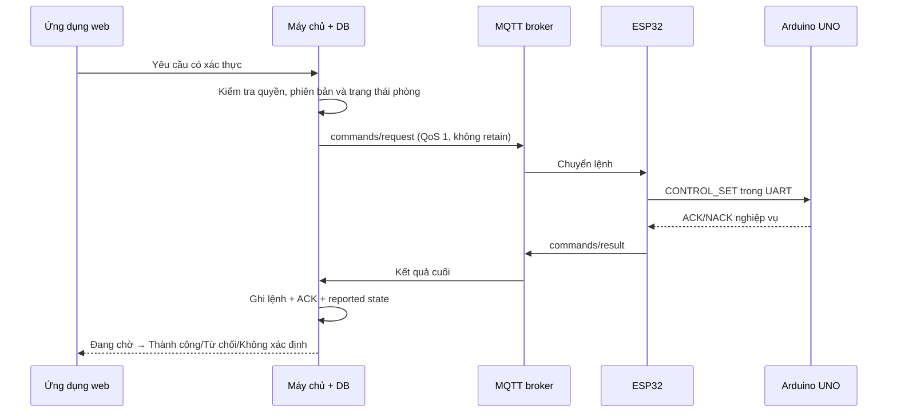
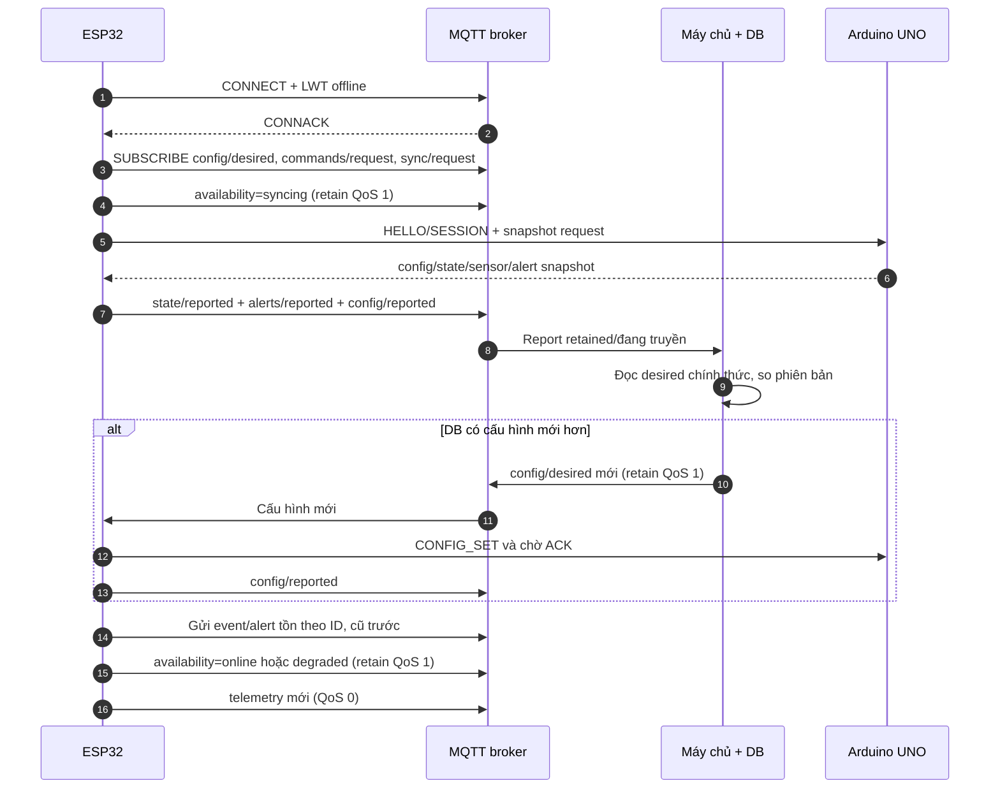

# THIẾT KẾ MQTT VÀ GIAO DIỆN DỮ LIỆU MẠNG — PHIÊN BẢN 1.0

## 1. Thông tin kiểm soát

| Thuộc tính | Giá trị |
|---|---|
| Tên tài liệu | Thiết kế MQTT và giao diện dữ liệu mạng cho phòng thông minh |
| Phiên bản | 1.0 |
| Trạng thái | **ĐÃ DUYỆT — 26/09/2026** |
| Giai đoạn | Giai đoạn 7 — Thiết kế MQTT |
| Ngày tạo | 26/09/2026 |
| Đầu vào đã khóa | Đặc tả 1.2, Ma trận kiểm thử 1.2, Danh mục phần cứng 1.2, CR-02, Kiến trúc 1.1, UML 1.1, Thiết kế phần cứng 1.0 và Giao thức UNO ↔ ESP32 1.0 |
| Phạm vi | Cây chủ đề, tải tin JSON, hướng truyền, QoS, retain, khả dụng, LWT, xác thực, ACL, lệnh/xác nhận và phục hồi kết nối |
| Chưa thuộc tài liệu này | Lược đồ cơ sở dữ liệu chi tiết (Giai đoạn 8), giao diện cụ thể (Giai đoạn 9), cấu hình chạy cuối cùng của broker (Giai đoạn 13), firmware và kết quả đo |

Tài liệu này là đặc tả thiết kế, không phải bằng chứng hệ thống đã kết nối broker. Mọi cổng `G7-*` ở Mục 17 đều **CHƯA THỰC HIỆN**.

## 2. Mục tiêu, phạm vi và nguyên tắc

MQTT là lớp vận chuyển giữa ESP32 và máy chủ. Nó không thay thế giao thức nối tiếp đã khóa và không phải nguồn chính thức của cấu hình hay trạng thái. Thiết kế phải giữ được chu trình:

```text
UNO đo/ra quyết định cục bộ
    → ESP32 chuyển đổi và xếp hàng
    → MQTT vận chuyển
    → máy chủ xác thực, lưu và phân phối
    → ứng dụng web hiển thị hoặc gửi yêu cầu
```

Các nguyên tắc bắt buộc:

1. Máy chủ và cơ sở dữ liệu là nguồn chính thức của cấu hình mong muốn; broker chỉ vận chuyển và giữ một số bản tin mới nhất bằng retain.
2. UNO là nguồn trạng thái đầu ra thực tế. `PUBACK` của MQTT chỉ chứng minh broker nhận bản tin, không chứng minh thiết bị đã thi hành lệnh.
3. Lệnh, cấu hình, sự kiện và cảnh báo phải có định danh để chống xử lý lặp. Telemetry định kỳ có thể mất khi ngoại tuyến và không được dựng lại giả.
4. Mọi tên trên dây dùng ASCII chữ thường, số, dấu gạch ngang hoặc gạch dưới; giao diện web dịch sang thuật ngữ tiếng Việt.
5. Không đưa mật khẩu Wi-Fi, mật khẩu MQTT, khóa bí mật hoặc mã PIN vào payload, nhật ký hay kho mã nguồn.
6. Thiết kế không làm thay đổi phạm vi phần cứng: cảm biến và tải không có bằng chứng vật lý vẫn được gắn nhãn `MO_PHONG`, `CHUA_SAN_SANG` hoặc `SUY_GIAM` theo tài liệu trước.

## 3. Lựa chọn giao thức và các quyết định kiến trúc

### 3.1. So sánh phương án

| Phương án | Ưu điểm | Hạn chế | Quyết định |
|---|---|---|---|
| HTTP gửi từng mẫu | Dễ thử bằng trình duyệt | ESP32 phải quản lý nhiều kết nối; không có retain/LWT tự nhiên; khó phân biệt lệnh và sự kiện | Không chọn làm kênh thiết bị |
| MQTT 3.1.1 | Nhẹ, publish/subscribe, QoS 0/1/2, retain, Will, thư viện ESP32 phổ biến | Cần thiết kế chống lặp và ACL ở lớp ứng dụng | **Chọn** |
| MQTT 5 | Có message expiry, reason code và thuộc tính phong phú | Thư viện/triển khai nhúng không đồng đều; nhu cầu hiện tại có thể giải quyết trong payload | Không khóa cho 1.0 |

Phiên bản MQTT khóa cho sản phẩm thiết kế là **MQTT 3.1.1**. Lý do và hành vi `Clean Session`, QoS, retained message và Will tuân theo chuẩn OASIS MQTT 3.1.1; cú pháp tải tin phía dưới là quy ước riêng của dự án.

### 3.2. Quyết định chính

| Mã | Quyết định | Hệ quả kiểm thử |
|---|---|---|
| ADR-07-01 | Dùng MQTT 3.1.1 | Client ESP32 và máy chủ phải công bố đúng protocol level; không dùng thuộc tính chỉ có ở MQTT 5. |
| ADR-07-02 | Bộ môi giới mục tiêu là Eclipse Mosquitto; thiết kế topic vẫn độc lập triển khai | Giai đoạn 13 cấu hình listener, tài khoản, ACL và lệnh chạy; không coi broker đã cài ở Giai đoạn 7. |
| ADR-07-03 | Một gốc topic `smartroom/v1/devices/{device_id}` | Mọi ACL và bộ phân tích bản tin có thể kiểm tra theo thiết bị. |
| ADR-07-04 | QoS 0 cho telemetry/diagnostic định kỳ; QoS 1 cho state, config, lệnh, kết quả, sự kiện, cảnh báo và availability | QoS 1 có thể giao lặp; máy chủ bắt buộc chống lặp bằng ID. Không dùng QoS 2. |
| ADR-07-05 | Retain chỉ cho availability, state/reported, config/desired, config/reported và alerts/reported | Subscriber mới có ảnh chụp hiện hành; không làm lệnh, sự kiện hoặc telemetry cũ sống lại. |
| ADR-07-06 | Thiết bị dùng `clean_session=true`, `keep_alive=30 s` | Không nhận lệnh cũ do phiên broker lưu; lệnh có TTL riêng trong JSON. |
| ADR-07-07 | ESP32 đặt LWT `offline` retained QoS 1; sau kết nối phát `syncing`, chỉ phát `online` sau hòa giải UNO | Máy chủ phân biệt đã kết nối MQTT với đã sẵn sàng nghiệp vụ. |
| ADR-07-08 | Ứng dụng web không kết nối MQTT trực tiếp | Máy chủ kiểm tra quyền, chờ ACK cuối và phát kết quả qua API/kênh thời gian thực. |
| ADR-07-09 | JSON UTF-8, không NaN/Infinity, tối đa 2.048 byte mỗi tải tin | Các bản tin lớn phải chia theo topic hoặc rút gọn; ESP32 không phải cấp phát payload không giới hạn. |
| ADR-07-10 | ID, phiên bản và `occurred_at`/`received_at` được tách | Không thay thời điểm thiết bị không chắc chắn bằng thời điểm máy chủ nhận. |

## 4. Cây chủ đề MQTT

`{device_id}` là định danh ASCII duy nhất, khớp biểu thức `[a-z0-9][a-z0-9-]{2,31}`; bản thiết kế minh họa dùng `room-01`. Không cho phép dấu cách, dấu `/`, ký tự tiếng Việt hoặc wildcard trong giá trị này.

```text
smartroom/v1/devices/{device_id}/
├── availability              # thiết bị → máy chủ, LWT/online/syncing/degraded
├── telemetry/sensors          # thiết bị → máy chủ, mẫu cảm biến định kỳ
├── state/reported             # thiết bị → máy chủ, ảnh chụp trạng thái thực tế
├── config/desired             # máy chủ → thiết bị, cấu hình chính thức cần áp dụng
├── config/reported            # thiết bị → máy chủ, kết quả phiên bản cấu hình
├── commands/request           # máy chủ → thiết bị, lệnh có hạn dùng
├── commands/result            # thiết bị → máy chủ, ACK/NACK nghiệp vụ cuối
├── events                     # thiết bị → máy chủ, sự kiện có ID
├── alerts/events              # thiết bị → máy chủ, thêm/hết/tái kích hoạt cảnh báo
├── alerts/reported            # thiết bị → máy chủ, tập cảnh báo đang tồn tại
├── sync/request               # máy chủ → thiết bị, yêu cầu ảnh chụp/hòa giải
├── sync/status                # thiết bị → máy chủ, tiến độ đồng bộ
└── diagnostics                # thiết bị → máy chủ, bộ đếm chẩn đoán không định kỳ
```

Không dùng wildcard để gửi lệnh. Máy chủ có thể subscribe `smartroom/v1/devices/+/...` ở phía dịch vụ nội bộ, nhưng client thiết bị chỉ được cấp quyền với `{device_id}` của chính nó.

### 4.1. Ma trận hướng, QoS và retain

| Chủ đề | Hướng | QoS | Retain | Lưu ý |
|---|---|---:|:---:|---|
| `availability` | Thiết bị → máy chủ | 1 | Có | LWT `offline`; `online/syncing/degraded` do ESP32 công bố |
| `telemetry/sensors` | Thiết bị → máy chủ | 0 | Không | Mẫu 2 giây; máy chủ lấy mẫu lưu một phút |
| `state/reported` | Thiết bị → máy chủ | 1 | Có | Ảnh chụp mới nhất, kèm `state_version` |
| `config/desired` | Máy chủ → thiết bị | 1 | Có | Bản chính thức mới nhất; xóa retain khi loại thiết bị |
| `config/reported` | Thiết bị → máy chủ | 1 | Có | Bản đã áp dụng hoặc bị từ chối |
| `commands/request` | Máy chủ → thiết bị | 1 | Không | Không giữ lệnh; `expires_at`/`ttl_ms` bắt buộc |
| `commands/result` | Thiết bị → máy chủ | 1 | Không | Kết quả cuối không phải `PUBACK` |
| `events` | Thiết bị → máy chủ | 1 | Không | Xếp hàng và gửi bù theo `event_id` |
| `alerts/events` | Thiết bị → máy chủ | 1 | Không | Chuyển trạng thái nguyên nhân cảnh báo |
| `alerts/reported` | Thiết bị → máy chủ | 1 | Có | Tập nguyên nhân hiện hành, không thay lịch sử |
| `sync/request` | Máy chủ → thiết bị | 1 | Không | Yêu cầu đồng bộ có `sync_id` |
| `sync/status` | Thiết bị → máy chủ | 1 | Không | Kết quả/tiến độ phiên đồng bộ |
| `diagnostics` | Thiết bị → máy chủ | 0 | Không | Không dùng làm heartbeat hoặc nhật ký nghiệp vụ |

QoS 1 là “ít nhất một lần”, vì vậy bên nhận phải chấp nhận bản tin lặp an toàn. QoS 2 không được dùng trong 1.0 vì chi phí trạng thái và lợi ích không cần thiết cho mô hình một phòng. Retain không phải bộ nhớ lịch sử.

## 5. Client, phiên kết nối và quyền truy cập

### 5.1. Danh tính client

| Client | Client ID đề xuất | Phiên | Vai trò |
|---|---|---|---|
| ESP32 | `smartroom-{device_id}-device` | `clean_session=true`, keep-alive 30 s | Đọc topic hướng xuống; xuất bản topic của chính thiết bị |
| Máy chủ | `smartroom-backend` | `clean_session=true`, keep-alive 30 s | Đọc/xuất bản mọi topic thiết bị qua tài khoản dịch vụ |
| Công cụ thử | ID riêng, không dùng trong sản phẩm | Theo kịch bản | Chỉ được cấp quyền tạm thời ở môi trường thử |

ID không được dùng chung giữa hai board hoặc hai tiến trình. Khi có kết nối mới trùng ID, broker có thể ngắt kết nối cũ; máy chủ phải ghi sự kiện hệ thống thay vì coi đó là chuyển trạng thái bình thường.

### 5.2. ACL tối thiểu

Với `device_id=room-01`, tài khoản thiết bị chỉ được:

| Quyền | Chủ đề |
|---|---|
| Đọc | `smartroom/v1/devices/room-01/config/desired` |
| Đọc | `smartroom/v1/devices/room-01/commands/request` |
| Đọc | `smartroom/v1/devices/room-01/sync/request` |
| Ghi | `smartroom/v1/devices/room-01/availability` |
| Ghi | `smartroom/v1/devices/room-01/telemetry/sensors` |
| Ghi | `smartroom/v1/devices/room-01/state/reported` |
| Ghi | `smartroom/v1/devices/room-01/config/reported` |
| Ghi | `smartroom/v1/devices/room-01/commands/result` |
| Ghi | `smartroom/v1/devices/room-01/events` |
| Ghi | `smartroom/v1/devices/room-01/alerts/events` |
| Ghi | `smartroom/v1/devices/room-01/alerts/reported` |
| Ghi | `smartroom/v1/devices/room-01/sync/status` |
| Ghi | `smartroom/v1/devices/room-01/diagnostics` |
| Cấm | `config/desired`, `commands/request` và mọi topic của thiết bị khác |

Máy chủ dùng tài khoản riêng có quyền đọc/ghi cây `smartroom/v1/devices/#` theo cấu hình broker. Không cấp quyền `#` cho ESP32 và không cho phép kết nối ẩn danh.

## 6. Bao dữ liệu chung và quy ước kiểu

### 6.1. Bao JSON

Mỗi bản tin nghiệp vụ có các trường sau, trừ LWT tối giản được quy định riêng:

```json
{
  "schema": "smartroom.mqtt",
  "schema_version": 1,
  "message_id": "room-01-00000042",
  "device_id": "room-01",
  "sent_at": null,
  "time_quality": "unsynced",
  "esp_boot_id": 305419896,
  "uno_boot_id": 2596069104,
  "link_session_id": 2712847316,
  "data": {}
}
```

Quy tắc:

- `message_id` là chuỗi ASCII dài tối đa 64 ký tự; lệnh do máy chủ cấp UUID/ID tương đương, sự kiện thiết bị ghép `device_id`, boot ID và bộ đếm cục bộ.
- `device_id` trong payload phải trùng đoạn `{device_id}` trên topic; sai thì máy chủ bỏ bản tin và ghi lỗi.
- `sent_at` là UTC ISO-8601 khi ESP32 đã có thời gian tin cậy; nếu chưa có, để `null` và dùng `uptime_ms` trong `data`.
- Máy chủ tự thêm `received_at`; không cho thiết bị ghi đè trường này.
- `time_quality` có `synced` hoặc `unsynced`. Không suy diễn thời điểm xảy ra từ thời điểm nhận nếu giá trị là `unsynced`.
- Số đo không hợp lệ dùng `null` và trường chất lượng tương ứng; không gửi `NaN`, `Infinity` hoặc chuỗi giả số.
- Tải tin tối đa 2.048 byte sau mã hóa UTF-8. Thiết bị từ chối bản tin vượt giới hạn trước khi chuyển qua UART.
- Các enum trên mạng dùng ASCII: `auto`, `manual`, `home`, `away`, `night`, `valid`, `stale`, `invalid`, `simulated`, `hardware_real`, `unknown`; giao diện ánh xạ thành “Tự động”, “Thủ công”, “Ở nhà”…

### 6.2. Phiên bản và chống lặp

Máy chủ lưu `message_id` đã xử lý trong khoảng thời gian lưu tương ứng. Bản tin lặp của `events`, `alerts/events` và `commands/result` không tạo bản ghi nghiệp vụ mới. `state/reported` và `config/reported` được áp dụng theo phiên bản; bản cũ hơn không ghi đè bản mới.

## 7. Lược đồ các chủ đề

Các lược đồ sau là ngữ nghĩa bắt buộc. Tên trường có thể chỉ được thay đổi qua quản lý thay đổi sau khi Giai đoạn 7 được duyệt.

### 7.1. `availability`

`data.status` nhận `offline`, `syncing`, `online` hoặc `degraded`; `data.reason` nhận mã ASCII như `unexpected_disconnect`, `boot`, `link_sync`, `config_pending`, `sensor_fault`, `queue_overflow`, `manual_diagnostic`.

```json
{
  "schema": "smartroom.mqtt",
  "schema_version": 1,
  "message_id": "room-01-availability-esp-0003",
  "device_id": "room-01",
  "sent_at": null,
  "time_quality": "unsynced",
  "esp_boot_id": 3,
  "uno_boot_id": 17,
  "link_session_id": 91,
  "data": {
    "status": "syncing",
    "reason": "link_sync",
    "protocol_version": "1.0",
    "config_version": 12,
    "state_version": 44,
    "uptime_ms": 8123
  }
}
```

LWT do ESP32 đặt khi CONNECT:

```json
{
  "schema": "smartroom.mqtt",
  "schema_version": 1,
  "device_id": "room-01",
  "data": { "status": "offline", "reason": "unexpected_disconnect" }
}
```

LWT dùng QoS 1, retain. Máy chủ không coi một bản `online` là hoàn tất đồng bộ nếu `status` chưa chuyển khỏi `syncing`.

### 7.2. `telemetry/sensors`

```json
{
  "schema": "smartroom.mqtt",
  "schema_version": 1,
  "message_id": "room-01-telemetry-883",
  "device_id": "room-01",
  "sent_at": null,
  "time_quality": "unsynced",
  "esp_boot_id": 3,
  "uno_boot_id": 17,
  "link_session_id": 91,
  "data": {
    "uptime_ms": 120340,
    "sample_counter": 883,
    "light": {"adc": 412, "relative_pct": 37, "quality": "valid"},
    "door_zone": {"distance_mm": 248, "state": "object_detected", "quality": "valid"},
    "mq2": {"adc": 516, "relative_pct": 42, "state": "warming", "quality": "valid", "heat_status": "warming"},
    "flame": {"raw": 0, "state": "normal", "quality": "valid"}
  }
}
```

`mq2.relative_pct` chỉ là mức tương đối của mô hình; trường `ppm` không tồn tại. Khi cảm biến làm nóng/hiệu chuẩn hoặc lỗi, `state`/`quality` phải phản ánh điều đó. Telemetry không được dùng để tự khẳng định thiết bị báo gas/báo cháy thương mại.

### 7.3. `state/reported`

Đây là ảnh chụp trạng thái sau xử lý ở UNO, có thể chứa cả đầu ra mô phỏng:

```json
{
  "schema": "smartroom.mqtt",
  "schema_version": 1,
  "message_id": "room-01-state-44",
  "device_id": "room-01",
  "sent_at": null,
  "time_quality": "unsynced",
  "esp_boot_id": 3,
  "uno_boot_id": 17,
  "link_session_id": 91,
  "data": {
    "state_version": 44,
    "config_version": 12,
    "room_profile": "home",
    "control_mode": "auto",
    "outputs": {
      "lamp": {"on": true, "source": "auto", "actuator_mode": "hardware_real"},
      "fan": {"on": false, "source": "auto", "actuator_mode": "simulated"},
      "lock": {"command": "locked", "actuator_mode": "simulated", "mechanical_verified": false}
    },
    "security": {"door_zone_armed": false},
    "alert": {"lifecycle": "normal", "active_count": 0},
    "alarm_output": {"led": false, "buzzer": false, "buzzer_available": false},
    "health": {"connection": "online", "sensor_fault": false, "queue_depth": 0}
  }
}
```

`actuator_mode=simulated` là bắt buộc với quạt và khóa của phiên bản hiện hành. `mechanical_verified=false` không được hiển thị thành “cửa đã khóa”.

### 7.4. `config/desired` và `config/reported`

`config/desired` luôn là bản đầy đủ, không gửi bản vá từng trường:

```json
{
  "schema": "smartroom.mqtt",
  "schema_version": 1,
  "message_id": "cfg-13",
  "device_id": "room-01",
  "sent_at": "2026-09-26T10:00:00Z",
  "time_quality": "synced",
  "data": {
    "config_version": 13,
    "source": "server_database",
    "settings": {
      "light_on_pct": 30,
      "light_off_pct": 50,
      "control_mode": "auto",
      "room_profile": "home",
      "light_calibration": {"dark_adc": 80, "bright_adc": 920, "enabled": true},
      "mq2": {"baseline_adc": 300, "span_adc": 500, "threshold_pct": 60, "calibration_enabled": false},
      "door_zone": {"threshold_mm": 350, "confirm_samples": 3, "calibration_enabled": true}
    }
  }
}
```

Giới hạn, quan hệ vùng trễ và cờ hiệu chuẩn phải đúng `CH-01`/Giao thức 1.0. Ngưỡng MQ-2 chỉ thuộc luồng bảo trì/hiệu chuẩn; không có trường `disable_safety`.

`config/reported` có cấu trúc:

```json
{
  "schema": "smartroom.mqtt",
  "schema_version": 1,
  "message_id": "cfg-report-13",
  "device_id": "room-01",
  "sent_at": null,
  "time_quality": "unsynced",
  "data": {
    "config_version": 13,
    "apply_result": "applied",
    "reason_code": "none",
    "reported_at_uptime_ms": 90123,
    "settings": {}
  }
}
```

Các giá trị `applied`, `rejected`, `unchanged`, `pending` được phép. Khi bị từ chối, ESP32/UNO giữ nguyên bản cũ và gửi `reason_code`, không gửi bản nửa áp dụng.

### 7.5. `commands/request` và `commands/result`

Lệnh từ máy chủ:

```json
{
  "schema": "smartroom.mqtt",
  "schema_version": 1,
  "message_id": "cmd-8a0d",
  "device_id": "room-01",
  "sent_at": "2026-09-26T10:01:00Z",
  "time_quality": "synced",
  "data": {
    "command_id": "cmd-8a0d",
    "operation": "set_device",
    "target": "lamp",
    "value": "on",
    "issued_at": "2026-09-26T10:01:00Z",
    "expires_at": "2026-09-26T10:01:30Z",
    "ttl_ms": 30000,
    "expected_state_version": 44,
    "base_config_version": 13,
    "new_config_version": 13,
    "options": {"user_confirmed": true, "force_manual": true}
  }
}
```

`operation` nhận `set_device`, `set_control_mode`, `set_room_profile`, `set_lock` hoặc `alert_action`. `target` và `value` phải khớp opcode của Giao thức 1.0; không có thao tác `toggle`. Lệnh quá hạn, sai phiên bản, thiếu xác nhận hoặc bị hồ sơ/an ninh chặn phải bị từ chối ở ESP32/UNO dù máy chủ đã kiểm tra trước.

Kết quả cuối:

```json
{
  "schema": "smartroom.mqtt",
  "schema_version": 1,
  "message_id": "result-cmd-8a0d",
  "device_id": "room-01",
  "sent_at": null,
  "time_quality": "unsynced",
  "data": {
    "command_id": "cmd-8a0d",
    "result": "applied",
    "reason_code": "none",
    "config_version": 13,
    "state_version": 45,
    "actual_state": {"lamp_on": true, "fan_on": false, "room_profile": "home", "control_mode": "manual"},
    "uno_ack": true,
    "replayed": false
  }
}
```

`result` nhận `applied`, `rejected`, `duplicate_ok`, `expired` hoặc `unknown`. `unknown` dùng khi ESP32 không nhận được ACK cuối từ UNO; giao diện phải hiển thị “Không xác định/Đang đồng bộ”, không hiển thị thành công. `PUBACK` MQTT không được đặt `result=applied`.

### 7.6. `events`

```json
{
  "schema": "smartroom.mqtt",
  "schema_version": 1,
  "message_id": "room-01-event-17-302",
  "device_id": "room-01",
  "sent_at": null,
  "time_quality": "unsynced",
  "data": {
    "event_id": "room-01-event-17-302",
    "event_type": "room_profile_changed",
    "severity": "info",
    "source": "uno",
    "occurred_at": null,
    "uptime_ms": 202030,
    "state_version": 46,
    "details": {"from": "home", "to": "away"},
    "replayed": true
  }
}
```

`event_type` gồm các mã cần cho nhật ký như `boot`, `link_degraded`, `link_recovered`, `room_profile_changed`, `device_state_changed`, `config_applied`, `config_rejected`, `sensor_fault`, `sensor_recovered`, `queue_overflow`, `command_rejected`. Event không thay thế telemetry định kỳ.

### 7.7. `alerts/events` và `alerts/reported`

Một cảnh báo có thể có nhiều `cause_id` đồng thời:

```json
{
  "schema": "smartroom.mqtt",
  "schema_version": 1,
  "message_id": "alert-17-4-add",
  "device_id": "room-01",
  "sent_at": null,
  "time_quality": "unsynced",
  "data": {
    "alert_id": "room-01-alert-17-4",
    "operation": "add",
    "alert_type": "safety",
    "severity": "warning",
    "source": "mq2",
    "lifecycle": "sounding",
    "active": true,
    "cause_id": 4,
    "reason_code": "mq2_threshold",
    "detail": {"relative_pct": 72, "buzzer_available": false},
    "replayed": false
  }
}
```

`operation` nhận `add`, `clear`, `retrigger`, `snapshot`. `alert_type` nhận `safety`, `security`, `system`; `severity` nhận `info`, `notice`, `warning`, `critical`. `alerts/reported` retained chứa danh sách nguyên nhân đang tồn tại, tổng mức độ, vòng đời và khả dụng LED/còi. Tắt tiếng không xóa nguyên nhân; nguyên nhân mới phải phát `retrigger` và bật lại LED/còi nếu đầu ra âm thanh khả dụng.

### 7.8. `sync/request` và `sync/status`

Máy chủ gửi:

```json
{
  "schema": "smartroom.mqtt",
  "schema_version": 1,
  "message_id": "sync-request-22",
  "device_id": "room-01",
  "sent_at": "2026-09-26T10:02:00Z",
  "time_quality": "synced",
  "data": {"sync_id": "sync-22", "scopes": ["config", "state", "alerts", "health"], "reason": "version_mismatch"}
}
```

ESP32 trả các pha `started`, `uno_snapshot`, `config_reconciled`, `queue_replayed`, `completed` hoặc `failed`; `sync/status` có `sync_id`, `result`, `config_version`, `state_version`, `queue_remaining` và `reason_code`.

### 7.9. `diagnostics`

Chỉ dùng cho bộ đếm/báo cáo chẩn đoán không định kỳ: lỗi CRC/COBS, timeout UART, lần reconnect, độ sâu hàng đợi, số bản tin loại cũ nhất, dung lượng tải tin và nguyên nhân gần nhất. Không dùng topic này để suy ra lệnh đã thành công hoặc để lưu lịch sử cảm biến.

## 8. Quy tắc lệnh, xác nhận và phiên bản

Luồng đầy đủ:



Các điều kiện bắt buộc:

1. Máy chủ sinh `command_id`, đặt `expires_at` không quá 30 giây kể từ `issued_at` và chỉ gửi khi thiết bị ở trạng thái có thể nhận.
2. ESP32 kiểm tra schema, `device_id`, TTL, phiên bản và ID lặp trước khi gửi xuống UNO.
3. UNO kiểm tra lại ưu tiên bảo vệ điện → an toàn → an ninh → hồ sơ phòng → Thủ công → Tự động. Một ACK chỉ được tạo sau khi trạng thái đã áp dụng.
4. Nếu UART timeout, ESP32 gửi `unknown`, công bố `degraded` và yêu cầu đồng bộ; không tự gửi lại một lệnh nhạy cảm nếu không xác định UNO đã thi hành.
5. Nếu nhận lại cùng `command_id` và nội dung giống nhau sau khi đã áp dụng, trả `duplicate_ok` kèm trạng thái hiện tại. Cùng ID nhưng payload khác là lỗi xung đột.
6. Khi `room_profile=away`, lệnh bật đèn/quạt bị từ chối. Lệnh mở khóa trong báo an ninh bị chặn; trong báo an toàn chỉ được mở mô phỏng khi người dùng xác nhận, không tự mở.

## 9. Cấu hình mong muốn, cấu hình báo cáo và hòa giải

Máy chủ ghi cấu hình vào cơ sở dữ liệu trước, tăng `config_version`, sau đó xuất bản toàn bộ `config/desired` retained. ESP32:

1. nhận bản retained hoặc bản mới;
2. so sánh `config_version` với NVS;
3. bỏ qua bản cũ hơn, chấp nhận lại bản giống hệt;
4. kiểm tra toàn bộ miền và chuyển qua `CONFIG_SET`;
5. chỉ ghi NVS sau ACK UNO;
6. công bố `config/reported` và `state/reported`;
7. nếu NACK, giữ bản cũ, báo `rejected` và không ghi một phần.

Khi nhiều bản desired đến nhanh, ESP32 chỉ xử lý theo thứ tự phiên bản; không áp dụng bản trung gian đã cũ nếu đã có bản mới hơn. Sau reconnect, máy chủ so sánh desired trong DB với reported thực tế, không dùng retain làm nguồn chính.

## 10. Trực tuyến, mất mạng và phục hồi

### 10.1. Hành vi khi mất kết nối

| Tình huống | UNO | ESP32 | Máy chủ/ứng dụng |
|---|---|---|---|
| Mất Wi-Fi | Vẫn đo, tự động đèn và cảnh báo cục bộ | Retry Wi-Fi; giữ NVS, state mới nhất; xếp hàng event/alert | Hiển thị Ngoại tuyến/Dữ liệu cũ |
| Mất MQTT | Không thay đổi logic cục bộ | Retry broker; không gửi lệnh cũ hết hạn | Không báo lệnh thành công nếu thiếu result |
| Mất máy chủ nhưng broker còn | Không đổi | Có thể publish, không coi broker ACK là DB đã lưu | Web suy giảm; máy chủ bù trạng thái từ retained/report |
| Lỗi UART UNO–ESP32 | UNO vẫn xử lý cục bộ trong khả năng | `degraded`, không xác nhận lệnh từ xa; yêu cầu bắt tay lại | Hiển thị Suy giảm/Không xác định |

ESP32 duy trì tối thiểu 100 mục event/alert, theo chính sách loại mục cũ nhất khi đầy và tạo `queue_overflow`. Không xếp hàng toàn bộ telemetry 2 giây; khoảng trống biểu đồ phải được giữ.

### 10.2. Trình tự reconnect



Không phát `online` trước khi UNO đã có phiên hợp lệ và trạng thái tối thiểu. Lệnh gửi trong lúc `syncing` bị từ chối với lý do `device_syncing` hoặc được máy chủ giữ ở trạng thái chờ có hạn; không được retain lệnh.

Khoảng chờ reconnect dự kiến: 1, 2, 4, 8, 16, tối đa 30 giây, thêm nhiễu nhỏ để tránh đồng thời. Giá trị thực tế và thư viện sẽ được kiểm thử ở Giai đoạn 12–17, không được ghi là số đo đạt.

## 11. Bảo mật và triển khai broker

### 11.1. Mức bảo vệ

- Broker bắt buộc `allow_anonymous=false`, tài khoản riêng cho ESP32 và máy chủ, mật khẩu không nằm trong repository.
- ACL giới hạn đúng cây topic của thiết bị; không cấp quyền xuất bản `config/desired` cho thiết bị.
- Trong mạng LAN cô lập dùng cho mô hình, listener MQTT 1883 chỉ mở trong LAN và vẫn yêu cầu xác thực. Không chuyển tiếp cổng này ra Internet.
- Nếu truy cập ngoài LAN hoặc đặt broker trên mạng không tin cậy, dùng listener TLS 8883, xác thực chứng thư CA và HTTPS cho web. Không công khai broker hoặc cơ sở dữ liệu trực tiếp.
- Tài khoản web không phải tài khoản MQTT. Máy chủ là lớp duy nhất chuyển yêu cầu người dùng thành `commands/request`.
- Bản tin không chứa mật khẩu, token web, mã PIN, khóa Wi-Fi hoặc khóa TLS riêng.

### 11.2. Cấu hình Mosquitto dự kiến ở Giai đoạn 13

Đây là khung yêu cầu, chưa phải file triển khai đã chạy:

```text
listener 1883
allow_anonymous false
password_file <duong_dan_bi_mat>
acl_file <duong_dan_acl>
```

Tùy môi trường, listener TLS 8883 và chứng thư sẽ được thêm khi cần truy cập ngoài LAN. Tài liệu chạy thật phải ghi rõ listener nào đang dùng; không được trình bày cấu hình dự kiến như kết quả đã triển khai.

## 12. Giới hạn, lỗi và quan sát

Các mã lý do trên MQTT phải ánh xạ được mã lỗi Giao thức 1.0, chẳng hạn `invalid_schema`, `payload_too_large`, `expired_command`, `duplicate_command`, `state_version_conflict`, `config_invalid`, `uart_timeout`, `uno_rejected`, `device_syncing`, `sensor_invalid`, `queue_overflow`, `safety_alert_active`.

Máy chủ phải ghi tối thiểu:

- `received_at`, topic, `device_id`, `message_id`, QoS và cờ retained;
- ID lệnh/sự kiện/cảnh báo, phiên boot, phiên liên kết, `config_version`, `state_version`;
- kết quả phân tích: mới, lặp, cũ, sai schema, bị từ chối hoặc đã xếp hàng;
- lý do khi chuyển `TRỰC_TUYẾN`, `SUY_GIẢM`, `NGOẠI_TUYẾN`.

Không ghi payload chứa bí mật. Telemetry được lưu theo chính sách một mẫu/phút ở Giai đoạn 8; bản tin nhận được không tự động trở thành một dòng nhật ký sự kiện.

## 13. Ánh xạ MQTT với giao thức UNO ↔ ESP32

| Ngữ nghĩa mạng | Bản tin UART 1.0 | Quy tắc |
|---|---|---|
| Cấu hình mong muốn | `CONFIG_SET` | Chỉ gửi sau khi desired hợp lệ; ACK mới cho phép `config/reported=applied`. |
| Cấu hình báo cáo | `CONFIG_REPORT` | Gắn `config_version`, giữ nguyên nếu NACK. |
| Lệnh điều khiển | `CONTROL_SET` | `commands/request` không được biến thành toggle. |
| Kết quả lệnh | `ACK`/`NACK` | `commands/result` phản ánh ACK cuối, không phản ánh PUBACK. |
| Telemetry | `SENSOR_REPORT` | QoS 0, không retain, không gửi bù toàn bộ. |
| Trạng thái | `STATE_REPORT` | QoS 1, retain, phiên bản tăng khi thay đổi có ý nghĩa. |
| Sự kiện | `EVENT_REPORT` | QoS 1, xếp hàng ngoại tuyến và chống lặp. |
| Cảnh báo | `ALERT_REPORT` | QoS 1; event chuyển trạng thái và reported snapshot tách nhau. |
| Sức khỏe | `HEALTH_REPORT`/`ERROR_REPORT` | Diagnostic và `availability` ở lớp MQTT. |
| Đồng bộ | `SNAPSHOT_REQUEST`, `SNAPSHOT_END`, `SYNC_COMPLETE` | `sync/status` chỉ hoàn tất sau khi UNO xác nhận ảnh chụp. |

MQTT không mang nguyên khung COBS/CRC. ESP32 giải mã UART, xác thực semantic rồi tạo JSON; chiều ngược lại kiểm tra JSON trước khi tạo khung UART.

## 14. Truy vết tới chức năng và kiểm thử

| Chức năng | Chủ đề chính | Kiểm thử liên quan |
|---|---|---|
| MT-03, MT-02 | `telemetry/sensors`, `state/reported`, `diagnostics` | KT02, KT14, KT15, KT21, KT36 |
| DK-02 | `commands/request`, `commands/result`, `state/reported` | KT03, KT04, KT09, KT18 |
| TD-02 | `config/desired`, `config/reported`, `state/reported`, `events` | KT02, KT06, KT07, KT11, KT14 |
| CD-01, CD-02 | `commands/*`, `config/*`, `state/reported`, `events` | KT04, KT08–KT11, KT24 |
| CH-01 | `config/desired`, `config/reported` | KT07, KT08, KT16, KT26 |
| AN-05, AN-06 | `telemetry/sensors`, `alerts/*`, `commands/*` | KT09, KT10, KT12, KT24, KT38, KT39 |
| AT-01, AT-02 | `telemetry/sensors`, `alerts/*`, `events` | KT25–KT31 |
| CB-01 | `alerts/events`, `alerts/reported`, `commands/*` | KT12, KT13, KT24, KT29–KT31 |
| MN-01 | `availability`, `sync/*`, mọi topic có ID | KT14–KT18, KT31 |
| UD-01 | Máy chủ trung gian; không MQTT trực tiếp từ web | KT03, KT18, KT19, KT36 |
| DL-01, BC-01 | telemetry/events/alerts + `received_at` | KT15, KT20, KT21, KT30, KT36, KT38 |
| TB-01 | cảnh báo từ `alerts/events` | KT34 |
| MR-01 | capability/telemetry mở rộng | KT35 |

Mọi chức năng nhóm A đều có topic và kiểm thử truy vết; TB-01/MR-01 vẫn là nhóm có điều kiện theo ma trận 1.2.

## 15. Tiêu chí chấp nhận Giai đoạn 7

- Cây topic không trùng tên, không wildcard trong lệnh và mọi topic có hướng rõ.
- Đủ bảy kênh ngữ nghĩa: availability, telemetry, reported state, desired/reported config, command/result, event, alert.
- Mỗi topic có QoS/retain được giải thích; không retain lệnh, event, alert transition hoặc telemetry.
- Có LWT retained, `syncing`/`online`/`degraded`, keep-alive và quy tắc reconnect.
- JSON có schema, ID, phiên boot, phiên liên kết, thời gian/chất lượng thời gian và payload giới hạn.
- Có ví dụ cho telemetry, state, config, command/result, event, alert và sync.
- ACK cuối từ UNO được tách khỏi PUBACK MQTT; có TTL, chống lặp và kết quả `unknown`.
- Cấu hình desired/reported nguyên tử, DB là nguồn chính thức, ESP32 dùng NVS, UNO dùng RAM.
- Mất mạng không dừng logic cục bộ; event/alert được gửi bù còn telemetry giữ khoảng trống.
- Có ACL thiết bị, cấm anonymous, tách tài khoản web/thiết bị và quy tắc TLS ngoài LAN.
- Không có tuyên bố ppm, trạng thái cơ khí thật, kết quả broker/firmware hoặc thử nghiệm chưa thực hiện.

## 16. Cổng kiểm tra thiết kế và tích hợp

| Mã | Nội dung | Tiêu chí | Trạng thái |
|---|---|---|---|
| G7-TOPIC-01 | Kiểm tra cây topic và regex `device_id` | Không trùng, không ký tự cấm, ánh xạ đủ chức năng | CHƯA THỰC HIỆN |
| G7-QOS-01 | Kiểm tra QoS/retain từng topic | Khớp ma trận Mục 4.1 | CHƯA THỰC HIỆN |
| G7-JSON-01 | Kiểm tra schema và payload biên | JSON hợp lệ, ≤2.048 byte, không NaN/Infinity | CHƯA THỰC HIỆN |
| G7-ID-01 | Gửi lặp event/command/result | Không tạo tác dụng hoặc bản ghi lặp | CHƯA THỰC HIỆN |
| G7-TTL-01 | Lệnh hết hạn và lệnh đang đồng bộ | Từ chối đúng lý do, không thi hành | CHƯA THỰC HIỆN |
| G7-ACK-01 | Phân biệt PUBACK với ACK UNO | UI chỉ thành công sau `commands/result=applied` | CHƯA THỰC HIỆN |
| G7-CONFIG-01 | Retained desired/reported lệch phiên bản | Bỏ bản cũ, áp dụng nguyên tử, giữ bản cũ khi lỗi | CHƯA THỰC HIỆN |
| G7-LWT-01 | Ngắt TCP/MQTT bất thường | Broker phát offline retained; server ghi sự kiện | CHƯA THỰC HIỆN |
| G7-RECON-01 | Reconnect theo trình tự | Snapshot, hòa giải, gửi bù event/alert rồi telemetry | CHƯA THỰC HIỆN |
| G7-ACL-01 | Thử publish/subscribe sai quyền | Thiết bị không đọc/ghi cây của thiết bị khác; anonymous bị từ chối | CHƯA THỰC HIỆN |
| G7-OFF-01 | Hàng đợi ngoại tuyến | Có giới hạn, loại cũ nhất khi đầy, không bù telemetry | CHƯA THỰC HIỆN |
| G7-TRACE-01 | Đối chiếu chức năng–topic–kiểm thử | Không thiếu truy vết và không đổi mã cũ | CHƯA THỰC HIỆN |

Các cổng trên cần broker và/hoặc firmware ở Giai đoạn 12–18; tài liệu hiện tại chỉ khóa tiêu chí, chưa đánh dấu đạt.

## 17. Nội dung chuyển sang giai đoạn sau

| Giai đoạn | Đầu ra sử dụng |
|---:|---|
| 8 — Dữ liệu | Bảng/collection cho telemetry, reported state, desired/reported config, command/result, event, alert và dedup ID. |
| 9 — Giao diện | Ánh xạ enum ASCII thành nhãn tiếng Việt; trạng thái chờ, không xác định, suy giảm, dữ liệu cũ và cảnh báo. |
| 10 — Cấu trúc dự án | Module MQTT, schema validator, cấu hình bí mật và bộ kiểm thử bản tin. |
| 12 — ESP32 | Client MQTT, LWT, reconnect, retained desired, queue, JSON và bridge UART. |
| 13 — Xây dựng MQTT | Cài/khởi chạy Mosquitto, listener, password/ACL, TLS tùy môi trường và lệnh thử. |
| 14–16 — Máy chủ/web | Publisher/subscriber dịch vụ, DB là nguồn chính thức, API và kênh thời gian thực. |
| 17–19 — Tích hợp/kiểm thử | Chạy G7-*, KT14–KT21, KT25–KT31 và kiểm thử hồi quy; chỉ cập nhật kết quả có minh chứng. |

## 18. Lịch sử sửa đổi và điểm duyệt

| Phiên bản | Trạng thái | Nội dung | Lý do/ảnh hưởng |
|---|---|---|---|
| 1.0 | **ĐÃ DUYỆT — 26/09/2026** | Khóa MQTT 3.1.1; cây topic `smartroom/v1/devices`; JSON; QoS/retain; LWT; ACL; command/result; desired/reported; reconnect và truy vết | Người dùng duyệt đầu ra Giai đoạn 7; việc cài broker và chạy các cổng `G7-*` vẫn thuộc giai đoạn tích hợp sau. |

**TRẠNG THÁI KHÓA:** Thiết kế MQTT 1.0 được duyệt làm đường cơ sở cho Giai đoạn 8 — Thiết kế dữ liệu. Chưa cài broker, chưa chạy MQTT, chưa viết firmware/máy chủ và chưa có kết quả `G7-*`; nếu hiện thực phát sinh thay đổi hành vi, phải ghi nhận qua quản lý thay đổi.

## 19. Tài liệu tham khảo kỹ thuật

1. OASIS, *MQTT Version 3.1.1*, các mục về `Clean Session`, QoS, retained message và Will: <https://docs.oasis-open.org/mqtt/mqtt/v3.1.1/os/mqtt-v3.1.1-os.html>.
2. Eclipse Mosquitto, *mosquitto.conf man page*, các tùy chọn `allow_anonymous`, `password_file`, `acl_file` và listener: <https://mosquitto.org/man/mosquitto-conf-5.html>.
3. Eclipse Mosquitto, *Authentication methods*: <https://mosquitto.org/documentation/authentication-methods/>.
