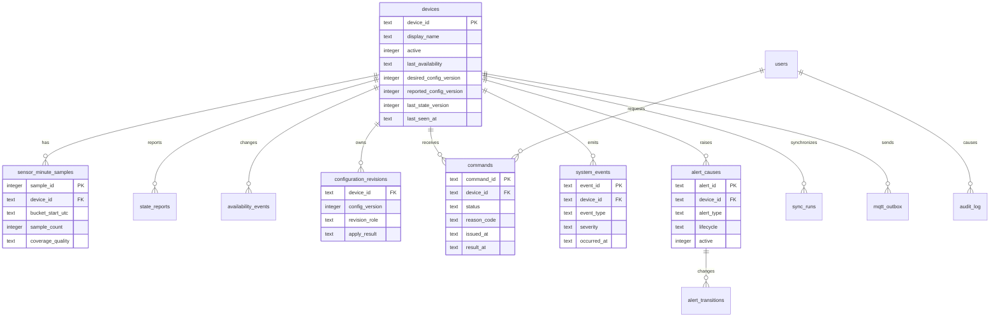
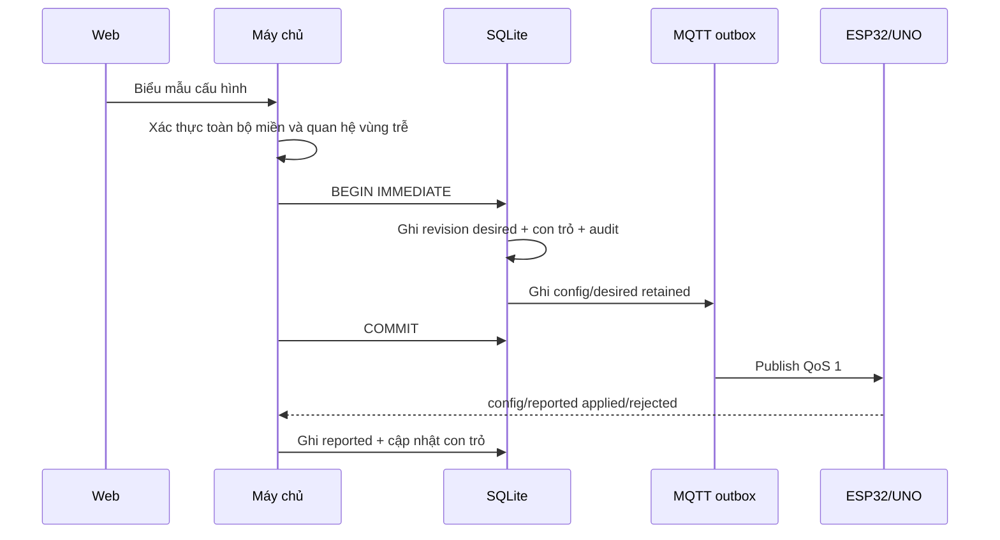

# THIẾT KẾ DỮ LIỆU VÀ CƠ SỞ DỮ LIỆU — PHIÊN BẢN 1.0

## 1. Thông tin kiểm soát

| Thuộc tính | Giá trị |
|---|---|
| Tên tài liệu | Thiết kế dữ liệu, cơ sở dữ liệu và nhật ký cho phòng thông minh |
| Phiên bản | 1.0 |
| Trạng thái | **ĐÃ DUYỆT — 26/09/2026** |
| Giai đoạn | Giai đoạn 8 — Thiết kế dữ liệu |
| Ngày tạo | 26/09/2026 |
| Đầu vào đã khóa | Đặc tả 1.2, Ma trận kiểm thử 1.2, CR-02, Kiến trúc 1.1, UML 1.1, Thiết kế phần cứng 1.0, Giao thức UNO ↔ ESP32 1.0 và MQTT 1.0 |
| Phạm vi | Mô hình dữ liệu, lược đồ cơ sở dữ liệu, nguồn cấu hình, chống trùng, lưu trữ, dọn dữ liệu và khôi phục |
| Chưa thuộc tài liệu này | Mã migration chạy thật, API cụ thể, giao diện web, tài khoản broker, firmware và kết quả kiểm thử thực tế |

Tài liệu này khóa cách phân biệt và lưu dữ liệu; nó chưa khẳng định cơ sở dữ liệu đã được tạo hoặc đã nhận bản tin thật.

## 2. Mục tiêu và quyết định nền tảng

### 2.1. Các nhóm dữ liệu phải phân biệt

| Nhóm | Ví dụ | Cách xử lý |
|---|---|---|
| Telemetry cảm biến | Mức sáng, vùng cửa SRF04, ADC/mức tương đối MQ-2, trạng thái cảm biến lửa | Nhận gần thời gian thực; chỉ lưu một mẫu mỗi phút; thiếu mẫu giữ khoảng trống |
| Trạng thái báo cáo | Hồ sơ phòng, phương thức, LED, tải mô phỏng, cảnh báo, khả dụng | Lưu ảnh chụp mới nhất và lịch sử thay đổi trong thời hạn |
| Cấu hình | Ngưỡng đèn, hiệu chuẩn LDR, MQ-2 bảo trì, vùng cửa, hồ sơ/phương thức | Máy chủ và DB là nguồn chính thức; desired/reported tách riêng, áp dụng nguyên tử |
| Lệnh và xác nhận | Lệnh bật/tắt, đổi hồ sơ, khóa mô phỏng, tắt tiếng/xác nhận | Lưu yêu cầu và kết quả cuối riêng; `PUBACK` không phải thành công nghiệp vụ |
| Sự kiện hệ thống | Khởi động, lỗi cảm biến, chuyển hồ sơ, kết nối lại, tràn hàng đợi | Có ID chống lặp, lưu nhật ký có truy vết |
| Cảnh báo | Nguyên nhân MQ-2, lửa, xâm nhập vùng cửa, lỗi cảm biến | Lưu vòng đời từng nguyên nhân và các lần chuyển trạng thái |
| Tài khoản/kiểm toán | Một chủ phòng, phiên đăng nhập, thao tác cấu hình | Không lưu mật khẩu rõ; lưu băm và nhật ký thao tác cần thiết |

### 2.2. Nền tảng được chọn

| Phương án | Ưu điểm | Hạn chế | Quyết định |
|---|---|---|---|
| Tệp JSON/CSV | Dễ đọc | Không có giao dịch, khóa duy nhất và truy vấn an toàn; dễ hỏng khi ghi đồng thời | Không chọn |
| SQLite 3 trên máy chủ | Không cần dịch vụ DB riêng, phù hợp một phòng/một chủ phòng, có giao dịch, khóa và chỉ mục | Một tiến trình ghi tại một thời điểm; WAL yêu cầu các tiến trình cùng máy chủ | **Chọn cho sản phẩm 1.0** |
| PostgreSQL/MySQL | Mở rộng tốt, nhiều người dùng | Cần dịch vụ và cấu hình thêm, không cần thiết cho mô hình hiện tại | Để hướng phát triển |

SQLite được chọn vì sản phẩm chính chỉ có một phòng, một máy chủ và không mua thêm hạ tầng. Máy chủ ứng dụng là lớp duy nhất mở tệp DB; trình duyệt, ESP32 và broker không truy cập tệp trực tiếp. Nếu mở rộng nhiều phòng/người dùng, lược đồ giữ nguyên ngữ nghĩa để có thể chuyển sang DB máy chủ lớn hơn.

Các quyết định kỹ thuật:

- Tệp dự kiến: `data/smartroom.sqlite3`, nằm ngoài thư mục tĩnh của web và không commit dữ liệu thật vào repository.
- Mỗi kết nối bật `PRAGMA foreign_keys = ON`; không phụ thuộc giá trị mặc định của thư viện.
- Dùng WAL cho đọc web đồng thời với ghi bản tin; tất cả tiến trình phải chạy trên cùng máy chủ, không đặt DB trên network filesystem.
- Dùng giao dịch rõ ràng, `BEGIN IMMEDIATE` cho cập nhật cấu hình/lệnh/trạng thái hiện hành; một thời điểm chỉ có một writer.
- Dùng `INTEGER` 0/1 cho Boolean, `TEXT` cho thời điểm UTC ISO-8601 có mili-giây và `INTEGER`/`REAL` cho số đo.
- Tên bảng/cột dùng ASCII `snake_case`; nhãn tiếng Việt chỉ nằm ở lớp giao diện.

Các quy tắc này dựa trên tài liệu chính thức SQLite về foreign key, transaction, WAL, kiểu dữ liệu và thời gian; liên kết được ghi tại Mục 19.

## 3. Mô hình logic



`devices` giữ con trỏ hiện hành để đọc nhanh; các bảng lịch sử vẫn là bằng chứng có thời hạn. Không dùng bảng `sensor_minute_samples` để suy ra rằng cảm biến đã đo trong một phút bị thiếu.

## 4. Kiểu miền và quy tắc dữ liệu

### 4.1. Enum dùng trong DB

| Kiểu | Giá trị được phép |
|---|---|
| `availability_status` | `online`, `syncing`, `degraded`, `offline` |
| `connection_state` | `online`, `degraded`, `offline` |
| `control_mode` | `auto`, `manual` |
| `room_profile` | `home`, `away`, `night` |
| `quality` | `valid`, `stale`, `invalid`, `not_ready` |
| `safety_state` | `warming`, `normal`, `alert`, `sensor_fault` |
| `alert_type` | `safety`, `security`, `system` |
| `severity` | `info`, `notice`, `warning`, `critical` |
| `alert_lifecycle` | `normal`, `sounding`, `muted`, `awaiting_ack` |
| `door_zone_state` | `clear`, `object_detected`, `unknown` |
| `lock_command` | `locked`, `unlocked`, `unknown` |
| `actuator_mode` | `hardware_real`, `simulated` |
| `time_quality` | `synced`, `unsynced` |
| `command_status` | `pending`, `applied`, `rejected`, `duplicate_ok`, `expired`, `unknown` |
| `config_role` | `desired`, `reported` |
| `config_apply_result` | `pending`, `applied`, `rejected`, `unchanged` |
| `coverage_quality` | `complete`, `partial` |

SQLite không có kiểu ENUM bắt buộc; các giá trị trên phải được kiểm tra bằng `CHECK` trong schema và bằng validator ở máy chủ. Giá trị ngoài miền bị từ chối trước khi ghi.

### 4.2. Thời gian và định danh

- `occurred_at`: thời điểm do thiết bị báo, có thể `NULL` khi `time_quality=unsynced`.
- `received_at`: thời điểm máy chủ nhận, luôn có và do máy chủ tạo.
- `created_at`, `updated_at`, `result_at`: UTC do máy chủ tạo.
- Thời điểm lưu dạng `TEXT` ISO-8601 UTC `YYYY-MM-DDTHH:MM:SS.SSSZ`; không dùng giờ địa phương làm khóa sắp xếp.
- `uptime_ms` và boot ID giữ lại để đối chiếu khi thiết bị chưa đồng bộ giờ.
- ID message/event/alert/command có khóa duy nhất; không dùng timestamp đơn độc làm ID.

### 4.3. Miền số đo

| Trường | Miền/ý nghĩa |
|---|---|
| `light_adc` | 0–1023 hoặc `NULL` nếu không hợp lệ |
| `light_pct` | 0–100; mức tương đối sau hiệu chuẩn |
| `distance_mm` | Số nguyên dương hoặc `NULL`; không suy ra cửa mở/đóng |
| `mq2_adc` | 0–1023 hoặc `NULL`; không phải ppm |
| `mq2_relative_pct` | 0–100; thang tương đối giáo dục |
| `flame_raw` | 0/1 hoặc `NULL` |
| `state_version`, `config_version` | Số nguyên không âm; tăng theo quy tắc giao thức |

MQ-2 luôn có `heat_status`/`safety_state` và `quality`. Lỗi cảm biến là dữ liệu suy giảm, không được ghi như một cảnh báo khí/lửa thật.

## 5. Danh mục bảng chính

### 5.1. `devices` — danh tính và con trỏ hiện hành

| Cột | Kiểu | Ràng buộc/ý nghĩa |
|---|---|---|
| `device_id` | TEXT | Khóa chính, regex ASCII của MQTT |
| `display_name` | TEXT | Tên hiển thị, không dùng làm định danh |
| `active` | INTEGER | 0/1; ngừng thiết bị không xóa lịch sử |
| `firmware_uno`, `firmware_esp32` | TEXT | Phiên bản được báo, có thể NULL |
| `last_availability` | TEXT | Enum availability |
| `last_availability_reason` | TEXT | Mã ASCII |
| `last_esp_boot_id`, `last_uno_boot_id`, `last_link_session_id` | INTEGER | Phiên chẩn đoán |
| `desired_config_version` | INTEGER | Con trỏ desired chính thức |
| `reported_config_version` | INTEGER | Con trỏ UNO/ESP32 đã báo |
| `last_state_version` | INTEGER | Trạng thái mới nhất được chấp nhận |
| `last_seen_at` | TEXT | `received_at` gần nhất của availability/state/telemetry |
| `updated_at` | TEXT | Thời điểm máy chủ cập nhật con trỏ |

Không xóa dòng thiết bị khi mất mạng. `active=0` chỉ dùng cho ngừng sử dụng có kiểm soát.

### 5.2. `sensor_minute_samples` — lịch sử telemetry đã lấy mẫu

Mỗi thiết bị có tối đa một dòng cho mỗi `bucket_start_utc` (phút UTC). Không lưu toàn bộ mẫu 2 giây.

| Cột | Kiểu | Ràng buộc/ý nghĩa |
|---|---|---|
| `sample_id` | INTEGER | Khóa chính tự tăng |
| `device_id` | TEXT | FK `devices` |
| `bucket_start_utc` | TEXT | Bắt đầu phút, UNIQUE theo thiết bị |
| `sample_count` | INTEGER | Số telemetry hợp lệ đã gom |
| `first_received_at`, `last_received_at` | TEXT | Thời điểm máy chủ nhận |
| `time_quality` | TEXT | `synced`/`unsynced` của mẫu đại diện |
| `coverage_quality` | TEXT | `complete` khi đủ mẫu kỳ vọng; `partial` khi chỉ có một phần |
| `light_adc`, `light_pct`, `light_quality` | INTEGER | LDR đại diện của phút |
| `distance_mm`, `door_zone_state`, `door_zone_quality` | INTEGER/TEXT | SRF04; không phải trạng thái cánh cửa |
| `mq2_adc`, `mq2_relative_pct`, `mq2_state`, `mq2_quality`, `mq2_heat_status` | INTEGER/TEXT | MQ-2 tương đối, không ppm |
| `flame_raw`, `flame_state`, `flame_quality` | INTEGER/TEXT | Dấu hiệu lửa và chất lượng |
| `source_boot_id`, `source_sample_counter` | INTEGER | Đối chiếu nguồn đại diện |
| `created_at`, `updated_at` | TEXT | Quản lý bản ghi |

Khi không có dòng cho một phút giữa hai mốc, biểu đồ ngắt đường và hiển thị khoảng trống. Không chèn một dòng “ước lượng” để làm đường biểu đồ liên tục.

### 5.3. `state_reports` — lịch sử trạng thái báo cáo

| Cột | Kiểu | Ý nghĩa |
|---|---|---|
| `state_report_id` | INTEGER | Khóa chính |
| `device_id`, `message_id` | TEXT | FK thiết bị; `message_id` UNIQUE |
| `state_version`, `config_version` | INTEGER | Phiên bản để bỏ bản cũ |
| `occurred_at`, `received_at` | TEXT | Thời gian thiết bị/máy chủ |
| `time_quality`, `room_profile`, `control_mode` | TEXT | Enum |
| `lamp_on`, `fan_on`, `lock_command` | INTEGER/TEXT | Quạt và khóa mang nhãn mô phỏng |
| `lamp_source`, `fan_source` | TEXT | `safety`, `security`, `room_profile`, `manual`, `auto` |
| `lamp_actuator_mode`, `fan_actuator_mode`, `lock_actuator_mode` | TEXT | Bản 1.2: quạt/khóa `simulated` |
| `lock_mechanical_verified` | INTEGER | Bản hiện hành luôn 0 với khóa mô phỏng |
| `door_zone_armed`, `alert_lifecycle`, `active_alert_count` | INTEGER/TEXT | Bối cảnh và cảnh báo |
| `alarm_led_on`, `buzzer_on`, `buzzer_available` | INTEGER | Còi chỉ khả dụng nếu cổng phần cứng đạt |
| `connection_state`, `health_json` | TEXT | Sức khỏe tại thời điểm báo cáo |
| `payload_json` | TEXT | Bản JSON đã xác thực để chẩn đoán |

Unique `(device_id, state_version)` ngăn report cũ ghi đè report mới. Report cùng phiên bản và cùng nội dung có thể bỏ qua an toàn.

### 5.4. `availability_events` — lịch sử kết nối

Lưu các chuyển trạng thái `syncing`, `online`, `degraded`, `offline`, cùng lý do, boot ID, link session, `message_id`, `occurred_at` và `received_at`. Chỉ chuyển trạng thái khi giá trị hoặc lý do thay đổi đáng kể; heartbeat lặp không tạo nhật ký vô nghĩa. Index theo `(device_id, received_at)`.

### 5.5. `configuration_revisions` — desired/reported nguyên tử

Mỗi phiên bản là một tài liệu đầy đủ, không lưu bản vá.

| Cột | Kiểu | Ràng buộc/ý nghĩa |
|---|---|---|
| `device_id`, `config_version`, `revision_role` | TEXT/INTEGER/TEXT | PK ghép; role `desired` hoặc `reported` |
| `source` | TEXT | `server_database`, `esp32_nvs`, `uno_ram`, `maintenance` |
| `apply_result` | TEXT | Enum kết quả cấu hình |
| `light_on_pct`, `light_off_pct` | INTEGER | 0–80 và 20–100; tắt cao hơn bật ít nhất 5 |
| `control_mode`, `room_profile` | TEXT | Enum |
| `light_dark_adc`, `light_bright_adc` | INTEGER | 0–1023; kiểm tra chiều và khoảng cách |
| `mq2_baseline_adc`, `mq2_span_adc`, `mq2_threshold_pct` | INTEGER | Dải kỹ thuật; không phải ppm |
| `mq2_calibration_enabled`, `door_calibration_enabled` | INTEGER | 0/1; không phải nút vô hiệu hóa an toàn |
| `door_threshold_mm`, `door_confirm_samples` | INTEGER | SRF04; không suy ra cửa đóng/mở |
| `created_by_user_id` | INTEGER | FK người dùng, NULL với report thiết bị |
| `created_at`, `applied_at`, `rejected_at` | TEXT | Thời điểm vòng đời |
| `reason_code` | TEXT | Lý do từ chối/áp dụng |
| `settings_json` | TEXT | Bản đầy đủ đã xác thực, phục vụ audit |

Unique `(device_id, config_version, revision_role)` và CHECK toàn bộ miền. `desired` mới chỉ trở thành cấu hình hiện hành sau khi ghi DB thành công; ESP32/UNO chỉ có cache/report, không thể tự thay desired chính thức.

### 5.6. `commands` — lệnh và ACK cuối

| Cột | Kiểu | Ý nghĩa |
|---|---|---|
| `command_id` | TEXT | Khóa chính do máy chủ sinh |
| `device_id` | TEXT | FK thiết bị |
| `requested_by_user_id` | INTEGER | FK chủ phòng |
| `operation`, `target`, `value` | TEXT | Khớp `CONTROL_SET` |
| `options_json` | TEXT | Xác nhận, force manual, chuyển Ở nhà |
| `issued_at`, `expires_at` | TEXT | Hạn lệnh |
| `ttl_ms` | INTEGER | Không quá 30.000 trong 1.0 |
| `expected_state_version`, `base_config_version`, `new_config_version` | INTEGER | Điều kiện chống thao tác trên trạng thái cũ |
| `mqtt_message_id` | TEXT | ID bản tin request |
| `status` | TEXT | Pending/applied/rejected/duplicate_ok/expired/unknown |
| `reason_code` | TEXT | Lý do cuối |
| `uno_ack` | INTEGER | 0/1/NULL; chỉ 1 khi ACK cuối từ UNO |
| `result_message_id` | TEXT | ID result thiết bị |
| `actual_state_json` | TEXT | Trạng thái sau xử lý |
| `created_at`, `published_at`, `result_at`, `updated_at` | TEXT | Vòng đời máy chủ |
| `attempt_count`, `last_error` | INTEGER/TEXT | Chẩn đoán outbox |

Không xóa lệnh ngay sau khi áp dụng; giữ theo thời hạn nhật ký để KT18 và truy vết người dùng có bằng chứng.

### 5.7. `system_events` — nhật ký sự kiện

| Cột | Kiểu | Ý nghĩa |
|---|---|---|
| `event_id` | TEXT | Khóa chính chống trùng |
| `device_id` | TEXT | FK thiết bị, NULL cho sự kiện máy chủ chung |
| `event_type`, `severity`, `source` | TEXT | Enum/mã ASCII |
| `occurred_at`, `received_at` | TEXT | Thiết bị/máy chủ |
| `time_quality`, `uptime_ms`, `state_version`, `config_version` | TEXT/INTEGER | Truy vết |
| `replayed` | INTEGER | 0/1, có phải gửi bù |
| `details_json` | TEXT | Chi tiết đã loại bí mật |
| `created_at` | TEXT | Thời điểm ghi |

Unique `event_id`; sự kiện gửi lại chỉ tăng bộ đếm nhận hoặc ghi audit kỹ thuật, không sinh sự kiện nghiệp vụ thứ hai.

### 5.8. `alert_causes` và `alert_transitions` — vòng đời cảnh báo

`alert_causes` giữ một dòng cho mỗi nguyên nhân đang hoặc đã từng tồn tại:

| Cột | Ý nghĩa |
|---|---|
| `alert_id` | ID ổn định của nguyên nhân |
| `device_id`, `source_uno_boot_id`, `cause_id` | FK, boot ID UNO và số nguyên từ UNO; UNIQUE theo thiết bị/boot/cause |
| `alert_type`, `severity`, `source` | An toàn/an ninh/hệ thống; mức; nguồn |
| `lifecycle`, `active` | Vòng đời hiện tại và cờ còn nguyên nhân |
| `first_seen_at`, `last_seen_at`, `cleared_at`, `acknowledged_at` | Mốc vòng đời |
| `details_json` | ADC, mức tương đối, vùng hoặc mã lỗi; không ppm |

`alert_transitions` lưu `add`, `clear`, `retrigger`, `snapshot`, `message_id`, `received_at`, `replayed` và trạng thái sau chuyển. Chỉ khi mọi nguyên nhân `active=0` và chủ phòng xác nhận, bản ghi tổng hợp mới về `normal`; tắt tiếng không xóa nguyên nhân.

### 5.9. `users`, `web_sessions` và `audit_log`

- `users`: một dòng chủ phòng, `username` UNIQUE, `password_hash`, `password_algorithm`, `active`, `created_at`, `updated_at`, `last_login_at`. Không có mật khẩu mặc định dùng thật.
- `web_sessions`: `session_id` ngẫu nhiên, `user_id`, `expires_at`, `created_at`, `revoked_at`, `last_seen_at`; cookie/token không ghi vào nhật ký thường.
- `audit_log`: `audit_id`, `user_id`, `action`, `target_type`, `target_id`, `outcome`, `reason_code`, `request_id`, `created_at`, `details_json` đã loại bí mật. Lưu thao tác đổi cấu hình, lệnh, tắt tiếng/xác nhận và đăng nhập thất bại.

Mật khẩu phải được băm bằng thư viện phù hợp ở Giai đoạn 14; tài liệu này không khóa thuật toán triển khai cụ thể nhưng cấm lưu rõ hoặc băm tự chế.

### 5.10. `mqtt_inbox`, `mqtt_outbox` và `sync_runs`

`mqtt_inbox` chỉ giữ metadata chống trùng cho bản tin tin cậy:

```text
(device_id, message_id) PRIMARY KEY,
topic, message_kind, first_received_at, last_received_at,
duplicate_count, processing_result, expires_at
```

Không bắt buộc ghi mọi telemetry QoS 0 vào inbox; aggregation theo phút đảm nhiệm việc giảm dữ liệu.

`mqtt_outbox` bảo đảm giao dịch DB và yêu cầu gửi MQTT không bị tách:

```text
outbox_id, device_id, message_id, topic, payload_json,
qos, retain, kind, status, available_at, expires_at,
attempt_count, published_at, last_error, created_at
```

Một request command/config được ghi vào outbox trong cùng transaction với bảng `commands`/`configuration_revisions`. Worker MQTT đánh dấu `published_at` sau khi broker trả PUBACK; kết quả thiết bị vẫn cập nhật độc lập.

`sync_runs` lưu `sync_id`, device, reason, requested scopes, start/end, result, versions, queue remaining và error. Bảng này phục vụ KT16/KT17, không phải nguồn trạng thái mới hơn UNO.

## 6. Chỉ mục, khóa và toàn vẹn

Chỉ mục tối thiểu:

| Bảng | Chỉ mục |
|---|---|
| `sensor_minute_samples` | UNIQUE `(device_id, bucket_start_utc)`; `(device_id, bucket_start_utc DESC)` |
| `state_reports` | UNIQUE `(device_id, state_version)`; `(device_id, received_at DESC)` |
| `availability_events` | `(device_id, received_at DESC)` |
| `configuration_revisions` | PK ghép; `(device_id, revision_role, config_version DESC)` |
| `commands` | `(device_id, created_at DESC)`; `(device_id, status)`; `expires_at` |
| `system_events` | UNIQUE `event_id`; `(device_id, received_at DESC)`; `(event_type, received_at DESC)` |
| `alert_causes` | `(device_id, active)`; `(device_id, last_seen_at DESC)` |
| `alert_transitions` | UNIQUE `(alert_id, message_id)`; `(device_id, received_at DESC)` |
| `mqtt_inbox` | PK `(device_id, message_id)`; `expires_at` |
| `mqtt_outbox` | `(status, available_at)`; UNIQUE `message_id` |

Foreign key phải bật ở mọi connection. Các khóa con trỏ trong `devices` không dùng FK trực tiếp tới phiên bản nếu điều đó cản trở transaction; ứng dụng kiểm tra phiên bản và cập nhật con trỏ trong cùng giao dịch.

## 7. Nguyên tắc giao dịch và luồng ghi

### 7.1. Telemetry

1. Kiểm tra topic, schema, `device_id`, miền số và chất lượng.
2. Nếu không hợp lệ, tạo `system_event` suy giảm; không lưu thành số đo hợp lệ.
3. Tính `bucket_start_utc` theo thời gian thiết bị nếu `synced`, nếu không dùng thời điểm nhận và đánh dấu `unsynced`.
4. Trong transaction, UPSERT dòng phút: cập nhật mẫu đại diện/đếm, không tạo dòng cho khoảng thiếu.
5. Cập nhật `devices.last_seen_at`; không ghi event mỗi 2 giây.

### 7.2. State report

1. Kiểm tra `state_version` không cũ hơn con trỏ hiện tại.
2. Ghi `state_reports` nếu message/version mới; cập nhật con trỏ `devices` cùng transaction.
3. Phát sự kiện thời gian thực cho web sau COMMIT; không phát trước khi commit.

### 7.3. Cấu hình desired



Nếu bất kỳ trường nào sai, rollback toàn bộ; desired cũ tiếp tục có hiệu lực. Không cập nhật web thành công chỉ vì transaction outbox đã commit.

### 7.4. Lệnh và kết quả

- Tạo `commands(status=pending)` và `mqtt_outbox` trong cùng transaction.
- Sau PUBACK, chỉ cập nhật `published_at`; không đổi `status` sang `applied`.
- Khi nhận `commands/result`, chống trùng theo `command_id`/`message_id`, cập nhật kết quả, ghi `audit_log`, state report nếu có và phát cho web.
- Nếu hết TTL chưa có result, trạng thái là `unknown` hoặc `expired` theo bằng chứng; không bịa `rejected` nếu không có ACK UNO.

### 7.5. Cảnh báo

- `alerts/events` được dedup trước, sau đó cập nhật `alert_transitions` và `alert_causes` trong một transaction.
- `alerts/reported` retained là ảnh chụp dùng khi reconnect; không xóa lịch sử transitions.
- Một event mới có thể thêm nguyên nhân trong khi nguyên nhân cũ đã tắt tiếng; tổng hợp lấy mức độ cao nhất.

## 8. Nguồn dữ liệu chính thức và quyền ghi

| Dữ liệu | Nguồn chính thức | Cache/bản sao | Quyền cập nhật |
|---|---|---|---|
| Cấu hình mong muốn | DB máy chủ `configuration_revisions(role=desired)` | MQTT retained, ESP32 NVS | Chủ phòng qua máy chủ; không nhận từ browser/ESP32 trực tiếp |
| Cấu hình đang chạy | ACK UNO + `config/reported` hợp lệ | UNO RAM, ESP32 NVS, DB reported | Chỉ đổi sau chuỗi CONFIG_SET → ACK |
| Trạng thái đầu ra | UNO `STATE_REPORT`/ACK cuối | ESP32, DB state_reports, web | Thiết bị báo; server không tự viết trạng thái thành công |
| Telemetry | UNO `SENSOR_REPORT` hợp lệ | ESP32/MQTT tạm thời, DB phút | Thiết bị phát; server kiểm tra và gom |
| Sự kiện/cảnh báo | UNO/ESP32 với ID | ESP32 queue, DB lịch sử | Thiết bị phát; server dedup và lưu |
| Tài khoản | DB máy chủ | Phiên cookie/token | Máy chủ xác thực |

Broker retained không được dùng để khôi phục cấu hình nếu DB không có bản tương ứng; khi lệch, server đọc DB và phát lại desired đúng phiên bản.

## 9. Lưu trữ, thời hạn và dọn dữ liệu

| Dữ liệu | Tần suất/lưu | Thời hạn mặc định | Quy tắc dọn |
|---|---|---|---|
| `sensor_minute_samples` | Một dòng/phút/thiết bị | 30 ngày | Xóa theo `bucket_start_utc` sau 30 ngày; không xóa khoảng trống vì không có dòng |
| `state_reports` | Mỗi thay đổi có ý nghĩa | 30 ngày | Giữ report mới nhất trong `devices`; lịch sử cũ dọn theo ngày |
| `availability_events` | Chỉ chuyển trạng thái | 30 ngày | Giữ trạng thái hiện tại trong `devices` |
| `commands`/`audit_log` | Mỗi lệnh/thao tác | 30 ngày | Không xóa pending; đánh dấu expired trước khi dọn |
| `system_events` | Sự kiện đáng chú ý | 30 ngày | Event trùng không tạo bản sao |
| `alert_causes`/`alert_transitions` | Mọi chuyển vòng đời | 30 ngày sau khi hết | Nguyên nhân active không bị dọn |
| `mqtt_inbox` | Metadata chống trùng | 30 ngày | Dọn bản đã hết hạn; không ảnh hưởng lịch sử event |
| `mqtt_outbox` | Bản tin cần gửi | Tối đa 30 ngày | Bản terminal dọn; bản hết hạn ghi kết quả rồi dọn |
| `sync_runs` | Mỗi phiên đồng bộ | 30 ngày | Không giữ payload bí mật |
| `configuration_revisions` desired/reported | Mỗi phiên bản | Bản hiện hành vô thời hạn; bản cũ tối thiểu 30 ngày | Không xóa bản đang là con trỏ; bản cũ chỉ dọn khi không còn audit cần thiết |
| `users`/mật khẩu băm | Một tài khoản | Đến khi thay thế/vô hiệu | Không lưu mật khẩu rõ |

Tác vụ dọn chạy định kỳ ở máy chủ, theo batch nhỏ và có audit `retention_cleanup`. Nếu dọn lỗi, không làm hỏng dữ liệu hiện hành; ghi sự kiện hệ thống.

## 10. Khoảng trống ngoại tuyến và biểu đồ

Máy chủ dùng hai nguồn thời gian:

- `occurred_at`/`uptime_ms` của thiết bị để phân tích nguyên nhân;
- `received_at` để biết khi nào server thật sự nhận.

Khi offline, ESP32 không gửi bù telemetry 2 giây. Sau reconnect, event/alert và state/config được gửi trước; các phút không có dòng `sensor_minute_samples` hiển thị khoảng trống. Nếu chỉ có một phần mẫu trong phút, `coverage_quality=partial` và UI có thể dùng ký hiệu khác, không tô thành dữ liệu hoàn chỉnh.

Không nội suy nhiệt độ/độ ẩm vì các cảm biến đó không thuộc sản phẩm hiện hành; không nội suy LDR, MQ-2, SRF04 hoặc lửa thành số đo thật.

## 11. Bảo mật và sao lưu

- DB chỉ mở từ máy chủ; không đặt trong thư mục web tĩnh, không commit file `.sqlite3`, `-wal`, `-shm` hoặc dữ liệu người dùng.
- Dùng câu lệnh tham số hóa; không ghép topic, username, payload hoặc input web thành SQL trực tiếp.
- Bật foreign key, transaction và quyền file tối thiểu cho tiến trình máy chủ.
- Sao lưu dùng SQLite online backup hoặc dừng dịch vụ rồi checkpoint đúng cách; không chỉ copy file chính khi WAL đang hoạt động.
- Bản sao lưu chứa tài khoản và nhật ký phải được bảo vệ quyền đọc; không đưa vào báo cáo hay commit.
- Nhật ký không chứa mật khẩu, token, Wi-Fi, khóa MQTT/TLS hoặc PIN.
- Web không được truy cập DB trực tiếp; mọi truy vấn đi qua máy chủ có xác thực và kiểm tra quyền chủ phòng.

## 12. Khung schema SQL cho Giai đoạn 15

Đây là khung thiết kế để viết migration ở Giai đoạn 15, chưa phải migration đã chạy:

```sql
PRAGMA foreign_keys = ON;
PRAGMA journal_mode = WAL;
PRAGMA synchronous = FULL;
PRAGMA busy_timeout = 5000;

CREATE TABLE devices (
  device_id TEXT PRIMARY KEY CHECK (length(device_id) BETWEEN 3 AND 32),
  display_name TEXT NOT NULL,
  active INTEGER NOT NULL DEFAULT 1 CHECK (active IN (0,1)),
  last_availability TEXT NOT NULL DEFAULT 'offline',
  desired_config_version INTEGER,
  reported_config_version INTEGER,
  last_state_version INTEGER,
  last_seen_at TEXT,
  updated_at TEXT NOT NULL
);

CREATE TABLE sensor_minute_samples (
  sample_id INTEGER PRIMARY KEY,
  device_id TEXT NOT NULL REFERENCES devices(device_id),
  bucket_start_utc TEXT NOT NULL,
  sample_count INTEGER NOT NULL CHECK (sample_count >= 1),
  coverage_quality TEXT NOT NULL CHECK (coverage_quality IN ('complete','partial')),
  light_adc INTEGER CHECK (light_adc IS NULL OR light_adc BETWEEN 0 AND 1023),
  light_pct INTEGER CHECK (light_pct IS NULL OR light_pct BETWEEN 0 AND 100),
  light_quality TEXT NOT NULL,
  distance_mm INTEGER,
  door_zone_state TEXT NOT NULL,
  mq2_adc INTEGER CHECK (mq2_adc IS NULL OR mq2_adc BETWEEN 0 AND 1023),
  mq2_relative_pct INTEGER CHECK (mq2_relative_pct IS NULL OR mq2_relative_pct BETWEEN 0 AND 100),
  mq2_state TEXT NOT NULL,
  flame_raw INTEGER CHECK (flame_raw IS NULL OR flame_raw IN (0,1)),
  flame_state TEXT NOT NULL,
  first_received_at TEXT NOT NULL,
  last_received_at TEXT NOT NULL,
  UNIQUE(device_id, bucket_start_utc)
);

CREATE TABLE commands (
  command_id TEXT PRIMARY KEY,
  device_id TEXT NOT NULL REFERENCES devices(device_id),
  operation TEXT NOT NULL,
  target TEXT NOT NULL,
  value TEXT NOT NULL,
  issued_at TEXT NOT NULL,
  expires_at TEXT NOT NULL,
  status TEXT NOT NULL CHECK (status IN ('pending','applied','rejected','duplicate_ok','expired','unknown')),
  reason_code TEXT,
  uno_ack INTEGER CHECK (uno_ack IS NULL OR uno_ack IN (0,1)),
  created_at TEXT NOT NULL,
  result_at TEXT
);
```

Migration thật phải bổ sung đầy đủ cột ở Mục 5, chỉ mục, `configuration_revisions`, `state_reports`, `events`, `alerts`, users, inbox/outbox và các constraint còn lại. Không coi đoạn SQL rút gọn là schema hoàn chỉnh để chạy sản phẩm.

## 13. Truy vết chức năng và kiểm thử

| Chức năng | Bảng/chủ đề dữ liệu chính | Kiểm thử |
|---|---|---|
| MT-03, MT-02 | `sensor_minute_samples`, `devices`, quality fields | KT02, KT14, KT15, KT21, KT36 |
| DK-02 | `commands`, `state_reports`, `audit_log` | KT03, KT04, KT09, KT18 |
| TD-02 | `configuration_revisions`, `state_reports`, `system_events` | KT02, KT06, KT07, KT11, KT14 |
| CD-01, CD-02 | `configuration_revisions`, `state_reports`, `commands` | KT04, KT08–KT11, KT24 |
| CH-01 | desired/reported revisions, `mqtt_outbox` | KT07, KT08, KT16, KT26 |
| AN-05, AN-06 | sensor minutes, `alert_causes`, `commands` | KT09, KT10, KT12, KT24, KT38, KT39 |
| AT-01, AT-02 | MQ-2/lửa columns, alert tables, event log | KT25–KT31 |
| CB-01 | `alert_causes`, `alert_transitions`, `alerts/reported` | KT12, KT13, KT24, KT29–KT31 |
| MN-01 | devices, availability, inbox/outbox, sync runs | KT14–KT18, KT31 |
| UD-01 | users, sessions, audit, commands | KT03, KT18, KT19, KT36 |
| DL-01, BC-01 | tất cả lịch sử và minute samples | KT15, KT20, KT21, KT30, KT36, KT38 |
| TB-01 | alert transitions + notification delivery audit | KT34 |
| MR-01 | telemetry/state mở rộng theo capability | KT35 |

Các mã chức năng và mã kiểm thử giữ nguyên tài liệu 1.2; không tạo mã mới thay thế mã cũ.

## 14. Tiêu chí chấp nhận Giai đoạn 8

- Mô hình tách đúng telemetry, state, config, command/result, event, alert, account và audit.
- DB máy chủ là nguồn chính thức của desired config; ESP32 NVS và UNO RAM chỉ là cache/runtime.
- Mỗi bảng có khóa, miền dữ liệu, foreign key/chỉ mục và quy tắc chống trùng phù hợp.
- Có phiên bản desired/reported và transaction nguyên tử; cấu hình sai không làm đổi bản cũ.
- Có lược đồ một mẫu/phút, thời hạn 30 ngày và quy tắc không nội suy khoảng trống.
- Có lịch sử cảnh báo nhiều nguyên nhân, tắt tiếng không xóa, xác nhận chỉ sau khi nguyên nhân hết.
- Có lệnh pending và result cuối; không coi PUBACK là ACK thiết bị.
- Có outbox/inbox và sync runs đủ để phục hồi MQTT/ESP32 nhưng không lưu bù toàn bộ telemetry.
- Có tài khoản chủ phòng không lưu mật khẩu rõ và audit thao tác quan trọng.
- Có kế hoạch WAL, foreign key, giao dịch, dọn dữ liệu, sao lưu và bảo mật tệp DB.
- Không có tuyên bố dữ liệu thực nghiệm, ppm, trạng thái cơ khí thật hoặc cơ sở dữ liệu đã chạy.

## 15. Cổng kiểm tra Giai đoạn 8

| Mã | Nội dung | Tiêu chí | Trạng thái |
|---|---|---|---|
| G8-SCHEMA-01 | Tạo DB rỗng từ migration | Tất cả bảng, khóa, CHECK và FK tạo được | CHƯA THỰC HIỆN |
| G8-FK-01 | Thử bản ghi thiết bị không tồn tại | Bị từ chối bởi FK/validator | CHƯA THỰC HIỆN |
| G8-DEDUPE-01 | Gửi lại event/alert/result cùng ID | Không tạo bản ghi hoặc hiệu ứng thứ hai | CHƯA THỰC HIỆN |
| G8-VERSION-01 | Report state/config cũ hơn | Không ghi đè con trỏ mới | CHƯA THỰC HIỆN |
| G8-ATOMIC-01 | Cấu hình sai một trường | Rollback toàn bộ, desired cũ còn hiệu lực | CHƯA THỰC HIỆN |
| G8-AGG-01 | Nhiều telemetry trong một phút | Một dòng phút đúng, có sample_count/coverage | CHƯA THỰC HIỆN |
| G8-GAP-01 | Thiếu cả một khoảng phút | Biểu đồ có khoảng trống, không nội suy | CHƯA THỰC HIỆN |
| G8-CMD-01 | PUBACK không có result UNO | Lệnh vẫn pending/unknown, không applied | CHƯA THỰC HIỆN |
| G8-ALERT-01 | Nhiều nguyên nhân/tắt tiếng/xác nhận | Chỉ xóa tổng khi mọi nguyên nhân hết và đã xác nhận | CHƯA THỰC HIỆN |
| G8-RET-01 | Dọn dữ liệu quá hạn | Chỉ xóa bản ghi quá hạn; giữ config hiện hành/user/alert active | CHƯA THỰC HIỆN |
| G8-WAL-01 | Hai kết nối đọc/ghi cùng máy chủ | Đọc không chặn ngoài quy tắc writer; DB không đặt trên network FS | CHƯA THỰC HIỆN |
| G8-BACKUP-01 | Sao lưu/khôi phục cùng WAL | Khôi phục đủ DB hợp lệ, không mất giao dịch đã commit | CHƯA THỰC HIỆN |
| G8-SEC-01 | Input SQL và quyền tệp | Không SQL injection; DB không phục vụ tĩnh; không lộ bí mật | CHƯA THỰC HIỆN |
| G8-TRACE-01 | Đối chiếu spec–MQTT–DB–test | Đủ 18 chức năng và 32 kiểm thử đang áp dụng | CHƯA THỰC HIỆN |

## 16. Nội dung chuyển sang giai đoạn sau

| Giai đoạn | Đầu ra sử dụng |
|---:|---|
| 9 — Thiết kế giao diện | API đọc các view hiện hành, biểu đồ phút có khoảng trống, trạng thái pending/unknown/degraded và bộ lọc nhật ký |
| 10 — Cấu trúc dự án | Thư mục migration, repository/DAO, validator, retention worker, outbox/inbox worker và dữ liệu mẫu mô phỏng |
| 13–15 — MQTT/máy chủ/DB | Cài SQLite, migration, transaction, broker worker, backup/restore và lệnh dọn dữ liệu |
| 16–18 — Web/tích hợp/kiểm thử phần mềm | API, kênh thời gian thực, kiểm thử schema/dedup/retention và mô phỏng mất mạng |
| 19–21 — Kiểm thử phần cứng/chốt sản phẩm | Đối chiếu log thật, không chuyển `CHƯA THỰC HIỆN` thành `ĐẠT` nếu thiếu minh chứng |

## 17. Lịch sử sửa đổi và điểm duyệt

| Phiên bản | Trạng thái | Nội dung | Lý do/ảnh hưởng |
|---|---|---|---|
| 1.0 | **ĐÃ DUYỆT — 26/09/2026** | Chọn SQLite cho mô hình một phòng; khóa nhóm dữ liệu, bảng, nguồn cấu hình, desired/reported, event/alert, chống trùng, outbox/inbox, retention 30 ngày và khoảng trống ngoại tuyến | Người dùng duyệt đầu ra Giai đoạn 8; migration và kiểm thử DB vẫn thuộc các giai đoạn triển khai sau. |

**TRẠNG THÁI KHÓA:** Thiết kế dữ liệu 1.0 được duyệt làm đường cơ sở cho Giai đoạn 9 — Thiết kế giao diện. Chưa chạy migration, chưa tạo DB thật, chưa nhận dữ liệu MQTT thật và toàn bộ cổng `G8-*` vẫn là `CHƯA THỰC HIỆN`; mọi thay đổi ngữ nghĩa sau này phải qua quản lý thay đổi.

## 18. Tài liệu tham khảo kỹ thuật

1. SQLite, *Foreign Key Support*: <https://www.sqlite.org/foreignkeys.html>.
2. SQLite, *Transaction*: <https://www.sqlite.org/lang_transaction.html>.
3. SQLite, *Write-Ahead Logging*: <https://www.sqlite.org/wal.html>.
4. SQLite, *Datatypes In SQLite*: <https://www.sqlite.org/datatype3.html>.
5. SQLite, *Date And Time Functions*: <https://www.sqlite.org/lang_datefunc.html>.
6. SQLite, *UPSERT*: <https://www.sqlite.org/lang_upsert.html>.
