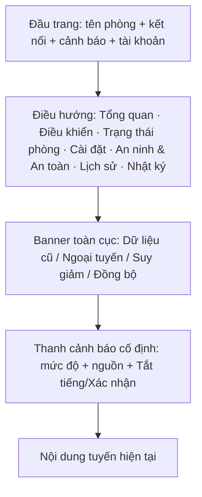
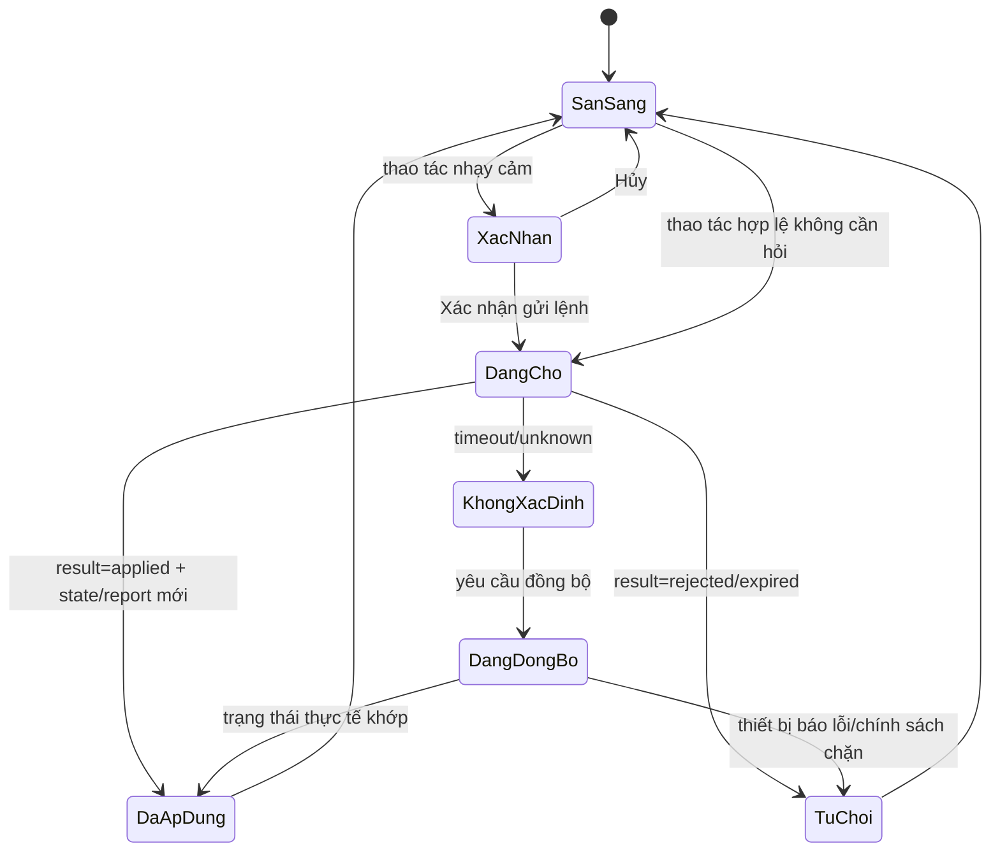
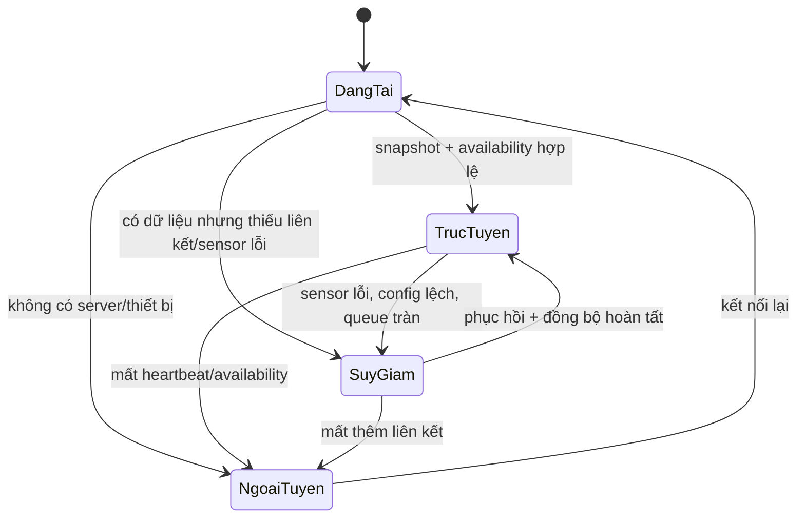

# THIẾT KẾ GIAO DIỆN WEB QUẢN LÝ — PHIÊN BẢN 1.0

## 1. Thông tin kiểm soát

| Thuộc tính | Giá trị |
|---|---|
| Tên tài liệu | Thiết kế giao diện web quản lý phòng thông minh |
| Phiên bản | 1.0 |
| Trạng thái | **ĐÃ DUYỆT — 26/09/2026** |
| Giai đoạn | Giai đoạn 9 — Thiết kế giao diện |
| Ngày tạo | 26/09/2026 |
| Đầu vào đã khóa | Đặc tả 1.2, Ma trận kiểm thử 1.2, CR-02, Kiến trúc 1.1, UML 1.1, Thiết kế phần cứng 1.0, Giao thức UART 1.0, MQTT 1.0 và Thiết kế dữ liệu 1.0 |
| Phạm vi | Kiến trúc thông tin, bố cục thích ứng, trang, thành phần, luồng thao tác, trạng thái tải/lỗi/ngoại tuyến và quy tắc hiển thị |
| Chưa thuộc tài liệu này | Cây thư mục mã nguồn (Giai đoạn 10), framework cụ thể, API đã chạy, cơ sở dữ liệu thật, firmware và kết quả người dùng |

Tài liệu này mô tả giao diện cần xây dựng, không phải ảnh chụp hoặc bằng chứng giao diện đã triển khai.

## 2. Mục tiêu và nguyên tắc trải nghiệm

Ứng dụng là một web thích ứng cho một chủ phòng, dùng máy tính hoặc điện thoại. Mọi chữ trên giao diện ưu tiên tiếng Việt; tên kỹ thuật chỉ xuất hiện ở phần chi tiết/chẩn đoán.

Nguyên tắc bắt buộc:

1. Hiển thị trạng thái thực tế từ máy chủ/thiết bị, không đổi trạng thái thành công ngay sau khi gửi lệnh.
2. Mọi giá trị phải kèm chất lượng và thời điểm; dữ liệu cũ, lỗi, chưa sẵn sàng và ngoại tuyến không được trình bày như số đo hiện tại.
3. Tách rõ `Tự động/Thủ công` khỏi `Ở nhà/Ra ngoài/Ban đêm`; trạng thái Ra ngoài có thể khóa điều khiển tiện nghi.
4. Hiển thị nổi bật rằng quạt và khóa là **MÔ PHỎNG**, đèn là đầu ra phần cứng thật theo phạm vi 1.2; không dùng nhãn “servo đã quay”, “cửa đã khóa chắc chắn” hoặc “quạt đang chạy”.
5. Cảnh báo an toàn/an ninh không bị ẩn bởi trang khác. Nút **Tắt tiếng** và **Xác nhận** là hai thao tác khác nhau.
6. Giao diện điện thoại được thiết kế trước, sau đó mở rộng thành lưới nhiều cột cho màn hình rộng. Đây là cách tiếp cận phù hợp với responsive design và media query của web hiện đại [MDN Responsive Design](https://developer.mozilla.org/en-US/docs/Learn_web_development/Core/CSS_layout/Responsive_Design).
7. Mọi thao tác dùng được bằng bàn phím, có tiêu điểm nhìn thấy, nhãn biểu mẫu và thông báo dành cho công nghệ hỗ trợ. Mục tiêu thiết kế là hướng tới WCAG 2.2 mức AA; chưa tuyên bố đạt trước khi kiểm thử thật [WCAG 2.2](https://www.w3.org/TR/wcag/).

## 3. Người dùng, quyền và phạm vi chức năng

### 3.1. Một chủ phòng

Phiên bản 1.0 chỉ có một tài khoản chủ phòng. Máy chủ quyết định quyền; trình duyệt không giữ thông tin MQTT của thiết bị.

| Tác vụ | Yêu cầu phiên | Xác nhận bổ sung |
|---|---|---|
| Xem tổng quan, lịch sử, nhật ký | Đã đăng nhập | Không |
| Bật/tắt đèn hoặc quạt mô phỏng | Đã đăng nhập | Có nếu đang Tự động vì sẽ chuyển Thủ công |
| Đổi phương thức/hồ sơ phòng | Đã đăng nhập | Có khi chuyển Ra ngoài, Ban đêm hoặc đổi quyền điều khiển |
| Đổi ngưỡng đèn | Đã đăng nhập | Kiểm tra toàn bộ biểu mẫu trước lưu |
| Đổi ngưỡng MQ-2 bảo trì | Đã đăng nhập + mở luồng Bảo trì/Hiệu chuẩn | Cảnh báo rõ; không có nút vô hiệu hóa an toàn |
| Tắt tiếng cảnh báo | Đã đăng nhập | Không xóa nguyên nhân |
| Xác nhận cảnh báo | Đã đăng nhập | Chỉ bật khi mọi nguyên nhân đã hết |
| Khóa/mở khóa mô phỏng | Đã đăng nhập | Mở khóa luôn hỏi xác nhận; cảnh báo an ninh có thể chặn |

Không có màn hình quản trị nhiều người dùng, chia quyền, email, SMS, điều khiển điện lưới hoặc điều khiển servo/động cơ thật.

## 4. Kiến trúc thông tin và điều hướng

### 4.1. Các tuyến giao diện

| Tuyến | Tên tiếng Việt | Mục đích |
|---|---|---|
| `/dang-nhap` | Đăng nhập | Tạo phiên chủ phòng |
| `/tong-quan` | Tổng quan | Nhìn nhanh cảm biến, tải, hồ sơ, cảnh báo và kết nối |
| `/dieu-khien` | Điều khiển | Đèn thật, quạt mô phỏng, phương thức và lệnh khóa mô phỏng |
| `/trang-thai-phong` | Trạng thái phòng | Chọn Ở nhà/Ra ngoài/Ban đêm và xem tác động |
| `/cai-dat-tu-dong` | Cài đặt tự động | Ngưỡng đèn, vùng trễ, trạng thái cấu hình desired/reported |
| `/an-ninh-an-toan` | An ninh & An toàn | Vùng cửa SRF04, khóa mô phỏng, MQ-2, cảm biến lửa và vòng đời cảnh báo |
| `/lich-su` | Lịch sử | Biểu đồ mức sáng 24 giờ/7 ngày/30 ngày, khoảng trống |
| `/nhat-ky` | Nhật ký | Lọc sự kiện, lệnh, cảnh báo, lỗi và kết quả |

`/tai-khoan` không phải một phân hệ độc lập bắt buộc; menu người dùng chỉ có đổi mật khẩu, xem phiên hiện tại và Đăng xuất khi Giai đoạn 16 triển khai.

### 4.2. Thanh khung chung



- Đầu trang luôn có trạng thái `Trực tuyến`, `Suy giảm` hoặc `Ngoại tuyến` và thời điểm cập nhật gần nhất.
- Khi có cảnh báo `Nghiêm trọng`, thanh cảnh báo xuất hiện trên mọi trang; không dùng cửa sổ bật lên lặp liên tục.
- Trên điện thoại, năm mục chính nằm ở thanh điều hướng dưới; các mục còn lại ở ngăn **Thêm**. Trên màn hình rộng, dùng thanh bên cố định.
- Khi chưa đăng nhập, chỉ cho phép `/dang-nhap`; các tuyến khác chuyển về đăng nhập và không tạo lệnh.

## 5. Hệ thống hiển thị và thích ứng

### 5.1. Bố cục theo kích thước

| Vùng | Bố cục |
|---|---|
| 360–767 px | Một cột; thẻ xếp dọc; nút thao tác toàn chiều rộng; bảng nhật ký cuộn ngang có nhãn rõ |
| 768–1199 px | Hai cột; thanh bên có thể thu gọn; biểu đồ và thẻ cảnh báo chia vùng |
| ≥1200 px | Lưới 12 cột; thanh bên cố định; tổng quan tối đa bốn thẻ cảm biến trên một hàng |

Không khóa nội dung vào chiều rộng thiết bị cụ thể. Dùng đơn vị tương đối, lưới linh hoạt và media query; luôn có thẻ viewport trong HTML. Nguồn CSS ở Giai đoạn 10 phải đặt kiểu điện thoại trước, sau đó thêm breakpoint rộng hơn.

### 5.2. Màu, chữ và biểu tượng

| Ý nghĩa | Nhãn bắt buộc | Quy tắc |
|---|---|---|
| Bình thường | Bình thường | Màu trung tính/xanh; vẫn có chữ |
| Đang chờ | Đang chờ | Hiển thị spinner nhẹ hoặc thanh tiến trình; không khóa toàn trang |
| Suy giảm | Suy giảm | Vàng/cam + lý do |
| Cảnh báo | Cảnh báo | Đỏ + biểu tượng + chữ; không chỉ dựa màu |
| Ngoại tuyến | Ngoại tuyến | Xám + thời điểm cuối |
| Mô phỏng | MÔ PHỎNG | Nhãn viền cố định trên thẻ cơ cấu |

Nhãn và biểu tượng phải đi cùng nhau; ví dụ biểu tượng khóa không được đứng một mình để biểu thị “đã khóa”. Chữ không nhỏ hơn mức đọc thoải mái trên điện thoại; tiêu đề và giá trị có thứ bậc rõ. Biểu đồ luôn có chú giải và đơn vị `%` hoặc `mm` tương ứng.

### 5.3. Tiêu điểm và thao tác cảm ứng

- Mọi nút, liên kết, ô nhập và tab có thể đi bằng bàn phím; focus ring không bị `outline: none` loại bỏ.
- Vùng bấm mục tiêu thiết kế tối thiểu 44×44 CSS px, có khoảng cách tránh bấm nhầm.
- Không tự động chuyển trang khi một cảnh báo mới đến; đưa thông báo vào vùng `aria-live` và giữ tiêu điểm người dùng.
- Hỗ trợ `prefers-reduced-motion`; khi bật, không nhấp nháy LED/cảnh báo trên giao diện và không dùng chuyển động dài.

## 6. Các trang và thành phần

### 6.1. Đăng nhập

Thành phần: tên tài khoản, mật khẩu, nút **Đăng nhập**, trạng thái đang xử lý và thông báo lỗi chung. Không hiển thị chi tiết “tài khoản tồn tại/không tồn tại”.

- Thành công: chuyển `/tong-quan`, tạo phiên máy chủ.
- Sai: thông báo “Thông tin đăng nhập chưa đúng”, không tạo lệnh.
- Phiên hết hạn: giữ tuyến hiện tại sau khi người dùng đăng nhập lại nếu an toàn; không gửi lại lệnh cũ.
- Không lưu mật khẩu ở localStorage; trình duyệt chỉ nhận cookie/token do máy chủ quản lý.

### 6.2. Tổng quan

```text
┌────────────────────────────────────────────────────────────┐
│ Phòng thông minh · Trực tuyến · Ở nhà · Tự động · Cảnh báo │
├────────────────────────────────────────────────────────────┤
│ [Mức sáng] [Vùng cửa] [MQ-2 tương đối] [Cảm biến lửa]     │
│  37 %        Trống         Đang làm nóng      Bình thường  │
│  Hợp lệ      Cập nhật...   Chưa kết luận      Hợp lệ       │
├───────────────────────────────┬────────────────────────────┤
│ Đầu ra                         │ Cảnh báo hiện hành         │
│ Đèn: Bật · Phần cứng thật     │ Không có / danh sách       │
│ Quạt: Tắt · MÔ PHỎNG          │ Tắt tiếng · Xác nhận       │
│ Khóa: Khóa · MÔ PHỎNG         │                            │
├───────────────────────────────┴────────────────────────────┤
│ Nhật ký gần đây · thời điểm cuối · chất lượng dữ liệu       │
└────────────────────────────────────────────────────────────┘
```

Thẻ bắt buộc:

| Thẻ | Nội dung |
|---|---|
| Mức sáng | `relative_pct`, ADC tùy chọn, chất lượng, thời điểm; dùng cho TD-02 |
| Vùng cửa | `Trống/Phát hiện đối tượng/Không xác định`, khoảng cách nếu hợp lệ; không gọi là cửa mở/đóng |
| MQ-2 | ADC tùy chọn, mức tương đối 0–100%, `Làm nóng/Bình thường/Cảnh báo/Lỗi cảm biến`; không có ppm |
| Cảm biến lửa | `Bình thường/Cảnh báo/Lỗi cảm biến`, thời điểm và nguồn |
| Đèn | Bật/Tắt, nguồn điều khiển, `PHẦN CỨNG THẬT` |
| Quạt | Bật/Tắt logic, nguồn điều khiển, `MÔ PHỎNG` |
| Khóa | Khóa/Mở theo trạng thái lệnh, `MÔ PHỎNG`, `Chưa xác minh cơ khí` |
| Kết nối | Trực tuyến/Suy giảm/Ngoại tuyến; Wi-Fi, MQTT, UART và thời điểm cuối nếu có |

Khi offline, mỗi thẻ vẫn giữ giá trị cuối nhưng có nhãn **Dữ liệu cũ — lúc HH:mm:ss**; nếu quá hạn hoặc lỗi thì hiển thị `—` và lý do.

### 6.3. Điều khiển

Mỗi thiết bị có thẻ:

- tên tiếng Việt;
- trạng thái báo cáo;
- nguồn `Thủ công/Tự động/Hồ sơ phòng/An toàn/An ninh`;
- nút **Bật** và **Tắt** đặt trạng thái, không có **Đảo trạng thái**;
- trạng thái lệnh `Đang gửi`, `Đang chờ ACK`, `Đã áp dụng`, `Bị từ chối`, `Không xác định`;
- cờ mô phỏng nếu là quạt.

Quy tắc tương tác:

1. Nếu đang `Tự động`, bấm Bật/Tắt mở hộp thoại: “Lệnh trực tiếp sẽ chuyển phương thức sang Thủ công. Bạn có xác nhận không?”. Chọn **Hủy** không tạo lệnh; **Xác nhận và thực hiện** gửi giao dịch ghép.
2. Nếu `Ra ngoài`, nút tiện nghi bị vô hiệu hóa với lý do “Ra ngoài đang cưỡng chế tắt đèn và quạt”. Không dùng disabled để che lý do; hiển thị chú giải văn bản.
3. Nếu dữ liệu cảm biến cũ/lỗi, điều khiển Thủ công vẫn có thể dùng theo chính sách; quy tắc Tự động hiển thị **Tạm dừng do dữ liệu không hợp lệ**.
4. Ứng dụng không đổi thẻ thiết bị ngay khi gửi. Chỉ sau `commands/result=applied` và/hoặc `state/reported` mới đổi trạng thái chính.
5. Khi timeout, giữ trạng thái trước đó, hiển thị **Không xác định — đang đồng bộ**, kèm nút **Thử lại** sau khi kiểm tra phiên.

Khóa trong trang này là **Khóa mô phỏng/Mở khóa mô phỏng**. Không đặt nhãn “Cửa đã khóa”; luôn hiển thị `xac_minh_co_khi=false` dưới phần chi tiết.

### 6.4. Trạng thái phòng

Ba thẻ lựa chọn độc lập:

| Hồ sơ | Tóm tắt hiển thị | Tác động phải xem trước |
|---|---|---|
| **Ở nhà** | Tiện nghi theo Tự động hoặc Thủ công | Không tự mở khóa; vùng an ninh trong phòng không báo động giả |
| **Ra ngoài** | Tắt cưỡng chế tiện nghi; khóa mô phỏng; trang bị vùng cửa | Từ chối lệnh bật đèn/quạt; cảnh báo xâm nhập được kích hoạt |
| **Ban đêm** | Giữ phương thức tiện nghi; bảo vệ vùng cửa | Chuyển động trong phòng không gây báo động giả |

Chuyển sang Ra ngoài/Ban đêm cần hộp thoại xác nhận nêu rõ hành động. Kết quả có ba mức:

- **Đã áp dụng:** tất cả hành động cần thiết có ACK;
- **Suy giảm:** hồ sơ đã đổi nhưng khóa/vùng/cơ cấu có bước lỗi;
- **Bị từ chối:** thiết bị không nhận hoặc chính sách không cho phép.

Khi trở về Ở nhà, giao diện phải nhắc: “Cửa không tự mở; phương thức trước đó được giữ”. Nếu phương thức là Thủ công, đèn/quạt không tự bật lại.

### 6.5. Cài đặt tự động

Biểu mẫu **Cài đặt đèn**:

| Trường | Hiển thị | Kiểm tra phía giao diện |
|---|---|---|
| Ngưỡng bật đèn | 0–80% | Số nguyên; 0 là tối nhất |
| Ngưỡng tắt đèn | 20–100% | Cao hơn ngưỡng bật ít nhất 5 điểm |
| Thời gian giữ tối thiểu | Hiển thị 10 giây, khóa chỉnh | Tham số kỹ thuật cố định |
| Hiệu chuẩn LDR | Mốc tối/sáng, trạng thái đã hiệu chuẩn | Chỉ lưu khi đủ hai mốc hợp lệ |

MQ-2 không nằm trong biểu mẫu tiện nghi. Một liên kết **Mở chế độ Bảo trì/Hiệu chuẩn an toàn** dẫn tới trang An ninh & An toàn, cảnh báo rằng ngưỡng chỉ là tương đối và không có nút vô hiệu hóa cảnh báo.

Trạng thái cấu hình luôn hiển thị:

```text
Cấu hình mong muốn: phiên bản 13 · Đã lưu máy chủ
Cấu hình báo cáo:   phiên bản 12 · Chờ thiết bị áp dụng
```

Nút **Lưu cấu hình** chuyển sang `Đang kiểm tra` → `Đang chờ thiết bị` → `Đã áp dụng` hoặc `Bị từ chối`. Nếu mất mạng, cho phép lưu nháp cục bộ trên biểu mẫu nhưng không ghi “đã áp dụng”; mặc định không tự gửi lại bản nháp sau reconnect nếu người dùng chưa xác nhận lại.

### 6.6. An ninh & An toàn

Chia thành ba vùng nhìn thấy cùng lúc:

1. **Vùng cửa:** `Trống/Phát hiện đối tượng/Không xác định`, ngưỡng và chất lượng SRF04; nhãn “Đây không phải trạng thái cánh cửa”.
2. **Khóa truy cập:** trạng thái lệnh Khóa/Mở, `MÔ PHỎNG`, xác minh cơ khí `Chưa có`; nút mở bị chặn trong cảnh báo an ninh cho đến khi nguyên nhân hết và được xác nhận.
3. **An toàn:** MQ-2 và cảm biến lửa, trạng thái làm nóng/hiệu chuẩn, mức tương đối, cảnh báo và lỗi cảm biến.

Cảnh báo hiển thị theo nguyên nhân:

| Thành phần | Nội dung đúng | Nội dung cấm |
|---|---|---|
| MQ-2 | “Mức tương đối 72% — Cảnh báo”; “Đang làm nóng”; “Lỗi cảm biến” | “72 ppm”, “đã xác định nồng độ khí” |
| Cảm biến lửa | “Dấu hiệu lửa — Cảnh báo”; “Lỗi cảm biến” | “Đã chứng nhận cháy” |
| SRF04 | “Phát hiện đối tượng tại vùng cửa” | “Cửa đã mở” |
| Khóa mô phỏng | “Lệnh mở khóa mô phỏng đã áp dụng” | “Chốt đã mở chắc chắn” |

Nút **Tắt tiếng** chỉ ảnh hưởng còi nếu còi khả dụng; LED và nguyên nhân vẫn còn. Nút **Xác nhận** bị khóa khi còn nguyên nhân active. Khi còi không đạt cổng phần cứng, giao diện ghi “Còi không khả dụng — LED vẫn là đầu ra cảnh báo”, không giả lập âm thanh.

### 6.7. Lịch sử

Bộ lọc bắt buộc: **24 giờ**, **7 ngày**, **30 ngày**; chọn chỉ số **Mức sáng**. Biểu đồ đường dùng mẫu phút từ DB:

- trục thời gian UTC được định dạng theo giờ địa phương để đọc, tooltip ghi cả timestamp;
- dòng bị ngắt khi thiếu mẫu;
- mẫu `partial`, `stale` hoặc `invalid` có chú giải riêng;
- không nội suy hoặc nối qua khoảng ngoại tuyến;
- trạng thái “Chưa có dữ liệu” khác với “Không tải được dữ liệu”.

Mốc chuyển hồ sơ, chuyển phương thức và cảnh báo có thể phủ lên biểu đồ dưới dạng chú thích; chúng không thay đổi số đo.

### 6.8. Nhật ký

Bộ lọc: khoảng thời gian, loại (`Lệnh`, `Cấu hình`, `Cảm biến`, `An ninh`, `An toàn`, `Hệ thống`), mức độ, nguồn và kết quả. Mỗi dòng có:

```text
Thời điểm · Loại · Mức độ · Nội dung tiếng Việt · Nguồn · Mã ID · Chi tiết
```

Chi tiết mở rộng hiển thị `event_id/command_id`, phiên boot, phiên liên kết, phiên bản cấu hình/trạng thái, thời điểm thiết bị/máy chủ và lý do. Không hiển thị mật khẩu, token, payload MQTT thô hoặc mã PIN.

## 7. Máy trạng thái giao diện

### 7.1. Lệnh điều khiển



### 7.2. Kết nối và dữ liệu



## 8. Luồng dữ liệu với máy chủ

### 8.1. Tải lần đầu

1. Trình duyệt `GET /api/session`; nếu hợp lệ gọi `GET /api/overview`.
2. Máy chủ trả ảnh chụp gồm dữ liệu, `received_at`, chất lượng, phiên bản và cảnh báo active.
3. Trình duyệt mở kênh sự kiện thời gian thực; dữ liệu đến sau ảnh chụp chỉ áp dụng khi ID/phiên bản mới hơn.
4. Nếu kênh thời gian thực không mở, hiển thị `Suy giảm` và dùng polling có giới hạn; không quay về MQTT trực tiếp.

### 8.2. Kênh thời gian thực

Thiết kế chọn **Server-Sent Events (SSE)** cho chiều máy chủ → trình duyệt và HTTP yêu cầu–đáp ứng cho lệnh/cấu hình. SSE phù hợp vì web chủ yếu nhận cập nhật; exact framework để Giai đoạn 10 quyết định.

```text
GET /api/events/stream
event: state.updated
id: stream-00042
data: {"device_id":"room-01","state_version":45,"...":"..."}
```

Event name:

| Event SSE | Nguồn | Xử lý |
|---|---|---|
| `telemetry.updated` | mẫu cảm biến hiện tại | Cập nhật thẻ nếu mới; không viết lịch sử từ trình duyệt |
| `state.updated` | `state_reports` | Cập nhật output/profile/mode |
| `availability.updated` | availability | Đổi badge và banner |
| `config.updated` | desired/reported | Đổi trạng thái cấu hình |
| `command.updated` | commands/result | Kết thúc trạng thái chờ theo `command_id` |
| `alert.updated` | alert causes/transitions | Cập nhật thanh cảnh báo |
| `event.created` | system events | Chèn một dòng nhật ký |

Trình duyệt gửi `Last-Event-ID` khi reconnect; máy chủ chỉ phát lại event còn trong cửa sổ an toàn hoặc gửi snapshot mới. Không phát lại toàn bộ telemetry bị thiếu.

### 8.3. Hợp đồng API mức giao diện

| Phương thức | Đường dẫn | Mục đích |
|---|---|---|
| `GET` | `/api/session` | Phiên, người dùng, quyền và trạng thái ứng dụng |
| `GET` | `/api/overview` | Ảnh chụp tổng quan, state, sensor, availability, alert |
| `GET` | `/api/config` | Desired/reported và giới hạn biểu mẫu |
| `PUT` | `/api/config/desired` | Tạo phiên bản cấu hình mong muốn mới |
| `POST` | `/api/commands` | Gửi lệnh có `command_id`, TTL và dữ liệu xác nhận |
| `POST` | `/api/alerts/{alert_id}/mute` | Tắt tiếng đầu ra âm thanh |
| `POST` | `/api/alerts/{alert_id}/ack` | Xác nhận sau khi nguyên nhân hết |
| `GET` | `/api/history?metric=light&from=&to=` | Mẫu phút và khoảng trống |
| `GET` | `/api/logs?type=&severity=&from=&to=&cursor=` | Nhật ký phân trang |
| `GET` | `/api/events/stream` | SSE thời gian thực |

Bao lỗi thống nhất:

```json
{
  "error_code": "command_rejected",
  "message": "Lệnh bị từ chối vì hồ sơ Ra ngoài đang cưỡng chế tắt tải tiện nghi.",
  "request_id": "req-123",
  "details": {"device_id": "room-01", "reason_code": "away_profile"}
}
```

HTTP `2xx` chỉ nghĩa là máy chủ đã tiếp nhận yêu cầu hợp lệ; giao diện vẫn chờ `command.updated`/ACK cuối. HTTP `401/403` không được biến thành trạng thái thiết bị.

## 9. Quy tắc cụ thể cho xung đột và ngoại tuyến

| Tình huống | Hiển thị | Hành động UI |
|---|---|---|
| Tắt quạt/đèn trong Tự động | Hộp thoại chuyển Thủ công | Chỉ gửi sau xác nhận |
| Bật tiện nghi trong Ra ngoài | Nút khóa + lý do | Không gửi lệnh |
| Ban đêm có đối tượng trong phòng | Không cảnh báo chuyển động bên trong | Vùng cửa vẫn có thể cảnh báo |
| Cảnh báo an ninh còn active | Banner nghiêm trọng | Chặn mở khóa mô phỏng |
| Cảnh báo an toàn còn active | Banner an toàn | Cho phép mở mô phỏng có xác nhận, không tự mở/xóa |
| Còi bị vô hiệu do cổng nguồn | Cảnh báo khả dụng còi | LED và trạng thái logic vẫn hiển thị |
| Cấu hình mới chưa tới thiết bị | “Đã lưu máy chủ — Chờ áp dụng” | Không gọi là đang chạy |
| Mất Internet | Banner Ngoại tuyến + thời điểm cuối | Khóa lệnh từ xa; vẫn xem snapshot cũ |
| Dữ liệu cảm biến lỗi | `Lỗi cảm biến`/`Không sẵn sàng` | Không thay bằng 0; tự động hóa hiển thị tạm dừng |
| Kết quả lệnh unknown | “Không xác định — đang đồng bộ” | Không đổi trạng thái lạc quan; cho xem nhật ký |

## 10. Thông báo trình duyệt

TB-01 là chức năng nhóm B. Giao diện có nút **Cho phép thông báo** trong trang Cài đặt/An ninh, không tự gọi hộp xin quyền khi vừa mở trang. Chỉ gửi một thông báo cho mỗi `alert_id`/mã cảnh báo; cảnh báo nội bộ vẫn hoạt động nếu người dùng từ chối.

Thông báo hệ điều hành cần quyền người dùng và thường yêu cầu ngữ cảnh an toàn HTTPS; trình duyệt có thể không hỗ trợ đồng đều, nên không dùng nó làm kênh cảnh báo duy nhất. Yêu cầu quyền chỉ sau thao tác bấm rõ ràng, phù hợp hướng dẫn Notifications API của MDN [Notifications API](https://developer.mozilla.org/en-US/docs/Web/API/Notifications_API/Using_the_Notifications_API).

## 11. Truy vết tới chức năng và kiểm thử

| Chức năng | Màn hình/thành phần | Kiểm thử |
|---|---|---|
| MT-03, MT-02 | Tổng quan, Lịch sử, chất lượng và banner dữ liệu cũ | KT02, KT14, KT15, KT21, KT36 |
| DK-02 | Điều khiển, dialog chuyển Thủ công, command state | KT03, KT04, KT09, KT18 |
| TD-02 | Cài đặt tự động, thẻ lý do tự động | KT02, KT06, KT07, KT11, KT14 |
| CD-01, CD-02 | Trạng thái phòng, bộ chọn mode/profile | KT04, KT08–KT11, KT24 |
| CH-01 | Biểu mẫu threshold, desired/reported | KT07, KT08, KT16, KT26 |
| AN-05, AN-06 | An ninh & An toàn, vùng cửa, khóa mô phỏng | KT09, KT10, KT12, KT24, KT38, KT39 |
| AT-01, AT-02 | Thẻ MQ-2/lửa, cảnh báo và trạng thái làm nóng | KT25–KT31 |
| CB-01 | Thanh cảnh báo, Tắt tiếng, Xác nhận, nhiều nguyên nhân | KT12, KT13, KT24, KT29–KT31 |
| MN-01 | Badge kết nối, banner, đồng bộ, trạng thái chờ | KT14–KT18, KT31 |
| UD-01 | Đăng nhập, route guard, toàn bộ shell | KT03, KT18, KT19, KT36 |
| DL-01, BC-01 | Nhật ký, Lịch sử, filter và khoảng trống | KT15, KT20, KT21, KT30, KT36, KT38 |
| TB-01 | Xin quyền và thông báo chống lặp | KT34 |
| MR-01 | Khu vực mở rộng chỉ khi được triển khai | KT35 |

## 12. Tiêu chí chấp nhận Giai đoạn 9

- Có đủ các tuyến bắt buộc: Đăng nhập, Tổng quan, Điều khiển, Trạng thái phòng, Cài đặt tự động, An ninh & An toàn, Lịch sử và Nhật ký.
- Tên chức năng hiển thị tiếng Việt; quạt/khóa mô phỏng và MQ-2 tương đối được gắn nhãn đúng.
- Không có cập nhật lạc quan; lệnh hiển thị chờ cho tới ACK/trạng thái báo cáo cuối.
- Có trạng thái rõ cho tải, lỗi, rỗng, dữ liệu cũ, Suy giảm, Ngoại tuyến và Không xác định.
- Có ba hồ sơ phòng, hai phương thức tiện nghi và quy tắc xung đột đúng đặc tả.
- Có biểu mẫu ngưỡng LDR với kiểm tra vùng trễ; desired/reported và phiên bản được hiển thị.
- Cảnh báo nhiều nguyên nhân, Tắt tiếng/Xác nhận và chặn mở khóa an ninh được thể hiện nhất quán.
- Biểu đồ 24 giờ/7 ngày/30 ngày không nội suy khoảng trống.
- Giao diện thích ứng mobile/desktop, keyboard/focus/aria-live và không dùng màu là tín hiệu duy nhất.
- Kênh SSE/API không làm lộ MQTT credential; đăng nhập và route guard nằm ở máy chủ.
- Không có tuyên bố đã chạy, ảnh thực nghiệm hoặc trạng thái phần cứng chưa được đo.

## 13. Cổng kiểm tra Giai đoạn 9

| Mã | Nội dung | Tiêu chí | Trạng thái |
|---|---|---|---|
| G9-IA-01 | Đối chiếu tuyến và menu | Đủ tám khu vực, không dead link | CHƯA THỰC HIỆN |
| G9-RESP-01 | Kiểm tra 360/768/1200 px | Không tràn ngang, thứ tự nội dung hợp lý | CHƯA THỰC HIỆN |
| G9-DATA-01 | Snapshot + SSE cập nhật | Không ghi đè bản mới bằng bản cũ; timestamp/quality hiện đúng | CHƯA THỰC HIỆN |
| G9-CMD-01 | Luồng lệnh applied/rejected/unknown | Không optimistic update; có retry/sync phù hợp | CHƯA THỰC HIỆN |
| G9-MODE-01 | Xung đột Tự động/Thủ công và hồ sơ | Dialog, disabled reason và xác nhận đúng | CHƯA THỰC HIỆN |
| G9-CONFIG-01 | Biểu mẫu ngưỡng | Kiểm tra toàn bộ, hiển thị desired/reported/pending | CHƯA THỰC HIỆN |
| G9-ALERT-01 | Nhiều nguyên nhân/tắt tiếng/xác nhận | Không xóa cảnh báo sai; chặn mở an ninh | CHƯA THỰC HIỆN |
| G9-GRAPH-01 | Lịch sử và gap | 24h/7d/30d đúng, không nội suy | CHƯA THỰC HIỆN |
| G9-AUTH-01 | Đăng nhập/route/API guard | Người chưa đăng nhập không xem/gửi lệnh | CHƯA THỰC HIỆN |
| G9-OFF-01 | Ngoại tuyến/dữ liệu cũ | Banner, thời điểm, khóa lệnh và phục hồi đúng | CHƯA THỰC HIỆN |
| G9-A11Y-01 | Bàn phím/focus/aria-live/contrast | Có thể sử dụng không cần chuột; không chỉ báo bằng màu | CHƯA THỰC HIỆN |
| G9-NOTIFY-01 | Quyền thông báo trình duyệt | Xin quyền sau thao tác; từ chối vẫn có cảnh báo nội bộ | CHƯA THỰC HIỆN |
| G9-TRACE-01 | Đối chiếu giao diện–DB–MQTT–test | Đủ 18 chức năng và 32 kiểm thử đang áp dụng | CHƯA THỰC HIỆN |

## 14. Nội dung chuyển sang giai đoạn sau

| Giai đoạn | Đầu ra sử dụng |
|---:|---|
| 10 — Tạo cấu trúc dự án | Cây route, component, state store, API client, SSE client, CSS responsive và fixture dữ liệu |
| 14–16 — Máy chủ/web | Hiện thực API, SSE, xác thực, command state, biểu đồ, nhật ký và thông báo |
| 17–18 — Tích hợp/kiểm thử phần mềm | Fixture `online/degraded/offline`, bản tin lặp, timeout, lỗi cảm biến và kiểm thử responsive/a11y |
| 19–21 — Kiểm thử phần cứng/chốt sản phẩm | Đối chiếu trạng thái UI với log/ACK thật; không đánh dấu ĐẠT nếu chưa có minh chứng |

## 15. Lịch sử sửa đổi và điểm duyệt

| Phiên bản | Trạng thái | Nội dung | Lý do/ảnh hưởng |
|---|---|---|---|
| 1.0 | **ĐÃ DUYỆT — 26/09/2026** | Khóa kiến trúc thông tin, tuyến web, bố cục mobile-first, thẻ dữ liệu, luồng lệnh/xác nhận, SSE/API, cảnh báo, lịch sử, nhật ký và tiêu chí khả năng tiếp cận web (accessibility) | Người dùng duyệt đầu ra Giai đoạn 9; mã giao diện và kiểm thử vẫn thuộc các giai đoạn triển khai sau. |

**TRẠNG THÁI KHÓA:** Thiết kế giao diện 1.0 được duyệt làm đường cơ sở cho Giai đoạn 10 — Tạo cấu trúc dự án. Chưa có kết quả chạy API/SSE, chưa xin quyền thông báo và toàn bộ cổng `G9-*` vẫn là `CHƯA THỰC HIỆN`; thay đổi hành vi sau mốc này phải qua quản lý thay đổi.

## 16. Tài liệu tham khảo kỹ thuật

1. MDN Web Docs, *Responsive web design*: <https://developer.mozilla.org/en-US/docs/Learn_web_development/Core/CSS_layout/Responsive_Design>.
2. MDN Web Docs, *Using media queries*: <https://developer.mozilla.org/en-US/docs/Web/CSS/Guides/Media_queries/Using>.
3. MDN Web Docs, *Using the Notifications API*: <https://developer.mozilla.org/en-US/docs/Web/API/Notifications_API/Using_the_Notifications_API>.
4. W3C, *Web Content Accessibility Guidelines (WCAG) 2.2*: <https://www.w3.org/TR/wcag/>.
5. W3C WAI, *Understanding Success Criterion 2.4.7: Focus Visible*: <https://www.w3.org/WAI/WCAG22/Understanding/focus-visible>.
