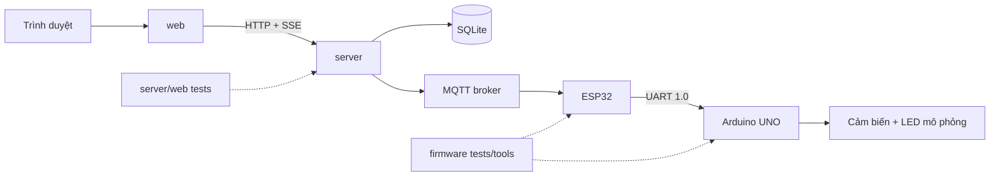

# CẤU TRÚC DỰ ÁN VÀ QUY ƯỚC MÃ NGUỒN — PHIÊN BẢN 1.0

## 1. Thông tin kiểm soát

| Thuộc tính | Giá trị |
|---|---|
| Tên tài liệu | Cấu trúc dự án phòng thông minh |
| Phiên bản | 1.0 |
| Trạng thái | **ĐÃ DUYỆT — 26/09/2026** |
| Giai đoạn | Giai đoạn 10 — Tạo cấu trúc dự án |
| Ngày tạo | 26/09/2026 |
| Đầu vào đã khóa | Đặc tả 1.2, Ma trận 1.2, CR-02, Kiến trúc 1.1, UML 1.1, Phần cứng 1.0, UART 1.0, MQTT 1.0, Dữ liệu 1.0 và Giao diện 1.0 |
| Phạm vi | Cây thư mục, nền tảng phần mềm, ranh giới mô-đun, cấu hình môi trường, quy ước build/test và file nền tảng |
| Chưa thuộc tài liệu này | Logic firmware hoàn chỉnh, migration chạy thật, broker, API nghiệp vụ hoàn chỉnh, giao diện hoàn chỉnh và kết quả thực nghiệm |

Giai đoạn này đã tạo các file nền tảng trong repository. Các file được gọi là **khung Giai đoạn 10**; không được trình bày như firmware, máy chủ hoặc ứng dụng đã hoàn thành.

## 2. Mục tiêu và quyết định nền tảng

### 2.1. Phương án được chọn

| Thành phần | Quyết định Giai đoạn 10 | Lý do |
|---|---|---|
| Máy chủ | Node.js + TypeScript, HTTP API theo hợp đồng Giai đoạn 9 | Một ngôn ngữ cho API, MQTT worker, SSE và công cụ kiểm thử; kiểu tĩnh giúp giảm lỗi dữ liệu |
| Cơ sở dữ liệu | SQLite 3 theo Dữ liệu 1.0 | Không cần dịch vụ DB riêng cho một phòng; chỉ máy chủ mở tệp |
| MQTT | Client MQTT 3.1.1 theo MQTT 1.0 | Giữ topic/QoS/retain/LWT đã khóa |
| Giao diện | TypeScript + HTML/CSS mobile-first, bundler Vite ở giai đoạn chạy web | Có thể tạo giao diện thích ứng mà không đưa MQTT credential vào trình duyệt |
| Firmware | PlatformIO với Arduino framework; một môi trường cho UNO R3 và ESP32 DevKit | Tách project, dễ kiểm tra biên dịch và khóa thư viện theo môi trường |
| Kiểm thử | Vitest/kiểm thử TypeScript cho phần máy chủ-web; bộ mô phỏng bản tin | Chạy tự động trước khi tích hợp phần cứng |

Framework HTTP cụ thể, thư viện SQLite/MQTT và phiên bản khóa sẽ được cài/kiểm tra ở Giai đoạn 13–16. Giai đoạn 10 chỉ đặt ranh giới và file cơ sở; không ghi kết quả cài đặt chưa thực hiện.

### 2.2. Nguyên tắc ranh giới

- `firmware/uno` không import mã ESP32, MQTT, HTTP hoặc JSON động.
- `firmware/esp32` không sở hữu logic đầu ra vật lý của UNO; ESP32 là cầu nối UART–Wi-Fi–MQTT/NVS.
- `server` không đọc chân GPIO/serial trực tiếp; mọi dữ liệu thiết bị đi qua MQTT.
- `web` chỉ gọi API/SSE của máy chủ; không biết tài khoản broker.
- `shared` chứa hợp đồng/kiểu dùng chung, không chứa bí mật và không nhân bản ngữ nghĩa đã khóa trong nhiều nơi.
- `data` chỉ chứa dữ liệu chạy cục bộ, bị bỏ qua bởi quản lý mã nguồn.
- `docs` là nguồn mô tả học thuật; mã nguồn phải khớp các tài liệu đã khóa.

## 3. Cây thư mục chuẩn

```text
super_iot_project/
├── README.md
├── .gitignore
├── package.json                    # workspace scripts, không chứa bí mật
├── config/
│   └── env.example                 # tên biến môi trường, giá trị mẫu an toàn
├── docs/
│   ├── 00-quy-trinh-du-an.md
│   ├── 01–11-*.md                  # đường cơ sở đã duyệt
│   └── 12-cau-truc-du-an-v1.0.md
├── firmware/
│   ├── uno/
│   │   ├── platformio.ini
│   │   ├── include/app.hpp
│   │   ├── src/main.cpp
│   │   ├── src/app.cpp
│   │   └── test/README.md
│   └── esp32/
│       ├── platformio.ini
│       ├── include/app.hpp
│       ├── src/main.cpp
│       ├── src/app.cpp
│       └── test/README.md
├── server/
│   ├── package.json
│   ├── tsconfig.json
│   ├── src/
│   │   ├── index.ts
│   │   ├── app.ts
│   │   ├── config/env.ts
│   │   ├── types/domain.ts
│   │   ├── api/routes.ts
│   │   ├── data/repository.ts
│   │   ├── mqtt/client.ts
│   │   └── realtime/event-stream.ts
│   └── test/README.md
├── web/
│   ├── package.json
│   ├── tsconfig.json
│   ├── vite.config.ts
│   ├── index.html
│   └── src/
│       ├── main.ts
│       ├── styles.css
│       └── README.md
├── shared/
│   └── README.md
├── tools/
│   ├── README.md
│   └── check-stage10.mjs
├── tests/
│   └── README.md
└── data/
    └── README.md                     # hướng dẫn thư mục runtime, không phải DB thật
```

Tên `01–11-*.md` trong sơ đồ chỉ là ký hiệu rút gọn; các file thực tế giữ tên đầy đủ đang có trong repository.

## 4. Trách nhiệm mô-đun

### 4.1. Firmware UNO

Các mô-đun sẽ được tách ở Giai đoạn 11:

| Mô-đun dự kiến | Trách nhiệm |
|---|---|
| `sensors` | LDR, SRF04, MQ-2, cảm biến lửa; chất lượng, làm nóng, lọc và lỗi |
| `actuators` | LED đèn, LED quạt mô phỏng, LED khóa mô phỏng, LED cảnh báo và còi có điều kiện |
| `automation` | Ngưỡng LDR, vùng trễ, thời gian giữ và nguồn điều khiển |
| `room_state` | Ở nhà/Ra ngoài/Ban đêm và Tự động/Thủ công |
| `alerts` | Nhiều nguyên nhân, Tắt tiếng/Xác nhận, ưu tiên an toàn/an ninh |
| `link_protocol` | COBS, CRC, session, sequence, ACK/NACK và cửa sổ POLL theo UART 1.0 |
| `app` | Lập lịch không chặn và phối hợp vòng lặp |

UNO không có mã tài khoản, HTTP, MQTT, SQLite hoặc JSON động.

### 4.2. Firmware ESP32

| Mô-đun dự kiến | Trách nhiệm |
|---|---|
| `uart_bridge` | Khung UART, parser, timeout, retry và snapshot |
| `wifi_manager` | Kết nối Wi-Fi, backoff, khả dụng |
| `mqtt_client` | Topic 1.0, JSON, QoS/retain/LWT, ACL client |
| `config_store` | NVS cho cấu hình hợp lệ gần nhất |
| `offline_queue` | Tối thiểu 100 event/alert, gửi bù cũ trước |
| `reconciliation` | Hòa giải boot/session/config/state sau reset/reconnect |
| `app` | Lập lịch không chặn và phối hợp hai liên kết |

ESP32 không biến `PUBACK` thành ACK thiết bị; chỉ kết quả UNO cuối mới được chuyển thành `commands/result`.

### 4.3. Máy chủ

| Mô-đun dự kiến | Trách nhiệm |
|---|---|
| `api` | Auth, overview, command, config, history, log và error envelope |
| `mqtt` | Kết nối broker, validate envelope, inbox/outbox, LWT/availability |
| `data` | SQLite repository, transaction, migration, retention |
| `realtime` | SSE snapshot/event, Last-Event-ID, reconnect |
| `auth` | Băm mật khẩu, session, route guard; chỉ một chủ phòng |
| `jobs` | Gom telemetry phút, dọn dữ liệu, retry outbox, health |
| `types` | Kiểu miền khớp docs 08–11 |

### 4.4. Web

| Mô-đun dự kiến | Trách nhiệm |
|---|---|
| `pages` | Tám tuyến UI ở Giai đoạn 9 |
| `components` | Thẻ sensor, output, alert, dialog xác nhận, banner và bảng log |
| `state` | Snapshot, SSE event, command/config lifecycle |
| `api` | Fetch có session, error envelope, không MQTT |
| `styles` | Mobile-first, breakpoint, focus, reduced motion |
| `fixtures` | Trạng thái mô phỏng để kiểm thử; không phải kết quả phần cứng |

## 5. Cấu hình môi trường

File `config/env.example` chỉ ghi tên và giá trị minh họa. Giá trị thật đặt trong môi trường cục bộ hoặc kho bí mật, không commit.

| Biến | Mặc định phát triển | Ý nghĩa |
|---|---|---|
| `NODE_ENV` | `development` | Chế độ chạy |
| `HTTP_PORT` | `3000` | Cổng máy chủ API |
| `WEB_DEV_PORT` | `5173` | Cổng Vite khi phát triển |
| `DB_FILE` | `./data/smartroom.sqlite3` | Tệp SQLite runtime |
| `MQTT_URL` | `mqtt://localhost:1883` | Chỉ LAN cô lập; không dùng ngoài LAN |
| `MQTT_DEVICE_ROOT` | `smartroom/v1/devices` | Gốc topic đã khóa |
| `MQTT_CLIENT_ID` | `smartroom-backend` | ID dịch vụ máy chủ |
| `SESSION_SECRET` | Không đặt giá trị dùng thật | Bí mật phiên, phải cung cấp bên ngoài |
| `COOKIE_SECURE` | `false` ở local | `true` khi HTTPS |

Firmware có bộ cấu hình riêng; Wi-Fi/MQTT credential không được ghi vào source. `env.example` không phải file cấu hình chạy.

## 6. Quy ước mã nguồn

- TypeScript bật strict mode; tên biến nội bộ ASCII rõ nghĩa, nhãn UI tiếng Việt.
- Mỗi hàm xử lý dữ liệu nhận input đã validate; lỗi dùng mã miền, không ném chuỗi tùy ý ra UI.
- Mọi ghi DB dùng transaction/repository; không để SQL trong component giao diện.
- Mọi bản tin MQTT đi qua validator; không truyền `any` từ broker tới UI.
- Firmware dùng lập lịch dựa trên `millis()`, không thêm `delay` dài vào vòng lặp.
- Không đặt mật khẩu, token, Wi-Fi, mã PIN, khóa TLS hoặc dữ liệu thật trong repository.
- Chức năng mô phỏng dùng cờ `actuator_mode=simulated` xuyên suốt; không đặt tên module khiến người đọc hiểu là servo/motor thật.
- Thời điểm máy chủ lưu UTC; UI định dạng theo locale nhưng giữ timestamp gốc trong chi tiết.
- Tên test giữ nguyên mã `KTxx`, `Gx-*`; không tái sử dụng ID cho hành vi khác.

## 7. Cấu hình chạy và kiểm tra dự kiến

Sau khi cài runtime ở các giai đoạn sau, các lệnh chuẩn dự kiến:

```text
npm install
npm run check:stage10
npm run typecheck
npm run test
npm run server:dev
npm run web:dev

pio run -d firmware/uno
pio run -d firmware/esp32
```

Ở Giai đoạn 10, các lệnh trên chưa được coi là đã chạy thành công; việc cài Node/PlatformIO và kiểm tra build sẽ được ghi nhận bằng bằng chứng ở Giai đoạn 11–18.

## 8. File nền tảng đã tạo

| File/nhóm | Trạng thái Giai đoạn 10 | Ý nghĩa |
|---|---|---|
| `package.json`, workspace package | Đã tạo | Khung lệnh và workspace, chưa khóa lockfile |
| `server/src/*` | Đã tạo khung | HTTP health scaffold, kiểu và cổng mô-đun; chưa có nghiệp vụ |
| `web/*` | Đã tạo khung | Trang HTML/CSS/TypeScript tối thiểu; chưa có màn hình thật |
| `firmware/*` | Đã tạo khung biên dịch | `setup/loop` và app entry an toàn; chưa đọc cảm biến/điều khiển |
| `shared`, `tools`, `tests`, `data` | Đã tạo | Ranh giới dữ liệu, công cụ, kiểm tra cấu trúc và runtime |
| `config/env.example`, `.gitignore` | Đã tạo | Cấu hình mẫu và bảo vệ bí mật/dữ liệu runtime |

“Đã tạo khung” không đồng nghĩa “đã triển khai thành công”.

## 9. Sơ đồ phụ thuộc



Không có mũi tên trực tiếp từ trình duyệt tới broker, UNO, ESP32 hoặc SQLite.

## 10. Cổng kiểm tra Giai đoạn 10

| Mã | Nội dung | Tiêu chí | Trạng thái |
|---|---|---|---|
| G10-TREE-01 | Đối chiếu cây thư mục | Đủ ranh giới firmware/server/web/shared/tools/tests/data | ĐẠT — kiểm tra tĩnh 26/09/2026 |
| G10-CONFIG-01 | Kiểm tra env mẫu | Không có bí mật, tên biến khớp tài liệu MQTT/DB/UI | ĐẠT — kiểm tra tĩnh; chưa chạy runtime |
| G10-TS-01 | TypeScript strict scaffold | File nền tảng có cấu hình compiler hợp lệ | CHƯA THỰC HIỆN — môi trường chưa có npm/tsc |
| G10-WEB-01 | Web scaffold | HTML/CSS/TS có thể được bundler nhận, không kết nối MQTT trực tiếp | CHƯA THỰC HIỆN — chưa có npm/Vite runtime |
| G10-FW-01 | Firmware scaffold | UNO/ESP32 có entry `setup/loop`, chưa tạo tác động tải ngoài ý muốn | CHƯA THỰC HIỆN — môi trường chưa có PlatformIO |
| G10-BOUNDARY-01 | Kiểm tra phụ thuộc | Không trộn DB/MQTT vào web hoặc JSON động vào UNO | ĐẠT — quét tĩnh 26/09/2026 |
| G10-SECRET-01 | Quét bí mật | Không có password/token/SSID thực trong file | ĐẠT — chỉ có giá trị mẫu trong `env.example` |
| G10-DOC-01 | Đối chiếu tài liệu | Cây, cổng chạy và trạng thái khớp README/00 | ĐẠT — kiểm tra file bắt buộc và liên kết README |
| G10-TRACE-01 | Đối chiếu 18 chức năng/32 kiểm thử | Không mất truy vết khi chuyển sang code | ĐẠT — 18 chức năng và 32 mã KT đang áp dụng |

## 11. Nội dung chuyển sang giai đoạn sau

| Giai đoạn | Đầu ra sử dụng |
|---:|---|
| 11 — Arduino UNO | Hiện thực các mô-đun sensors, actuators, automation, room state, alerts và UART |
| 12 — ESP32 | Hiện thực UART bridge, Wi-Fi, MQTT, NVS, queue và reconciliation |
| 13–16 — MQTT/máy chủ/web | Cài phụ thuộc, migration, broker, API, SSE và giao diện theo khung đã tạo |
| 17–18 — Tích hợp/kiểm thử phần mềm | Dùng thư mục tests/tools và fixture để kiểm thử tự động |
| 19–21 — Phần cứng/chốt sản phẩm | Nạp firmware, chạy cổng vật lý và cập nhật kết quả có bằng chứng |

## 12. Lịch sử sửa đổi và điểm duyệt

| Phiên bản | Trạng thái | Nội dung | Lý do/ảnh hưởng |
|---|---|---|---|
| 1.0 | **ĐÃ DUYỆT — 26/09/2026** | Tạo workspace Node/TypeScript, web, server, firmware PlatformIO, shared/tools/tests/data; khóa ranh giới mô-đun và env mẫu | Đầu ra Giai đoạn 10 dựa trên giao diện, dữ liệu, MQTT và giao thức đã duyệt |

**TRẠNG THÁI KHÓA:** Cấu trúc dự án 1.0 đã được người dùng duyệt ngày 26/09/2026 và Giai đoạn 10 được khóa. Các kiểm tra tĩnh về cây, ranh giới, liên kết và truy vết đã đạt; TypeScript/Vite/PlatformIO vẫn chỉ được ghi nhận sau khi môi trường tương ứng khả dụng. Việc duyệt cấu trúc không phải bằng chứng các thành phần đã build hoặc chạy trên phần cứng.
