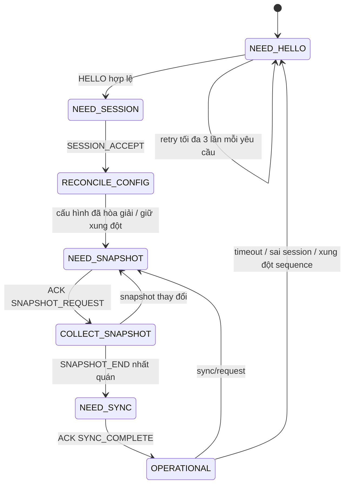

# LẬP TRÌNH ESP32 — PHIÊN BẢN 1.0

## 1. Thông tin kiểm soát

| Thuộc tính | Giá trị |
|---|---|
| Tên tài liệu | Lập trình ESP32 |
| Phiên bản | 1.0 |
| Trạng thái | **ĐÃ DUYỆT — 26/09/2026** |
| Giai đoạn | Giai đoạn 12 — Lập trình ESP32 |
| Ngày cập nhật | 26/09/2026 |
| Đường cơ sở đầu vào | Đặc tả/Ma trận/Danh mục 1.2; Kiến trúc/UML 1.1; Phần cứng, UART, MQTT, Dữ liệu, Giao diện và Cấu trúc dự án 1.0; Firmware UNO 1.0 đã duyệt |

Tài liệu này mô tả mã đã tạo trong `firmware/esp32`. Các kết quả build và kiểm tra host được ghi riêng với thử nghiệm Wi-Fi, broker, UART hai board và phần cứng thật. Chưa có ca kiểm thử trong Ma trận 1.2 được đổi khỏi `CHƯA THỰC HIỆN`.

## 2. Phạm vi hiện thực

Firmware ESP32 thực hiện:

- UART2 tại GPIO16/GPIO17, `19200 8N1`, ESP32 làm chủ theo Giao thức 1.0;
- COBS, CRC-16/CCITT-FALSE, session, sequence, ACK liên kết, correlation, retry, snapshot và hòa giải;
- Wi-Fi STA và MQTT 3.1.1 với LWT, QoS/retain, subscribe giới hạn và reconnect có khoảng chờ tăng dần;
- kiểm tra JSON tối đa 2.048 byte trước khi chuyển thành cấu hình/lệnh UART;
- cấu hình hợp lệ gần nhất trong NVS, chỉ ghi sau ACK của UNO;
- hàng đợi bền vững LittleFS 128 mục cho sự kiện, cảnh báo và kết quả lệnh cần gửi bù;
- telemetry, trạng thái báo cáo, desired/reported config, command/result, event, alert, sync và diagnostics theo MQTT 1.0;
- giữ bí mật Wi-Fi/MQTT ngoài kho mã nguồn.

ESP32 không điều khiển trực tiếp LED/còi/cảm biến của UNO, không tự suy đoán trạng thái cơ khí và không biến MQTT `PUBACK` thành kết quả lệnh.

## 3. Tổ chức mã nguồn

| File | Trách nhiệm |
|---|---|
| `firmware/esp32/src/main.cpp` | Điểm vào Arduino, chỉ chuyển cho bộ điều phối. |
| `include/domain.hpp` | Enum, mã lỗi, cấu hình, báo cáo và trạng thái dùng chung ở phía ESP32. |
| `include/protocol.hpp`, `src/protocol.cpp` | CRC, COBS, khung dây và payload cấu hình/lệnh; phần này có thể kiểm thử trên host. |
| `include/uno_link.hpp`, `src/uno_link.cpp` | UART chủ, bắt tay, sequence, retry nguyên khung, snapshot, ACK/NACK và đồng bộ. |
| `include/config_store.hpp`, `src/config_store.cpp` | Bản cấu hình NVS có magic, phiên bản định dạng và CRC32. |
| `include/offline_queue.hpp`, `src/offline_queue.cpp` | Vòng đệm LittleFS cố định, hai header luân phiên và CRC từng bản ghi. |
| `include/mqtt_gateway.hpp`, `src/mqtt_gateway.cpp` | Wi-Fi/MQTT, JSON, topic, desired/reported, command/result, cảnh báo và reconnect. |
| `include/runtime_config.hpp` | Giá trị mặc định an toàn khi chưa có bí mật. |
| `include/secrets.example.hpp` | Mẫu cấu hình riêng tư; không chứa credential thật. |
| `src/app.cpp` | Khởi tạo NVS/queue/link/gateway và lịch vòng lặp không dùng `delay()`. |
| `platformio.ini` | Board, core và phiên bản thư viện khóa. |
| `tools/esp32_protocol_host_test.cpp` | Vector giao thức và round-trip cấu hình/lệnh trên host. |

## 4. Nền tảng và thư viện đã khóa

| Thành phần | Phiên bản | Lý do |
|---|---:|---|
| PlatformIO Espressif32 | 6.13.0 | Core ổn định, tái tạo được build cho `esp32dev`. |
| Arduino ESP32 trong platform | 2.0.17 | Do PlatformIO 6.13.0 cung cấp. |
| `256dpi/MQTT` | 2.5.2 | MQTT 3.1.1, publish/Will QoS 1 và callback phù hợp thiết kế. |
| ArduinoJson | 7.4.2 | Parse/serialize JSON có giới hạn; phiên bản khóa tránh thay đổi API. |
| Preferences | Theo Arduino ESP32 core | NVS cho bản cấu hình nhỏ. |
| LittleFS | Theo Arduino ESP32 core | Hàng đợi dung lượng lớn hơn, không ghi dồn vào NVS. |

Lựa chọn API được đối chiếu với [tài liệu thư viện MQTT chính thức](https://github.com/256dpi/arduino-mqtt), [metadata chính thức ArduinoJson 7.4.2](https://github.com/bblanchon/ArduinoJson/blob/7.x/library.json) và [tài liệu Preferences của Espressif](https://docs.espressif.com/projects/arduino-esp32/en/latest/api/preferences.html). Callback MQTT chỉ sao chép bản tin vào hàng đợi RAM; parse JSON, publish và gọi UART được thực hiện sau callback để tránh tái nhập khi publish QoS lớn hơn 0. Bản tin vào phải có envelope và ID hợp lệ; cấu hình đầy đủ được đọc bằng kiểu số có kiểm tra tràn, cờ hiệu chuẩn phải là Boolean, còn thời điểm phát hành/hết hạn lệnh phải là UTC hợp lệ.

## 5. Khởi động và trạng thái an toàn

Trình tự `begin()`:

1. mở Serial USB chẩn đoán ở 115200;
2. mở namespace NVS `smartroom`, kiểm tra magic/format/CRC của cấu hình;
3. mount LittleFS; trên board mới chỉ format phân vùng LittleFS nếu mount thất bại;
4. tạo `esp_boot_id` khác 0 từ nguồn ngẫu nhiên phần cứng;
5. khởi tạo gateway nhưng không kết nối nếu thiếu `secrets.hpp` hợp lệ;
6. mở UART2 và bắt đầu `HELLO_REQUEST` với UNO;
7. chỉ cho phép lệnh từ xa sau session, snapshot và `SYNC_COMPLETE`.

Nếu thiếu credential, UART/NVS/logic cục bộ vẫn chạy; không có credential mặc định dùng thật. Nếu queue bền vững không khả dụng, thiết bị báo Suy giảm và không ACK sự kiện/cảnh báo quan trọng như thể đã lưu thành công.

## 6. Liên kết UNO ↔ ESP32

### 6.1. Máy trạng thái



### 6.2. Quy tắc hiện thực

- Một thời điểm chỉ có một yêu cầu chưa hoàn tất.
- Retry dùng đúng byte đã mã hóa, cùng sequence và correlation; không dựng lại khung với ACK khác.
- Timeout trả lời 150 ms, tối đa ba lần gửi; khung dở quá 200 ms bị loại.
- `HELLO_REQUEST` lặp mỗi một giây khi chưa có phiên; poll danh nghĩa 200 ms khi có phiên.
- Sequence UNO chỉ được commit sau khi semantic hợp lệ. Với `EVENT_REPORT`/`ALERT_REPORT`, callback phải publish QoS 1 thành công hoặc ghi LittleFS thành công trước khi ESP32 ACK sequence.
- ACK/NACK phải có `request_type`, correlation và `ack_sequence` đúng yêu cầu đang chờ.
- Cấu hình vắng mặt trong snapshot được nhận bằng payload 24 byte bằng 0 và dẫn đến trạng thái `config_pending`, không bị diễn giải thành cấu hình hợp lệ.
- Timeout lệnh tạo kết quả `unknown`, chuyển liên kết sang Suy giảm và bắt tay/snapshot lại; không tự suy đoán thành công/thất bại.
- Mọi giao dịch đang bay bị hủy bởi timeout, sai session hoặc xung đột sequence đều được trả về lớp MQTT như kết quả không xác định trước khi bắt tay lại; không để lệnh treo vô hạn.
- Khi phát hiện `uno_boot_id` mới, ESP32 xóa snapshot/cause cảnh báo chỉ còn trong RAM của boot cũ, chuyển về Đồng bộ và tái tạo trạng thái từ snapshot UNO trước khi cho phép lệnh.

## 7. Cấu hình và NVS

Nguồn chính thức vẫn là cơ sở dữ liệu máy chủ. NVS chỉ chứa bản đầy đủ gần nhất đã được UNO ACK.

Luồng `config/desired`:

1. kiểm tra schema, `device_id`, `source=server_database`, kiểu và toàn bộ trường;
2. dựng `DeviceConfig` đủ `field_mask=0x003F`;
3. kiểm tra phiên bản, ngưỡng ánh sáng, mốc ADC, MQ-2 và vùng SRF04;
4. gửi nguyên tử bằng `CONFIG_SET`;
5. chỉ sau ACK mới ghi blob NVS có CRC32 và cập nhật cache;
6. NACK giữ bản cũ và phát `config/reported=rejected`;
7. timeout giữ desired để thử lại an toàn sau đồng bộ vì `CONFIG_SET` có version và idempotent.

Nhiều desired đã nằm trong hàng đợi nhận được xử lý trước khi bắt đầu giao dịch; bản phiên bản cao nhất được giữ. Nếu bản mới đến khi một bản đang bay, firmware hoàn tất giao dịch đã gửi rồi áp dụng bản mới hơn, không làm mất ánh xạ ACK.

Lệnh đổi phương thức/hồ sơ hoặc giao dịch ghép chuyển Thủ công/Ở nhà cũng cập nhật bản NVS sau ACK bằng cách áp thay đổi lên cấu hình cache đầy đủ. Nếu ghi NVS thất bại sau khi UNO đã áp dụng, trạng thái lệnh vẫn phản ánh ACK thật nhưng availability chuyển Suy giảm do phiên bản cache không khớp.

## 8. Hàng đợi ngoại tuyến

| Thuộc tính | Hiện thực |
|---|---|
| Dung lượng | 128 bản ghi cố định; lớn hơn yêu cầu tối thiểu 100. |
| Payload | Tối đa 2.048 byte/bản ghi. |
| Loại | Event, alert transition và command result; không xếp hàng telemetry. |
| Thứ tự | FIFO, bản cũ trước. |
| Khi đầy | Loại bản cũ nhất, tăng bộ đếm và tạo một event `queue_overflow` có chống lặp trong cùng đợt. |
| Bền vững | LittleFS; hai header A/B có generation + CRC, record có ID + CRC. |
| Mất điện giữa ghi | Record được ghi trước, rồi mới commit header còn lại; header cũ vẫn là điểm phục hồi. Riêng khi đầy, thao tác loại bản cũ được commit trước khi ghi đè ô vừa giải phóng để header không trỏ vào record đã bị thay thế. |
| Gửi bù | Giữ `message_id`, đặt `data.replayed=true`, chỉ pop sau publish QoS 1 thành công. |

Telemetry hai giây không được ghi bù. Khi mất mạng, biểu đồ phải giữ khoảng trống như thiết kế dữ liệu.

## 9. Wi-Fi, MQTT và phục hồi

- Wi-Fi STA và MQTT thử lại theo dãy 1, 2, 4, 8, 16, tối đa 30 giây, cộng nhiễu 0–250 ms.
- MQTT dùng `clean_session=true`, keep-alive 30 giây, buffer đọc/ghi 2.304 byte.
- LWT `offline` dùng QoS 1 + retain.
- Subscribe QoS 1 chỉ ba topic: `config/desired`, `commands/request`, `sync/request` của đúng thiết bị.
- Sau kết nối: publish `syncing` → chờ UNO READY/desired → publish state/config/alerts retained → replay queue → publish `online` hoặc `degraded`.
- Event/alert phát sinh trong lúc đồng bộ được ghi queue, không vượt lên trước snapshot retained.
- Lệnh đến khi chưa Online/READY hoặc cấu hình cache xung đột bị từ chối `device_syncing`; không đưa lệnh cũ vào queue.
- NTP chỉ bổ sung UTC khi đã tin cậy; trước đó `sent_at=null`, `time_quality=unsynced` và giữ `uptime_ms` của UNO.

## 10. Lệnh và xác nhận đầu-cuối

`commands/request` được kiểm tra:

- schema, thiết bị và `command_id`;
- `ttl_ms` trong 1–30.000 ms; `expires_at` được kiểm tra khi đồng hồ đã đồng bộ;
- opcode/target/value không có toggle;
- ba phiên bản state/config và các cờ xác nhận;
- ID lặp trong cache RAM tám mục: cùng ID+cùng payload trả kết quả đã biết, cùng ID+payload khác bị từ chối.

Một lệnh hợp lệ được giữ tối đa đến deadline nếu UART đang bận bởi poll ngắn. `commands/result=applied` chỉ phát sau ACK UNO. NACK phát `rejected`; hết timeout UART phát `unknown`. Kết quả không thể publish ngay được ghi vào queue bền vững.

## 11. JSON, topic và nhãn mô phỏng

Firmware dùng đủ 13 nhánh topic của MQTT 1.0, giữ đúng QoS/retain. JSON có envelope `schema`, `schema_version`, `message_id`, `device_id`, thời gian, boot/session ID và `data`; payload vượt 2.048 byte bị loại trước UART.

Các trạng thái quạt và khóa luôn lấy `actuator_flags` từ UNO. `fan.actuator_mode=simulated`, `lock.actuator_mode=simulated` và `mechanical_verified=false` không được chuyển thành trạng thái cơ khí thật. MQ-2 chỉ xuất `adc`, `relative_pct`, trạng thái làm nóng/chất lượng; không có trường ppm.

## 12. Bí mật và ranh giới bảo mật

- `secrets.example.hpp` chỉ là mẫu; người dùng sao chép thành `secrets.hpp`.
- `secrets.hpp` bị `.gitignore` loại và không được in ra Serial/MQTT.
- Firmware yêu cầu cả tài khoản và mật khẩu MQTT, không tự nối ẩn danh.
- Phiên bản hiện hành dùng TCP 1883 trong LAN cô lập theo thiết kế đã duyệt; không mở cổng ra Internet.
- ACL broker, tài khoản thật và thử quyền sai thuộc Giai đoạn 13/17.
- Web không biết credential thiết bị và không kết nối MQTT trực tiếp.

## 13. Kết quả build và kiểm tra hiện có

Lệnh build:

```powershell
pio run -d firmware/esp32 -e esp32dev
```

Kết quả ngày 26/09/2026:

| Thuộc tính | Kết quả |
|---|---:|
| Platform | Espressif32 6.13.0 |
| Board profile | `esp32dev`, flash 4 MB |
| Build | **THÀNH CÔNG**; có `firmware.elf` và `firmware.bin` |
| RAM tĩnh | 58.592 / 327.680 byte — 17,9% |
| Flash ứng dụng | 887.709 / 1.310.720 byte — 67,7% |
| Cảnh báo project source | 0 với `-Wall -Wextra -Werror` |
| Kiểm thử codec host | **ĐẠT**: CRC, COBS, vector khung, config/control |

Các số trên là báo cáo toolchain, không phải phép đo runtime trên board. Chưa đo heap nhỏ nhất, stack task, độ trễ, flash wear hoặc khả năng chịu mất điện thật.

## 14. Truy vết chức năng

| Chức năng | Vai trò firmware ESP32 |
|---|---|
| MT-03, MT-02 | Nhận/kiểm tra `SENSOR_REPORT`, tạo telemetry có chất lượng và thời gian. |
| DK-02, TD-02 | Chuyển lệnh/config; chỉ báo trạng thái từ ACK/`STATE_REPORT`. |
| CD-01, CD-02, CH-01 | Version, desired/reported, NVS và giao dịch nguyên tử. |
| AN-05, AN-06 | Telemetry vùng cửa, cảnh báo và nhãn khóa mô phỏng. |
| AT-01, AT-02 | Telemetry/cảnh báo khí-lửa có trạng thái suy giảm; không ppm. |
| CB-01 | Alert transition + retained snapshot nhiều nguyên nhân. |
| MN-01 | UART, Wi-Fi, MQTT, reconnect, queue và hòa giải. |
| UD-01 | Giao diện mạng có command/result; xác thực người dùng vẫn thuộc máy chủ. |
| DL-01, BC-01 | Event ID, replay và telemetry nguồn; DB/biểu đồ thuộc Giai đoạn 14–16. |
| TB-01, MR-01 | Cung cấp alert/capability đầu vào nếu chức năng có điều kiện được triển khai. |

Không có mã chức năng mới và không thay đổi ý nghĩa mã hiện hành.

## 15. Cổng kiểm tra Giai đoạn 12

| Mã | Nội dung | Tiêu chí | Trạng thái |
|---|---|---|---|
| G12-SRC-01 | Cấu trúc nguồn | Tách protocol/link/store/queue/MQTT/app; không có placeholder | ĐẠT — kiểm tra tĩnh 26/09/2026 |
| G12-BUILD-01 | Build ESP32 đích | PlatformIO build không lỗi, sinh BIN | ĐẠT — 26/09/2026 |
| G12-MEM-01 | Tài nguyên tĩnh | RAM/flash trong giới hạn board | ĐẠT Ở MỨC BUILD — xem Mục 13 |
| G12-PROTO-01 | Codec dùng chung | Vector `0x29B1`, `0xD285`, config/control round-trip | ĐẠT — host test trả mã 0 |
| G12-LINK-01 | Logic UART chủ | Một giao dịch, retry nguyên byte, session/snapshot/sync, ACK critical sau lưu | ĐẠT — rà soát tĩnh; UART thật chưa chạy |
| G12-MQTT-01 | Topic/QoS/retain/LWT | Khớp MQTT 1.0; callback không thực thi nghiệp vụ trực tiếp | ĐẠT — rà soát tĩnh/build |
| G12-CONFIG-01 | Desired/NVS | Full config, kiểm tra toàn bộ, chỉ ghi sau ACK | ĐẠT — rà soát tĩnh; reset thật chưa chạy |
| G12-QUEUE-01 | Queue ngoại tuyến | 128 mục, FIFO/drop-oldest, CRC, không queue telemetry | ĐẠT — rà soát tĩnh/build; mất điện thật chưa chạy |
| G12-RECON-01 | Reconnect/hòa giải | syncing → snapshot/config → replay → online/degraded | ĐẠT — rà soát máy trạng thái; broker thật chưa chạy |
| G12-ACK-01 | ACK đầu-cuối | Không dùng PUBACK làm thành công; timeout là unknown | ĐẠT — rà soát tĩnh |
| G12-SECRET-01 | Bí mật | Mẫu riêng, file thật bị ignore, không log credential | ĐẠT — quét tĩnh |
| G12-TRACE-01 | Truy vết | Đủ chức năng hiện hành, topic và ca KT; không hồi sinh tải bị loại | ĐẠT — kiểm tra tĩnh |
| G12-HW-01 | Nạp/chạy ESP32 | Boot ổn định, heap/stack/reset đúng | CHƯA THỰC HIỆN — cần board |
| G12-UART-01 | Hai board thật | Handshake, snapshot, retry/ACK ở 19200 8N1 | CHƯA THỰC HIỆN — cần đấu mạch qua cổng G5 |
| G12-NET-01 | Wi-Fi/broker thật | LWT, ACL, QoS1, reconnect và replay đúng | CHƯA THỰC HIỆN — chờ Giai đoạn 13/17 |

## 16. Cách cấu hình và build

1. Sao chép `firmware/esp32/include/secrets.example.hpp` thành `secrets.hpp`.
2. Điền Wi-Fi, địa chỉ broker LAN, tài khoản thiết bị và `device_id` đã cấp.
3. Không gửi hoặc commit file chứa bí mật.
4. Build bằng lệnh ở Mục 13; chỉ upload khi kết nối UART/nguồn đã qua cổng vật lý.
5. Theo dõi Serial USB 115200 để biết NVS/config/queue khởi tạo được hay không; log không chứa mật khẩu.

## 17. Giới hạn và điểm còn mở

- Chưa nạp firmware lên ESP32 thật, chưa đo heap runtime, stack hoặc reset bất thường.
- Chưa có broker Giai đoạn 13 nên chưa chạy LWT, ACL, QoS 1, retained desired hay NTP thật.
- Chưa nối UNO–ESP32 nên các cổng UART/timing/retry đầu-cuối vẫn chờ thao tác vật lý.
- Tự format khi LittleFS mount thất bại có thể làm mất queue nếu phân vùng hỏng; hệ thống khi đó chỉ có thể báo Suy giảm sau boot, không thể phục hồi dữ liệu đã mất.
- Cache command ID tám mục nằm trong RAM; broker dùng clean session và lệnh không retain. Chống lặp bền vững đầu-cuối vẫn do máy chủ/DB thực hiện ở Giai đoạn 14–15.
- TCP 1883 chỉ phù hợp LAN cô lập. Truy cập qua mạng không tin cậy phải mở thay đổi để dùng TLS 8883.
- Không có kết quả thực nghiệm hoặc ca KT của Ma trận 1.2 được đánh dấu ĐẠT tại Giai đoạn 12.

## 18. Lịch sử sửa đổi và điểm duyệt

| Phiên bản | Trạng thái | Nội dung | Lý do/ảnh hưởng |
|---|---|---|---|
| 1.0 | **ĐÃ DUYỆT — 26/09/2026** | Hiện thực UART chủ, Wi-Fi/MQTT, JSON có kiểm tra kiểu/tràn/thời hạn, NVS, queue LittleFS có commit an toàn khi đầy, reconnect, desired/reported, command/result, event/alert/sync; build ESP32 và kiểm thử codec | Người dùng duyệt đầu ra Giai đoạn 12; không thay đổi giao thức UART/MQTT hoặc phạm vi phần cứng đã khóa |

**TRẠNG THÁI KHÓA:** Firmware ESP32 1.0 đã được người dùng duyệt ngày 26/09/2026 và Giai đoạn 12 được khóa. Build và kiểm tra tĩnh đã đạt; các cổng board, UART thật, broker và kiểm thử thực nghiệm vẫn `CHƯA THỰC HIỆN`.
