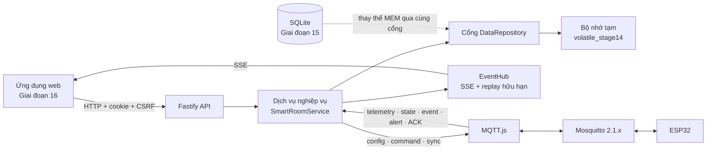
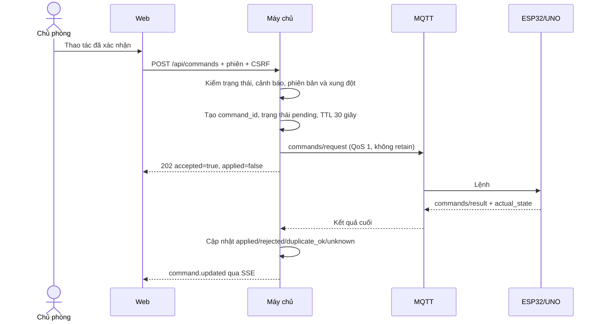
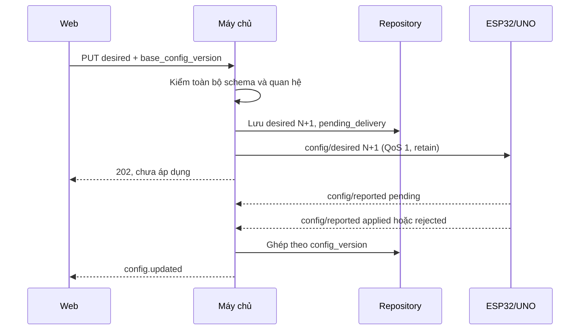

# XÂY DỰNG MÁY CHỦ ỨNG DỤNG — PHIÊN BẢN 1.0

## 1. Thông tin kiểm soát

| Thuộc tính | Giá trị |
|---|---|
| Tên tài liệu | Xây dựng máy chủ ứng dụng cho hệ thống phòng thông minh |
| Phiên bản | 1.0 |
| Trạng thái | **ĐÃ DUYỆT — 28/09/2026** |
| Giai đoạn | Giai đoạn 14 — Xây dựng máy chủ |
| Ngày tạo | 28/09/2026 |
| Đầu vào đã khóa | Kiến trúc 1.1, MQTT 1.0, Dữ liệu 1.0, Giao diện 1.0, Cấu trúc dự án 1.0, Firmware ESP32 1.0 và Xây dựng MQTT 1.0 |
| Đầu ra | Mã máy chủ, xác thực, MQTT, API, SSE, repository tạm, script vận hành và kiểm thử mô-đun |
| Chưa thuộc giai đoạn | SQLite/migration/retention bền vững, giao diện web hoàn chỉnh, tích hợp thiết bị thật và kết quả kiểm thử phần cứng |

Tài liệu này mô tả phần mềm đã tạo trong `server/` và `infrastructure/server/`. Kết quả kiểm thử trong tài liệu chỉ chứng minh mô-đun máy chủ và hợp đồng phần mềm trên máy phát triển; không thay đổi bất kỳ ca `KTxx` nào khỏi `CHƯA THỰC HIỆN`.

## 2. Kết quả triển khai và ranh giới

Máy chủ hiện thực đầy đủ bề mặt cần thiết để:

- kết nối MQTT 3.1.1 bằng tài khoản máy chủ riêng;
- nhận, kiểm tra và phân loại dữ liệu thiết bị;
- duy trì ảnh chụp trạng thái, cấu hình, cảnh báo, lệnh và nhật ký;
- phát cấu hình mong muốn, lệnh có hạn dùng và yêu cầu đồng bộ;
- cung cấp API HTTP có xác thực cho ứng dụng web;
- đẩy cập nhật một chiều tới trình duyệt bằng Server-Sent Events (SSE);
- không suy đoán thành công chỉ vì HTTP hoặc MQTT đã nhận bản tin;
- tiếp tục khởi động ở trạng thái suy giảm khi broker chưa sẵn sàng và tự hòa giải sau khi kết nối lại.

Repository của Giai đoạn 14 là **bộ nhớ tạm**. Nó cố ý mang nhãn `volatile_stage14`; dữ liệu mất khi tiến trình máy chủ dừng. Giai đoạn 15 phải thay bằng SQLite, migration, inbox/outbox, retention 30 ngày và tài khoản bền vững mà không đổi hợp đồng dịch vụ/API đã khóa ở đây. Vì vậy Giai đoạn 14 không tuyên bố đã đạt lưu trữ 30 ngày, phục hồi sau restart máy chủ hoặc giao dịch DB–MQTT bền vững.

## 3. Công nghệ và phiên bản đã kiểm tra

| Thành phần | Phiên bản cài đặt | Vai trò |
|---|---:|---|
| Node.js | 24.19.0 | Môi trường chạy; dự án yêu cầu từ 20.12 trở lên |
| pnpm | 11.19.0 | Quản lý workspace và khóa phụ thuộc |
| TypeScript | 5.9.3 | Kiểu tĩnh, biên dịch ESM |
| Fastify | 5.12.5 | HTTP API và vòng đời máy chủ |
| `@fastify/cookie` | 11.1.2 | Cookie phiên phía máy chủ |
| `@fastify/cors` | 11.3.0 | Chỉ cho phép nguồn web đã cấu hình |
| MQTT.js | 5.16.0 | Client MQTT 3.1.1, tự nối lại và đăng ký lại topic |
| Zod | 4.6.5 | Kiểm tra chặt dữ liệu HTTP và MQTT |
| Vitest | 2.1.9 | Kiểm thử mô-đun/API |

`pnpm-lock.yaml` ở gốc là nguồn khóa phiên bản. Không có lockfile con trong `server/`.

## 4. Kiến trúc hiện thực



### 4.1. Phân tách trách nhiệm

| Thành phần | Trách nhiệm |
|---|---|
| Tuyến API | Xác thực phiên, kiểm tra Origin/CSRF, kiểm tra request, mã HTTP và bao lỗi thống nhất |
| Dịch vụ nghiệp vụ | Chính sách lệnh, phiên bản cấu hình, vòng đời lệnh/cảnh báo, hòa giải MQTT và phát sự kiện web |
| `DataRepository` | Hợp đồng lưu/đọc; không để API phụ thuộc SQLite cụ thể |
| `MemoryRepository` | Hiện thực tạm để G14 chạy và kiểm thử; chống trùng, snapshot, mẫu phút, log có giới hạn |
| Cổng MQTT | Kết nối, đăng ký, công bố QoS/retain và thông báo trạng thái kết nối |
| Bộ kiểm tra schema | Giới hạn 2.048 byte, JSON chặt, enum/miền/quan hệ và khớp topic–`device_id` |
| `EventHub` | ID tăng đơn điệu, cửa sổ phát lại hữu hạn và đăng ký SSE |
| Bảo mật | Băm mật khẩu, phiên mờ, CSRF và giới hạn thử đăng nhập |

## 5. Hợp đồng MQTT đã hiện thực

Gốc topic là `${MQTT_DEVICE_ROOT}/${DEVICE_ID}`; mặc định dùng `smartroom/v1/devices/room-01`. Máy chủ không đăng ký wildcard ngoài thiết bị cấu hình.

### 5.1. Chiều thiết bị → máy chủ

| Hậu tố | QoS đăng ký | Xử lý |
|---|---:|---|
| `availability` | 1 | LWT/online/syncing/degraded, ghi chuyển trạng thái và phát SSE |
| `telemetry/sensors` | 0 | Kiểm tra chất lượng, giữ mẫu mới nhất và gom ánh sáng theo phút |
| `state/reported` | 1 | Chỉ nhận `state_version` mới hơn; không để bản cũ ghi đè |
| `config/reported` | 1 | Theo dõi pending/applied/rejected và đối chiếu `config_version` |
| `commands/result` | 1 | Kết thúc lệnh bằng ACK/NACK nghiệp vụ, không dùng PUBACK làm kết quả |
| `events` | 1 | Ghi nhật ký và phát `event.created` |
| `alerts/events` | 1 | Cập nhật từng nguyên nhân cảnh báo |
| `alerts/reported` | 1 | Hòa giải ảnh chụp các nguyên nhân đang hoạt động |
| `sync/status` | 1 | Ghi kết thúc phiên đồng bộ |
| `diagnostics` | 0 | Giữ chẩn đoán mới nhất, ghi lỗi đáng chú ý |

### 5.2. Chiều máy chủ → thiết bị

| Hậu tố | QoS | Retain | Quy tắc |
|---|---:|---:|---|
| `config/desired` | 1 | Có | Bản cấu hình đầy đủ, phiên bản tăng đơn điệu; DB sẽ là nguồn chính thức ở G15 |
| `commands/request` | 1 | Không | ID UUID, hạn 30 giây, phiên bản trạng thái/cấu hình và cờ xác nhận |
| `sync/request` | 1 | Không | Yêu cầu snapshot config/state/alerts/health sau khi máy chủ nối lại |

Mọi payload chiều ra được kiểm tra kích thước trước publish. Máy chủ dùng MQTT 3.1.1 (`protocolVersion=4`), `clean=true`, keep-alive 30 giây, reconnect 2 giây và tự đăng ký lại topic.

### 5.3. Kiểm tra, chống trùng và thứ tự

- JSON dùng schema chặt; trường không khai báo bị từ chối. Trường `ppm` bị cấm vì MQ-2 chỉ cung cấp ADC/mức tương đối trong mô hình.
- `device_id` trong payload phải trùng ID trên topic.
- `message_id` tin cậy được chống trùng theo `(device_id, message_id)`.
- `state_version` chỉ tăng; trạng thái cũ hoặc trùng không ghi đè.
- `config_version` phân biệt desired/reported và không thay bằng thời gian.
- Thời điểm thiết bị chưa đồng bộ không được giả thành UTC chính xác; `received_at` của máy chủ được lưu riêng.
- Bản `commands/result` đến muộn có thể thay trạng thái `unknown` do timeout bằng kết quả cuối có căn cứ; kết quả terminal khác không bị ghi đè tùy tiện.

## 6. API cho ứng dụng web

### 6.1. Danh mục tuyến

| Phương thức | Đường dẫn | Xác thực | Kết quả chính |
|---|---|---|---|
| `POST` | `/api/auth/login` | Không; kiểm Origin và giới hạn thử | Tạo cookie HttpOnly và trả CSRF token |
| `POST` | `/api/auth/logout` | Phiên + CSRF | Thu hồi phiên, xóa cookie |
| `GET` | `/api/session` | Tùy chọn | Trạng thái đăng nhập và CSRF token nếu có |
| `GET` | `/api/overview` | Phiên | Snapshot thiết bị, cấu hình, cảnh báo và chế độ lưu |
| `GET` | `/api/config` | Phiên | Desired/reported cùng giới hạn biểu mẫu |
| `PUT` | `/api/config/desired` | Phiên + CSRF | `202`; tạo desired mới, chưa gọi là đã áp dụng |
| `POST` | `/api/commands` | Phiên + CSRF | `202`; lệnh pending chờ `commands/result` |
| `GET` | `/api/commands/:command_id` | Phiên | Trạng thái và trạng thái thực tế của một lệnh |
| `POST` | `/api/alerts/:alert_id/mute` | Phiên + CSRF | Tắt tiếng qua lệnh thiết bị; không xóa cảnh báo |
| `POST` | `/api/alerts/:alert_id/ack` | Phiên + CSRF | Chỉ cho xác nhận khi mọi nguyên nhân đã hết |
| `GET` | `/api/history` | Phiên | Mẫu ánh sáng một phút; bỏ bucket thiếu, không nội suy |
| `GET` | `/api/logs` | Phiên | Lọc/phân trang nhật ký |
| `GET` | `/api/events/stream` | Phiên | SSE, heartbeat và phát lại hữu hạn |
| `GET` | `/health` | Không | Tình trạng HTTP/MQTT và nhãn lưu tạm |

Bao lỗi thống nhất:

```json
{
  "error_code": "state_version_conflict",
  "message": "Trạng thái thiết bị đã thay đổi; hãy tải lại.",
  "request_id": "req-...",
  "details": {"expected": 45, "received": 44}
}
```

HTTP `202` chỉ xác nhận máy chủ đã tiếp nhận. Giao diện phải giữ trạng thái “Đang chờ” tới khi nhận `command.updated` hoặc `config.updated` có kết quả cuối.

### 6.2. Sự kiện SSE

Máy chủ phát đúng bảy tên đã khóa: `telemetry.updated`, `state.updated`, `availability.updated`, `config.updated`, `command.updated`, `alert.updated` và `event.created`. Mỗi sự kiện có ID. Khi `Last-Event-ID` còn trong cửa sổ, máy chủ phát lại phần thiếu; nếu con trỏ quá cũ, máy chủ gửi snapshot mới có cờ `replay_window_missed`. Heartbeat 15 giây chỉ giữ kết nối, không phải dữ liệu nghiệp vụ.

## 7. Xác thực và bảo vệ API

- Một tài khoản chủ phòng; username cấu hình bằng môi trường.
- Mật khẩu băm bằng `scrypt` với salt ngẫu nhiên, khóa 64 byte và so sánh hằng thời gian; mật khẩu rõ không được lưu.
- Phiên dùng token ngẫu nhiên mờ; bộ nhớ chỉ lập chỉ mục bằng HMAC với bí mật phiên.
- Cookie có `HttpOnly`, `SameSite=Strict`, thời hạn cấu hình; `Secure=true` bắt buộc khi triển khai HTTPS.
- Mọi thao tác ghi ngoài đăng nhập cần Origin đúng `WEB_ORIGIN` và `X-CSRF-Token` hợp lệ.
- Đăng nhập sai bị giới hạn 5 lần trong 15 phút theo IP.
- CORS chỉ cho đúng nguồn web và không đưa MQTT credential cho trình duyệt.
- Body HTTP giới hạn 16 KiB; payload MQTT giới hạn 2.048 byte.
- Máy chủ từ chối khởi động khi còn bí mật mẫu, thiếu mã băm hoặc bí mật phiên ngắn.
- `config/server.local.env` chứa bí mật, bị `.gitignore` loại khỏi nguồn.

Phiên của G14 cũng đang ở bộ nhớ và mất khi restart; lưu phiên/tài khoản bền vững thuộc G15.

## 8. Quy tắc nghiệp vụ lệnh và cấu hình

### 8.1. Lệnh có xác nhận



Máy chủ áp dụng lại các ràng buộc đã chốt trước khi gửi:

- thiết bị phải báo `online`, có trạng thái và không có lệnh pending khác;
- `expected_state_version` nếu có phải khớp;
- cấu hình trạng thái phải đồng bộ desired, ngoại trừ thao tác cảnh báo;
- Ra ngoài chặn tải tiện nghi;
- điều khiển trực tiếp trong Tự động cần xác nhận chuyển Thủ công;
- mở khóa mô phỏng bị chặn khi báo an ninh còn hoạt động;
- báo an toàn cho phép mở có xác nhận, không tự mở hoặc xóa cảnh báo;
- mở trong Ra ngoài/Ban đêm cần giao dịch chuyển về Ở nhà;
- timeout không được đổi giao diện thành thành công mà thành `unknown`.

### 8.2. Cấu hình nguyên tử



Nếu `base_config_version` cũ, toàn bộ yêu cầu bị từ chối `409`; không trộn từng trường. Một lệnh đổi hồ sơ/phương thức có thể mang `pendingConfigMutation`; desired chỉ tăng sau ACK thiết bị thành công. Bản retained không thay thế nguồn chính thức trong repository.

## 9. Trực tuyến, ngoại tuyến và đồng bộ lại

| Tình huống | Hành vi máy chủ |
|---|---|
| Broker chưa chạy khi server khởi động | HTTP vẫn chạy; `/health` là suy giảm; MQTT.js tiếp tục nối lại |
| MQTT mất kết nối | Không nhận lệnh điều khiển mới; desired hợp lệ vẫn được lưu với lý do `mqtt_offline` |
| MQTT nối lại | Công bố lại desired mới nhất, gửi `sync/request`, chờ snapshot thật |
| Thiết bị offline/syncing/degraded | API lệnh từ chối `device_not_ready`; không cập nhật lạc quan |
| Lệnh hết 30 giây | Chuyển `unknown`, ghi log, chờ snapshot/kết quả muộn để hòa giải |
| SSE mất kết nối | Trình duyệt dùng `Last-Event-ID`; phát lại trong cửa sổ hoặc nhận snapshot |
| Máy chủ restart ở G14 | Mất dữ liệu tạm và phiên; đây là giới hạn đã công bố, không phải hành vi sản phẩm cuối |

Việc UNO tiếp tục tự động hóa/cảnh báo ngoại tuyến là trách nhiệm firmware, không phải máy chủ. Máy chủ không tự chạy lại quy tắc đèn và không tự suy ra trạng thái cơ cấu.

## 10. Dữ liệu hiện hành và bàn giao Giai đoạn 15

### 10.1. Khả năng tạm đã có

- snapshot availability, telemetry, state, diagnostics;
- desired/reported config;
- lệnh và kết quả;
- danh sách nguyên nhân cảnh báo;
- log có bộ lọc và con trỏ;
- chống trùng tối đa 4.096 ID trong tiến trình;
- tối đa 5.000 dòng log trong tiến trình;
- bucket ánh sáng một phút, có số mẫu, min/max/trung bình và chất lượng phủ;
- khoảng trống không được nội suy.

### 10.2. Điều kiện bắt buộc ở Giai đoạn 15

SQLite phải hiện thực cùng `DataRepository` và bổ sung:

- migration đầy đủ theo Thiết kế dữ liệu 1.0;
- transaction cấu hình/lệnh với MQTT inbox/outbox;
- khóa duy nhất và chống lặp bền vững;
- WAL, foreign key, chỉ mục và đường dẫn DB cấu hình;
- tài khoản/phiên hoặc cơ chế bền vững tương đương;
- lưu mẫu phút, state, config, command, event, alert, audit và sync;
- retention 30 ngày theo batch, không xóa bản hiện hành/pending/active;
- phục hồi sau restart và kiểm thử migration/rollback.

Không được chỉ thay `Map` bằng câu lệnh SQL rời rạc mà bỏ transaction/outbox.

## 11. Cấu hình và vận hành

### 11.1. Khởi tạo bí mật cục bộ

```powershell
.\infrastructure\server\Initialize-Server.ps1
```

Script hỏi kín mật khẩu chủ phòng và mật khẩu MQTT, kiểm tra mật khẩu chủ phòng tối thiểu 12 ký tự, tạo băm `scrypt`, sinh bí mật phiên bằng bộ sinh số ngẫu nhiên mật mã rồi tạo `config/server.local.env` bị bỏ qua bởi Git.

### 11.2. Chạy

```powershell
.\infrastructure\server\Start-Server.ps1
```

Hoặc dùng `pnpm server:dev` sau khi đã nạp các biến môi trường. Mặc định HTTP chỉ bind `127.0.0.1:3000`; broker có thể chạy cùng máy. Không công khai HTTP/MQTT ra Internet trong cấu hình mô hình.

### 11.3. Kiểm tra phát triển

```powershell
pnpm --filter super-iot-server typecheck
pnpm --filter super-iot-server build
pnpm --filter super-iot-server test
pnpm check:stage14
```

## 12. Truy vết chức năng

| Chức năng | Thành phần máy chủ |
|---|---|
| MT-03, MT-02 | Schema telemetry, chất lượng dữ liệu, snapshot và bucket ánh sáng |
| DK-02 | API lệnh, chính sách Thủ công, trạng thái báo cáo/ACK thật |
| TD-02 | Đồng bộ ngưỡng, trạng thái/nguồn điều khiển; quyết định tự động vẫn ở UNO |
| CD-01, CD-02 | Lệnh đổi phương thức/hồ sơ, phiên bản cấu hình và kiểm tra xung đột |
| CH-01 | Desired/reported, kiểm tra nguyên tử và hòa giải phiên bản |
| AN-05 | Telemetry vùng cửa, event/cảnh báo và hồ sơ trang bị bảo vệ |
| AN-06 | Lệnh khóa mô phỏng, nhãn trạng thái thực tế và quy tắc mở có xác nhận |
| AT-01, AT-02 | Telemetry an toàn, trạng thái làm nóng/lỗi, nhiều nguyên nhân cảnh báo |
| CB-01 | Snapshot/event cảnh báo, tắt tiếng/xác nhận và vòng đời nhiều nguyên nhân |
| MN-01 | MQTT reconnect, availability, sync và chống lặp |
| UD-01 | Đăng nhập, phiên, CSRF, API và SSE |
| DL-01 | Cổng repository, log, phân loại dữ liệu; độ bền/retention hoàn tất ở G15 |
| BC-01 | API lịch sử, bucket phút và khoảng trống trung thực |
| TB-01 | Máy chủ đã cung cấp alert SSE; quyền/thông báo trình duyệt hoàn tất ở G16 |
| MR-01 | Chưa kích hoạt; nếu dùng phải mở thay đổi schema/hiển thị và kiểm thử có điều kiện |

Toàn bộ **16 chức năng nhóm A** có điểm xử lý hoặc hợp đồng máy chủ. Nhóm B mới hoàn thành phần nguồn sự kiện; nhóm C không được trình bày như đã triển khai.

## 13. Sửa lỗi tương thích CR-03

Khi ghép schema máy chủ với firmware, phát hiện `config/reported pending` và kết quả cuối của cùng `config_version` có thể trùng `message_id`, khiến máy chủ khử nhầm ACK cuối. [CR-03](./04-kiem-soat-thay-doi-CR-03.md) đã sửa firmware ESP32 để:

- mỗi lần phát `config/reported` có bộ đếm/ID riêng;
- ID chung chứa cả boot ID ESP32 và UNO;
- không đổi topic, JSON, QoS, retain hoặc nghiệp vụ.

Sau sửa, firmware ESP32 đã build lại và kiểm thử máy chủ có ca riêng cho `pending → applied` cùng phiên bản nhưng hai ID khác nhau.

## 14. Kết quả xác minh phần mềm

Ngày 28/09/2026 trên máy phát triển:

| Mã | Nội dung | Kết quả |
|---|---|---|
| G14-TYPE-01 | TypeScript `tsc --noEmit` | **ĐẠT** |
| G14-BUILD-01 | Biên dịch máy chủ `tsc` | **ĐẠT** |
| G14-TEST-01 | Vitest: mật khẩu, schema MQTT, SSE, API, dịch vụ | **ĐẠT — 5 file, 13/13 kiểm thử** |
| G14-AUDIT-01 | `pnpm audit --prod --audit-level=high` | **ĐẠT — không phát hiện lỗ hổng đã biết** |
| G14-PS-01 | Phân tích cú pháp hai script PowerShell máy chủ | **ĐẠT** |
| G14-CR03-01 | ESP32 build lại sau CR-03 | **ĐẠT — RAM 17,9%; flash 67,7%** |
| G14-CR03-02 | Checker G12 và vector codec ESP32 | **ĐẠT** |

Bộ kiểm thử máy chủ bao phủ:

1. băm/xác minh mật khẩu và từ chối tham số băm bất thường;
2. schema MQTT đúng firmware, giới hạn payload và cấm `ppm`;
3. quan hệ ngưỡng/cấu hình nguyên tử;
4. cửa sổ replay SSE;
5. đăng nhập, phiên, cookie và CSRF;
6. desired hợp lệ ở trạng thái chờ, lịch sử phút không nội suy;
7. lệnh pending tới ACK cuối và giao dịch ghép cấu hình;
8. state cũ không ghi đè, event lặp không tạo bản sao;
9. LWT tối giản hợp lệ và loại `device_id` sai;
10. không khử nhầm `config/reported pending → applied` sau CR-03.

Đây không phải kết quả chạy ESP32/UNO thật, đo cảm biến hay ca chấp nhận đầu-cuối. Toàn bộ `KT01–KT39` đang áp dụng vẫn giữ trạng thái `CHƯA THỰC HIỆN` theo Ma trận 1.2.

## 15. Cổng chấp nhận Giai đoạn 14

| Mã | Tiêu chí | Trạng thái |
|---|---|---|
| G14-ARCH-01 | API, dịch vụ, repository, MQTT và SSE tách trách nhiệm | **ĐẠT — kiểm tra mã** |
| G14-MQTT-01 | Đủ topic, QoS/retain, reconnect, giới hạn và schema MQTT 1.0 | **ĐẠT — kiểm tra mã/mô-đun** |
| G14-CMD-01 | Lệnh có ID/TTL/phiên bản; không cập nhật lạc quan; ACK cuối | **ĐẠT — kiểm thử mô-đun** |
| G14-CONFIG-01 | Desired/reported, cấu hình nguyên tử và xung đột phiên bản | **ĐẠT — kiểm thử mô-đun** |
| G14-AUTH-01 | Băm mật khẩu, phiên, cookie, CSRF và giới hạn đăng nhập | **ĐẠT — kiểm thử API/mã** |
| G14-API-01 | Đủ bề mặt API/SSE cho Thiết kế giao diện 1.0 | **ĐẠT — kiểm thử API/kiểm tra tĩnh** |
| G14-DATA-01 | Repository tạm có ranh giới rõ, không tuyên bố độ bền giả | **ĐẠT — kiểm tra mã/tài liệu** |
| G14-TRACE-01 | 16/16 chức năng nhóm A có truy vết máy chủ | **ĐẠT — kiểm tra tĩnh** |
| G14-SECRET-01 | Không có bí mật thật trong nguồn; env cục bộ bị bỏ qua | **ĐẠT — kiểm tra tĩnh** |
| G14-REGRESSION-01 | Server build/test và firmware ESP32 build lại sau CR-03 | **ĐẠT — kết quả chạy 28/09/2026** |

## 16. Giới hạn và công việc kế tiếp

- Chưa có SQLite, migration, outbox/inbox và retention thật: thuộc Giai đoạn 15.
- Chưa có giao diện web hoàn chỉnh hoặc Notifications API: thuộc Giai đoạn 16.
- Chưa chạy đường MQTT thật máy chủ ↔ broker ↔ ESP32; kiểm thử tích hợp thuộc Giai đoạn 17.
- Chưa kiểm thử tải, mất điện tiến trình, backup/restore hoặc nhiều tab trình duyệt.
- Phiên và giới hạn đăng nhập đang ở RAM; restart xóa chúng.
- TLS/HTTPS chưa bật; cấu hình hiện chỉ dành cho máy cục bộ/LAN tin cậy.
- Không có kết quả cảm biến, nguồn, UART hai board hay cơ cấu vật lý.

## 17. Lịch sử sửa đổi và điểm duyệt

| Phiên bản | Trạng thái | Nội dung | Lý do/ảnh hưởng |
|---|---|---|---|
| 1.0 | **ĐÃ DUYỆT — 28/09/2026** | Hiện thực Fastify, MQTT.js, schema chặt, xác thực/CSRF, API/SSE, lệnh/cấu hình có ACK, repository tạm và 13 kiểm thử; áp dụng CR-03 | Người dùng duyệt đầu ra G14; SQLite bền vững được tách đúng sang G15 |

**TRẠNG THÁI KHÓA:** Giai đoạn 14 và CR-03 được người dùng duyệt ngày 28/09/2026. Hợp đồng máy chủ/API/MQTT/SSE được dùng làm đường cơ sở cho **Giai đoạn 15 — Xây dựng cơ sở dữ liệu**; các giới hạn `volatile_stage14` phải được thay bằng SQLite bền vững trước khi tuyên bố lưu trữ sản phẩm.

## 18. Tài liệu tham khảo kỹ thuật

1. Fastify, *Documentation*: <https://fastify.dev/docs/latest/>.
2. MQTT.js, *MQTT client for Node.js and the browser*: <https://github.com/mqttjs/MQTT.js>.
3. Zod, *Documentation*: <https://zod.dev/>.
4. Node.js, *Crypto — `scrypt` and random bytes*: <https://nodejs.org/api/crypto.html>.
5. MDN Web Docs, *Using server-sent events*: <https://developer.mozilla.org/en-US/docs/Web/API/Server-sent_events/Using_server-sent_events>.
