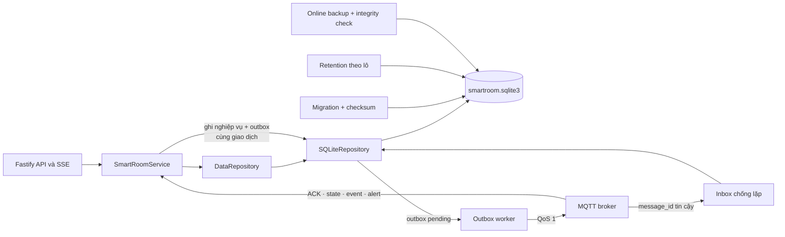
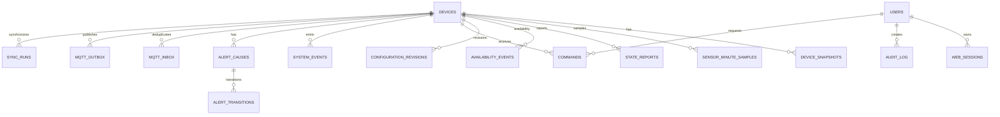

# XÂY DỰNG CƠ SỞ DỮ LIỆU — PHIÊN BẢN 1.0

## 1. Thông tin kiểm soát

| Thuộc tính | Giá trị |
|---|---|
| Tên tài liệu | Xây dựng cơ sở dữ liệu cho hệ thống phòng thông minh |
| Phiên bản | 1.0 |
| Trạng thái | **ĐÃ DUYỆT — 28/09/2026** |
| Giai đoạn | Giai đoạn 15 — Xây dựng cơ sở dữ liệu |
| Ngày tạo | 28/09/2026 |
| Đầu vào đã khóa | Kiến trúc 1.1, MQTT 1.0, Thiết kế dữ liệu 1.0, Cấu trúc dự án 1.0 và Máy chủ 1.0 |
| Đầu ra | Migration SQLite, repository bền vững, inbox/outbox, phiên đăng nhập, retention, sao lưu/phục hồi, công cụ vận hành và kiểm thử |
| Chưa thuộc giai đoạn | Giao diện web hoàn chỉnh, tích hợp broker–ESP32 thật, kiểm thử phần cứng và số liệu thực nghiệm |

Tài liệu này mô tả mã đã hiện thực trong `server/migrations/`, `server/src/data/`, `server/scripts/` và `infrastructure/database/`. Các kết quả ở đây là kiểm thử phần mềm trên máy phát triển; không làm thay đổi trạng thái `CHƯA THỰC HIỆN` của các ca chấp nhận `KTxx`.

## 2. Kết quả và quyết định nền tảng

SQLite được dùng cho sản phẩm một phòng/một tài khoản chủ phòng. Máy chủ là thành phần duy nhất mở tệp cơ sở dữ liệu; ESP32, broker và trình duyệt không truy cập tệp trực tiếp. `DataRepository` tiếp tục là ranh giới nghiệp vụ, còn `SQLiteRepository` thay `MemoryRepository` làm hiện thực mặc định. Kho bộ nhớ chỉ còn phục vụ kiểm thử cô lập.

Kết quả Giai đoạn 15 gồm:

- một migration khởi tạo đầy đủ lược đồ đã thiết kế, dùng bảng `STRICT`, khóa ngoại, `CHECK`, `UNIQUE` và chỉ mục;
- tự động áp dụng migration theo thứ tự, kiểm tra checksum SHA-256 và từ chối migration đã bị sửa;
- bật khóa ngoại, chế độ nhật ký WAL, `synchronous=FULL` và thời gian chờ khóa 5 giây;
- lưu bền snapshot, mẫu cảm biến theo phút, trạng thái, cấu hình desired/reported, lệnh, sự kiện, cảnh báo, phiên và nhật ký;
- ghi command/config/sync cùng MQTT outbox trong một giao dịch;
- chống xử lý lặp bằng MQTT inbox cho bản tin tin cậy;
- worker outbox phục hồi sau khởi động lại, thử lại có khoảng chờ và không phát lại lệnh hết hạn;
- retention 30 ngày theo lô nhỏ, bảo vệ bản ghi hiện hành/đang chờ/đang hoạt động;
- sao lưu trực tuyến, mở lại bản sao và kiểm tra toàn vẹn;
- công cụ dòng lệnh cho migration, retention và backup.

## 3. Công nghệ và phiên bản đã kiểm tra

| Thành phần | Phiên bản | Vai trò |
|---|---:|---|
| Node.js | 24.19.0 | Môi trường chạy; dự án yêu cầu từ 22 |
| pnpm | 11.19.0 | Quản lý workspace và khóa phụ thuộc |
| `better-sqlite3` | 13.0.3 | Kết nối SQLite đồng bộ, transaction và online backup |
| SQLite nhúng | 3.53.4 | Cơ sở dữ liệu quan hệ cục bộ |
| TypeScript | 5.9.3 | Repository, worker và công cụ vận hành có kiểu |
| Vitest | 2.1.9 | Kiểm thử repository/API/dịch vụ |

`pnpm-lock.yaml` là nguồn khóa phiên bản. `better-sqlite3` 13 yêu cầu Node.js từ 22 nên trường `engines` ở gốc và máy chủ đã được khóa tương ứng.

## 4. Kiến trúc hiện thực

Nguyên tắc ranh giới:

| Thành phần | Trách nhiệm |
|---|---|
| Migration | Tạo lược đồ/constraint/chỉ mục; không chứa logic nghiệp vụ động |
| `SQLiteRepository` | Giao dịch, ánh xạ miền–SQL, truy vấn, tổng hợp phút, inbox/outbox và retention |
| `SmartRoomService` | Chính sách nghiệp vụ, kiểm tra schema, vòng đời lệnh/cảnh báo, hòa giải và worker định kỳ |
| Công cụ vận hành | Migration thủ công, dọn theo chính sách, backup và chẩn đoán |
| SQLite | Toàn vẹn quan hệ, độ bền cục bộ và nhất quán giao dịch |

## 5. Lược đồ vật lý

Migration `001_initial.sql` tạo 16 bảng nghiệp vụ; `schema_migrations` do bộ chạy migration tạo riêng.

| Nhóm | Bảng | Mục đích chính |
|---|---|---|
| Thiết bị/hiện hành | `devices`, `device_snapshots` | Danh tính, con trỏ phiên bản và snapshot mới nhất |
| Cảm biến/kết nối | `sensor_minute_samples`, `state_reports`, `availability_events` | Mẫu một phút, lịch sử trạng thái và kết nối |
| Cấu hình/lệnh | `configuration_revisions`, `commands` | Desired/reported nguyên tử, lệnh và ACK cuối |
| Sự kiện/cảnh báo | `system_events`, `alert_causes`, `alert_transitions` | Nhật ký có nghĩa, nguyên nhân đồng thời và chuyển trạng thái cảnh báo |
| Tài khoản/kiểm toán | `users`, `web_sessions`, `audit_log` | Chủ phòng, phiên bền vững và dấu vết thao tác |
| Giao tiếp bền vững | `mqtt_inbox`, `mqtt_outbox`, `sync_runs` | Chống lặp, gửi lại có kiểm soát và lần đồng bộ |
| Quản trị lược đồ | `schema_migrations` | Phiên bản, tên, checksum và thời điểm áp dụng migration |

Các miền quan trọng được kiểm tra ở cả Zod và SQL: hồ sơ phòng, phương thức điều khiển, chất lượng dữ liệu, trạng thái cơ cấu thật/mô phỏng, vòng đời cảnh báo, mức độ sự kiện, giới hạn ADC/phần trăm, vùng trễ ánh sáng và quan hệ phiên bản. Không có cột hoặc tuyên bố `ppm`.

## 6. Nguồn dữ liệu chính thức

| Dữ liệu | Nguồn chính thức | Quy tắc |
|---|---|---|
| Cấu hình mong muốn | Bản desired hiện hành trong DB | Con trỏ `devices.desired_config_version`; tạo phiên bản mới nguyên tử |
| Cấu hình đang chạy | Reported mới nhất từ thiết bị | Không suy ra đã áp dụng chỉ từ việc publish desired |
| Trạng thái thiết bị | `state/reported` mới nhất hợp lệ | `state_version` cũ không ghi đè bản mới |
| Số đo gần nhất | Snapshot telemetry | Mang thời điểm nhận, chất lượng thời gian và boot/session nguồn |
| Lịch sử biểu đồ | `sensor_minute_samples` | Một bucket mỗi phút; khoảng thiếu dữ liệu được giữ nguyên |
| Kết quả lệnh | `commands/result` | Lưu `result_message_id` thật; timeout cục bộ để `NULL` |
| Cảnh báo | Tập `alert_causes` đang hoạt động | Nhiều nguyên nhân cùng tồn tại; transition lưu độc lập |
| Phiên web | `web_sessions` | DB chỉ giữ digest HMAC của cookie token, không giữ token rõ |

## 7. Giao dịch, inbox và outbox

### 7.1. Cấu hình và lệnh

Khi tạo desired hoặc command, repository dùng `BEGIN IMMEDIATE` để ghi bản ghi nghiệp vụ và `mqtt_outbox` trong cùng giao dịch. Nếu constraint hoặc ghi outbox lỗi, toàn bộ bị rollback; cấu hình cũ/lệnh cũ không bị thay đổi nửa chừng. HTTP chỉ trả trạng thái chờ, không coi commit DB là ACK từ thiết bị.

### 7.2. Công bố bền vững

Worker đọc outbox theo `(status, available_at, outbox_id)`. Chỉ sau khi thao tác publish hoàn tất mới đánh dấu `published`; lỗi sẽ tăng `attempt_count`, lưu `last_error` và đặt lần thử sau. Lệnh quá hạn được đánh dấu hết hạn thay vì phát lại. Khi máy chủ hoặc broker trở lại, desired hiện hành và yêu cầu sync được xếp hàng để hòa giải.

### 7.3. Chống lặp chiều vào

Các bản tin QoS 1 có `message_id` được ghi vào inbox theo khóa `(device_id, message_id)`. Bản trùng chỉ tăng bộ đếm và không lặp lại tác động. Telemetry/diagnostics QoS 0 không bắt buộc ghi từng gói vào inbox để tránh ghi đĩa vô nghĩa; phép tổng hợp phút và khóa bucket xử lý dữ liệu lịch sử.

## 8. Tổng hợp dữ liệu cảm biến và khoảng trống

- Bucket dùng phút UTC của `sent_at` khi đồng hồ nguồn đồng bộ; nếu không thì dùng `received_at`.
- Mỗi phút/thiết bị có một dòng; số mẫu, số mẫu sáng hợp lệ/không hợp lệ, tổng, nhỏ nhất, lớn nhất và giá trị trung bình được cập nhật bằng UPSERT.
- Ánh sáng lịch sử dùng trung bình các mẫu hợp lệ; trường chất lượng và metadata nguồn vẫn được lưu.
- SRF04, MQ-2 và cảm biến lửa lưu giá trị/trạng thái phục vụ mô hình; MQ-2 chỉ có ADC và mức tương đối, không suy diễn ppm.
- Không tạo mẫu giả khi thiết bị hoặc mạng ngoại tuyến. API biểu đồ trả các điểm có thật nên giao diện có thể thể hiện khoảng trống trung thực.

## 9. Tài khoản, phiên và kiểm toán

- Khi khởi tạo lần đầu, máy chủ tạo tài khoản chủ phòng từ tên và băm `scrypt` trong môi trường; không lưu mật khẩu rõ.
- Nếu DB đã có chủ phòng khác tên, máy chủ dừng để tránh âm thầm tạo tài khoản ngoài dự kiến.
- Cookie token được sinh ngẫu nhiên; DB chỉ lưu HMAC digest, CSRF token, hạn dùng, thời điểm dùng cuối và trạng thái thu hồi.
- Đăng nhập, thay đổi cấu hình, hoàn tất lệnh và retention tạo dấu vết phù hợp trong `audit_log`/`system_events`.
- Tệp DB và bản sao là dữ liệu nhạy cảm, bị loại khỏi quản lý mã nguồn.

## 10. Migration và đường dẫn runtime

`openDatabase()` thực hiện theo thứ tự:

1. quy đường dẫn tương đối về gốc dự án và tạo thư mục cha;
2. mở SQLite với timeout 5 giây;
3. bật `foreign_keys=ON`, WAL và `synchronous=FULL`;
4. tạo `schema_migrations` nếu chưa có;
5. so tên/checksum của migration đã áp dụng;
6. áp dụng từng migration mới trong `BEGIN IMMEDIATE`, cập nhật `user_version` rồi commit;
7. rollback và dừng nếu có lỗi.

`DB_FILE=./data/smartroom.sqlite3` vì vậy luôn trỏ tới thư mục `data/` ở gốc, kể cả khi pnpm chạy script với thư mục hiện hành là `server/`. Không được chỉnh sửa `001_initial.sql` sau khi sản phẩm dùng dữ liệu thật; thay đổi tiếp theo phải tạo `002_...sql`.

## 11. Chính sách lưu giữ

Mặc định lịch sử lưu 30 ngày, worker chạy mỗi 3.600 giây và xóa tối đa 500 dòng mỗi bảng/lần. Ba giá trị có thể cấu hình trong giới hạn kỹ thuật bằng biến môi trường.

| Dữ liệu | Điều kiện dọn | Bảo vệ bắt buộc |
|---|---|---|
| Mẫu phút, availability, event, audit | Cũ hơn cutoff | Không áp dụng cho snapshot hiện hành |
| State reports | Cũ hơn cutoff | Giữ `last_state_version` của thiết bị |
| Config revisions | Cũ hơn cutoff | Giữ desired và reported hiện hành |
| Commands | Cũ hơn cutoff | Không xóa `pending` |
| Alert transitions/causes | Cũ hơn cutoff | Không xóa nguyên nhân còn `active` |
| Inbox | Quá `expires_at` | Không ảnh hưởng lịch sử nghiệp vụ đã ghi |
| Outbox | Cũ hơn cutoff | Chỉ xóa `published`/`expired`, giữ `pending` |
| Sync runs | Cũ hơn cutoff | Giữ lần có kết quả `pending` |
| Sessions | Hết hạn hoặc đã thu hồi | Không ảnh hưởng tài khoản |

Mỗi lần retention chạy trong một transaction và ghi audit `retention_cleanup`. Việc xóa theo lô tránh giữ khóa ghi quá lâu; chạy lặp sẽ dọn tiếp phần còn lại.

## 12. Sao lưu và phục hồi

`db:backup` dùng online backup của SQLite nên tạo ảnh nhất quán ngay cả khi cơ sở dữ liệu ở WAL. Công cụ từ chối ghi đè đích, sau đó mở bản sao và yêu cầu `integrity_check=ok`. Hướng dẫn đầy đủ nằm tại [`infrastructure/database/README.md`](../infrastructure/database/README.md).

Không coi sao lưu là hợp lệ chỉ vì tệp đã được tạo. Bản sao phải vượt qua checksum migration/toàn vẹn và được thử mở lại. Việc phục hồi dùng một đường dẫn DB mới sau khi dừng máy chủ, giúp giữ tệp cũ để điều tra và quay lui.

## 13. Truy vết chức năng

| Chức năng | Thành phần dữ liệu |
|---|---|
| MT-03, MT-02 | Snapshot telemetry, mẫu phút, chất lượng và metadata thời gian/nguồn |
| DK-02 | `commands`, outbox, state report và audit; giữ nhãn cơ cấu thật/mô phỏng |
| TD-02 | Desired/reported, mẫu ánh sáng, state report và sự kiện tự động |
| CD-01, CD-02 | Phiên bản cấu hình, lệnh chuyển trạng thái và lịch sử state |
| CH-01 | Revision desired/reported nguyên tử, constraint ngưỡng và outbox |
| AN-05 | Khoảng cách/vùng cửa, cảnh báo an ninh, state/event |
| AN-06 | Lệnh/trạng thái khóa mô phỏng và `mechanical_verified=false` |
| AT-01, AT-02 | ADC/mức tương đối/trạng thái làm nóng, lửa, lỗi cảm biến và alert causes |
| CB-01 | Nhiều `alert_causes`, `alert_transitions`, snapshot và audit |
| MN-01 | Availability, inbox/outbox, sync run, boot/session metadata và phục hồi |
| UD-01 | User, session bền vững, audit và dữ liệu API |
| DL-01 | Toàn bộ lược đồ, retention, migration và backup |
| BC-01 | Mẫu phút có chỉ mục thời gian và khoảng trống trung thực |
| TB-01 (B) | Transition cảnh báo/sự kiện là nguồn cho thông báo ở Giai đoạn 16 |
| MR-01 (C) | Chưa kích hoạt; muốn dùng phải mở thay đổi capability/schema/kiểm thử |

Toàn bộ **16/16 chức năng nhóm A** có nơi lưu hoặc quy tắc dữ liệu tương ứng. Giai đoạn này không tự nâng nhóm B/C thành chức năng đã triển khai.

## 14. Kết quả xác minh phần mềm

Kết quả chạy ngày 28/09/2026 trên máy phát triển:

| Mã | Nội dung | Kết quả |
|---|---|---|
| G15-TYPE-01 | TypeScript `tsc --noEmit` | **ĐẠT** |
| G15-TEST-01 | Toàn bộ Vitest máy chủ | **ĐẠT — 6 file, 22/22 kiểm thử** |
| G15-DB-01 | 9 kiểm thử chuyên biệt SQLite | **ĐẠT — 9/9** |
| G15-CLI-01 | Migration CLI trên DB tạm | **ĐẠT — WAL, FK bật, integrity `ok`, user version 1** |
| G15-CLI-02 | Retention CLI trên DB tạm | **ĐẠT — giao dịch hoàn tất, không có dữ liệu giả để xóa** |
| G15-CLI-03 | Online backup, mở lại và integrity | **ĐẠT** |
| G15-BUILD-01 | Biên dịch máy chủ | **ĐẠT** |
| G15-AUDIT-01 | Kiểm tra phụ thuộc sản xuất | **ĐẠT — không phát hiện lỗ hổng đã biết** |
| G15-STATIC-01 | Cổng tĩnh Giai đoạn 10–15 | **ĐẠT** |

Chín kiểm thử DB chứng minh:

1. migration, WAL, khóa ngoại và constraint;
2. snapshot/chống lặp/mẫu phút vẫn còn sau khi mở lại;
3. command và outbox cùng giao dịch, phục hồi hàng đợi sau restart;
4. cấu hình sai rollback toàn bộ;
5. phiên còn hiệu lực sau restart nhưng cookie token không xuất hiện rõ trong tệp;
6. retention giữ pending, cảnh báo active và cấu hình hiện hành;
7. reader vẫn đọc snapshot đã commit khi writer giữ giao dịch WAL mới;
8. online backup mở lại đúng state và toàn vẹn;
9. đủ nhóm bảng và checksum migration không đổi khi mở lại.

## 15. Giới hạn và nguyên tắc học thuật

- Chưa có phép chạy liên tục 30 ngày; chính sách retention mới được kiểm thử bằng đồng hồ/dữ liệu tạm có kiểm soát.
- Chưa kiểm thử mất điện vật lý đúng lúc ghi, lỗi đĩa, hết dung lượng hoặc tải đồng thời lớn.
- Chưa chạy đường MQTT thật máy chủ ↔ broker ↔ ESP32 và chưa xác minh gửi bù trên thiết bị thật.
- Chưa có dữ liệu cảm biến thật trong DB sản phẩm; không đưa số liệu tạm vào báo cáo như kết quả thực nghiệm.
- Chưa có giao diện web hoàn chỉnh; các truy vấn/API là đầu vào cho Giai đoạn 16.
- SQLite phù hợp phạm vi một phòng/một tiến trình máy chủ. Mở rộng đa phòng/tải ghi lớn cần đánh giá lại DB máy chủ.
- Toàn bộ `KT01–KT39` đang áp dụng vẫn giữ `CHƯA THỰC HIỆN`; 22 kiểm thử ở đây là kiểm thử phần mềm cấp mô-đun/tích hợp cục bộ.

## 16. Cổng chấp nhận Giai đoạn 15

| Mã | Tiêu chí | Trạng thái |
|---|---|---|
| G15-SCHEMA-01 | Lược đồ đầy đủ, constraint/index và cùng tên với Thiết kế dữ liệu 1.0 | **ĐẠT — kiểm tra mã/migration** |
| G15-MIGRATION-01 | Migration tăng phiên bản, checksum, rollback và chẩn đoán | **ĐẠT — kiểm thử + CLI** |
| G15-PERSIST-01 | Snapshot/config/state/command/alert/session bền vững qua restart | **ĐẠT — kiểm thử phần mềm** |
| G15-TX-01 | Desired/command/sync và outbox cùng giao dịch | **ĐẠT — kiểm thử phần mềm** |
| G15-DEDUP-01 | Inbox chống lặp; telemetry QoS 0 không ghi inbox vô nghĩa | **ĐẠT — kiểm tra mã/kiểm thử** |
| G15-RETENTION-01 | Chính sách 30 ngày theo batch và bảo vệ dữ liệu hiện hành | **ĐẠT — kiểm thử + CLI** |
| G15-BACKUP-01 | Online backup, không ghi đè và kiểm tra bản phục hồi | **ĐẠT — kiểm thử + CLI** |
| G15-AUTH-01 | Tài khoản/phiên bền vững, token không lưu rõ | **ĐẠT — kiểm thử phần mềm** |
| G15-TRACE-01 | 16/16 chức năng nhóm A có truy vết dữ liệu | **ĐẠT — kiểm tra tĩnh** |
| G15-DOC-01 | Công cụ vận hành, giới hạn và điểm duyệt được tài liệu hóa | **ĐẠT — chờ người dùng duyệt** |

## 17. Lịch sử sửa đổi và điểm duyệt

| Phiên bản | Trạng thái | Nội dung | Lý do/ảnh hưởng |
|---|---|---|---|
| 1.0 | **ĐÃ DUYỆT — 28/09/2026** | Hiện thực SQLite, migration/checksum, repository, inbox/outbox, phiên bền vững, retention, backup và kiểm thử | Người dùng duyệt đầu ra G15; thay kho `volatile_stage14` bằng lưu trữ sản phẩm mà không đổi API/MQTT đã khóa |

**TRẠNG THÁI KHÓA:** Giai đoạn 15 được người dùng duyệt ngày 28/09/2026. Lược đồ, migration, repository, inbox/outbox, retention và quy trình sao lưu là đường cơ sở cho **Giai đoạn 16 — Xây dựng ứng dụng web**; thay đổi hành vi dữ liệu sau mốc này phải được đánh giá tác động và quản lý phiên bản.

## 18. Tài liệu tham khảo kỹ thuật

1. SQLite, *Foreign Key Support*: <https://www.sqlite.org/foreignkeys.html>.
2. SQLite, *Transaction*: <https://www.sqlite.org/lang_transaction.html>.
3. SQLite, *Write-Ahead Logging*: <https://www.sqlite.org/wal.html>.
4. SQLite, *STRICT Tables*: <https://www.sqlite.org/stricttables.html>.
5. SQLite, *Pragma statements — integrity_check*: <https://www.sqlite.org/pragma.html#pragma_integrity_check>.
6. WiseLibs, *better-sqlite3*: <https://github.com/WiseLibs/better-sqlite3>.
