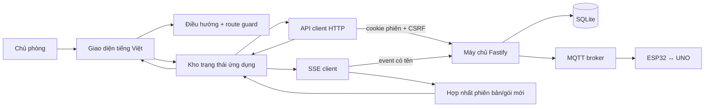
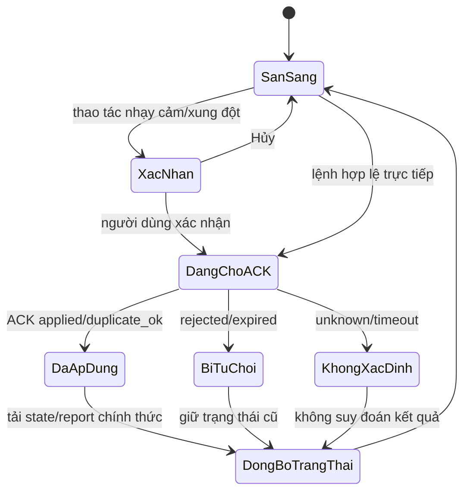

# XÂY DỰNG ỨNG DỤNG WEB — PHIÊN BẢN 1.0

## 1. Thông tin kiểm soát

| Thuộc tính | Giá trị |
|---|---|
| Tên tài liệu | Xây dựng ứng dụng web quản lý phòng thông minh |
| Phiên bản | 1.0 |
| Trạng thái | **ĐÃ DUYỆT — 29/09/2026** |
| Giai đoạn | Giai đoạn 16 — Xây dựng ứng dụng web |
| Ngày tạo | 28/09/2026 |
| Đầu vào đã khóa | Đặc tả 1.2, Ma trận kiểm thử 1.2, Kiến trúc 1.1, MQTT 1.0, Thiết kế dữ liệu 1.0, Thiết kế giao diện 1.0, Máy chủ 1.0 và Cơ sở dữ liệu 1.0 |
| Đầu ra | SPA TypeScript tiếng Việt, CSS thích ứng, API client, SSE, xác thực, điều khiển có ACK, cấu hình, cảnh báo, lịch sử, nhật ký và kiểm thử web |
| Chưa thuộc giai đoạn | Tích hợp toàn chuỗi với broker/ESP32/UNO thật, kiểm thử trình duyệt–thiết bị vật lý, số liệu cảm biến thực nghiệm và tuyên bố WCAG chính thức |

Tài liệu này mô tả mã đã hiện thực trong `web/` và phần mở rộng API tương thích của CR-04. Các kết quả nêu ở đây là kiểm thử phần mềm; không tự động chuyển bất kỳ ca chấp nhận `KTxx` nào sang `ĐẠT`.

## 2. Kết quả triển khai

Ứng dụng đã được xây dựng dưới dạng ứng dụng web một trang (Single-Page Application — SPA) TypeScript, không kết nối trực tiếp tới MQTT. Trình duyệt chỉ giao tiếp với máy chủ Fastify bằng HTTP và Server-Sent Events (SSE). Cách tách này giữ thông tin MQTT ngoài trình duyệt, dùng lại xác thực/CSRF của máy chủ và bảo đảm mọi lệnh đi qua cùng chính sách nghiệp vụ.

Đầu ra Giai đoạn 16 gồm:

- tám tuyến đã thiết kế, trong đó bảy tuyến nghiệp vụ được bảo vệ bởi phiên đăng nhập;
- giao diện điện thoại trước, mở rộng ở các vùng 560, 720, 900, 1.024 và 1.240 px;
- tải ảnh chụp tổng quan, cấu hình và nhật ký từ API;
- nhận cập nhật có tên qua SSE, bỏ trạng thái phiên bản cũ và dùng polling dự phòng khi SSE suy giảm;
- lệnh điều khiển có mã lệnh, trạng thái chờ ACK và tải lại trạng thái thực tế; không cập nhật lạc quan;
- kiểm tra vùng trễ ánh sáng, hiệu chuẩn LDR và miền tương đối MQ-2 trước khi lưu toàn bộ cấu hình;
- hiển thị danh sách đầy đủ nguyên nhân cảnh báo, tách **Tắt tiếng** khỏi **Xác nhận**;
- biểu đồ SVG không nối qua khoảng trống dữ liệu;
- bộ lọc nhật ký, phân trang và chi tiết kỹ thuật không chứa bí mật;
- thông báo trình duyệt chỉ xin quyền sau thao tác rõ ràng và chống lặp theo `alert_id`;
- 30 kiểm thử web cấp mô-đun/hợp đồng và một kiểm thử hồi quy máy chủ cho CR-04.

## 3. Kiến trúc hiện thực

| Mô-đun | Trách nhiệm |
|---|---|
| `app.ts` | Điều phối phiên, điều hướng, tải dữ liệu, lệnh, cấu hình, SSE/polling và thông báo |
| `api/client.ts` | Bao HTTP, cookie cùng nguồn, CSRF, lỗi thống nhất và các endpoint Giai đoạn 14 |
| `realtime/sse-client.ts` | Mở EventSource có credential, đăng ký event có tên và bỏ riêng event JSON hỏng |
| `state/store.ts` | Trạng thái giao diện tập trung và phát thay đổi cho bộ kết xuất |
| `state/realtime.ts` | Hợp nhất snapshot/event, chống quay lùi `state_version`, cập nhật hai tập cảnh báo |
| `router.ts` | Danh mục tuyến, chuẩn hóa URL và chặn tuyến khi chưa xác thực |
| `domain/config-validation.ts` | Kiểm tra nguyên tử ngưỡng/vùng trễ/hiệu chuẩn trước khi gửi máy chủ |
| `domain/history.ts` | Chia đoạn dữ liệu lịch sử và tạo khoảng truy vấn 24 giờ/7 ngày/30 ngày |
| `notifications.ts` | Xin quyền theo thao tác và chống thông báo lặp |
| `ui/render.ts` | Kết xuất tám trang, trạng thái tải/lỗi/rỗng/ngoại tuyến và nhãn phần cứng/mô phỏng |
| `styles.css` | Hệ thống màu/chữ/thẻ, bố cục mobile-first, focus, mục tiêu 44 px và reduced motion |

Không có mã truy cập MQTT, mật khẩu thiết bị hoặc bí mật máy chủ trong gói web.

## 4. Tuyến và màn hình

| Tuyến | Nội dung đã hiện thực |
|---|---|
| `/dang-nhap` | Tên tài khoản, mật khẩu, trạng thái đang xử lý, lỗi chung và ghi chú không lưu mật khẩu trong trình duyệt |
| `/tong-quan` | Mức sáng, vùng cửa SRF04, MQ-2 tương đối, cảm biến lửa, hồ sơ/phương thức, đầu ra và nhật ký gần đây |
| `/dieu-khien` | Đèn thật, quạt mô phỏng, khóa mô phỏng, Tự động/Thủ công, xác nhận xung đột và trạng thái ACK |
| `/trang-thai-phong` | Ở nhà, Ra ngoài, Ban đêm, tác động từng hồ sơ và hộp thoại xác nhận |
| `/cai-dat-tu-dong` | Ngưỡng bật/tắt đèn, vùng trễ, hiệu chuẩn LDR, desired/reported và phiên bản cấu hình |
| `/an-ninh-an-toan` | Vùng cửa, khóa mô phỏng, MQ-2, cảm biến lửa, cảnh báo nhiều nguyên nhân, bảo trì và quyền thông báo |
| `/lich-su` | Biểu đồ mức sáng 24 giờ/7 ngày/30 ngày, bảng dữ liệu và khoảng trống trung thực |
| `/nhat-ky` | Lọc thời gian/loại/mức độ/nguồn, phân trang và chi tiết bản ghi |

Người chưa đăng nhập luôn được chuyển về `/dang-nhap`. Sau khi đăng nhập, yêu cầu vào `/dang-nhap` được chuyển về `/tong-quan`. Phiên hết hạn giữ tuyến muốn quay lại nhưng không tự gửi lại lệnh cũ.

## 5. Trạng thái dữ liệu và kết nối

Ứng dụng tải ảnh chụp trước rồi mở SSE. EventSource tự gửi `Last-Event-ID` khi kết nối lại theo cơ chế trình duyệt. Nếu máy chủ không còn cửa sổ phát lại, server gửi `state.updated` có `snapshot=true`; trình duyệt thay toàn bộ ảnh tổng quan. Với event rời:

| Event | Hành vi giao diện |
|---|---|
| `telemetry.updated` | Cập nhật cảm biến, `received_at` và chất lượng; không tự ghi lịch sử ở trình duyệt |
| `state.updated` | Chỉ nhận phiên bản không cũ hơn trạng thái đang có |
| `availability.updated` | Đổi nhãn Trực tuyến/Suy giảm/Ngoại tuyến và khóa lệnh khi cần |
| `config.updated` | Cập nhật desired/reported nhưng giữ bản nháp người dùng đang sửa |
| `command.updated` | Kết thúc trạng thái chờ theo `command_id`, sau đó tải lại trạng thái chính thức |
| `alert.updated` | Dùng `activeAlerts` cho banner; dùng `alerts` cho cả nguyên nhân đang hoạt động và chờ xác nhận |
| `event.created` | Tải lại nhật ký khi người dùng đang ở Tổng quan/Nhật ký |

Khi SSE lỗi, ứng dụng đánh dấu kênh thời gian thực `Suy giảm` và tải tổng quan có giới hạn mỗi 15 giây. Khi SSE mở lại, polling dừng. Khi máy chủ hoặc thiết bị ngoại tuyến, lệnh từ xa bị khóa; giá trị cuối vẫn kèm thời điểm và chuyển nhãn **Dữ liệu cũ** sau ngưỡng 15 giây.

## 6. Lệnh, xác nhận và chống cập nhật lạc quan

- Bấm đèn/quạt khi đang Tự động mở xác nhận chuyển nguyên tử sang Thủ công.
- Hồ sơ Ra ngoài khóa nút đèn/quạt và hiển thị lý do.
- Mở khóa mô phỏng luôn hỏi xác nhận; nếu đang Ra ngoài/Ban đêm, lệnh yêu cầu chuyển về Ở nhà.
- Cảnh báo an ninh đang hoạt động chặn mở khóa; cảnh báo an toàn không tự mở nhưng cho phép chủ phòng xác nhận thao tác theo chính sách.
- HTTP `2xx` chỉ tạo `pendingCommand`. Thẻ đầu ra chỉ đổi theo state/report hoặc lần tải tổng quan sau ACK.
- `unknown` không được biến thành thành công; giao diện ghi **Không xác định — đang đồng bộ** rồi tải lại trạng thái.

Hộp thoại có `role=dialog`, nhãn/diễn giải, tiêu điểm ban đầu, vòng Tab và phím Escape. Nút và liên kết có vòng tiêu điểm nhìn thấy.

## 7. Cấu hình và dữ liệu lịch sử

### 7.1. Cấu hình

Ứng dụng luôn gửi toàn bộ `ConfigSettings` cùng `base_config_version`. Cấu hình bị chặn phía trình duyệt nếu:

- ngưỡng bật đèn ngoài 0–80% hoặc ngưỡng tắt ngoài 20–100%;
- vùng trễ ánh sáng nhỏ hơn 5 điểm phần trăm;
- ADC LDR ngoài 0–1.023 hoặc hai mốc hiệu chuẩn đang bật cách nhau dưới 10;
- baseline/span MQ-2 ngoài miền ADC hoặc tổng vượt 1.023;
- ngưỡng MQ-2 không phải số nguyên 0–100%.

Máy chủ vẫn là lớp kiểm tra quyết định. Sau lưu, giao diện ghi **Đã lưu máy chủ — Chờ thiết bị áp dụng**, tách phiên bản desired khỏi reported; không gọi là đang chạy trước reported `applied/unchanged`.

### 7.2. Biểu đồ

Biểu đồ chỉ dùng mẫu một phút do API trả về. Hàm `historySegments` sắp xếp điểm và tạo đoạn mới nếu:

- mẫu rỗng;
- chất lượng `invalid`;
- khoảng giữa hai bucket lớn hơn 150 giây.

SVG vì vậy không nối đường qua thời gian thiết bị ngoại tuyến. Mẫu `partial` dùng ký hiệu riêng; bảng chi tiết giữ giá trị, số mẫu và chất lượng gốc.

## 8. Cảnh báo và CR-04

Khi nối giao diện với hợp đồng Giai đoạn 14–15, phát hiện API tổng quan chỉ trả `activeAlerts`. Một nguyên nhân đã hết (`active=false`) nhưng còn `awaiting_ack` vì vậy biến mất trước khi chủ phòng có thể bấm **Xác nhận**.

[CR-04](./04-kiem-soat-thay-doi-CR-04.md) mở rộng tương thích `DeviceOverview`:

- `activeAlerts`: chỉ nguyên nhân đang hoạt động, dùng cho banner/toàn cục;
- `alerts`: cả nguyên nhân đang hoạt động và đã hết nhưng còn chờ xác nhận;
- SSE `alert.updated` giữ `active_alerts` và bổ sung `alerts`;
- repository bộ nhớ/SQLite và kiểm thử hồi quy dùng cùng ngữ nghĩa;
- không thay MQTT, firmware, migration, mã chức năng hoặc mã `KTxx`.

Nút **Tắt tiếng** chỉ có cho nguyên nhân đang hoạt động. **Xác nhận** chỉ bật khi nguyên nhân đó ở `awaiting_ack` và không còn bất kỳ nguyên nhân active nào. Một cảnh báo mới cùng mã vẫn được phép làm thông báo/còi hoạt động lại theo phía thiết bị.

## 9. Khả năng tiếp cận và thích ứng

| Yêu cầu | Hiện thực |
|---|---|
| 360–767 px | Một cột, thanh điều hướng dưới, menu Thêm, nút tối thiểu 44 px |
| 768–1.199 px | Lưới hai/ba cột theo nội dung, biểu đồ cuộn khi cần |
| Từ 1.200 px | Thanh bên cố định, lưới rộng và vùng nội dung giới hạn dễ đọc |
| Bàn phím | Liên kết bỏ qua, focus ring, điều hướng gốc, modal Tab/Escape |
| Công nghệ hỗ trợ | Nhãn biểu mẫu, `aria-current`, `role=status/alert/dialog`, vùng `aria-live` |
| Không chỉ dùng màu | Mỗi trạng thái có chữ, biểu tượng/nhãn và màu |
| Giảm chuyển động | `prefers-reduced-motion` vô hiệu hóa chuyển động không cần thiết |

Đây là hiện thực hướng tới WCAG 2.2 AA, không phải chứng nhận tuân thủ. Kiểm thử trình duyệt, độ tương phản tự động và công nghệ hỗ trợ thật được tiếp tục ở Giai đoạn 18.

## 10. Nhãn phạm vi phần cứng

Giao diện tuân thủ CR-02 và không biến trạng thái logic thành kết quả vật lý:

- đèn: **PHẦN CỨNG THẬT** theo thiết kế pinout, nhưng chưa tuyên bố đã sáng trước kiểm thử vật lý;
- quạt: **MÔ PHỎNG**, chỉ là logic/LED, không ghi động cơ đang quay;
- khóa: **MÔ PHỎNG**, hiển thị trạng thái lệnh và `Chưa xác minh cơ khí`;
- SRF04: `Vùng trống/Phát hiện đối tượng`, không suy ra cánh cửa mở/đóng;
- MQ-2: ADC/mức tương đối 0–100%, không phải ppm;
- cảm biến lửa: dấu hiệu/cảnh báo mô hình, không phải thiết bị báo cháy thương mại;
- còi: hiển thị `Không khả dụng` khi cờ phần cứng chưa qua cổng đo; LED vẫn là đầu ra cảnh báo.

## 11. Truy vết chức năng

| Chức năng | Thành phần web | Kiểm thử phần mềm G16 | Ca chấp nhận liên quan |
|---|---|---|---|
| MT-03 | Tổng quan, Lịch sử, mức sáng/ADC/chất lượng/thời điểm | history, realtime, render | KT14, KT15, KT21, KT36 |
| MT-02 | Nhãn Hợp lệ/Cũ/Không hợp lệ và khóa tự động theo trạng thái thiết bị | realtime, render | KT02 |
| DK-02 | Điều khiển đèn thật/quạt mô phỏng, trạng thái ACK | API, render | KT03, KT04, KT09, KT18 |
| TD-02 | Cài đặt ngưỡng/vùng trễ và nguồn Tự động | config-validation, render | KT02, KT06, KT07, KT11, KT14 |
| CD-01 | Bộ chọn Tự động/Thủ công và xác nhận lệnh trực tiếp | router, render | KT04, KT08, KT11 |
| CD-02 | Ba thẻ hồ sơ và xác nhận tác động | router, render | KT08–KT11, KT24 |
| CH-01 | Desired/reported, phiên bản và biểu mẫu kiểm tra nguyên tử | config-validation, API | KT07, KT08, KT16, KT26 |
| AN-05 | Thẻ vùng cửa SRF04 và trạng thái trang bị | realtime, render | KT09, KT10, KT12, KT30, KT31, KT38 |
| AN-06 | Khóa mô phỏng, chặn mở khi báo an ninh | render, API | KT09, KT24, KT39 |
| AT-01 | MQ-2 làm nóng/tương đối/lỗi và bảo trì | config-validation, render | KT07, KT25, KT26, KT28, KT31 |
| AT-02 | Cảm biến lửa và cảnh báo độc lập | render, realtime | KT27, KT28, KT31 |
| CB-01 | `alerts`/`activeAlerts`, Tắt tiếng/Xác nhận | realtime, API, CR-04 server | KT12, KT13, KT24, KT29–KT31 |
| MN-01 | Badge, banner, SSE, polling, snapshot và đồng bộ lại | realtime, API | KT14–KT18, KT31 |
| UD-01 | Đăng nhập, route guard, CSRF, toàn bộ shell | router, API, render | KT03, KT18, KT19, KT36 |
| DL-01 | Nhật ký, bộ lọc, phân trang, thời gian và chi tiết | API, render | KT15, KT20, KT21, KT30, KT36, KT38 |
| BC-01 | Ba khoảng thời gian, SVG chia đoạn và bảng | history, render | KT21 |
| TB-01 (B) | Xin quyền theo thao tác, chống lặp `alert_id` | notifications | KT34 |
| MR-01 (C) | Không kích hoạt giao diện riêng | Không có | KT35 chỉ áp dụng khi mở phạm vi |

Toàn bộ **16/16 chức năng nhóm A** có thành phần giao diện hoặc xử lý web tương ứng. Nhóm B được hiện thực ở mức thông báo trình duyệt; đây vẫn là kênh bổ sung. Nhóm C chưa kích hoạt.

## 12. Kết quả xác minh phần mềm

Kết quả chạy ngày 28/09/2026 trên máy phát triển:

| Mã | Nội dung | Kết quả |
|---|---|---|
| G16-TYPE-01 | TypeScript web `tsc --noEmit` | **ĐẠT** |
| G16-TEST-01 | Vitest web | **ĐẠT — 7 file, 30/30 kiểm thử** |
| G16-BUILD-01 | Vite build sản phẩm | **ĐẠT — 15 mô-đun; JS 67,28 kB, CSS 27,10 kB trước nén** |
| G16-ROUTE-01 | Tám tuyến, route guard và nhãn tiếng Việt | **ĐẠT — kiểm thử + kiểm tra tĩnh** |
| G16-DATA-01 | Snapshot/SSE, bỏ state cũ, hai tập cảnh báo | **ĐẠT — kiểm thử phần mềm** |
| G16-CMD-01 | CSRF, trạng thái chờ, không optimistic | **ĐẠT — kiểm thử + kiểm tra mã** |
| G16-CONFIG-01 | Vùng trễ/hiệu chuẩn/MQ-2 | **ĐẠT — 4 kiểm thử** |
| G16-GRAPH-01 | Sắp xếp/chia đoạn/khoảng 7 ngày | **ĐẠT — 4 kiểm thử** |
| G16-NOTIFY-01 | Xin quyền rõ ràng và chống lặp | **ĐẠT — 4 kiểm thử** |
| G16-CR04-01 | Cảnh báo `awaiting_ack` còn trong overview nhưng không thuộc active | **ĐẠT — kiểm thử máy chủ** |
| G16-STATIC-01 | Cây file, API/SSE, responsive, nhãn mô phỏng và truy vết | **ĐẠT** |
| G16-VISUAL-01 | Trang Đăng nhập tại 360/768/1.200 px | **ĐẠT — không tràn ngang; đã phát hiện và sửa khoảng cách hai ô nhập ở 360 px** |
| G16-AUDIT-01 | Kiểm tra phụ thuộc sản xuất | **ĐẠT — không phát hiện lỗ hổng đã biết** |

Ba mươi kiểm thử web gồm 4 kiểm thử điều hướng, 4 cấu hình, 4 lịch sử, 5 hợp nhất thời gian thực, 5 API/CSRF/lỗi, 4 thông báo và 4 kết xuất giao diện. Chúng không thay cho kiểm thử đầu-cuối với board thật.

## 13. Hướng dẫn chạy

1. Sao chép các tên biến trong `config/env.example` sang môi trường chạy và cung cấp bí mật thật ngoài repository.
2. Chạy máy chủ ở cổng 3.000; có thể đặt `MQTT_ENABLED=false` để kiểm tra riêng web/API khi không chạy broker.
3. Từ gốc dự án, chạy `pnpm web:dev`.
4. Mở `http://localhost:5173`; Vite chuyển tiếp `/api` và `/health` tới `WEB_API_TARGET`, mặc định là `http://127.0.0.1:3000`.
5. Dùng `pnpm --filter super-iot-web typecheck`, `test` và `build` để tái tạo cổng phần mềm.

Không đặt mật khẩu, session secret hoặc tài khoản MQTT trong mã web, URL hoặc repository.

## 14. Giới hạn và nguyên tắc học thuật

- Chưa chạy trình duyệt cùng dữ liệu từ ESP32/UNO thật; trạng thái UI mới được kiểm thử bằng dữ liệu phần mềm có kiểm soát.
- Trang Đăng nhập đã được kiểm tra trực quan ở 360/768/1.200 px trên trình duyệt trong ứng dụng; các trang sau đăng nhập và nhiều engine trình duyệt vẫn cần kiểm thử ở Giai đoạn 18. Môi trường trình duyệt kiểm tra không truy cập được API cục bộ dù API/Vite proxy đáp ứng từ tiến trình kiểm tra, nên không suy diễn kết quả tích hợp từ lượt này.
- Chưa kiểm thử screen reader, bàn phím trên thiết bị di động, độ tương phản tự động hoặc chứng nhận WCAG.
- Chưa kiểm thử HTTPS/notification trong môi trường triển khai; từ chối quyền vẫn giữ cảnh báo trong ứng dụng.
- Không có kết quả đèn, SRF04, MQ-2, cảm biến lửa, UART hoặc cảnh báo vật lý trong tài liệu này.
- Không có tuyên bố ppm, cửa đã đóng/mở cơ khí, servo đã quay, motor đang chạy hoặc thiết bị báo cháy thương mại.
- Toàn bộ 32 ca `KTxx` đang áp dụng vẫn là `CHƯA THỰC HIỆN`; kết quả G16 là kiểm thử phần mềm phát triển.

## 15. Cổng chấp nhận Giai đoạn 16

| Mã | Tiêu chí | Trạng thái |
|---|---|---|
| G16-PAGE-01 | Đủ tám tuyến, tiếng Việt và route guard | **ĐẠT — kiểm thử + kiểm tra tĩnh** |
| G16-RESP-01 | CSS mobile-first, breakpoint và mục tiêu chạm | **ĐẠT — kiểm tra mã + trang Đăng nhập tại 360/768/1.200 px; còn các trang sau đăng nhập/đa trình duyệt ở G18** |
| G16-AUTH-01 | Cookie phiên, CSRF và không lộ MQTT credential | **ĐẠT — kiểm thử + kiểm tra mã** |
| G16-REALTIME-01 | Snapshot/SSE/polling và chống state cũ | **ĐẠT — kiểm thử phần mềm** |
| G16-COMMAND-01 | ACK/NACK/unknown, xác nhận và không optimistic | **ĐẠT — kiểm tra mã/kiểm thử hợp đồng** |
| G16-CONFIG-01 | Desired/reported, version và kiểm tra nguyên tử | **ĐẠT — kiểm thử phần mềm** |
| G16-ALERT-01 | Nhiều nguyên nhân, tắt tiếng, xác nhận và CR-04 | **ĐẠT — kiểm thử phần mềm** |
| G16-HISTORY-01 | 24 giờ/7 ngày/30 ngày và khoảng trống | **ĐẠT — kiểm thử phần mềm** |
| G16-A11Y-01 | Nhãn, focus, dialog, aria-live, reduced motion | **ĐẠT — kiểm tra mã; chưa tuyên bố WCAG** |
| G16-LABEL-01 | Đèn thật; quạt/khóa mô phỏng; MQ-2 không ppm | **ĐẠT — kiểm thử kết xuất** |
| G16-TRACE-01 | 16/16 A, B/C và `KTxx` cùng ngữ nghĩa | **ĐẠT — kiểm tra tĩnh** |
| G16-DOC-01 | Mã chạy, giới hạn và điểm duyệt được ghi rõ | **ĐẠT — người dùng duyệt 29/09/2026** |

## 16. Lịch sử sửa đổi và điểm duyệt

| Phiên bản | Trạng thái | Nội dung | Lý do/ảnh hưởng |
|---|---|---|---|
| 1.0 | **ĐÃ DUYỆT — 29/09/2026** | Hiện thực SPA TypeScript, tám trang, API/SSE, xác thực, lệnh, cấu hình, cảnh báo, lịch sử, nhật ký, responsive/a11y và kiểm thử | Đầu ra Giai đoạn 16; CR-04 được duyệt cùng mốc này |

**ĐIỂM DUYỆT:** Người dùng đã duyệt Giai đoạn 16 và CR-04 ngày 29/09/2026. Tài liệu 1.0 được khóa và dự án chuyển sang **Giai đoạn 17 — Tích hợp**.

## 17. Tài liệu tham khảo kỹ thuật

Các nguồn dưới đây đã được dùng trong Thiết kế giao diện 1.0 và tiếp tục chi phối hiện thực:

1. MDN Web Docs, *Responsive web design*: <https://developer.mozilla.org/en-US/docs/Learn_web_development/Core/CSS_layout/Responsive_Design>.
2. MDN Web Docs, *Using server-sent events*: <https://developer.mozilla.org/en-US/docs/Web/API/Server-sent_events/Using_server-sent_events>.
3. MDN Web Docs, *Using the Notifications API*: <https://developer.mozilla.org/en-US/docs/Web/API/Notifications_API/Using_the_Notifications_API>.
4. W3C, *Web Content Accessibility Guidelines (WCAG) 2.2*: <https://www.w3.org/TR/WCAG22/>.
