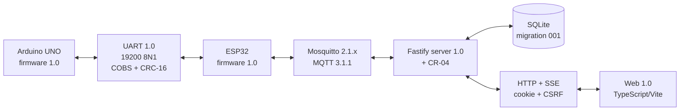

# TÍCH HỢP HỆ THỐNG PHÒNG THÔNG MINH 1.0

## 1. Thông tin tài liệu

| Thuộc tính | Giá trị |
|---|---|
| Tên tài liệu | Tích hợp hệ thống phòng thông minh |
| Phiên bản | 1.0 — bản nháp Giai đoạn 17 |
| Trạng thái | **ĐANG THỰC HIỆN** |
| Giai đoạn | Giai đoạn 17 — Tích hợp |
| Ngày tạo | 29/09/2026 |
| Đầu vào đã khóa | Giai đoạn 1–16; CR-02, CR-03 và CR-04; Firmware UNO/ESP32, MQTT, server, database và web 1.0 |
| Đầu ra hiện có | Manifest tương thích; bộ mô phỏng thiết bị; phép thử broker → server → SQLite → API/SSE → web; bộ thử chịu lỗi; công cụ board/log và phiếu bằng chứng phần cứng |
| Điểm còn thiếu | Nạp/chạy UNO và ESP32 thật, đo chuyển mức/nguồn, UART thật, Wi-Fi từ ESP32 và quan sát đầu ra/cảm biến vật lý |

Tài liệu này tách hai loại bằng chứng:

1. **Tích hợp phần mềm có kiểm soát:** dùng Mosquitto, server, SQLite và web thật; thay UNO/ESP32 bằng thiết bị **MÔ PHỎNG** đúng hợp đồng MQTT 1.0.
2. **Tích hợp vật lý:** chỉ được ghi nhận sau khi người dùng thao tác trên board, đo điện và gửi ảnh/log tương ứng.

Kết quả phần mềm dưới đây **không phải bằng chứng phần cứng** và không tự chuyển ca chấp nhận `KTxx` sang `ĐẠT`.

## 2. Kết luận tích hợp hiện tại

- Giai đoạn 16 và CR-04 đã được người dùng duyệt ngày 29/09/2026, nên đủ điều kiện bắt đầu Giai đoạn 17.
- Hợp đồng giữa các thành phần thống nhất ở UART 1.0 (`0x10`, 19200 8N1), MQTT 1.0 (`smartroom.mqtt`, schema 1), API/SSE server 1.0 + CR-04, migration SQLite 001 và web 1.0.
- Chuỗi phần mềm đã được chạy đầu-cuối trên loopback bằng Mosquitto thật, SQLite file thật, Fastify thật và Vite proxy thật. Thiết bị đầu cuối vẫn là mô phỏng.
- Lệnh web giữ `pending` đến khi có `commands/result`; phép thử xác nhận không cập nhật lạc quan.
- Cấu hình desired được lưu/outbox/publish retained, sau đó chỉ chuyển `applied` khi thiết bị mô phỏng trả `config/reported` cùng phiên bản.
- Chuỗi phần mềm đã loại payload sai schema, bỏ state có phiên bản cũ, chống ghi trùng cùng `message_id`, và phục hồi outbox qua **3 chu kỳ** dừng/chạy lại broker thật với phiên bản cấu hình tăng đơn điệu.
- Trạng thái, telemetry, cấu hình và phiên web còn sau khi khởi động lại server với MQTT tắt, xác nhận đường lưu trữ SQLite.
- Hồi quy chịu lỗi riêng đạt **6/6**: timeout lệnh không tạo thành công giả, kết quả đến muộn vẫn hòa giải được, 1.000 payload MQTT tùy ý được xử lý hữu hạn, tối đa 512 đột biến telemetry một byte được kiểm tra và lớp dịch vụ qua 25 chu kỳ offline/online.
- Codec host của cả UNO và ESP32 từ chối mọi tiền tố khung bị cắt, delimiter nằm trong payload COBS và mọi khung thử bị lật một bit; đây vẫn chỉ là bằng chứng trên máy phát triển.
- Tiền kiểm máy phát triển đạt `PREPARATION_READY`: PlatformIO, binary hai firmware, cờ an toàn, công cụ vận hành và Mosquitto portable sẵn sàng; biên bản vẫn cố định `hardware_evidence=false`, `physical_measurements=false` và `upload_performed=false`.
- Runner ngày 29/09/2026 đạt **15/15** điểm xác nhận phần mềm; cả hai firmware build-only đạt bằng PlatformIO cục bộ, chưa nạp board.
- Giai đoạn 17 chưa thể đóng vì toàn bộ cổng board/UART/điện/Wi-Fi vật lý vẫn `CHƯA THỰC HIỆN`.

## 3. Kiến trúc tích hợp



Trong phép thử tự động G17, khối UNO + UART + ESP được thay bằng `SimulatedDevice`. Các khối Mosquitto, Fastify, SQLite, HTTP/SSE và Vite không bị thay thế.

## 4. Ma trận phiên bản tương thích

Nguồn máy đọc là `config/integration-compatibility.json`.

| Thành phần/hợp đồng | Phiên bản khóa cho G17 | Dấu kiểm tra |
|---|---|---|
| Firmware UNO | 1.0 | `kProtocolVersion = 0x10`, SoftwareSerial D10/D11, 19200 baud |
| Firmware ESP32 | 1.0 | `kProtocolVersion = 0x10`, UART2 GPIO16/GPIO17, 19200 8N1 |
| Giao thức UNO–ESP32 | Tài liệu 1.0 / wire `0x10` | COBS, CRC-16/CCITT-FALSE, session, sequence, ACK/NACK |
| MQTT | Tài liệu 1.0 / MQTT 3.1.1 | root `smartroom/v1/devices`, schema `smartroom.mqtt`, schema version 1 |
| Mosquitto | 2.1.x | QoS tối đa 1; payload 2.048 byte; ACL G13 |
| Server | 1.0 + CR-04 | Fastify, MQTT.js protocolVersion 4, API/SSE, `alerts` + `activeAlerts` |
| Database | 1.0 / migration 001 | SQLite `user_version=1`, bảng `STRICT`, WAL, inbox/outbox |
| Web | 1.0 | tám tuyến, cookie/CSRF, snapshot/SSE/polling, ACK |
| Thiết bị logic | `room-01` | Firmware, ACL, server env và topic cùng ID |

Mọi thay đổi một trong các giá trị trên sau mốc duyệt phải được đánh giá tương thích; không chỉ sửa một phía.

## 5. Hai hồ sơ chạy

### 5.1. Hồ sơ A — phần mềm loopback có thiết bị mô phỏng

Lệnh tái tạo:

```powershell
pnpm check:stage17
pnpm integration:stage17
```

`pnpm integration:stage17` build server/web trước, sau đó runner thực hiện và báo **15/15** điểm xác nhận:

1. đối chiếu manifest tương thích đã khóa;
2. tạo Mosquitto tạm chỉ bind `127.0.0.1`, cổng ngẫu nhiên, giới hạn QoS/payload giống cấu hình G13;
3. khởi động thiết bị mô phỏng và subscribe ba topic vào thiết bị;
4. khởi động Fastify với SQLite file tạm, MQTT thật và cấu hình phiên thật;
5. khởi động Vite với proxy `/api`, `/health` tới Fastify;
6. đăng nhập qua proxy, kiểm tra cookie/CSRF;
7. đưa telemetry/state/config qua MQTT và đọc lại qua API;
8. gửi lệnh đèn, chờ ACK thiết bị rồi kiểm tra trạng thái/phiên bản;
9. gửi desired config, chờ reported config cùng phiên bản;
10. nhận `telemetry.updated` qua SSE và đọc lịch sử SQLite;
11. phát payload sai schema và xác nhận chỉ ghi warning, không ghi đè snapshot hợp lệ;
12. phát `state_version` cũ và xác nhận trạng thái không quay lùi;
13. phát trùng cùng `message_id` và xác nhận chỉ lưu một sự kiện;
14. lặp 3 lần việc dừng broker, lưu desired config vào outbox khi ngoại tuyến, chạy lại broker và xác nhận replay tới `applied` với phiên bản tăng đơn điệu;
15. đóng server, mở lại cùng database khi MQTT tắt và kiểm tra dữ liệu/phiên còn nguyên.

Broker tạm cho phép anonymous vì chỉ bind loopback và bị xóa sau lượt chạy. Lượt này xác minh vận chuyển/hợp đồng đầu-cuối, **không thay** kiểm thử xác thực/ACL 8/8 của Giai đoạn 13. Không credential thật nào được tạo hoặc ghi vào repository.

Trước khi người dùng thao tác board, có thể tái tạo tiền kiểm máy phát triển bằng:

```powershell
pnpm check:hardware-preparation
pnpm test:hardware-tooling
```

Biên bản `data/logs/hardware/stage17-hardware-preparation.json` chỉ ghi hash binary, tình trạng công cụ/cờ an toàn, danh sách COM hiện có và trạng thái tồn tại của cấu hình cục bộ. Công cụ phụ trợ còn có snapshot/diff COM, ghép báo cáo Checkpoint 1 ở trạng thái `PENDING_GPT_REVIEW` và thu serial 115200 có timeout/`-WhatIf`. Hồi quy công cụ đạt **14/14** bằng fixture và thư mục tạm, gồm nhánh số đo danh định, ngoài dải, COM mơ hồ, serial dry-run không tạo file và đầu ra che log khớp mẫu mà không sửa log nguồn. Chúng không đọc nội dung secret, không mở serial trong bài hồi quy, không nạp board và không thay bằng chứng vật lý.

### 5.2. Hồ sơ B — phần cứng LAN thật

Hồ sơ này dùng broker đã khởi tạo bằng `Initialize-Mqtt.ps1`, tài khoản `room-01-device` và `smartroom-backend`, SQLite vận hành, server và web. ESP32 phải dùng IP LAN của broker; không dùng `localhost`. Cổng 1883 chỉ mở trên mạng Private/LAN và không chuyển tiếp Internet.

Hồ sơ B chưa được chạy. Không được dùng kết quả Hồ sơ A để điền kết quả Hồ sơ B.

## 6. Kết quả phần mềm ngày 29/09/2026

| Mã | Cổng | Kết quả |
|---|---|---|
| G17-SW-01 | Manifest khóa phiên bản UNO/ESP32/MQTT/server/DB/web | **ĐẠT — kiểm tra tĩnh** |
| G17-SW-02 | Firmware hai phía cùng wire `0x10`, 19200 8N1, đúng chân | **ĐẠT — kiểm tra tĩnh** |
| G17-SW-03 | ESP32/server cùng schema 1 và topic root | **ĐẠT — kiểm tra tĩnh** |
| G17-SW-04 | ACL phủ 10 topic device→server, 3 topic server→device và backend | **ĐẠT — kiểm tra tĩnh; ACL động đã đạt 8/8 ở G13** |
| G17-SW-05 | Build server + web | **ĐẠT** |
| G17-SW-06 | Mosquitto ↔ MQTT.js ↔ Fastify ↔ SQLite | **ĐẠT — thiết bị mô phỏng** |
| G17-SW-07 | Vite ↔ HTTP proxy ↔ phiên cookie/CSRF | **ĐẠT — phần mềm loopback** |
| G17-SW-08 | Telemetry/snapshot MQTT → SQLite → overview API | **ĐẠT — dữ liệu mô phỏng** |
| G17-SW-09 | Lệnh web → outbox/MQTT → result/ACK → API | **ĐẠT — thiết bị mô phỏng; pending → applied** |
| G17-SW-10 | Desired retained → reported cùng phiên bản | **ĐẠT — thiết bị mô phỏng** |
| G17-SW-11 | SSE `telemetry.updated` qua Vite proxy | **ĐẠT — dữ liệu mô phỏng** |
| G17-SW-12 | Lịch sử và phục hồi trạng thái/phiên/config sau restart | **ĐẠT — SQLite file tạm** |
| G17-SW-13 | Payload MQTT sai schema bị loại và ghi warning | **ĐẠT — dữ liệu mô phỏng** |
| G17-SW-14 | `state_version` cũ không ghi đè snapshot mới | **ĐẠT — dữ liệu mô phỏng** |
| G17-SW-15 | Hai bản tin cùng `message_id` chỉ tạo một sự kiện | **ĐẠT — dữ liệu mô phỏng** |
| G17-SW-16 | Broker mất/kết nối lại; outbox giữ pending rồi replay tới applied qua 3 chu kỳ, phiên bản tăng đơn điệu | **ĐẠT — broker thật, thiết bị mô phỏng** |

Runner ghi biên bản máy đọc vào `data/logs/stage17-software-integration.json`. File là log runtime bị `.gitignore` loại trừ, không chứa mật khẩu, database hay payload bí mật.

### 6.1. Hồi quy chịu lỗi bổ sung

Lệnh `pnpm test:resilience` tách các tình huống chịu lỗi khỏi bộ hồi quy thông thường và đã đạt **6/6** ngày 29/09/2026:

| Lớp | Phạm vi đã chạy | Ranh giới |
|---|---|---|
| Server — timeout lệnh | `pending → unknown` với `device_result_timeout`; không đổi trạng thái đèn; kết quả thiết bị đến muộn vẫn chuyển sang `applied` | Đồng hồ giả và MQTT giả; không phải timeout UART thật |
| Server — fuzz MQTT | 1.000 payload byte tùy ý; tối đa 512 đột biến một byte của telemetry; từ chối topic gần đúng/traversal/device ngoài miền | Dữ liệu xác định trên host; không phải nhiễu đường dây |
| Server — soak reconnect | 25 chu kỳ offline/online; version 2→26 tăng đơn điệu; mỗi version có đúng một desired retained và đi `pending_delivery → applied` | Transport giả ở lớp dịch vụ |
| Web — timeout | Hiển thị “Không xác định — đang đồng bộ” và lý do chưa xác nhận đúng hạn; không hiển thị thành công giả | DOM giả trên host; chưa thay thao tác trình duyệt thật |
| UART host — UNO/ESP32 | Từ chối mọi khung thử bị cắt, delimiter sai vị trí và hỏng một bit, ngoài các vector CRC/COBS/payload biên đã khóa | Không đo mức điện, baud thực hoặc nhiễu vật lý |

Ba chu kỳ broker ở G17-SW-16 dùng tiến trình Mosquitto thật trên loopback; 25 chu kỳ soak dùng transport giả để tăng số lần lặp nhanh. Hai lớp bổ sung cho nhau nhưng đều không thay bằng chứng ESP32/UNO thật.

## 7. Ranh giới của mô phỏng

Thiết bị mô phỏng có chủ ý:

- tạo envelope giống ESP32 với `esp_boot_id`, `uno_boot_id`, `link_session_id`;
- xuất availability, telemetry, state, reported config, alerts snapshot, diagnostics và sync status;
- nhận desired config, command và sync request;
- trả ACK có `uno_ack=true` để thử vòng đời phía server;
- giữ quạt/khóa là `simulated`, khóa `mechanical_verified=false`;
- không xuất ppm, lux, khoảng cách đã hiệu chuẩn hoặc âm thanh thật.

`uno_ack=true` trong simulator chỉ là dữ liệu kích thích phần mềm; nó không chứng minh UNO thật đã ACK. Tên file, log và tài liệu luôn giữ nhãn **MÔ PHỎNG**.

## 8. Cổng tích hợp phần cứng

| Mã | Nội dung cần xác minh | Bằng chứng tối thiểu | Trạng thái |
|---|---|---|---|
| G17-HW-ID-01 | Đúng model/pin thực tế | Ảnh rõ UNO, ESP32, SRF04, mạch chuyển mức và nhãn chân | `CHƯA THỰC HIỆN` |
| G17-HW-PWR-01 | Hai USB riêng, không nối hai rail 5 V | Sơ đồ/ảnh dây + số đo từng rail 4,75–5,25 V; chênh GND ≤0,1 V | `CHƯA THỰC HIỆN` |
| G17-HW-LVL-01 | UNO D11 → chia áp → ESP32 GPIO16 | Số đo idle HIGH tại nút RX_3V trong 2,7–3,4 V trước khi nối ESP32 | `CHƯA THỰC HIỆN` |
| G17-HW-LVL-02 | ESP32 GPIO17 → hai C1815 → UNO D10 | LOW ≤0,4 V; HIGH ≥3,0 V; đúng cực tính | `CHƯA THỰC HIỆN` |
| G17-HW-UNO-01 | Firmware UNO 1.0 trên board | LED khởi động an toàn; không reset/nóng; USB 115200 nếu có và `uno_boot_id` qua handshake/MQTT | `CHƯA THỰC HIỆN` |
| G17-HW-ESP-01 | Firmware ESP32 1.0 trên board | Log boot 115200; NVS/LittleFS; không reset bất thường | `CHƯA THỰC HIỆN` |
| G17-HW-UART-01 | Handshake/snapshot/ACK 19200 8N1 | Log hai board và diagnostics không tăng CRC/frame error trong lượt thử | `CHƯA THỰC HIỆN` |
| G17-HW-NET-01 | ESP32 → Wi-Fi → broker có ACL | Broker thấy client đúng; availability/state/config retained; reconnect/LWT | `CHƯA THỰC HIỆN` |
| G17-HW-E2E-01 | Web → server → ESP32 → UNO → LED đèn D6 → web | Video/ảnh + log cùng `command_id`; UI chỉ applied sau ACK | `CHƯA THỰC HIỆN` |
| G17-HW-SENSOR-01 | LDR/SRF04 qua toàn chuỗi | Số đo/thao tác có timestamp, log MQTT/API và màn hình tương ứng | `CHƯA THỰC HIỆN` |

Các cổng MQ-2, flame và còi tiếp tục theo G5-PWR/SEN/ACT. Ba cờ `SMARTROOM_ENABLE_MQ2`, `SMARTROOM_ENABLE_FLAME_SENSOR` và `SMARTROOM_ENABLE_BUZZER` vẫn bằng `0`; không bật chỉ để hoàn thành tích hợp.

## 9. Trình tự an toàn cho lượt phần cứng đầu tiên

Lượt đầu chỉ tích hợp **hai board + UART + LED/LDR/SRF04 an toàn**, chưa nối MQ-2, flame hoặc còi:

1. Ngắt cả hai cáp USB; xác nhận servo, motor và relay để rời.
2. Giữ nguyên ba cờ an toàn bằng `0`; chưa sửa firmware.
3. Lưu snapshot COM khi chưa cắm board, cắm từng board riêng rồi dùng `Get-BoardPorts.ps1 -CompareSnapshot ...`; chỉ nhận cổng `Mới xuất hiện`, không suy đoán từ số COM hoặc chip CH340.
4. Cấp UNO và ESP32 bằng hai USB riêng, tuyệt đối không nối hai rail 5 V; khi chưa nối dây tín hiệu, đo từng rail và chênh GND theo G17-HW-PWR-01.
5. Lắp mạch chia áp và hai tầng C1815 đúng sơ đồ Giai đoạn 5; đo G17-HW-LVL-01/02 trước khi nối GPIO16/D10.
6. Chỉ sau khi mức logic đạt mới nối D11→GPIO16, GPIO17→D10 và GND chung.
7. Tạo `firmware/esp32/include/secrets.hpp` từ file mẫu, điền Wi-Fi/broker LAN/credential ngoài repository; không gửi nội dung file này.
8. Build lại và nạp từng board bằng `infrastructure/firmware/Upload-Firmware.ps1`; script kiểm tra cờ an toàn, secret, COM và yêu cầu xác nhận trước khi upload.
9. Khởi động broker, server và web; quan sát availability, config sync và diagnostics trước khi gửi lệnh.
10. Thử đúng một lệnh đèn D6; lưu `command_id`, log ACK và ảnh/video LED. Nếu reset, nóng, mức điện sai hoặc CRC/frame error tăng thì ngắt nguồn và không thử tiếp.

Sau lượt tối thiểu đạt mới thêm LDR/SRF04. MQ-2, flame và còi là các lượt riêng sau cổng đo tương ứng.

## 10. Gói bằng chứng người dùng cần gửi

Không gửi mật khẩu, `secrets.hpp`, `server.local.env`, cookie hay file database. Gói an toàn gồm:

- ảnh toàn cảnh dây khi chưa cấp nguồn và ảnh cận mạch chuyển mức;
- bảng số đo: rail UNO, rail ESP32, chênh GND, RX_3V idle HIGH, đầu ra nâng mức LOW/HIGH;
- tên cổng COM của hai board;
- log Serial UNO và ESP32 từ boot đến handshake, loại bỏ thông tin mạng nhạy cảm;
- đoạn log broker/server có thời gian và `command_id`, không có credential;
- ảnh/video LED D6 trước/sau lệnh và ảnh web hiển thị trạng thái đã ACK.

Điền đường dẫn và số đo vào [phiếu bằng chứng phần cứng](./19a-phieu-bang-chung-phan-cung.md). Trước khi gửi log, chạy `infrastructure/firmware/Redact-IntegrationLog.ps1` rồi vẫn mở bản `.redacted.log` để rà soát thủ công. GPT sẽ đối chiếu bằng chứng, chẩn đoán sai khác và chỉ cập nhật cổng thực sự có dữ liệu.

## 11. Kiểm soát lỗi khi tích hợp thật

| Hiện tượng | Dừng ở đâu | Kiểm tra đầu tiên |
|---|---|---|
| Board reset/nóng/rail ngoài dải | Ngắt USB ngay | Chập, nối nhầm rail 5 V, cực transistor, tải ngoài |
| UART không handshake | Không thử lệnh web | GND chung, đường chéo D11→GPIO16/D10←GPIO17, mức HIGH/LOW, 19200 8N1 |
| CRC/frame error tăng | Giữ tải an toàn tắt | Dây ngắn, mức logic, nhiễu, thứ tự C1815, SRF04 ISR |
| ESP32 vào Wi-Fi nhưng không MQTT | Không mở firewall Public | IP LAN broker, tài khoản device, ACL, listener Private, cùng subnet |
| Server online nhưng device offline | Không suy trạng thái từ broker | `DEVICE_ID`, topic root, client ID, LWT và retained availability |
| Lệnh mãi pending/unknown | Không bấm lặp liên tục | `command_id`, commands/request/result, UART ACK, version config/state |
| UI khác LED | Coi UI chưa xác minh | state/reported mới nhất, ACK, phiên bản state; không dùng trạng thái optimistic |

## 12. Truy vết và trạng thái kiểm thử chấp nhận

Phép thử G17-SW bao phủ đường tích hợp của telemetry, lệnh, cấu hình, SSE, lịch sử và restart. Nó là kiểm tra kỹ thuật phát triển, không phải thao tác chấp nhận trên sản phẩm vật lý.

Toàn bộ **32 ca `KTxx` đang áp dụng vẫn là `CHƯA THỰC HIỆN`**. Chỉ Giai đoạn 18/19 với kịch bản và bằng chứng phù hợp mới cập nhật từng ca; mã và ý nghĩa ca không được tái sử dụng.

## 13. Cổng chấp nhận Giai đoạn 17

| Nhóm | Điều kiện đóng | Trạng thái |
|---|---|---|
| Phiên bản/hợp đồng | Manifest khớp mã hai firmware, MQTT, server, DB và web | **ĐẠT** |
| Chuỗi phần mềm | Build + runner loopback đạt, log ghi rõ mô phỏng | **ĐẠT — MÔ PHỎNG** |
| Chuẩn bị thao tác board | Build-only hai firmware, tiền kiểm `PREPARATION_READY`, snapshot/diff COM, upload/log và phiếu bằng chứng sẵn sàng | **ĐẠT — chưa nạp board** |
| Bí mật/ACL | Không lộ secret; ACL G13 không bị nới | **ĐẠT ở mã/cấu hình; credential LAN chưa dùng trong G17** |
| Board và nguồn | Hai board nạp/chạy, nguồn/mức logic qua cổng | `CHƯA THỰC HIỆN` |
| UART thật | Handshake, snapshot, ACK/retry có bằng chứng | `CHƯA THỰC HIỆN` |
| Wi-Fi/MQTT từ ESP32 | ACL, retained/LWT/reconnect qua LAN | `CHƯA THỰC HIỆN` |
| Đầu-cuối vật lý | Lệnh đèn và cảm biến an toàn đi toàn chuỗi | `CHƯA THỰC HIỆN` |
| Duyệt người dùng | Người dùng duyệt tài liệu sau bằng chứng phần cứng | `CHƯA DUYỆT` |

## 14. Lịch sử và điểm dừng

| Phiên bản | Trạng thái | Nội dung |
|---|---|---|
| 1.0 nháp | **ĐANG THỰC HIỆN** | Khóa ma trận tương thích; thêm simulator/runner 15/15 với 3 chu kỳ broker thật; hồi quy chịu lỗi 6/6, fuzz/soak và codec host khung hỏng; build-only hai firmware; chuẩn bị công cụ COM/upload/che log, phiếu bằng chứng và trình tự tích hợp board thật |

**ĐIỂM DỪNG:** Các hạng mục phần mềm ưu tiên có thể làm an toàn khi chưa chạm board đã hoàn tất và vẫn có thể tiếp tục mở rộng hồi quy nếu cần, nhưng không kết quả phần mềm nào đóng được các cổng vật lý. Giai đoạn 17 chưa đóng và chưa chuyển Giai đoạn 18. Bước có giá trị quyết định tiếp theo là người dùng thực hiện lượt phần cứng tối thiểu ở Mục 9 và cung cấp gói bằng chứng Mục 10.
